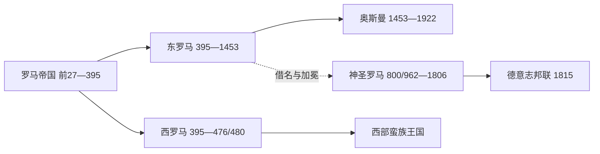

---
tags:
  - 历史
  - 欧洲史
  - 罗马
  - 拜占庭
  - 神圣罗马帝国
  - 帝国比较
关联:
  - "[国家的概念史与建制化程度：现代国家、历史语汇与中间形态](../../国家的概念史与建制化程度：现代国家、历史语汇与中间形态.md)"
  - "[帕提亚、萨珊与奥斯曼：罗马的镜像与继承人（前 247—1922）](../../中东/帕提亚、萨珊与奥斯曼：罗马的镜像与继承人（前 247—1922）.md)"
  - "[亚历山大前后：从阿契美尼德到奥斯曼的帝国接力（前 550—1922）](../古希腊/亚历山大前后：从阿契美尼德到奥斯曼的帝国接力（前 550—1922）.md)"
  - "[查理曼大帝加冕笔记](../查理曼大帝加冕笔记.md)"
  - "[犹太教、基督教、东正教与新教的发展历史：三次分化与两千年谱系](../../../意识形态，宗教和文化运动/犹太教、基督教、东正教与新教的发展历史：三次分化与两千年谱系.md)"
  - "[马丁·路德与宗教改革：从赎罪券到威斯特伐利亚（1517—1648）](../../../意识形态，宗教和文化运动/马丁·路德与宗教改革：从赎罪券到威斯特伐利亚（1517—1648）.md)"
  - "[西欧四次大一统尝试：帝国标准化、失败机制与多中心秩序](../../../经济理论/资本与政体比较/西欧四次大一统尝试：帝国标准化、失败机制与多中心秩序.md)"
---

# 三个罗马：西罗马、东罗马与神圣罗马——一顶皇冠的三种戴法（395—1806）

> 公元 800 年圣诞节，罗马的圣彼得大教堂里同时存在两个「罗马」：一个在君士坦丁堡，由女皇伊琳娜执掌；一个在罗马，刚刚被教皇利奥三世戴上皇冠的查理曼。而罗马城本身，既不归君士坦丁堡直接管，也不归查理曼直接管——它归教皇。
>
> 这不是一场误会，而是「罗马」这个词的常态：它从来不是一个国家名，而是一整套可以被拆开继承的合法性资产。

> **根节点**：为什么「罗马」这顶皇冠可以在 395—1806 年间被三套完全不同的制度分别戴在头上，而且三者还能长期并存、互不承认？
>
> **叙事逻辑**：词义拆解 → 395 分家 → 西罗马停付 → 东罗马续命 → 神圣罗马借名 → 两个罗马并存 → 三套制度对照 → 八要件打分 → 三种死法与遗产 → 名字的政治 → 收束。
>
> **立场说明**：本文依据通史、制度史与拜占庭学研究整理；年代、面积、人口、军队规模等数字尽量给区间并标注口径。对「476 年灭亡」「拜占庭帝国」等通行说法，会说明其史学来源与争议，不把后世术语当成当时人的自称。
>
> **来源标注**：综合 Gibbon、Heather、Ward-Perkins、Brown、Haldon、Herrin、Kaldellis、Whaley、Wilson 等研究，以及 Britannica、Oxford Classical Dictionary、Deutsches Historisches Museum 等公开条目；具体见文末参考来源。数字待核处已列入待核实清单。

**分工说明**：本篇讲「罗马」自身的三次继承；[帕提亚、萨珊与奥斯曼：罗马的镜像与继承人（前 247—1922）](../../中东/帕提亚、萨珊与奥斯曼：罗马的镜像与继承人（前 247—1922）.md) 讲罗马在东方的镜像与波斯—奥斯曼接力；[亚历山大前后：从阿契美尼德到奥斯曼的帝国接力（前 550—1922）](../古希腊/亚历山大前后：从阿契美尼德到奥斯曼的帝国接力（前 550—1922）.md) 讲希腊化到奥斯曼的帝国接力；[查理曼大帝加冕笔记](../查理曼大帝加冕笔记.md) 是 800 年的事件笔记。本篇把这三条线放进同一个结构里比较。

---

## 知识树

```txt
根节点：为什么「罗马」能被三套制度分别继承，而且还能长期并存？
│
├── 〇、坐标：时间、数字与材料偏差（先把尺子放好）
│   ├── 时间锚点：395 / 476 / 480 / 800 / 962 / 1054 / 1204 / 1453 / 1648 / 1806
│   ├── 数字锚点：81 年、1058 年、844 年、653 年并存
│   └── 三种材料偏差：术语时代错置、胜利者叙事、现代民族国家回溯
│
├── 一、一个词，四具身体（词义拆解）
│   ├── 城市身体：罗马城
│   ├── 法律身体：罗马法
│   ├── 宗教身体：罗马教会
│   └── 政治身体：皇冠
│
├── 二、395：不是「分裂」，是「分家办公」（分治的三种含义）
│   ├── 行政分治：两套宫廷、两套军队、两套财政
│   ├── 法律统一：同一个帝国，两位皇帝
│   └── 为什么这次分家没有再合上
│
├── 三、西罗马：一个「停止支付」的帝国（395—476/480）
│   ├── 476 年到底发生了什么
│   ├── 财政—军事机器的四个断点
│   └── 六种「灭亡」解释与证据强度
│
├── 四、东罗马：一个「改名」的帝国（395—1453）
│   ├── 「拜占庭」是 16 世纪的发明
│   ├── 为什么它能活 1058 年：七件冗余
│   └── 1204：自己人打自己人
│
├── 五、神圣罗马：一个「借名」的帝国（800/962—1806）
│   ├── 800 与 962：两次加冕的区别
│   ├── 「神圣」「罗马」「帝国」三个词的来历
│   └── 伏尔泰的三不：修辞精确、法理不精确
│
├── 六、两个罗马并存（800—1453）：互不承认的 653 年
│   ├── 君士坦丁堡眼中的查理曼与奥托
│   ├── 1054：教会分裂如何固化政治分裂
│   └── 1204 与 1453：拉丁人先打，奥斯曼后打
│
├── 七、三套制度：皇帝怎么产生、钱从哪来、兵从哪来（制度对照）
│   ├── 皇帝的产生方式
│   ├── 法律与财政
│   └── 教会与语言
│
├── 八、八要件打分：为什么「名字最响的那个国家最弱」（制度解剖）
│   ├── 统一评分表：10 / 12 / 7
│   ├── 分项解释：西罗马强在官僚，东罗马强在冗余，神圣罗马强在契约
│   └── 「分数解释能力，冗余解释存活」
│
├── 九、三种死法与三种遗产（终点与遗产）
│   ├── 西罗马：停付
│   ├── 东罗马：被征服
│   ├── 神圣罗马：主动退位
│   └── 三件遗产：法律、教会、语言
│
├── 十、谁还有资格叫罗马（名字的政治）
│   ├── translatio imperii：帝国转移论
│   ├── 奥斯曼的 Kayser-i Rûm 与俄罗斯的第三罗马
│   └── 现代回声：从罗马条约到「第三帝国」
│
└── 十一、收束：归因、延伸与个体坐标
    ├── 归因：罗马是「合法性资产包」，不是血缘
    ├── 延伸：三个正在被重写的「罗马」
    └── 个体坐标：三个识别问题
```

---

## 〇、坐标：时间、数字与材料偏差

### 0.1 时间锚点

先把三条线的时间轴并排放在一张表里。下表只列「改变结构」的节点，不列所有皇帝与战役。

| 时间 | 事件 | 对本文的作用 |
| :--- | :--- | :--- |
| 293 | 戴克里先建立四帝共治 | 帝国第一次被切成多个行政中心 |
| 330 | 君士坦丁堡建成 | 东部获得一个「新罗马」首都 |
| 380 | 《帖撒罗尼迦敕令》 | 尼西亚基督教成为帝国正统 |
| 395 | 狄奥多西一世去世，帝国由两子分治 | 本文的西罗马/东罗马起点 |
| 410 | 阿拉里克劫掠罗马 | 西部权威的象征性重击 |
| 438 | 《狄奥多西法典》颁布 | 西罗马的法律身体定型 |
| 439 | 汪达尔人夺取迦太基 | 西部最大税源与粮仓失守 |
| 455 | 汪达尔人再劫罗马 | 西部中央权威进一步瓦解 |
| 476 | 奥多亚塞废罗慕路斯·奥古斯都路斯 | 通行的「西罗马灭亡」年 |
| 480 | 尤利乌斯·尼波斯被杀 | 西帝位法理上彻底空缺 |
| 527—565 | 查士丁尼在位 | 东罗马最后一次大规模西征 |
| 529—534 | 《民法大全》编成 | 罗马法身体的最大备份 |
| 537 | 圣索菲亚大教堂落成 | 东罗马的帝国—教会综合体成型 |
| 568 | 伦巴第人进入意大利 | 西部彻底碎片化 |
| 7 世纪 | 阿拉伯征服叙利亚、埃及、北非 | 东罗马从地中海帝国缩成巴尔干—安纳托利亚国家 |
| 726—843 | 圣像破坏运动 | 东罗马的教会与皇权关系重组 |
| 800 | 查理曼在罗马加冕 | 西部第一次「复制」罗马皇冠 |
| 812 | 拜占庭承认查理曼为皇帝 | 两个罗马的第一次有限互相承认 |
| 843 | 《凡尔登条约》 | 查理曼帝国三分 |
| 962 | 奥托一世在罗马加冕 | 神圣罗马帝国的制度起点 |
| 972 | 奥托二世迎娶狄奥法诺 | 拜占庭对西方皇帝的第二次承认 |
| 1018 | 巴西尔二世灭保加利亚第一帝国 | 东罗马巴尔干霸权顶点 |
| 1054 | 东西教会互相绝罚 | 两个罗马的宗教分裂固化 |
| 1071 | 曼齐刻尔特战役 | 东罗马失去安纳托利亚腹地 |
| 1204 | 第四次十字军攻陷君士坦丁堡 | 东罗马的财政—行政核心被摧毁 |
| 1254 | 「Sacrum Romanum Imperium」固定 | 「神圣罗马帝国」名称成型 |
| 1261 | 米海尔八世收复君士坦丁堡 | 东罗马复国，但已无法恢复 |
| 1356 | 《黄金诏书》 | 神圣罗马的选帝侯制度固定 |
| 1453 | 奥斯曼攻陷君士坦丁堡 | 东罗马终结 |
| 1495 | 帝国法院设立 | 神圣罗马的司法一体化尝试 |
| 1500—1512 | 帝国圈建立；名称加上「德意志民族」 | 神圣罗马的治理结构调整 |
| 1517 | 路德发表《九十五条论纲》 | 神圣罗马的宗教统一破裂 |
| 1555 | 《奥格斯堡和约》 | 神圣罗马进入双教并存 |
| 1648 | 《威斯特伐利亚和约》 | 神圣罗马的主权进一步碎片化 |
| 1804 | 弗朗茨二世称奥地利皇帝 | 哈布斯堡为帝国解散准备后路 |
| 1806 | 弗朗茨二世退位，帝国解散 | 神圣罗马终结 |

**收束**：三条线不是首尾相接的「朝代序列」，而是**两段并存、一次借用、三次死亡**。西罗马先停付，东罗马继续活了 977 年；神圣罗马在东罗马还在时就已「借名」，又在东罗马死后继续活了 353 年。

### 0.2 数字锚点

| 数字 | 含义 | 在本文中的作用 |
| :--- | :--- | :--- |
| 81 年 | 395—476，西罗马从分治到废帝 | 说明「停付」发生得并不慢 |
| 85 年 | 395—480，到法理上最后一位西帝死亡 | 另一个常用口径 |
| 1058 年 | 395—1453，东罗马的跨度 | 说明「续命」可以有多长 |
| 977 年 | 476—1453，西罗马灭亡后东罗马独存 | 说明「罗马」并未在 476 年消失 |
| 653 年 | 800—1453，两个罗马并存 | 本文最关键的重叠期 |
| 844 年 | 962—1806，神圣罗马的跨度 | 说明「借名」也能借很久 |
| 1006 年 | 800—1806，从查理曼加冕算起 | 另一个常用口径 |
| 353 年 | 1453—1806，东罗马死后神圣罗马继续存在 | 说明「罗马」品牌的惯性 |
| 57 年 | 1204—1261，拉丁帝国 | 东罗马的「中断期」 |
| 249 年 | 1204—1453，从第四次十字军到最终陷落 | 说明东罗马不是「一夜死亡」 |
| 10 / 12 / 7 | 西罗马 / 东罗马 / 神圣罗马的八要件得分 | 本文的制度比较核心 |
| 7 | 1356 年固定的选帝侯人数 | 神圣罗马的选举君主制 |
| 10 | 1512 年后的帝国圈数量 | 神圣罗马的区域治理单位 |
| 约 300 | 1648 年后常见的神圣罗马邦国数量估计 | 说明「帝国」内部的碎片化 |
| 约 7,000 | 1453 年君士坦丁堡守军估计 | 对比奥斯曼军的规模 |
| 5—8 万 | 1453 年奥斯曼攻城军估计 | 口径不一，只作量级参考 |
| 53 天 | 1453 年围城时长（4 月 6 日—5 月 29 日） | 说明首都防御的极限 |

**收束**：这些数字里，最容易被误读的是「81 年」与「1058 年」。它们不是「西罗马短命、东罗马长寿」的道德判断，而是**两套不同冗余度的制度在遇到冲击时的不同表现**。

### 0.3 三种材料偏差

| 偏差 | 表现 | 本文的处理 |
| :--- | :--- | :--- |
| **术语时代错置** | 当时没有人自称「西罗马帝国」「拜占庭帝国」「神圣罗马帝国」 | 首次出现时说明这是后世术语，并给出当时的自称 |
| **胜利者叙事** | 英国史家把 476 当「罗马灭亡」，拜占庭史家把 1453 当「拜占庭灭亡」，德国史家把 1806 当「第一帝国终结」 | 把三个终点并列，而不是选一个当唯一答案 |
| **现代民族国家回溯** | 把神圣罗马读成「德国第一帝国」，把拜占庭读成「希腊帝国」，把西罗马读成「欧洲文明之死」 | 先拆制度，再谈民族；不用 19 世纪的范畴倒推 |
| **数字口径不一** | 面积、人口、军队规模多为估计，且学者差异很大 | 给区间、标「估计」、列入待核实 |

> ⚠️ **两套「三个罗马」不要混**：本文的「三个罗马」是**西罗马、东罗马、神圣罗马**，分类轴是「谁戴皇冠、哪套制度」。另一套常见说法是**第一罗马（罗马城）—第二罗马（君士坦丁堡）—第三罗马（莫斯科）**，分类轴是「谁是正统基督教帝国」。两套序列有重叠，但不是同一张表。

| 序列 | 成员 | 分类轴 | 常见用途 |
| :--- | :--- | :--- | :--- |
| 本文的「三个罗马」 | 西罗马、东罗马、神圣罗马 | 谁戴皇冠、哪套制度 | 制度比较 |
| 「第一/第二/第三罗马」 | 罗马城、君士坦丁堡、莫斯科 | 谁是正统基督教帝国 | 俄罗斯、东正教叙事 |

**收束**：先把「三个罗马」这个词拆成两套序列，后面才不会把「神圣罗马」和「第三罗马」混成同一个东西。

---

## 一、一个词，四具身体

> 📌 **罗马（Roma / Rhōmē / Rūm）**：本文中至少指四样东西——城市、帝国、教会、人群。四者可以分离继承，所以「罗马灭亡」必须先问「哪一具身体灭亡」。**本文的作用**：它是整篇笔记的拆分工具。

| 身体 | 载体 | 关键时间 | 继承者 | 今天的痕迹 |
| :--- | :--- | :--- | :--- | :--- |
| **城市身体** | 罗马城 | 传说前 753 年建城—今 | 教皇国 → 意大利 → 梵蒂冈 | 罗马市、梵蒂冈、朝圣路线 |
| **法律身体** | 罗马法 | 前 450 年《十二表法》—533 年《民法大全》 | 拜占庭 → 博洛尼亚 → 欧洲大陆 | 大陆法系、《民法大全》、《法学阶梯》 |
| **宗教身体** | 罗马教会 | 1 世纪—今 | 天主教 | 梵蒂冈、教区制、主教制 |
| **政治身体** | 皇冠 / imperium | 前 27—1453/1806 | 东罗马、神圣罗马、奥斯曼、俄罗斯 | 皇帝头衔、加冕礼、「第三罗马」 |

四具身体的寿命完全不同：**政治身体最短命，法律与宗教身体最长命**。西罗马的政治身体在 476/480 年停止，但它的法律身体被东罗马保存，宗教身体被教皇继承，城市身体一直活到今天。东罗马的政治身体在 1453 年停止，但它的宗教身体在东正教世界继续，法律身体被奥斯曼部分保留。神圣罗马的政治身体在 1806 年停止，但它的法律与制度遗产进入德意志邦联和现代欧洲。



> 🔗 **横向关联**：本节「四具身体可以拆开继承」与 [西欧四次大一统尝试：帝国标准化、失败机制与多中心秩序](../../../经济理论/资本与政体比较/西欧四次大一统尝试：帝国标准化、失败机制与多中心秩序.md) §2.2「罗马法、拉丁语与基督教为何比帝国更长寿」形成**直接呼应**——那篇讲罗马留下的三件长寿命遗产；本节把它们拆成四种「身体」，再加上最脆弱的政治身体。**帝国会死，零件不会一起死。**

> 🔗 **横向关联**：本节「罗马是多重身份嵌套」与 [国家的概念史与建制化程度：现代国家、历史语汇与中间形态](../../国家的概念史与建制化程度：现代国家、历史语汇与中间形态.md) §5.6 对「帝国」的判断形成**方法同构**——那篇说罗马帝国是「公民／拉丁人／同盟者」多重法律身份嵌套，不是单一国家；本节说它还是「城市／法律／教会／皇冠」四重身体的嵌套。**用「国家」去套罗马，会同时漏掉这两层嵌套。**

---

## 二、395：不是「分裂」，是「分家办公」

### 2.1 分治的三种含义

395 年狄奥多西一世去世，帝国由两个儿子继承：18 岁的阿卡狄乌斯得到东部，10 岁的霍诺留得到西部。通史常把这一年写成「罗马帝国分裂」，但这句话需要拆开。

| 含义 | 内容 | 是否等于分裂 |
| :--- | :--- | :--- |
| **行政分治** | 两套宫廷、两套军队、两套财政、两套高级官僚 | 否 |
| **皇位共享** | 两位奥古斯都共享同一个 imperium，理论上仍是同一个帝国 | 否 |
| **法律统一** | 同一套罗马法、同一套公民权、同一年执政官名单 | 否 |
| **主权切割** | 两个互不隶属的最高权力 | 是，但 395 年没有发生 |

**收束**：395 年发生的是前三项，不是第四项。当时没有人认为「罗马帝国亡了」，只认为「帝国又分了一次家」。真正把「分治」变成「分裂」的，是后面 81 年的财政、军事与宫廷政治。

### 2.2 为什么这次分家没有再合上

| 因素 | 西部 | 东部 |
| :--- | :--- | :--- |
| **财政地理** | 税基依赖北非、高卢、意大利；城市密度较低 | 埃及、叙利亚、安纳托利亚提供更稳定的税源；城市更密 |
| **军事地理** | 莱茵—多瑙河双线压力，野战军被军头控制 | 幼发拉底与巴尔干两条战线，但有更厚的财政缓冲 |
| **宫廷政治** | 皇帝年幼，军头废立频繁 | 宫廷官僚体系更稳定，皇帝与元老院、教会的关系更可操作 |
| **语言与教会** | 拉丁语西部，教皇逐渐独立 | 希腊语东部，牧首与皇帝相互依存 |
| **蛮族进入路径** | 多瑙河—莱茵河—高卢—西班牙—北非，直接切进税区 | 主要在多瑙河与东部边疆，离核心税区较远 |

**收束**：西部不是「运气不好」，而是**税基更集中、军权更私人、缓冲更薄**。同样的冲击打到东部，东部还能用埃及、叙利亚、安纳托利亚三个税区互相补位；西部一旦失去北非，就没有第二个税区可以顶上。

> 🔗 **横向关联**：本节「西部税基集中、缓冲薄」与 [政治统一的吸引力半径_量化模型与历史验证](../../../../人类学/政治统一的吸引力半径_量化模型与历史验证.md) §3.2「欧洲案例：罗马帝国的半径」形成**成本—收益对照**——那篇用统治半径解释罗马为何能撑到地中海尺度；本节用税基结构解释为什么同一半径在西部先断。**地图上的半径，本质上是税册与军团的补给线。**

> ⚠️ **校正**：395 年不是第一次分治，也不是唯一一次。293 年四帝共治、364 年瓦伦提尼安与瓦伦斯分治，都比 395 年更早。395 年的特殊性在于：**这是最后一次没有再合上的分治**，而不是「第一次分裂」。

---

## 三、西罗马：一个「停止支付」的帝国（395—476/480）

### 3.1 476 年到底发生了什么

476 年，日耳曼军头奥多亚塞（Odoacer）杀死西部军队统帅欧瑞斯特（Orestes），废黜其子罗慕路斯·奥古斯都路斯（Romulus Augustulus），然后把西部的皇帝徽章送到君士坦丁堡，表示「西部不需要自己的皇帝了」。东帝芝诺（Zeno）回应说：奥多亚塞应该从合法皇帝尤利乌斯·尼波斯（Julius Nepos）那里取得授权。奥多亚塞于是以「意大利国王」和「罗马贵族」的身份统治意大利，名义上仍是东帝的代理人。

| 时间 | 事件 | 性质 |
| :--- | :--- | :--- |
| 475 | 欧瑞斯特拥立罗慕路斯·奥古斯都路斯 | 西部又一次宫廷政变 |
| 476 | 奥多亚塞废罗慕路斯，送徽章给芝诺 | 西部皇位「停止支付」 |
| 480 | 尼波斯在达尔马提亚被杀 | 法理上的西帝位彻底空缺 |
| 493 | 狄奥多里克攻取拉文纳，杀奥多亚塞 | 东哥特王国取代奥多亚塞 |
| 535—554 | 查士丁尼发动哥特战争 | 东罗马短暂收复意大利，但破坏巨大 |
| 568 | 伦巴第人进入意大利 | 意大利再次碎片化 |

**收束**：476 年不是「罗马文明灭亡」，而是**西部不再供养一个自己的皇帝**。这是一次财政—军事意义上的「停付」，不是一次文明意义上的「终结」。真正的法理终点是 480 年尼波斯之死；真正的制度重组是 493 年东哥特王国；真正把意大利打烂的是 535—554 年的哥特战争。

### 3.2 财政—军事机器的四个断点

| 断点 | 时间 | 机制 | 后果 |
| :--- | :--- | :--- | :--- |
| **北非失守** | 439 | 汪达尔人夺取迦太基与非洲粮仓 | 西部最大税源与粮食来源被切断 |
| **高卢与西班牙碎片化** | 406—418 | 蛮族王国在税区内自立 | 税基与兵源同时缩水 |
| **军头政治** | 4—5 世纪 | magister militum 控制军队，废立皇帝 | 皇帝成为可替换的傀儡 |
| **教会地产与免税** | 4—5 世纪 | 教会土地扩张，元老院地产集中 | 财政负担压在小土地所有者身上 |
| **瘟疫与气候** | 2—6 世纪 | 人口下降、农业波动 | 税基进一步缩小（因果仍有争议） |

**收束**：西罗马不是「被一个敌人打败」，而是**同时失去税基、兵源与中央权威**。当这三样一起流失时，皇帝换谁都不重要了。

### 3.3 六种「灭亡」解释与证据强度

| 解释 | 代表 | 核心主张 | 证据强度 |
| :--- | :--- | :--- | :--- |
| **基督教软化** | 吉本（Gibbon） | 基督教使人消极，教会消耗帝国资源 | 低—中：叙事宏大，因果难证 |
| **蛮族压力** | 希瑟（Heather） | 匈人推动的迁徙链，加上西部财政—军事崩溃 | 高：文献、考古、财政史互相支持 |
| **物质崩溃** | 沃德-珀金斯（Ward-Perkins） | 城市、贸易、生活水平真实下降 | 高：考古证据强 |
| **晚期古代转型** | 布朗（Brown） | 不是衰亡，而是地中海世界重组 | 高：长时段视角，但容易淡化暴力 |
| **气候与瘟疫** | 哈珀（Harper） | 气候波动与瘟疫削弱人口与财政 | 中：科学证据增加，因果仍有争议 |
| **没有「灭亡」** | 哈尔萨尔（Halsall） | 「fall」是后世叙事，476 不是断点 | 中—高：史学批判有力，但容易取消问题 |

**收束**：最强的共识是「西部帝国作为中央财政—军事机器的解体」；最弱的共识是「某个单一原因」。把六种解释并排，比选一个「真凶」更接近史学研究的状态。

> 📌 **晚期古代（Late Antiquity）**：彼得·布朗（Peter Brown）1971 年提出的分期概念，大致覆盖 150—750 年，强调罗马世界晚期的连续性、宗教转型与文化重组，而不是单纯的「衰亡」。**本文的作用**：它把「制度终止」与「文明崩溃」分开——西罗马的皇帝制度终止了，但地中海世界的城市、教会、法律和贸易并没有在同一天消失。

> 📌 **联邦者（foederati）**：以条约进入罗马体系的蛮族群体，向帝国提供兵役，换取土地、粮食或年金。**本文的作用**：说明「军队蛮族化」不是单纯的外敌入侵，而是帝国自己把防务外包出去；当外包方变成地方权力中心时，帝国就不再垄断暴力。

> 🔗 **横向关联**：本节「西罗马死于税基与军权的双重流失」与 [西欧四次大一统尝试：帝国标准化、失败机制与多中心秩序](../../../经济理论/资本与政体比较/西欧四次大一统尝试：帝国标准化、失败机制与多中心秩序.md) §2.3「为什么西部帝国崩解」形成**直接展开**——那篇从标准化与多中心角度解释西部崩解；本节把同一过程拆成四个财政—军事断点。**同一件事，一个用「标准化」讲，一个用「现金流」讲。**

---

## 四、东罗马：一个「改名」的帝国（395—1453）

### 4.1 「拜占庭」是 16 世纪的发明

东罗马人从不自称「拜占庭人」。他们自称 **Rhomaioi**（罗马人），称自己的国家为 **Romania**（罗马人的地方），称皇帝为 **basileus**（国王/皇帝）或 **autokrator**（独裁者/全权者）。「拜占庭帝国」这个名字通常追溯到 1557 年德意志人文主义者希罗尼穆斯·沃尔夫（Hieronymus Wolf）编纂的《拜占庭历史文献集成》；19 世纪以后，这个名字才在史学中标准化。

| 名称 | 使用者 | 含义 | 问题 |
| :--- | :--- | :--- | :--- |
| **Rhomaioi** | 东罗马人自称 | 罗马人 | 现代读者容易误以为他们「不是罗马人」 |
| **Romania** | 东罗马官方/民间 | 罗马人的地方 | 与今天的「罗马尼亚」不是同一个概念 |
| **拜占庭帝国** | 后世史学家 | 以首都旧名「拜占庭」命名 | 暗示这是一个不同的民族/国家 |
| **东罗马帝国** | 后世史学家 | 罗马帝国的东半部 | 比「拜占庭」更接近当时的自我理解 |
| **Rum** | 阿拉伯/波斯/奥斯曼 | 罗马/拜占庭 | 后来变成地名、教派与人口分类 |

**收束**：名字不是小事。「拜占庭帝国」这个叫法会让读者以为它是一个希腊人的新国家；实际上，它是**罗马帝国东半部的连续体**，只是语言从拉丁语转为希腊语、宗教从帝国基督教转为东正教、疆域从地中海帝国缩成巴尔干—安纳托利亚国家。

### 4.2 为什么它能活 1058 年：七件冗余

> 📌 **冗余（redundancy）**：同一项功能有不止一个承载者；当其中一个失效，系统还能靠另一个继续运转。**本文的作用**：它是解释「分数不高也能活很久」的关键变量，与八要件分数配合使用。

| 冗余 | 机制 | 失效或削弱时 |
| :--- | :--- | :--- |
| **首都地形** | 君士坦丁堡三面环水，狄奥多西城墙 | 1204、1453 被攻破 |
| **金币** | solidus / hyperpyron 的长期信用 | 11 世纪贬值，财政压力上升 |
| **罗马法** | 《查士丁尼法典》《法学阶梯》《新律》 | 一直是帝国认同与行政的核心 |
| **东正教会** | 普世牧首、修道院、圣像、教区网络 | 1054 后与西方分裂，但仍能动员 |
| **希腊语** | 行政、文化、教育的通用语 | 7 世纪后更彻底地取代拉丁语 |
| **军区制** | 地方化农业养兵，降低现金财政依赖 | 10 世纪后雇佣兵化，地方贵族崛起 |
| **外交** | 联姻、赐官、雇佣、分而治之 | 1204 后信用破产，难以重组 |

**收束**：七件冗余让东罗马在失去埃及、叙利亚、安纳托利亚、甚至首都之后还能重组；但每一次重组都更小、更穷、更依赖外部。**冗余能延长寿命，但不能恢复原来的规模。**

### 4.3 三次断点：一次比一次狠

| 断点 | 时间 | 失去什么 | 为什么没死 | 最终代价 |
| :--- | :--- | :--- | :--- | :--- |
| **阿拉伯征服** | 7 世纪 | 叙利亚、埃及、北非 | 军区制 + 安纳托利亚 + 首都 | 从地中海帝国变成巴尔干—安纳托利亚国家 |
| **曼齐刻尔特** | 1071 | 安纳托利亚腹地 | 科穆宁复兴 + 西方雇佣兵 | 经济与军事基础缩小 |
| **第四次十字军** | 1204 | 首都、国库、官僚 | 尼西亚流亡政权 + 1261 复国 | 复国后无法恢复，最终 1453 |

**收束**：三次断点一次比一次狠。7 世纪失去的是「外围税区」，1071 年失去的是「兵源腹地」，1204 年失去的是「心脏」。心脏被自己人打坏之后，东罗马就只剩一个还在跳的壳。

### 4.4 1204：自己人打自己人

1204 年 4 月，第四次十字军原本要去埃及，却在威尼斯的影响下转向君士坦丁堡。拉丁军队攻入城市，进行了三天的劫掠；随后建立「拉丁帝国」（1204—1261），威尼斯获得大量港口与岛屿。1261 年，尼西亚帝国的米海尔八世（Michael VIII Palaiologos）收复君士坦丁堡，但复国后的拜占庭只剩君士坦丁堡、摩里亚、若干岛屿和沿海据点，税收与人口都远远不如 12 世纪。

1453 年 4 月 6 日，奥斯曼苏丹穆罕默德二世开始围城；5 月 29 日，君士坦丁堡陷落。守军估计约 7,000 人（含外籍士兵），奥斯曼军估计 5—8 万人，围城 53 天。穆罕默德二世随后自称 **Kayser-i Rûm**（罗马的凯撒），并把东正教牧首制纳入奥斯曼的米勒特体系。

> 📌 **拉丁帝国（Latin Empire）**：1204 年第四次十字军攻陷君士坦丁堡后建立的拉丁政权，持续到 1261 年。**本文的作用**：它说明「罗马人打罗马人」如何摧毁拜占庭的财政—行政核心；1204 年不是一次普通的战败，而是**心脏被摘除**。

**收束**：东罗马不是「被奥斯曼一夜灭掉」的。它在 1204 年就被自己人打成了重伤，1453 年只是最后一口血被抽走。

> 🔗 **横向关联**：本节「1204 是心脏被摘除」与 [帕提亚、萨珊与奥斯曼：罗马的镜像与继承人（前 247—1922）](../../中东/帕提亚、萨珊与奥斯曼：罗马的镜像与继承人（前 247—1922）.md) §6.1「三个真空：塞尔柱、蒙古、拜占庭」形成**因果衔接**——那篇讲拜占庭留下的真空如何被奥斯曼填补；本节讲真空是怎么被 1204 年提前挖出来的。**1453 年的城，是 1204 年就已经开始空的那座城。**

> 🔗 **横向关联**：本节「1054 与 1204 的连锁」与 [犹太教、基督教、东正教与新教的发展历史：三次分化与两千年谱系](../../../意识形态，宗教和文化运动/犹太教、基督教、东正教与新教的发展历史：三次分化与两千年谱系.md) §四「1054 年：第二次分化」形成**长时段呼应**——那篇讲教会分裂的教义与政治原因；本节讲分裂如何在 1204 年变成军事行动。**教义分歧不会自己变成屠杀，是政治把分歧变成了刀。**

---

## 五、神圣罗马：一个「借名」的帝国（800/962—1806）

### 5.1 800 与 962：两次加冕的区别

| 维度 | 800 年查理曼 | 962 年奥托一世 |
| :--- | :--- | :--- |
| **加冕者** | 教皇利奥三世 | 教皇约翰十二世 |
| **加冕地** | 罗马圣彼得大教堂 | 罗马圣彼得大教堂 |
| **头衔措辞** | 「治理罗马帝国的皇帝」（具体措辞有争议） | 「奥古斯都皇帝」 |
| **帝国范围** | 法兰克王国 + 伦巴第 + 罗马公国 | 德意志 + 意大利 + 勃艮第（逐步） |
| **与拜占庭的关系** | 812 年被承认为「法兰克人的皇帝」 | 972 年联姻后才获得较稳定的承认 |
| **后续** | 843 年《凡尔登条约》三分，帝国碎片化 | 延续到 1806 年 |

**收束**：800 年是「罗马皇冠的第一次西方复制」，962 年是「复制品的制度化」。神圣罗马帝国通常从 962 年算起，但它的合法性模板来自 800 年。

### 5.2 「神圣」「罗马」「帝国」三个词的来历

| 词 | 关键时间 | 原意 | 后来的变化 |
| :--- | :--- | :--- | :--- |
| **罗马** | 800 年起 | 罗马帝国的合法性 | 1254 年固定为「Sacrum Romanum Imperium」 |
| **神圣** | 1157 年 | 腓特烈一世强调帝国不受教皇支配 | 与教皇的「神圣」解释权竞争 |
| **帝国** | 800/962 年 | imperium（统治权） | 不是现代国家，而是法律共同体 |
| **德意志民族** | 1474/1512 年 | 帝国主要由德语区承担 | 19 世纪被读成「德意志民族国家」 |

**收束**：四个词没有一个是「一次性发明」的，它们是层层叠加的合法性标签。**「神圣罗马帝国」不是罗马帝国的延续，而是罗马帝国合法性的一次再包装。**

### 5.3 伏尔泰的三不：修辞精确、法理不精确

伏尔泰在《风俗论》（1756）里讥讽这个帝国「既不神圣，也不罗马，也不帝国」。这句话常被当成定论，但它其实是**修辞精确、法理不精确**的警句。

| 指控 | 表面证据 | 反证 |
| :--- | :--- | :--- |
| **不神圣** | 教皇与皇帝长期争权；宗教改革后一半诸侯是新教徒；帝国还世俗化教会财产 | 皇帝仍以基督教皇帝自居；帝国法院与教会法并存 |
| **不罗马** | 皇帝由德意志选帝侯选出；罗马城在教皇国；疆域主要在德语区 | 皇帝称「罗马人的皇帝」；帝国法继受罗马法；「罗马」是法理头衔，不是民族标签 |
| **不帝国** | 诸侯保有军队、关税、司法；皇帝不能直接命令他们 | 1495 年后有帝国法院、帝国圈、帝国税；帝国仍是一个可运作的法律共同体 |

**收束**：伏尔泰的句子描述的是**帝国的实质**，不是**帝国的自称**。它精准地指出三个词都是「合法性包装」，但它不能证明帝国「不存在」——它只证明这个帝国不是 18 世纪意义上的中央集权国家。

### 5.4 神圣罗马的结构：没有官僚的帝国

| 装置 | 时间 | 功能 | 局限 |
| :--- | :--- | :--- | :--- |
| **选帝侯** | 1356 年固定 | 选举「罗马人的国王」，再由教皇加冕为皇帝 | 皇位不能稳定世袭 |
| **帝国议会** | 15 世纪末制度化 | 诸侯、城市、教会代表协商 | 没有强制执行力 |
| **帝国圈** | 1500/1512 年 | 按区域组织征兵、收税、执行判决 | 各圈能力差异大 |
| **帝国法院** | 1495 年 | 提供上诉与裁决 | 地方特权与习惯法仍在 |
| **帝国军与帝国税** | 16 世纪起 | 分摊兵员与费用 | 诸侯常常拖欠或拒绝 |
| **永久议会** | 1663 年起 | 常设在雷根斯堡 | 变成外交谈判场，不是立法机关 |

> 📌 **选帝侯（Kurfürsten）**：1356 年《黄金诏书》固定的七位选举人——美因茨、科隆、特里尔三位大主教，以及波希米亚国王、莱茵普法尔茨伯爵、萨克森公爵、勃兰登堡藩侯。**本文的作用**：它把皇位变成「选举君主制」，从制度上防止皇位变成某一家的私产，也削弱了皇帝对诸侯的控制。

> 📌 **帝国圈（Reichskreise）**：1500 年起把神圣罗马划分为若干区域，由圈内诸侯与城市共同负责征兵、收税、执行帝国法院判决。**本文的作用**：它是在没有中央官僚的情况下提供区域治理的「中间层」，也是神圣罗马能够长期低分存活的关键冗余之一。

**收束**：神圣罗马不是「没有制度」，而是**制度很多、中心很弱**。它的治理靠的是诸侯、教会、城市、法院、帝国圈的多层拼接，而不是一个自上而下的官僚机器。

> 🔗 **横向关联**：本节「没有官僚的帝国」与 [查理曼大帝加冕笔记](../查理曼大帝加冕笔记.md) 的 800 年事件形成**前后衔接**——那篇讲加冕的过程与争议；本节讲加冕之后，这顶皇冠如何在德意志政治中被制度化、又被诸侯拆解。**800 年是一次加冕，962 年才是一个帝国的开始。**

> 🔗 **横向关联**：本节「选帝侯与帝国圈」与 [西欧四次大一统尝试：帝国标准化、失败机制与多中心秩序](../../../经济理论/资本与政体比较/西欧四次大一统尝试：帝国标准化、失败机制与多中心秩序.md) §四「神圣罗马帝国：名义统一的反例」形成**直接对话**——那篇说它延续了帝国却没有消灭多中心；本节把「多中心」拆成选帝侯、帝国圈、帝国法院三个具体装置。**它不是「失败的国家」，而是「另一种国家」。**

> 🔗 **横向关联**：本节「宗教统一破裂」与 [马丁·路德与宗教改革：从赎罪券到威斯特伐利亚（1517—1648）](../../../意识形态，宗教和文化运动/马丁·路德与宗教改革：从赎罪券到威斯特伐利亚（1517—1648）.md) §1.1「一张碎成三百块的地图」、§6.2「奥格斯堡和约」、§6.4「威斯特伐利亚」形成**因果链**——那篇讲宗教改革如何在神圣罗马的政治碎片中爆发；本节讲这种碎片为什么既是帝国的弱点，也是它能活到 1806 年的原因。**碎片化让它打不赢，也让它死不掉。**

---

## 六、两个罗马并存（800—1453）：互不承认的 653 年

### 6.1 君士坦丁堡眼中的查理曼与奥托

在君士坦丁堡看来，800 年的查理曼只是一个「法兰克人的国王」，不是「罗马人的皇帝」。拜占庭有自己的皇帝、自己的罗马法、自己的首都，凭什么承认一个西方蛮族国王？812 年，拜占庭使节在亚琛承认查理曼为「皇帝」，但限定为「法兰克人的皇帝」，不是「罗马人的皇帝」。972 年，奥托二世迎娶拜占庭公主狄奥法诺（Theophano），两个宫廷才建立起较稳定的互相承认。

| 时间 | 事件 | 拜占庭的承认程度 |
| :--- | :--- | :--- |
| 800 | 查理曼加冕 | 不承认；视之为篡夺 |
| 812 | 亚琛和约 | 承认「法兰克人的皇帝」，不承认「罗马人的皇帝」 |
| 962 | 奥托一世加冕 | 不承认；视为西方僭主 |
| 972 | 奥托二世与狄奥法诺联姻 | 有限承认；两个宫廷建立外交关系 |
| 1054 | 东西教会互相绝罚 | 宗教承认破裂 |
| 1204 | 第四次十字军攻陷君士坦丁堡 | 军事打击；彻底不信任 |
| 1439 | 佛罗伦萨合一 | 拜占庭求援，做出教会让步，但未获有效军事援助 |
| 1453 | 君士坦丁堡陷落 | 东罗马终结；「第二罗马」成为历史 |

**收束**：两个罗马并存 653 年，但从未互相承认对方是「唯一的罗马」。这 653 年是「罗马」品牌通胀的时期：**称号越多，含金量越低；含金量越低，越需要新的合法性包装。**

### 6.2 1054：教会分裂如何固化政治分裂

1054 年，教皇使节洪贝尔（Humbert）与君士坦丁堡牧首米海尔一世·凯鲁拉里乌斯（Michael I Cerularius）互相绝罚。这一事件通常被当作「东西教会大分裂」的标志，但实际分裂是长期积累的结果：语言（拉丁语/希腊语）、教义（和子句 Filioque）、礼仪（无酵饼/有酵饼）、教会管辖权（教皇首席权/牧首自治）、政治（神圣罗马皇帝与拜占庭皇帝）。

| 分歧 | 西方 | 东方 |
| :--- | :--- | :--- |
| **教义** | 圣灵从父「和子」发出（Filioque） | 圣灵从父发出（不加「和子」） |
| **礼仪** | 无酵饼 | 有酵饼 |
| **教会论** | 教皇首席权、普世管辖权 | 五个牧首区共治，罗马居首但非绝对 |
| **政治** | 神圣罗马皇帝与教皇互相制衡 | 皇帝与牧首相互依存 |
| **语言** | 拉丁语 | 希腊语 |

**收束**：1054 年不是「一天分裂」，而是**长期分歧的政治结算**。真正的伤口是 1204 年——拉丁十字军攻陷君士坦丁堡，让「兄弟分裂」变成「兄弟相杀」。

### 6.3 1204 与 1453：拉丁人先打，奥斯曼后打

| 阶段 | 时间 | 谁打谁 | 结果 |
| :--- | :--- | :--- | :--- |
| 第四次十字军 | 1204 | 拉丁十字军打拜占庭 | 君士坦丁堡陷落，拉丁帝国建立 |
| 复国 | 1261 | 尼西亚帝国打拉丁帝国 | 拜占庭复国，但元气大伤 |
| 奥斯曼扩张 | 14—15 世纪 | 奥斯曼打拜占庭 | 拜占庭只剩首都与少数飞地 |
| 最终围城 | 1453 | 奥斯曼打君士坦丁堡 | 东罗马终结 |

**收束**：东罗马的最后 249 年，是一个「被自己人打伤、被外人收割」的故事。1453 年的奥斯曼不是「突然出现的野蛮人」，而是 1204 年之后逐步填补真空的邻居。

> 🔗 **横向关联**：本节「两个罗马互不承认」与 [帕提亚、萨珊与奥斯曼：罗马的镜像与继承人（前 247—1922）](../../中东/帕提亚、萨珊与奥斯曼：罗马的镜像与继承人（前 247—1922）.md) §4.1「世界的两只眼睛」形成**结构对照**——那篇讲罗马—波斯双极世界的互相镜像；本节讲罗马内部两个皇帝的互相否认。**外部镜像让双方都不敢松懈，内部镜像让双方都不肯妥协。**

---

## 七、三套制度：皇帝怎么产生、钱从哪来、兵从哪来

下表把三个罗马放在同一组维度上比较。比较的目的不是选「谁更先进」，而是看**权力如何被生产**。

| 维度 | 西罗马（约 400） | 东罗马（约 550—1000） | 神圣罗马（约 1500） |
| :--- | :--- | :--- | :--- |
| **皇帝产生** | 父子继承 + 军队拥立 + 元老院承认 | 紫室出生 + 共治 + 军队/元老院欢呼 | 七选帝侯选举 + 教皇加冕（1508 后自称当选皇帝） |
| **首都** | 米兰/拉文纳（罗马为象征） | 君士坦丁堡（「新罗马」） | 无固定首都；法兰克福选举、维也纳后期 |
| **语言** | 拉丁语 | 希腊语（7 世纪后官方化） | 拉丁语/德语/地方语言 |
| **法律** | 《狄奥多西法典》438 | 《查士丁尼法典》529—534；《巴西尔法典》 | 罗马法继受 + 帝国法院 1495 + 地方习惯法 |
| **财政** | 土地税 annona + 关税 | 土地税 + 金币 + 国营贸易 | 帝国税 Matrikel + 诸侯税 + 关税 |
| **军队** | 边防军 + 野战军 + 联邦者 | 军区制 + 职业军 + 雇佣兵 | 帝国军 + 诸侯军 + 雇佣兵 |
| **宗教** | 尼西亚基督教；教皇渐独立 | 东正教；皇帝—牧首 symphonia | 天主教；1555 后双教并存 |
| **继承** | 无固定；父子/推举 | 紫室 + 共治；篡位常见 | 选举；1438 后哈布斯堡实际世袭 |
| **边界** | limes + 行省 | 军区/边疆；7 世纪后收缩 | 外部边界 + 内部重叠管辖权 |
| **灭亡** | 476/480 停止支付 | 1453 被征服 | 1806 主动退位 |

**收束**：三者的最大差异不是疆域大小，而是**权力如何被生产**：西罗马靠税与军，东罗马靠税、法、教会与首都，神圣罗马靠契约与选举。

三套制度的底层逻辑可以各用一句话概括：

- **西罗马**：古代官僚帝国。皇帝是最高指挥官，税册与军团是两根支柱；支柱一断，皇帝就变成可替换的军头。
- **东罗马**：中世纪官僚帝国。皇帝、教会、法律三足鼎立，首都是保险箱；每失去一条腿，就用另一条腿撑住。
- **神圣罗马**：封建法律共同体。皇帝是仲裁者，不是指挥官；主权分散在诸侯、教会、城市手里，帝国靠法院与契约维持。

> 🔗 **横向关联**：本节「三套权力生产方式」与 [帕提亚、萨珊与奥斯曼：罗马的镜像与继承人（前 247—1922）](../../中东/帕提亚、萨珊与奥斯曼：罗马的镜像与继承人（前 247—1922）.md) §9.4「一个统一模型：中介型帝国」形成**结构互补**——那篇用「中央—中介—共同体」三层模型解释波斯—奥斯曼帝国；本节把神圣罗马放在「共同体层最强、中央层最弱」的极端位置。**同一个三层模型，可以解释两种看起来完全相反的帝国。**

---

## 八、八要件打分：为什么「名字最响的那个国家最弱」

### 8.1 统一评分表：10 / 12 / 7

评分标准取自 [国家的概念史与建制化程度：现代国家、历史语汇与中间形态](../../国家的概念史与建制化程度：现代国家、历史语汇与中间形态.md) §三的八个要件，每项 0（缺失）/1（部分）/2（充分），满分 16。评分是启发式，不是精密测量。

| 要件 | 西罗马（约 400） | 东罗马（约 550） | 神圣罗马（约 1500） | 判据 |
| :--- | :---: | :---: | :---: | :--- |
| **1 主权/最终裁决** | 1 | 2 | 1 | 是否存在单一上诉终点 |
| **2 领土/线性边界** | 1 | 1 | 1 | 边界是线还是带 |
| **3 非人格化职位** | 2 | 2 | 1 | 职位能否脱离任职者 |
| **4 官僚/文书** | 2 | 2 | 1 | 档案、任期、薪俸、考核 |
| **5 统一司法** | 2 | 2 | 1 | 统一成文法 + 上诉层级 |
| **6 常备军/普遍财政** | 1 | 2 | 1 | 普遍税 vs 贡赋/包税 |
| **7 公民/可读性** | 1 | 1 | 0 | 户籍/身份登记 |
| **8 法人人格** | 0 | 0 | 1 | 国家能否独立缔约/被诉 |
| **合计** | **10** | **12** | **7** | — |

### 8.2 分项解释

- **西罗马 10 分**：第 3、4、5 项满格（官僚、法典、税制），但第 1 项被军头架空，第 6 项在 5 世纪衰减，第 7 项只有法律身份、没有政治参与，第 8 项为零。**它是一个「官僚能力很强、但中央权威正在漏气」的帝国。**
- **东罗马 12 分**：第 1—6 项几乎满格，第 7 项只有臣民与税册，第 8 项为零。**它是三者中行政能力最强的，但它的强项仍然建立在皇帝个人之上，而不是抽象法人之上。**
- **神圣罗马 7 分**：第 3—6 项都只有 1 分（有制度，但不能穿透），第 7 项为零，第 8 项为 1 分（帝国作为法律共同体）。**它不是「没有制度」，而是「制度很多、中心很弱」。**

### 8.3 「分数解释能力，冗余解释存活」

| 政权 | 分数 | 冗余来源 | 存续 | 结局 |
| :--- | :---: | :--- | :--- | :--- |
| **西罗马** | 10 | 低：单一税基、单一军权、无第二首都 | 81 年（395—476） | 停止支付 |
| **东罗马** | 12 | 高：首都、金币、法律、教会、希腊语、军区、外交 | 1058 年（395—1453） | 被征服 |
| **神圣罗马** | 7 | 高：封建契约、选帝侯、帝国法院、帝国圈、双教并存、地方自治 | 844 年（962—1806） | 主动退位 |

**收束**：分数解释**能力**，冗余解释**存活**。西罗马分数不低，但冗余低——北非一丢，就没有第二个税区可以顶上；东罗马分数高、冗余也高——每次失去一条腿，都能用另一条腿撑住；神圣罗马分数低，但冗余极高——中心很弱，可是诸侯、教会、城市、法院、帝国圈互相备份，所以怎么打都死不掉。

> ⚠️ **打分是启发式**：同一政权在不同时点分数会变。西罗马在 400 年可能还有 10 分，到 470 年可能只剩 6 分；东罗马在 550 年是 12 分，到 1400 年可能只剩 5 分；神圣罗马在 1500 年是 7 分，到 1648 年后可能只剩 5 分。**分数是快照，不是身份证。**

> 🔗 **横向关联**：本节「10 / 12 / 7」与 [帕提亚、萨珊与奥斯曼：罗马的镜像与继承人（前 247—1922）](../../中东/帕提亚、萨珊与奥斯曼：罗马的镜像与继承人（前 247—1922）.md) §9.1「八要件打分：4.5／9／12.5」和 §9.2「分数解释能力，冗余解释存活」形成**同一套尺子的连续测量**——那篇量的是波斯—奥斯曼谱系；本篇量的是罗马谱系。**同一把尺子量两个谱系，才能看出「高分低冗余」和「低分高冗余」不是特例，而是常态。**

---

## 九、三种死法与三种遗产

### 9.1 三种死法

| 政权 | 死法 | 直接原因 | 深层原因 | 一句话 |
| :--- | :--- | :--- | :--- | :--- |
| **西罗马** | 停付 | 476 年废帝 + 480 年尼波斯死 | 税基、兵源、中央权威同时流失 | 不是被灭，是付不起 |
| **东罗马** | 被征服 | 1453 年奥斯曼攻城 | 1204 年后财政—军事核心无法恢复 | 不是一夜死，是失血 249 年 |
| **神圣罗马** | 主动退位 | 1806 年弗朗茨二世解散帝国 | 1648 年后主权碎片化 + 拿破仑改组 | 不是被打死，是被宣布清盘 |

**收束**：三种死法对应三种制度弱点：西罗马死于**现金流**，东罗马死于**失血**，神圣罗马死于**产权分散**。

### 9.2 三件遗产

| 遗产 | 载体 | 传给谁 | 今天的痕迹 |
| :--- | :--- | :--- | :--- |
| **罗马法** | 《狄奥多西法典》《查士丁尼法典》《法学阶梯》 | 拜占庭 → 意大利 → 欧洲大陆 | 大陆法系、《民法大全》、法学教育 |
| **基督教** | 罗马教会、东正教会 | 天主教、东正教、新教 | 梵蒂冈、东正教文明圈、教区制 |
| **语言** | 拉丁语、希腊语 | 罗曼语族、东正教文化圈 | 法语、西班牙语、意大利语、葡萄牙语、罗马尼亚语；希腊语 |

除此之外，还有一类不属于「物」的遗产：**政治语汇**——imperium、res publica、公民、元老院、独裁、合法性。它们不是制度，而是制度的语法；三套罗马都用这套语法给自己写授权书。

**收束**：帝国死了，但它的「零件」还在运行。这就是为什么「罗马」可以被反复继承——**因为需要被继承的从来不是那个国家，而是它留下的法律、宗教、语言和头衔。**

> 🔗 **横向关联**：本节「三件遗产」与 [西欧四次大一统尝试：帝国标准化、失败机制与多中心秩序](../../../经济理论/资本与政体比较/西欧四次大一统尝试：帝国标准化、失败机制与多中心秩序.md) §2.2 形成**直接展开**——那篇讲罗马法、拉丁语与基督教为何比帝国更长寿；本节把它们拆成「法律身体／宗教身体／语言身体」，并补上政治语汇。**帝国是容器，遗产是内容物；容器碎了，内容物还在流动。**

> 🔗 **横向关联**：本节「语言遗产」与 [语系、语族、语支与方言：语言分类的层级与世界的语系版图](../../../../语言学/语系、语族、语支与方言：语言分类的层级与世界的语系版图.md) 的印欧语系部分形成**长时段呼应**——那篇讲罗曼语族如何在拉丁语的分化中形成；本节讲拉丁语为什么能成为「罗马帝国最长寿的器官」。**语言不靠皇帝活着，它靠使用者活着。**

### 9.3 现代回声

- **西罗马** → 「西方文明衰落」叙事：从吉本到斯宾格勒，再到今天的「罗马衰亡类比」。它提醒我们：**衰落不是一个事件，而是一个财政—军事—合法性的连锁过程。**
- **东罗马** → 东正教文明圈：俄罗斯、巴尔干、希腊、近东的东正教社群，仍然把拜占庭当作礼仪、法律与帝国观念的源头。
- **神圣罗马** → 德国「第一帝国」与欧洲联邦制参照：1871 年的德意志帝国后来被纳入「第二帝国」序列（「第二帝国」是 20 世纪的回溯命名，不是 1871 年的自称），而「第三帝国」叙事则把神圣罗马当作「第一帝国」。今天欧盟的「辅助性原则」也常被追溯到神圣罗马的多层治理。

---

## 十、谁还有资格叫罗马

### 10.1 translatio imperii：帝国转移论

> 📌 **帝国转移（translatio imperii）**：一种中世纪合法性理论：最高统治权会从一个民族或帝国转移到另一个民族或帝国；新持有者不必与旧持有者有血缘关系，只需要「承接」帝国的合法性。**本文的作用**：它解释了为什么非罗马人也能自称罗马皇帝。

这条理论在中世纪西方被用来把「罗马—拜占庭—法兰克—德意志」串成一条线；在拜占庭看来，这条线根本不存在——**罗马帝国没有转移，它只是被拉丁人偷走了名字。** 两套叙事互相否认，却都叫「罗马」。

### 10.2 奥斯曼：Kayser-i Rûm

1453 年之后，穆罕默德二世自称 **Kayser-i Rûm**（罗马的凯撒），把君士坦丁堡当作自己的首都，保留东正教牧首制，并把巴尔干和安纳托利亚的东正教徒纳入米勒特体系（米勒特制度的法典化在 19 世纪，但承认牧首的实践从 1453 年后开始）。奥斯曼不是拜占庭的「血统继承者」，而是**空间与头衔的继承者**：它接管了首都、税收结构、教会组织和「罗马」这个合法性标签。

| 维度 | 拜占庭 | 奥斯曼 |
| :--- | :--- | :--- |
| **合法性** | 基督教皇帝，上帝代理人 | 伊斯兰苏丹—哈里发，加齐传统 |
| **精英来源** | 希腊—罗马贵族、官僚、教会 | 德夫希尔梅、土耳其—巴尔干军事精英 |
| **法律** | 罗马法 + 东正教法 | 伊斯兰法 + 苏丹卡农 |
| **宗教** | 东正教 | 逊尼派伊斯兰教，米勒特制度 |
| **语言** | 希腊语 | 奥斯曼土耳其语 |

**收束**：奥斯曼拿走了「罗马」的空间与头衔，但没有拿走「罗马」的法律与教会。**它继承的是首都，不是文明。**

### 10.3 俄罗斯：第三罗马

1472 年，莫斯科大公伊凡三世迎娶拜占庭末代皇帝的侄女索菲亚·帕列奥罗格（Sophia Palaiologina），莫斯科宫廷开始采用双头鹰等拜占庭符号。约 1510—1521 年，普斯科夫的修士菲洛费伊（Filofei）在书信中提出「第三罗马」说法：**两个罗马已经倒下，第三个罗马屹立不倒，第四个罗马不会出现。** 1589 年，莫斯科牧首区成立；1721 年，彼得一世改称「皇帝」（imperator），把俄罗斯帝国正式接上罗马—拜占庭的皇帝头衔。

需要区分的是：**「第三罗马」在当时并不是官方国策**，而是宗教—政治话语；它在 19 世纪斯拉夫派和泛斯拉夫主义中被重新发现，后来又被用来解释俄罗斯的「东正教文明使命」。

### 10.4 现代回声

| 候选者 | 时间 | 继承依据 | 被谁承认 | 今天的痕迹 |
| :--- | :--- | :--- | :--- | :--- |
| **东罗马** | 395—1453 | 制度连续 | 自己；部分东方教会 | Rhomaioi、Rum |
| **神圣罗马** | 800/962—1806 | 教皇加冕 + translatio imperii | 西方教会；后来自我承认 | Kaiser、Reich |
| **奥斯曼** | 1453—1922 | 征服 + 头衔 | 部分巴尔干与伊斯兰世界 | Kayser-i Rûm、Rum |
| **俄罗斯** | 1472/1510 起 | 联姻 + 宗教 | 部分东正教世界 | 第三罗马、双头鹰 |
| **意大利** | 1871/1922—1943 | 地理 + 民族 | 自己 | 罗马帝国叙事、法西斯「帝国」 |

**收束**：「罗马」的继承从来不是单一谱系，而是多套「合法性工程」的竞争。谁掌握叙事，谁就能把罗马变成自己的祖先。

> 🔗 **横向关联**：本节「多套合法性工程竞争」与 [帕提亚、萨珊与奥斯曼：罗马的镜像与继承人（前 247—1922）](../../中东/帕提亚、萨珊与奥斯曼：罗马的镜像与继承人（前 247—1922）.md) §10.4「现代民族国家如何挑祖先」形成**直接呼应**——那篇讲现代国家如何在波斯—伊斯兰—奥斯曼的谱系里挑祖先；本节讲现代国家如何在罗马—拜占庭—神圣罗马的谱系里挑祖先。**挑祖先不是考古，是政治。**

> 🔗 **横向关联**：本节「名字的政治」与 [荷兰正名：Holland 与 Netherlands 的名字政治](../荷兰正名：Holland 与 Netherlands 的名字政治.md) 形成**方法同构**——那篇讲「Holland」如何被当成国家名，本节讲「罗马」如何被当成合法性标签。**名字越响，越容易被拿来当授权书。**

---

## 十一、收束：归因、延伸与个体坐标

### 11.1 归因：罗马是「合法性资产包」，不是血缘

罗马不是血缘共同体，也不是领土国家的连续体，而是一份**可以拆分的合法性资产包**：城市、法律、教会、皇冠、语言、公民权。三顶皇冠各拿了一部分：

- **西罗马**拿走了「皇帝」与「官僚国家」，但没拿到足够的现金流；
- **东罗马**拿走了「罗马法」「东正教会」「希腊语」与「新罗马」，活成了罗马的「续命版」；
- **神圣罗马**拿走了「皇冠」与「加冕礼」，但没拿到「国家」。

所以「谁是罗马」没有唯一答案，只有**「你用的是哪一套继承规则」**：制度连续、法理授权、宗教正统、军事征服、还是自我认同？每一套规则都会给出不同的答案。

### 11.2 延伸：三个正在被重写的「罗马」

- **欧盟的「罗马」**：1957 年《罗马条约》把「罗马」变成欧洲一体化的符号；今天欧盟的「辅助性原则」与多层治理，常被拿来与神圣罗马的帝国圈、帝国法院做类比。
- **俄罗斯的「第三罗马」**：从菲洛费伊到斯拉夫派，再到当代东正教民族主义，「第三罗马」仍然是俄罗斯自我理解的一个资源。
- **土耳其的「Rum」**：从塞尔柱罗姆苏丹国到奥斯曼的 Kayser-i Rûm，再到现代土耳其对巴尔干与东地中海的想象，「罗马」仍然是伊斯兰世界理解自身历史的一个坐标。

### 11.3 个体坐标：三个识别问题

1. **这句话里的「罗马」指哪具身体？** 城市、法律、教会，还是皇冠？四者的死亡时间不同，混在一起就会得出「罗马在 476 年灭亡」这种半对半错的结论。
2. **它的继承依据是什么？** 制度连续、法理授权、宗教正统、军事征服，还是自我认同？不同依据会给出不同的「正统」。
3. **谁在用它、想让你承认什么？** 「罗马」从来不是中性词，它是一张授权书。看清谁在盖章，比争论「谁是真罗马」更有用。

**最后一句话**：西罗马死于现金流，东罗马死于失血，神圣罗马死于产权分散；但它们共同证明——**一个名字可以比国家活得久，只要它把自己拆成可以继承的零件。**

---

## 索引表

| # | 概念/事件 | 时间 | 类型 | 所属维度 | 横向关联笔记 | 重要性 |
|---|---------|------|------|---------|------------|--------|
| 1 | 四具身体 | — | 概念 | 一 | [西欧四次大一统尝试](../../../经济理论/资本与政体比较/西欧四次大一统尝试：帝国标准化、失败机制与多中心秩序.md) §2.2 | ⭐⭐⭐⭐⭐ |
| 2 | 395 年分治 | 395 | 政治 | 二 | — | ⭐⭐⭐⭐⭐ |
| 3 | partitio imperii | 395 | 概念 | 二 | — | ⭐⭐⭐⭐ |
| 4 | 476 年废帝 | 476 | 政治 | 三 | — | ⭐⭐⭐⭐⭐ |
| 5 | 480 年尼波斯死 | 480 | 政治 | 三 | — | ⭐⭐⭐⭐ |
| 6 | 晚期古代 | 1971 | 概念 | 三 | [西欧四次大一统尝试](../../../经济理论/资本与政体比较/西欧四次大一统尝试：帝国标准化、失败机制与多中心秩序.md) §2.3 | ⭐⭐⭐⭐ |
| 7 | 联邦者 foederati | 4—5 世纪 | 制度 | 三 | — | ⭐⭐⭐ |
| 8 | 北非失守 | 439 | 军事/财政 | 三 | — | ⭐⭐⭐⭐ |
| 9 | 军头政治 | 4—5 世纪 | 政治 | 三 | — | ⭐⭐⭐⭐ |
| 10 | 拜占庭名称 | 1557 | 概念 | 四 | — | ⭐⭐⭐⭐ |
| 11 | Rhomaioi | — | 概念 | 四 | — | ⭐⭐⭐⭐ |
| 12 | 七件冗余 | — | 制度 | 四 | — | ⭐⭐⭐⭐⭐ |
| 13 | 军区制 | 7—11 世纪 | 制度 | 四 | — | ⭐⭐⭐⭐ |
| 14 | 1204 年君士坦丁堡陷落 | 1204 | 军事 | 四 | [三次分化](../../../意识形态，宗教和文化运动/犹太教、基督教、东正教与新教的发展历史：三次分化与两千年谱系.md) §四 | ⭐⭐⭐⭐⭐ |
| 15 | 1453 年君士坦丁堡陷落 | 1453 | 军事 | 四 | [帕提亚、萨珊与奥斯曼](../../中东/帕提亚、萨珊与奥斯曼：罗马的镜像与继承人（前 247—1922）.md) §6.3 | ⭐⭐⭐⭐⭐ |
| 16 | 800 年查理曼加冕 | 800 | 政治/宗教 | 五 | [查理曼大帝加冕笔记](../查理曼大帝加冕笔记.md) | ⭐⭐⭐⭐⭐ |
| 17 | 962 年奥托一世加冕 | 962 | 政治/宗教 | 五 | — | ⭐⭐⭐⭐⭐ |
| 18 | Sacrum Imperium | 1157 | 概念 | 五 | — | ⭐⭐⭐⭐ |
| 19 | 1512 年名称 | 1512 | 概念 | 五 | — | ⭐⭐⭐⭐ |
| 20 | 伏尔泰三不 | 1756 | 概念 | 五 | — | ⭐⭐⭐⭐ |
| 21 | 选帝侯 | 1356 | 制度 | 五 | — | ⭐⭐⭐⭐⭐ |
| 22 | 帝国圈 | 1500/1512 | 制度 | 五 | — | ⭐⭐⭐⭐ |
| 23 | 帝国法院 | 1495 | 制度 | 五 | — | ⭐⭐⭐⭐ |
| 24 | 威斯特伐利亚 | 1648 | 政治 | 五 | [马丁·路德](../../../意识形态，宗教和文化运动/马丁·路德与宗教改革：从赎罪券到威斯特伐利亚（1517—1648）.md) §6.4 | ⭐⭐⭐⭐⭐ |
| 25 | 1806 年帝国解散 | 1806 | 政治 | 五 | — | ⭐⭐⭐⭐⭐ |
| 26 | 812 年拜占庭承认 | 812 | 外交 | 六 | — | ⭐⭐⭐⭐ |
| 27 | 972 年联姻 | 972 | 外交 | 六 | — | ⭐⭐⭐⭐ |
| 28 | 1054 年东西教会分裂 | 1054 | 宗教 | 六 | [三次分化](../../../意识形态，宗教和文化运动/犹太教、基督教、东正教与新教的发展历史：三次分化与两千年谱系.md) §四 | ⭐⭐⭐⭐⭐ |
| 29 | 两个罗马并存 653 年 | 800—1453 | 政治 | 六 | — | ⭐⭐⭐⭐⭐ |
| 30 | 八要件 10/12/7 | — | 制度 | 八 | [国家的概念史](../../国家的概念史与建制化程度：现代国家、历史语汇与中间形态.md) §8.2 | ⭐⭐⭐⭐⭐ |
| 31 | 分数与冗余 | — | 概念 | 八 | [帕提亚、萨珊与奥斯曼](../../中东/帕提亚、萨珊与奥斯曼：罗马的镜像与继承人（前 247—1922）.md) §9.2 | ⭐⭐⭐⭐⭐ |
| 32 | 三种死法 | — | 概念 | 九 | — | ⭐⭐⭐⭐ |
| 33 | 罗马法遗产 | — | 法律 | 九 | [西欧四次大一统尝试](../../../经济理论/资本与政体比较/西欧四次大一统尝试：帝国标准化、失败机制与多中心秩序.md) §2.2 | ⭐⭐⭐⭐⭐ |
| 34 | 基督教遗产 | — | 宗教 | 九 | [三次分化](../../../意识形态，宗教和文化运动/犹太教、基督教、东正教与新教的发展历史：三次分化与两千年谱系.md) §六 | ⭐⭐⭐⭐⭐ |
| 35 | 语言遗产 | — | 语言 | 九 | [语系、语族、语支与方言](../../../../语言学/语系、语族、语支与方言：语言分类的层级与世界的语系版图.md) | ⭐⭐⭐⭐ |
| 36 | translatio imperii | 中世纪 | 概念 | 十 | — | ⭐⭐⭐⭐⭐ |
| 37 | Kayser-i Rûm | 1453 | 概念 | 十 | [帕提亚、萨珊与奥斯曼](../../中东/帕提亚、萨珊与奥斯曼：罗马的镜像与继承人（前 247—1922）.md) §6.3 | ⭐⭐⭐⭐ |
| 38 | 第三罗马 | 1510—1521 | 概念 | 十 | — | ⭐⭐⭐⭐ |
| 39 | 罗马条约 | 1957 | 现代 | 十 | — | ⭐⭐⭐ |
| 40 | 第三帝国 | 1923/1933 | 现代 | 十 | — | ⭐⭐⭐ |

---

## 待核实清单

1. 西罗马 395 年前后的面积与人口（常见估计约 200 万 km²、2,000 万人上下）——口径不一，待核。
2. 476 与 480 哪一个算「西罗马终结」——不同史书处理不同，本文并列。
3. 800 年查理曼头衔的准确措辞（「imperator Romanum gubernans imperium」还是「imperator Romanorum」）——学界有争议，待核。
4. 812 年拜占庭承认查理曼的具体文本与措辞——待核。
5. 962 年奥托一世加冕的仪式细节与当时头衔——待核。
6. 「神圣罗马帝国」名称的首次使用：1157 年 Sacrum Imperium、1254 年 Sacrum Romanum Imperium、1474/1512 年 German Nation——具体年份与文本待核。
7. 伏尔泰引文的原文与章节（《风俗论》1756，第 70 章？）——待核。
8. 1453 年守军与奥斯曼军数字（约 7,000 对 5—8 万）——口径不一，待核。
9. 1204 年十字军人数与君士坦丁堡人口——估计值，待核。
10. 神圣罗马的邦国数量（约 300）、帝国骑士（约 1,500）、帝国城市（约 50）——不同时点差异大，待核。
11. 第三罗马书信的年代（约 1510—1521）与作者菲洛费伊——待核。
12. 「拜占庭」一词的普及时间（沃尔夫 1557；19 世纪标准化）——待核。

---

## 参考来源

1. Edward Gibbon, *The History of the Decline and Fall of the Roman Empire*, 6 vols., 1776–1789.
2. Peter Heather, *The Fall of the Roman Empire: A New History of Rome and the Barbarians*, Oxford University Press, 2005.
3. Bryan Ward-Perkins, *The Fall of Rome and the End of Civilization*, Oxford University Press, 2005.
4. Peter Brown, *The World of Late Antiquity, AD 150–750*, Thames and Hudson, 1971.
5. Guy Halsall, *Barbarian Migrations and the Roman West, 376–568*, Cambridge University Press, 2007.
6. Kyle Harper, *The Fate of Rome: Climate, Disease, and the End of an Empire*, Princeton University Press, 2017.
7. Michael McCormick, *Origins of the European Economy: Communications and Commerce, AD 300–900*, Cambridge University Press, 2001.
8. John Haldon, *Byzantium in the Seventh Century: The Transformation of a Culture*, Cambridge University Press, 1990.
9. John Haldon, *The Empire That Would Not Die: The Paradox of Eastern Roman Survival, 640–740*, Harvard University Press, 2016.
10. Judith Herrin, *Byzantium: The Surprising Life of a Medieval Empire*, Princeton University Press, 2007.
11. Cyril Mango, *Byzantium: The Empire of New Rome*, Scribner, 1980.
12. Dimitri Obolensky, *The Byzantine Commonwealth: Eastern Europe, 500–1453*, Praeger, 1971.
13. Georg Ostrogorsky, *History of the Byzantine State*, Rutgers University Press, 1956.
14. Warren Treadgold, *A History of the Byzantine State and Society*, Stanford University Press, 1997.
15. Anthony Kaldellis, *The Byzantine Republic: People and Power in New Rome*, Harvard University Press, 2015.
16. Anthony Kaldellis, *Streams of Gold, Rivers of Blood: The Rise and Fall of Byzantium, 955 A.D. to the First Crusade*, Oxford University Press, 2017.
17. Anthony Kaldellis, *Byzantium Unbound*, Arc Humanities Press, 2019.
18. Peter H. Wilson, *Heart of Europe: A History of the Holy Roman Empire*, Harvard University Press, 2016.
19. Joachim Whaley, *Germany and the Holy Roman Empire*, 2 vols., Oxford University Press, 2012.
20. James Bryce, *The Holy Roman Empire*, 1864.
21. Geoffrey Barraclough, *The Origins of Modern Germany*, Blackwell, 1946.
22. Robert Folz, *The Concept of Empire in Western Europe from the Fifth to the Fourteenth Century*, Edward Arnold, 1969.
23. Werner Goez, *Translatio Imperii*, Mohr, 1958.
24. James Muldoon, *Empire and Order: The Concept of Empire, 800–1800*, Macmillan, 1999.
25. Voltaire, *Essai sur les mœurs et l'esprit des nations*, 1756.
26. Britannica, "Holy Roman Empire", "Byzantine Empire", "Western Roman Empire"；Oxford Classical Dictionary 相关条目；Deutsches Historisches Museum 相关条目（访问时间：2026-11）。
27. 中文参考：爱德华·吉本《罗马帝国衰亡史》；陈志强《拜占庭帝国史》；徐家玲《拜占庭文明》；彼得·希瑟《罗马帝国的陨落》；布赖恩·沃德-珀金斯《罗马的灭亡》。具体版本与页码待补。
