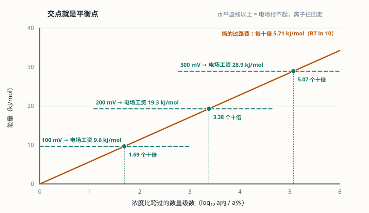
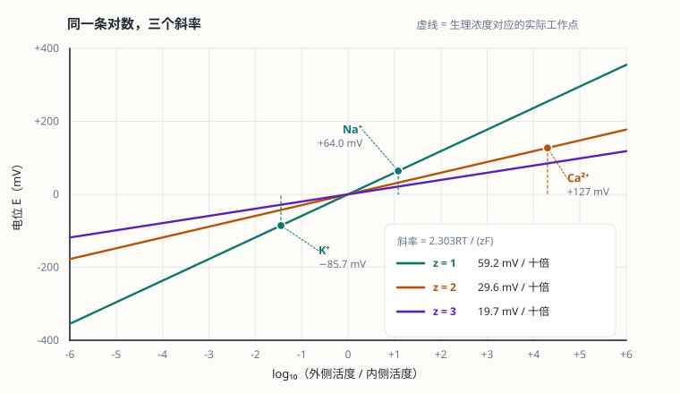

---
tags:
  - 化学
  - 电化学
  - 物理化学
  - 热力学
  - 公式工具
  - 传感
关联:
  - "[水与膜上的自发电位：从冻结电势到化学渗透](水与膜上的自发电位：从冻结电势到化学渗透——电荷分离的三种手法与三层膜电位.md)"
  - "[醌类：芳香性的赎金](醌类：芳香性的赎金——呼吸链的心脏、染料母体与药毒同源的弹头.md)"
  - "[θ 溶剂、良溶剂与分子标度指数](θ 溶剂、良溶剂与分子标度指数：一根柔性链如何在溶剂里决定自己的形状.md)"
  - "[化学渗透理论](../生物学/化学渗透理论.md)"
  - "[辅因子：金属离子、维生素衍生物与酶的化学外挂](../生物学/辅因子：金属离子、维生素衍生物与酶的化学外挂.md)"
  - "[香农采样定理与信息论](../电子、计算机和通信/香农采样定理与信息论：数字世界的两条底层定律.md)"
---

# Nernst 方程：59 mV 的来历、三种写法与它失效的四道边界

> **根节点**：为什么电化学电位对浓度是「对数」而不是「线性」，而每一个数量级恰好值 59 mV？这个数字在哪些地方是硬约束，在哪些地方只是一条被误用的近似？

> **叙事逻辑**：一句话定位 → 从电化学势推导 → 59 mV 的三个来源 → 三种写法与符号陷阱 → 活度与单离子不可测 → pH 电极 → 电池与相律 → 生物膜 → 四道失效边界 → 五个「Nernst」辨名 → 收束

> **立场说明**：公式推导、常数值、历史年份、文献出处属于可查证内容；「对数来自熵」「平台意味着两相」这类结构性解释标为分析；对文献数值的引用标注来源，未核实处标「待核实」。

> **来源标注**：Nernst 1889 年原始论文、Bard & Faulkner 与 Atkins 的教材表述、IUPAC 的 pH 与活度约定、Hodgkin–Katz 与 Mitchell 的原始文献、Sze 的半导体器件手册；整理于 2026-11-19。

## 知识树

```txt
根节点：为什么电位对浓度是「对数」，每个数量级又恰好值 59 mV？
│
├── 一、一句话定位（它是「平衡」的方程，不是「电压」的方程）
│   ├── 它是 ΔG = 0 的电压解
│   └── 它承诺绝对值，不承诺速度
│
├── 二、推导：四个输入，一个输出（化学势 → 电化学势 → 相等）
│   ├── μ = μ° + RT ln a
│   ├── μ̃ = μ + zFφ
│   ├── 平衡时两侧 μ̃ 相等
│   └── 等价说法：熵的过路费 = 电场的工资
│
├── 三、59.16 mV：这个数字的全部来源（一个热电压乘一个换底系数）
│   ├── RT/F = 25.69 mV，即 k_BT/e
│   ├── ln10 = 2.303
│   └── 温度表：20 / 25 / 37 ℃
│
├── 四、三种写法与符号陷阱（同一个方程的三张面孔）
│   ├── 还原式 / 电池式 / 膜式
│   ├── 谁在分子、谁在分母
│   └── 八条高频错法
│
├── 五、量的是活度，不是浓度（对数尺子的刻度单位）
│   ├── 活度系数 γ：0.1 M 时约 0.78
│   ├── 单离子活度原理上不可测
│   └── 所以「绝对电极电位」不存在
│
├── 六、器件：pH 电极如何把 10⁻¹⁴ 压成 0.4 V（对数-电压转换器）
│   ├── 玻璃电极与 59 mV/pH
│   ├── 斜率检验＝故障诊断
│   └── 检测下限、碱误差、液接电位
│
├── 七、电池：为什么放电时电压几乎不变（相律钉住了活度）
│   ├── 纯相：a = 1，电压是台阶
│   ├── 固溶体/插层：电压是斜坡
│   └── 温度系数是熵计
│
├── 八、生物：−85 mV 与 +64 mV 的算术（一个细胞就是一台浓差电池）
│   ├── 单离子 Nernst 电位
│   ├── GHK：把「平衡」换成「稳态」
│   └── Ca²⁺ 的 30 mV/decade 与质子动力势
│
├── 九、失效边界：它不管的四件事（平衡、理想、单实体、连接）
│   ├── 过电位 → Butler–Volmer
│   ├── 高离子强度 → 活度模型崩
│   ├── 纳米电极 → 离散事件
│   └── 液接电位 → 不可消除的偏置
│
├── 十、五个 Nernst（同名不同物的辨名表）
│   ├── 方程 / Planck / Einstein / 热定理 / 分配定律
│   └── 59 mV 在半导体里也出现：亚阈值摆幅
│
└── 十一、收束：一条对数，很多把尺子
    ├── 归因：对数来自熵，不来自电
    ├── 延伸：所有电位型传感共用同一道天花板
    └── 个体坐标：读仪表时的四条自检
```

## 〇、锚点：先建立量级与时间坐标

### 0.1 数字锚点

| 数字 | 含义 | 在本文中的作用 |
|---|---|---|
| **59.16 mV** | 25 ℃、一价离子，每十倍活度的电位变化 | 全篇的主刻度 |
| **25.69 mV** | $RT/F$，即单个电荷的热能当量 $k_BT/e$ | 59.16 的「母单位」，也是二极管方程里的热电压 |
| **2.303** | $\ln 10$ | 自然对数换十进对数的系数，是「少乘 2.3」类错误的来源 |
| **5.71 kJ/mol** | 25 ℃ 下把 1 mol 一价离子浓缩十倍所需的功 | 「熵的过路费」的单价 |
| **29.58 mV** | Ca²⁺、Mg²⁺（z=2）的每十倍斜率 | 多价离子信噪比减半的算术 |
| **61.54 mV** | 37 ℃ 下的每十倍斜率 | 生理温度的刻度，与 25 ℃ 相差 4% |
| **0.828 V** | pH 0→14 全程的电势跨度（14 × 59.16 mV） | 说明 pH 电极是「对数-电压压缩器」 |
| **16.9** | 一价离子产生 1 V 所需的十倍数量级数（≈8×10¹⁶ 倍浓度比） | 说明「电位是浓度比的对数」有多贵 |
| **118 mV/dec** | $\alpha=0.5$、$z=1$ 时的 Tafel 斜率 | Nernst 常数在动力学里的孪生兄弟 |
| **59.5 mV/dec** | 300 K 下 MOSFET 亚阈值摆幅的玻尔兹曼下限 | 同一个 $kT/q$ 在半导体里现身 |
| **−59 mV/pH** | 1e⁻/1H⁺ 反应的 E–pH 斜率 | Pourbaix 图与醌/氢醌电位的地基 |
| **1–3 mV** | 典型液接电位的量级 | 提醒：你测到的永远不是「单个电极」 |

### 0.2 时间锚点

| 年份 | 事件 | 为什么值得记 |
|---|---|---|
| **1889** | Nernst 发表《离子的电动势作用》 | 方程诞生，比电子的发现早 8 年 |
| 1891 | Nernst 分配定律 | 同一套「活度 + 对数」的语言进入液液萃取 |
| 1897 | J. J. Thomson 发现电子 | 方程先有，载体后到 |
| 1906 | Nernst 热定理 | 后来成为热力学第三定律的核心 |
| **1909** | Haber 与 Klemensiewicz 做出玻璃电极；Sørensen 提出 pH | Nernst 方程变成第一台实用对数传感器 |
| 1920 | Nernst 获诺贝尔化学奖 | 授奖理由写的是「热化学」，不是电化学 |
| 1937 | Nikolsky 提出玻璃电极的干扰方程 | 「扩展 Nernst 方程」 |
| 1943 / 1949 | Goldman；Hodgkin 与 Katz | 从「单离子平衡」走到「多离子稳态」 |
| 1945 | Pourbaix 的 E–pH 图 | Nernst 方程被画成地图 |
| 1961 | Mitchell 的化学渗透假说 | 把 Δψ 与 ΔpH 合并成一笔预算 |
| 2002 | IUPAC 的操作性 pH 定义 | 官方承认：pH 只能靠电池电动势定义 |

### 0.3 图示导览

| 图 | 位置 | 一句话 |
|---|---|---|
| 图 1 · 同一条对数，三个斜率 | §三 | 单价、二价、三价三条直线，以及 K⁺/Na⁺/Ca²⁺ 的实际工作点 |
| 图 2 · 交点就是平衡点 | §二 | 熵的过路费（斜线）与电场的工资（水平线）相交处即 Nernst 电位 |

## 一、一句话定位：它是「平衡」的方程，不是「电压」的方程

**Nernst 方程不是「电压如何产生」的公式，而是「反应在哪里停住」的公式。** 它回答的是：当净反应已经停止（$\Delta G=0$）时，两极之间**必须**是多少伏。

最常见的形式：

$$
E = E^\circ - \frac{RT}{zF}\ln Q
$$

- **$E$**：电池电动势或电极电位，单位 V。正值表示「按书写的方向自发（放电）」。
- **$E^\circ$**：标准电动势，即所有活度都等于 1（气体为 1 bar）时的 $E$。它只由反应物与产物的本性决定，是这套体系的「零点偏移」。
- **$R$**：气体常数，8.314 J/(mol·K)。
- **$T$**：热力学温度，K。全文所有「59 mV」都默认 298.15 K。
- **$z$**：反应转移的电子数（无量纲的计量数）。在膜电位语境里它退化成离子价数。
- **$F$**：法拉第常数，96485 C/mol，即 1 mol 电子的电荷量。
- **$Q$**：反应商（reaction quotient），$\prod_i a_i^{\nu_i}$，产物活度在分子、反应物活度在分母，无量纲。注意它和「电荷量 Q」同名，本文一律写「反应商 $Q$」。
- **$\ln$**：自然对数。换成 $\log_{10}$ 时，系数变成 $2.303RT/zF$。

> 📌 **Nernst 方程（Nernst equation）**：描述电化学平衡时电极电位与各物种活度之间关系的方程，本质是「电化学势相等」这一平衡条件的解。**它在本文中的作用是提供一把通用标尺**——后面所有关于 pH 电极、电池平台、神经膜电位的讨论，都是这把标尺在不同几何下的读数。

**它的三个等价面孔**（同一个数的三块表盘）：

| 面孔 | 表达式 | 谁在用 | 关键动作 |
|---|---|---|---|
| 电压 | $E = E^\circ - \dfrac{RT}{zF}\ln Q$ | 电化学、电池、腐蚀 | 直接读电压 |
| 自由能 | $\Delta G = \Delta G^\circ + RT\ln Q$，配合 $\Delta G = -zFE$ | 热力学 | 算「想不想反应」 |
| 平衡常数 | $E^\circ = \dfrac{RT}{zF}\ln K$ | 分析化学、教材习题 | 把 $Q=K$、$E=0$ 代入即得 |

**收束句**：把 $Q=K$ 代回 Nernst 方程必须得到 $E=0$——电池「死掉」的那一刻，就是它的平衡常数被满足的那一刻。三张面孔是同一个数被三个仪表读出。

**它承诺什么、不承诺什么**：

| 它承诺 | 它不承诺 |
|---|---|
| 平衡时的电位（唯一的、可算的） | 达到平衡要多快 |
| 活度比与电位的换算 | 实际端电压（有净电流时不是它） |
| 电位随温度的变化规律 | 「浓度」（它要的是活度） |
| 半反应的热力学方向 | 一个真实电极的绝对电位（不可测，见 §五） |

**动力学补丁**：有净电流时，万用表读到的是

$$
E_{\text{端}} = E_{\text{Nernst}} \mp \eta \mp iR
$$

- **$E_{\text{端}}$**：你实际读到的端电压；
- **$\eta$**：过电位（overpotential），电荷转移的「额外收费」；
- **$iR$**：欧姆降，来自电解质电阻与接触电阻；
- **符号**：放电时两项都让电压**变低**（取负），充电时反向（取正）。

正因为如此，只有**开路**时端电压才等于 Nernst 电位——这也是「开路电位（OCP）」这个测量标准存在的理由。

> 🔗 **横向关联**：本节「Nernst 给平衡、剩下的都是损耗」与 [水与膜上的自发电位：从冻结电势到化学渗透](水与膜上的自发电位：从冻结电势到化学渗透——电荷分离的三种手法与三层膜电位.md) §8.2「平衡的天花板是 Nernst，动力学的天花板只是漏电」形成**同构关系**——那篇讲「想超过 59 mV/decade 的天花板必须放弃平衡」，本篇讲「想测到 Nernst 电位必须没有电流」。两句话是同一件事的两面：**只要还有通量，读数就不再是热力学的读数。**

## 二、推导：四个输入，一个输出

### 2.1 三个基本量

**输入一，化学势**：

$$
\mu_i = \mu_i^\circ + RT\ln a_i
$$

- **$\mu_i$**：组分 $i$ 的化学势（J/mol），即「再加一摩尔要花多少自由能」；
- **$\mu_i^\circ$**：标准化学势，$a_i=1$ 时的值；
- **$a_i$**：活度，无量纲（见 §五）；
- **$RT\ln a_i$**：浓度项。$a_i<1$ 时它为负——**越稀越稳定**，这是混合熵的直接结果。

**输入二，把电荷搬进电位**。一个带电粒子放在电位为 $\varphi$ 的位置，要多付 $z_iF\varphi$ 的能量。

> 📌 **电化学势（electrochemical potential）**：
>
> $$\tilde\mu_i = \mu_i^\circ + RT\ln a_i + z_iF\varphi$$
>
> - **$\tilde\mu_i$**：电化学势（J/mol），把「化学」与「静电」两笔账合并后的总势；
> - **$z_i$**：该组分的电荷数（带符号）；
> - **$\varphi$**：该处的内电位（inner potential），单位 V。**它本身不可测**——只有两点之差可测；
> - **$z_iF\varphi$**：静电项，把一个摩尔电荷放到该电位所需的功。
>
> **它在本文中的作用**：整门电化学都建立在一条公理上——**平衡时 $\tilde\mu$ 处处相等**。Nernst、Donnan、GHK、Nernst–Planck 全是它的不同投影。

**输入三，平衡条件**：对任一可逆过程，$\sum_i\nu_i\tilde\mu_i=0$。对电极反应，这等价于「反应物的 $\tilde\mu$ 之和 = 产物的 $\tilde\mu$ 之和」。

### 2.2 路径 A：三行的热力学捷径

$$
\Delta G = \Delta G^\circ + RT\ln Q
$$
$$
\Delta G = -zFE
$$
$$
\Longrightarrow\quad E = E^\circ - \frac{RT}{zF}\ln Q
$$

第一式是化学平衡的通用式；第二式是「自由能如何变成电功」（$\Delta G<0$ 时 $E>0$，即自发）；两式联立即得 Nernst。**没有引入任何新假设。**

### 2.3 路径 B：收支平衡（更值得记住的一版）

把 1 mol 一价离子从活度 $a_1$ 的一侧搬到 $a_2>a_1$ 的一侧，有两笔账：

| 账目 | 表达式 | 25 ℃、一个数量级的数值 |
|---|---|---|
| 熵要收的费（把离子「浓缩」的代价） | $RT\ln(a_2/a_1)$ | $8.314\times298.15\times2.303 = 5.71$ kJ/mol |
| 电场能付的钱（逆着 E 搬电荷） | $zFE$ | 当 $E=59.16$ mV、$z=1$ 时为 $5.71$ kJ/mol |
| 收支相抵 | $zFE = RT\ln(a_2/a_1)$ | 得 $E=\frac{RT}{zF}\ln\frac{a_2}{a_1}$ |

**这就是全部。** Nernst 方程不含任何额外假设，它就是这条收支平衡式移项的结果。

> 📌 **比喻：收费站与工资单**。把离子搬高一个数量级，熵收 5.71 kJ/mol 的过路费；电场愿意为每个电荷付 $zFE$ 的工资。两者相等时，搬运工不再愿意干活——这就是平衡。**59 mV 就是这个汇率。**



*图 2 · 橙线是「熵的过路费」随浓度比线性上涨；三条水平虚线是三种电场强度下「每摩尔电荷能拿到的工资」。交点左侧电场付得起，离子被推上坡；交点右侧付不起，离子顺坡回流。交点即 Nernst 电位。*

> 🔗 **横向关联**：本节「$\ln a$ 这一项来自混合熵」与 [θ 溶剂、良溶剂与分子标度指数](θ 溶剂、良溶剂与分子标度指数：一根柔性链如何在溶剂里决定自己的形状.md) §2.1–2.4 的熵推导形成**上下游关系**——那篇从「教室里的排法数」一路推到 $S=-k\sum N_i\ln x_i$，说明化学势的浓度项为什么是对数；本篇直接把那个对数当成已知量，去付电场的账。**同一台熵学机器，一边算形状，一边算电压。**

> 🔗 **横向关联**：同一条「$-\sum p\ln p$」还在 [香农采样定理与信息论](../电子、计算机和通信/香农采样定理与信息论：数字世界的两条底层定律.md) 的熵定义里出现（该笔记指出它「与玻尔兹曼熵形式同源、只差常数与对数底」）。这是**互证关系**——信息熵、混合熵、Nernst 的对数项，共享同一个「按状态数计费」的数学骨架。

### 2.4 一个自检：$z=1$、$a_2/a_1=10$ 时应得多少

- 熵费：$5.71$ kJ/mol；
- 电功：$1\times96485\times E$ J/mol；
- 相抵：$E=5710/96485 = 0.05916$ V。

**如果这个自检得不到 59.16 mV，说明你的 $\ln$ 和 $\log_{10}$ 至少有一个用错了。**

## 三、59.16 mV：这个数字的全部来源

### 3.1 三个数字的乘积

$$
\frac{2.303\,RT}{F} = 2.303\times\frac{8.314\times298.15}{96485} = 2.303\times0.025693 = 0.05916\ \text{V}
$$

分开看才有用：

| 因子 | 数值 | 它是什么 |
|---|---|---|
| $RT/F$ | 25.69 mV | **热电压**：单个电荷的热能当量 $k_BT/e$ |
| $\ln 10$ | 2.303 | 换底系数：把「每 e 倍」改成「每十倍」 |
| 乘积 | **59.16 mV** | 每十倍活度对应的电位变化 |

**热电压才是那个「物理常数」。** 59 mV 只是它乘上一个纯数学的 2.303。同一个 $k_BT/e$ 出现在：二极管方程 $I=I_S(e^{V/V_T}-1)$ 里的 $V_T$、德拜长度里的 $kT/e$、MOSFET 亚阈值摆幅里的 $kT/q$。**它不专属于电化学。**

### 3.2 温度表

| 温度 | $RT/F$ | $2.303RT/F$（每十倍） |
|---|---|---|
| 0 ℃（273.15 K） | 23.5 mV | 54.2 mV |
| 20 ℃（293.15 K） | 25.3 mV | 58.2 mV |
| **25 ℃（298.15 K）** | **25.7 mV** | **59.16 mV** |
| 37 ℃（310.15 K） | 26.7 mV | 61.5 mV |
| 100 ℃（373.15 K） | 32.2 mV | 74.0 mV |

**收束句**：59 mV 不是自然常数，它是「室温」这个特定温度下的读数。**体温下它已经是 61.5 mV**——若在校准与测量之间混用了两个温度，全程 14 个 pH 单位会累积约 0.5 个 pH 的系统误差。

### 3.3 这个刻度有多贵

| 目标电位 | 一价离子所需浓度比 | 直觉 |
|---|---|---|
| 59 mV | 10 倍 | 细胞能轻松做到 |
| −85 mV（神经元 K⁺） | ≈28 倍（140/5） | 一次泵送就能维持 |
| 1 V | ≈8×10¹⁶ 倍 | 实验室级别的极端条件 |
| 230 V（冻结电势） | ≈10³⁸⁸⁸ 倍 | **宇宙里没有这么多原子** |

> 🔗 **横向关联**：本节的最后一行与 [水与膜上的自发电位：从冻结电势到化学渗透](水与膜上的自发电位：从冻结电势到化学渗透——电荷分离的三种手法与三层膜电位.md) §8.2 的「230 V 需要 $10^{3888}$ 倍浓度比」形成**同一条论证的两端**——那篇由此判定冻结电势必然是**非平衡**的动力学电位；本篇则说明这个「贵」不是工程问题，而是**对数刻度的固有价格**：每多一个数量级，只买到 59 mV。

### 3.4 价数的惩罚



*图 1 · 横轴是外侧/内侧的活度比（对数），纵轴是电位。三条直线斜率分别为 59.2 / 29.6 / 19.7 mV 每十倍，对应 z = 1 / 2 / 3。三个圆点是按典型生理浓度算出的真实工作点。*

$$
E_{\rm ion}=\frac{RT}{zF}\ln\frac{a_{\rm out}}{a_{\rm in}} \quad\Longrightarrow\quad \text{斜率}\propto\frac{1}{z}
$$

| 离子 | $z$ | 每十倍 | 同样浓度比下的电位 |
|---|---|---|---|
| K⁺、Na⁺、H⁺ | 1 | 59.2 mV | $E$ |
| Ca²⁺、Mg²⁺ | 2 | 29.6 mV | $E/2$ |
| Al³⁺、PO₄³⁻ | 3 | 19.7 mV | $E/3$（阴离子符号相反） |

**收束句**：$z$ 在分母上，意味着**多价离子的电位信号天生更弱**。这是 Ca²⁺ 电极比 pH 电极难做一个数量级的根本原因，也是细胞为什么用「瞬时的、局部的」钙火花而不是「稳态的钙电位」来传递信息的原因之一（分析）。

## 四、三种写法与符号陷阱

同一个物理，在三个学科里有三套约定。混用这些约定，是电化学最常见的错误来源——比算错更常见。

| 维度 | 还原式（IUPAC 半反应） | 电池式（整电池） | 膜式（生理） |
|---|---|---|---|
| 典型写法 | $E=E^\circ-\frac{RT}{zF}\ln\frac{a_{\rm Red}}{a_{\rm Ox}}$ | $E_{\rm cell}=E^\circ_{\rm cell}-\frac{RT}{zF}\ln\frac{\prod a_{\rm 产物}}{\prod a_{\rm 反应物}}$ | $E_{\rm ion}=\frac{RT}{zF}\ln\frac{[{\rm ion}]_{\rm out}}{[{\rm ion}]_{\rm in}}$ |
| 分子上放谁 | 还原态 | 产物 | 外侧 |
| 有没有负号 | 有 | 有 | **没有** |
| 电位指什么 | 该电极对 SHE | 阴极对阳极 | 膜内对膜外 |
| 谁在用 | 分析化学、教材习题 | 电池、腐蚀 | 生理学、生物物理 |
| 最常见的错法 | Red/Ox 写反 | 把反应物放进分子 | 照抄一个负号 |

**为什么膜式没有负号**：因为它把方向定义反了。电化学的约定是「还原电位」（氧化态得电子，电位高意味着更想得电子）；生理学的约定是「膜内减膜外」，对阳离子而言，外高内低对应负电位——两个反号正好抵消。

**八条高频错法**：

| # | 错法 | 后果 | 怎么防 |
|---|---|---|---|
| 1 | 把 $\ln$ 当 $\log_{10}$ | 差 2.303 倍（59.16 ↔ 25.7） | 看到「25 mV/decade」几乎一定是这个错 |
| 2 | 忘掉 $z$ | Ca²⁺ 用 59 而不是 29.6 | 先问「转移几个电荷」 |
| 3 | 反应商 $Q$ 与电荷量 $Q$ 串味 | 量纲错乱 | 一律称「反应商」 |
| 4 | $E^\circ$ 与 $E^{\circ\prime}$ 不分 | 生化体系偏 0.4 V 量级 | 生化的标准态是 pH 7：$E^{\circ\prime}=E^\circ-\frac{59\,{\rm mV}}{z}\times7n_{\rm H^+}$ |
| 5 | 把纯固体/纯液体写进对数 | 不会算错，但会误以为它在变 | $a=1$，$\ln 1=0$ |
| 6 | 气体用浓度 | 高压下错得离谱 | 用 $p/p^\circ$ |
| 7 | 用浓度代替活度 | 生理盐水中偏 7 mV 量级 | 见 §五 |
| 8 | 混淆阳极/阴极与氧化/还原 | 整电池符号全反 | $E_{\rm cell}=E_{\rm cathode}-E_{\rm anode}$ 只在两者都取还原电位时成立 |

**收束句**：三条写法的差别只有两件事——**谁在分子上**、**电位从哪量到哪**。把这两个问题各问一次，任何符号都能自己推出来，不需要背。

### 4.1 一个完整的算术例子：Daniell 电池

电池反应：$\mathrm{Zn(s)+Cu^{2+}(aq)\rightleftharpoons Zn^{2+}(aq)+Cu(s)}$，$z=2$，$E^\circ=+1.100$ V（$+0.340-(-0.762)$）。

$$E=1.100-\frac{0.05916}{2}\log_{10}\frac{a_{\rm Zn^{2+}}}{a_{\rm Cu^{2+}}}$$

取 $a_{\rm Zn^{2+}}=1$、$a_{\rm Cu^{2+}}=10^{-3}$：

$$
E=1.100-0.02958\times\log_{10}\frac{1}{10^{-3}}=1.100-0.02958\times3=1.011\ \text{V}
$$

- **$0.05916/2=0.02958$**：二价离子每十倍的斜率，只有一价的一半；
- **比值是 $a_{\rm Zn^{2+}}/a_{\rm Cu^{2+}}$**：因为反应商里只有溶液中的离子，纯固体 $a=1$ 不进对数；
- **结果下降**：产物（Zn²⁺）堆积、反应物（Cu²⁺）减少，反应更不愿意往正向走。

**唯一的直觉**：**对数里的比值越大，电位越低。** 因为比值大意味着产物堆积，正反应被压住。

## 五、量的是活度，不是浓度

### 5.1 活度是「热力学上有效的浓度」

$$
a_i=\gamma_i\frac{c_i}{c^\circ}
$$

- **$a_i$**：活度，无量纲；
- **$\gamma_i$**：活度系数，理想稀溶液中等于 1；
- **$c_i$**：体积摩尔浓度；
- **$c^\circ$**：标准浓度 1 mol/L，作用是**把浓度变成无量纲数**——对数里不能放有量纲的量。

### 5.2 活度系数有多大

25 ℃ 下的 Davies 方程（Debye–Hückel 的经验扩展）：

$$
\log_{10}\gamma_i=-0.51z_i^2\left(\frac{\sqrt I}{1+\sqrt I}-0.3I\right)
$$

- **$I$**：离子强度，$I=\frac12\sum_j c_jz_j^2$，单位 mol/L。它衡量「溶液里有多少电荷在屏蔽彼此」，不是浓度总和；
- **$z_i$**：该离子的电荷数；
- **$-0.51$**：25 ℃ 水的 Debye–Hückel 常数；
- **$\sqrt I/(1+\sqrt I)$**：远场屏蔽项；
- **$0.3I$**：高浓度经验修正项。

| 体系 | 离子强度 $I$ | 一价离子 $\gamma$ | 对 Nernst 电位的偏差（$z=1$） |
|---|---|---|---|
| 超纯水 | ~10⁻⁷ | ≈1.00 | 0 |
| 10 mM 缓冲液 | 0.01 | ≈0.90 | ≈2.7 mV |
| 0.1 M KCl | 0.1 | ≈0.77 | ≈6.7 mV |
| 生理盐水 / 血浆 | 0.15 | ≈0.75 | ≈7.4 mV |
| 海水 | ~0.7 | ~0.7（Davies 外推，**待核实**） | ≈9 mV |

**一条手算规则**：$\gamma$ 每差 10%，$z=1$ 时电位差 2.5 mV（$59.16\times\log_{10}1.1$）。所以「高精度电位测量」本质上是**一门控制离子强度的技术**，不是一门把电压表买贵的艺术。

### 5.3 单离子活度原理上不可测

热力学只能测量**电中性组合**的活度（例如电解质整体的平均离子活度系数 $\gamma_\pm$）。单个离子的活度必须借助一个额外的、非热力学的假设——最常用的是 MacInnes 约定（假设 KCl 溶液中 K⁺ 与 Cl⁻ 的 $\gamma$ 相等）。

后果有三条，都很硬：

1. **「绝对电极电位」不存在。** 标准氢电极 = 0 V 是一个**约定**，不是测量结果。
2. **pH 的定义必须是操作性的。** IUPAC（2002）不用 $-\log a_{\rm H^+}$ 定义 pH，而用「同一支氢电极在样品与标准缓冲液中测得的电动势差」来定义——正因为 $a_{\rm H^+}$ 单独不可测。
3. **「氢标电位绝对值约 4.4 V」这类数字依赖约定。** 把电子逸出功、表面偶极等量拼进来才能得到，不同约定给出不同值（**待核实**）。

> 📌 **单离子活度问题（single-ion activity problem）**：热力学可测量的只有电中性的组合量，因此任何「单个离子的化学势」都内含一个无法检验的约定。**它在本文中的作用**：让你明白 Nernst 方程给出的每个「单电极电位」都只是相对值，而**两个半电池之间的差**才是真正可测的物理量。

**收束句**：方程给你一个精确的**差值**；每一个「单电极电位」的绝对值，都站在一个不可检验的约定上。**你能测的永远是两个半电池之差。**

## 六、器件：pH 电极如何把 10⁻¹⁴ 压成 0.4 V

### 6.1 一台对数-电压转换器

| 环节 | 物理 | Nernst 在哪一步 |
|---|---|---|
| 玻璃薄膜 | 表面水化层中的硅醇基与 H⁺ 交换 | 建立相界电位 |
| 内参液 + 内参电极 | 固定一个半电池 | 提供零点 $E^\circ$ |
| 外参比电极 + 液接 | 完成回路 | 引入 1–3 mV 的偏置 |
| 电压表 | 输入阻抗 >10¹² Ω | 必须**不取电流**，否则破坏平衡 |

**核心数字**：pH 0→14 对应 $14\times59.16 = 0.828$ V。也就是说，**跨越 14 个数量级的浓度被压缩进不到 1 V 的电压窗**。这是所有「对数传感器」的魔法：它用电压的分辨率换浓度的动态范围。

**反过来说**：想让电位**线性**地响应浓度是不可能的——Nernst 的 $1/z$ 与 $\ln$ 已经把这门生意签死了。

> 🔗 **横向关联**：本节「pH 电极 = Nernst 响应 + 参比偏置」与 [水与膜上的自发电位：从冻结电势到化学渗透](水与膜上的自发电位：从冻结电势到化学渗透——电荷分离的三种手法与三层膜电位.md) §5.3「相界电势与离子载体」形成**同一原理的两个实例**——那篇讲缬氨霉素如何把 K⁺ 的「换外套」代价变成 59 mV/decade 的电极响应，本篇补上完整电池的另外两个电极与那 1–3 mV 的液接偏置。**选择性的来源不同（离子载体 vs 玻璃交换位点），读数的形式完全相同。**

### 6.2 斜率是诊断量

| 实测斜率（25 ℃，以 $\rm pH$ 为单位） | 判定 |
|---|---|
| 98–102%（58–60 mV/pH） | 正常 |
| 92–97% | 开始老化或结垢，先清洗 |
| < 90% | 更换 |
| > 105% 或读数持续抖动 | 参比堵塞、液接不稳，或尚未稳定 |

**为什么这一条特别有用**：Nernst 方程给出了一个**与浓度无关的绝对预期值**。你不是在问「读数对不对」（无法独立验证），而是在问「斜率对不对」——后者是纯几何量，可以独立检验。

### 6.3 三类误差

| 误差 | 触发条件 | 机制 | 表现 |
|---|---|---|---|
| **碱误差**（sodium error） | pH > 12 | Na⁺ 也能与玻璃表面交换 | 读数**偏低** |
| **酸误差**（acid error） | pH < 1 | 玻璃表面脱水、阴离子渗透 | 读数**偏高** |
| **液接电位** | 盐桥堵塞、稀释、污染 | 两种电解质接触处的扩散电位 | 1–3 mV（≈0.02–0.05 pH）甚至更大的偏置 |

**「同一杯水，两支电极差 0.1 pH」九成是液接电位。** 这不是 Nernst 方程失效，而是你以为自己在测半电池，其实测的是「半电池 + 两个液接 + 一个参比」。

### 6.4 扩展 Nernst 方程

$$
E=E^\circ+\frac{2.303RT}{z_iF}\log_{10}\left(a_i+\sum_j K_{ij}^{\rm pot}a_j^{z_i/z_j}\right)
$$

- **$a_i$**：待测离子活度；
- **$a_j$**：干扰离子活度；
- **$K_{ij}^{\rm pot}$**：电位选择性系数，越小越好（$10^{-3}$ 表示 j 的干扰能力只有 i 的千分之一）；
- **$z_i/z_j$**：把干扰离子折算到待测离子的刻度上；
- **整个括号**：相当于「把干扰离子当成一种假想的待测离子，加进有效浓度」。

> 📌 **离子选择电极（ion-selective electrode, ISE）**：靠一层选择性膜把「某种离子的活度」翻译成电位的器件。Nernst 方程是它的设计公式，Nikolsky 方程是它的现实版本。**它在本文中的作用**：说明「Nernst 方程 + 一个干扰项」就是工业界实际使用的全部模型。

## 七、电池：为什么放电时电压几乎不变

### 7.1 平台与斜坡，都是相律的读法

$$
E=E^\circ-\frac{RT}{zF}\ln Q
$$

如果电极是**纯相**（纯固体金属、纯液体金属、纯固相氧化物），它的活度恒为 1，与「还剩多少」无关。$\Delta G=-zFE$，而相律保证：**两相共存时，各组分的化学势被温度与压力钉死，与总量无关**。于是电压不动。

| 电极类型 | 活度行为 | 充放电曲线 | 例子 |
|---|---|---|---|
| 纯金属 / 纯固相 | $a=1$ 恒定 | **台阶（平台）** | Zn/Cu、LiFePO₄/FePO₄ 两相区 |
| 汞齐 / 合金 | 随组成变化 | 缓坡 | 铅酸电池的 Pb–Sb 极板 |
| 插层 / 固溶体 | 连续变化 | **斜坡** | LiₓCoO₂、石墨 LiₓC₆ |
| 浓差电池 | 随两侧浓度变化 | 随浓度差衰减 | 参比电极、腐蚀电池 |

**收束句**：**平台意味着「两相」，斜坡意味着「一相」。** 锂电的充放电曲线本质上是一张「活度–组成」图，Nernst 方程是它的读数规则（分析）。

### 7.2 温度系数是熵计

在恒压、无电流条件下：

$$
\frac{dE}{dT}=\frac{\Delta S}{zF}
$$

- **$dE/dT$**：开路电位的温度系数，通常为 mV/K 量级；
- **$\Delta S$**：电池反应的熵变（J/(mol·K)）；
- **$zF$**：每摩尔反应的电荷量。

测一条 E–T 直线，斜率除以 $zF$ 就是熵变。这个方法的精度常常优于量热，而且**不需要知道反应机理**——因为电压的温度系数就是自由能对温度的导数。19 世纪末，这是热化学的重要工具之一。

### 7.3 Pourbaix 图：把方程画成地图

| 反应 | E–pH 斜率 | 截距（$E^\circ$，vs SHE） |
|---|---|---|
| $2{\rm H^+}+2e^-\to{\rm H_2}$ | −59 mV/pH | 0 V |
| ${\rm O_2}+4{\rm H^+}+4e^-\to2{\rm H_2O}$ | −59 mV/pH | +1.229 V |
| ${\rm Fe^{3+}}+e^-\to{\rm Fe^{2+}}$ | 0（不涉及 H⁺） | +0.771 V |
| ${\rm Fe(OH)_3}+3{\rm H^+}+e^-\to{\rm Fe^{2+}}+3{\rm H_2O}$ | −177 mV/pH（3 × 59） | 依物种 |

**读法**：**每涉及 1 个 H⁺ 与 1 个 e⁻，斜率就是 −59 mV/pH。** 斜率的大小直接告诉你这个反应吃掉几个质子：

$$
\text{斜率} = -59.16\ \text{mV/pH}\times\frac{n_{\rm H^+}}{n_{e^-}}
$$

水的稳定窗宽度恰好 1.23 V，就是两条 −59 mV/pH 直线截距差的直接后果。

> 🔗 **横向关联**：本节的斜率规则与 [醌类：芳香性的赎金](醌类：芳香性的赎金——呼吸链的心脏、染料母体与药毒同源的弹头.md) §4.2「质子耦合：−59 mV 的魔咒」形成**同一公式的两个应用面**——那篇讲「取代基怎么拧电位旋钮、质子怎么拧 pH 旋钮」，本篇给出那条直线的通用来历。醌/氢醌是 2e⁻/2H⁺，所以斜率恰为 −59 mV/pH，与 pH 电极落在同一条刻度上；也正因为耦合了质子，醌的电位才随微环境 pH 连续可调。

## 八、生物：−85 mV 与 +64 mV 的算术

### 8.1 一个细胞就是一台浓差电池

| 离子 | 胞外 | 胞内 | $E_{\rm ion}$（Nernst） | 说明 |
|---|---|---|---|---|
| K⁺ | 5 mM | 140 mM | **−85 mV** | 静息电位的「地板」 |
| Na⁺ | 145 mM | 12 mM | **+64 mV** | 动作电位的「天花板」 |
| Cl⁻ | 110 mM | 10 mM | **−62 mV** | 常接近静息电位 |
| Ca²⁺ | 2 mM | 100 nM | **+127 mV** | 跨四个数量级，蓄势最猛 |

**三条必须加的限定**：

1. **浓度是典型值**，不同神经元、不同物种可差 2 倍，算出的电位也就差十几 mV。
2. **严格说要用活度**：胞内离子强度 0.2–0.3 M，$\gamma\approx0.7$–0.8，所以表中数字本身带 5–10 mV 量级的约定误差（**待核实**）。
3. **细胞从不处于任何单个离子的 Nernst 平衡**。静息电位 −70 mV 与 $E_K=-85$ mV 差 15 mV——这 15 mV 就是 K⁺ 的持续漏出，然后被泵补回来。它是**稳态**，不是**平衡**。

> 📌 **比喻**：Nernst 是「只有一扇门开着时的终点」；GHK 是「三扇门都开着、宽窄各不相同时的停靠点」。真实细胞永远是后者。

### 8.2 GHK：把「平衡」换成「稳态」

$$
V_m=\frac{RT}{F}\ln\frac{P_K[{\rm K^+}]_{\rm out}+P_{Na}[{\rm Na^+}]_{\rm out}+P_{Cl}[{\rm Cl^-}]_{\rm in}}{P_K[{\rm K^+}]_{\rm in}+P_{Na}[{\rm Na^+}]_{\rm in}+P_{Cl}[{\rm Cl^-}]_{\rm out}}
$$

- **$V_m$**：跨膜电位（膜内减膜外）；
- **$P_X$**：各离子的膜通透性，任意单位但必须同一标度；
- **Cl⁻ 的分子分母对调**：它是阴离子，浓度项方向相反；
- **自检**：若只有 K⁺ 可透（$P_{Na}=P_{Cl}=0$），GHK 立刻退化成 $E_K$。这是判断「有没有抄错」最快的办法。

### 8.3 质子动力势与 ATP 的算术

$$
\Delta p=\Delta\psi-59\,\Delta{\rm pH}\ \ (\text{mV})
$$

把「电」与「化学」两项合成一笔预算。线粒体约 $\Delta p=150$–$200$ mV，其中约 80% 在 $\Delta\psi$ 里；叶绿体相反，主要靠 $\Delta{\rm pH}$。

**ATP 合酶的算术**（分析）：合成 1 个 ATP 需约 50–60 kJ/mol；一个质子过 ATP 合酶放出 $F\Delta p$。若 $\Delta p=180$ mV，每质子约 17.4 kJ/mol，则需要 3–4 个质子。哺乳动物 ATP 合酶的 $c$ 环有 8 个亚基，对应每圈 8 个质子产 3 个 ATP——数量级自洽。

> 🔗 **横向关联**：本节「Δψ 与 ΔpH 是一笔预算的两个账户」与 [化学渗透理论](../生物学/化学渗透理论.md) §2「PMF 由两部分组成」形成**定义与实例的关系**——那篇给出通用分解式与不同生物的比例，本篇补上「单个离子的 Nernst 电位是这笔预算的上限」这一层。这也是 [水与膜上的自发电位](水与膜上的自发电位：从冻结电势到化学渗透——电荷分离的三种手法与三层膜电位.md) §7.1 那张量级表的生理端。

> 🔗 **横向关联**：本节「质子梯度 → ATP」与 [辅因子：金属离子、维生素衍生物与酶的化学外挂](../生物学/辅因子：金属离子、维生素衍生物与酶的化学外挂.md) 的「电子瀑布电位表」形成**上下游关系**——NADH（−0.32 V）到 O₂（+0.82 V）的 1.1 V 落差，正是把 Δp 充到 200 mV 量级的能量来源；Nernst 方程则负责把「这个落差能维持多大的浓度比」翻译成数字。

## 九、失效边界：它不管的四件事

| # | 边界 | 现象 | 该换用什么 |
|---|---|---|---|
| 1 | **平衡** | 有净电流时端电压偏离 | Butler–Volmer / Tafel / 等效电路 |
| 2 | **理想** | 高离子强度、浓溶液 | Pitzer 活度模型、实测平均活度系数 |
| 3 | **尺度** | 纳米电极、单分子、pA 级电流 | 单电子计数、随机热力学 |
| 4 | **连接** | 液接、参比漂移、吸附污染 | 四电极法、盐桥、差分测量 |

### 9.1 边界一：过电位

$$
i=i_0\left[\exp\left(\frac{\alpha_a zF\eta}{RT}\right)-\exp\left(-\frac{\alpha_c zF\eta}{RT}\right)\right]
$$

- **$i$**：净电流密度（A/m²）；
- **$i_0$**：交换电流密度，衡量「这个反应本身有多容易」；
- **$\eta$**：过电位，$E-E_{\rm Nernst}$；
- **$\alpha_a,\alpha_c$**：阳极/阴极传递系数，通常各约 0.5。

大过电位时它退化成 Tafel 式 $\eta=a+b\log i$，其中

$$
b=\frac{2.303RT}{\alpha zF}
$$

$\alpha=0.5$、$z=1$ 时 $b=118$ mV/decade——**正好是 59 mV 的两倍**。同一个常数以两倍的面目出现在动力学里。这是「59 mV 不只属于平衡」的证据。

### 9.2 边界二：理想溶液

离子强度超过约 0.1 M 后，Debye–Hückel 失效，Davies 只是经验外推。海水、血浆、电池电解液都需要 Pitzer 模型或实测值。**这意味着在真实体系里，Nernst 方程的精度上限就是活度系数的精度（几 mV）。**

### 9.3 边界三：单实体尺度

当电极小到纳米、电流小到 pA，电流变成离散电子事件，$i$–$E$ 曲线出现台阶。此时必须区分**静电电位 $\varphi$**（局部电场的积分）与**电化学势 $\tilde\mu$**（含化学项）——单一的 Nernst 值不再有意义。

### 9.4 边界四：连接

**你永远无法测量「一个」电极的绝对电位。** 任何测量都包含：参比电极电位 + 液接电位 + 吸附/污染层。这一条不是近似，是**原理性**的（见 §5.3）。

**收束句**：Nernst 方程是一条**平衡的、理想的、宏观的、相对的**方程。四个限定词，就是四道边界。**任何一次「测出来不对」，先对号入座这四条，再去怀疑公式。**

## 十、五个「Nernst」：同名不同物的辨名表

| 名称 | 表达式 | 管什么 | 常见混淆 |
|---|---|---|---|
| **Nernst 方程** | $E=E^\circ-\frac{RT}{zF}\ln Q$ | 平衡电位 | 被当成「电压随时间变化」的公式 |
| **Nernst–Planck 方程** | $J_i=-D_i\nabla c_i-\frac{z_iF}{RT}D_ic_i\nabla\varphi+c_i\mathbf{v}$ | 传质：扩散 + 迁移 + 对流 | 被当成「Nernst 方程的微分形式」 |
| **Nernst–Einstein 关系** | $D_i=\frac{RT}{z_iF}u_i$ | 扩散系数 ↔ 迁移率 | 在高浓度、相关运动下失效 |
| **Nernst 热定理**（1906） | $T\to0$ 时 $\Delta S\to0$ | 热力学第三定律 | 与电化学毫无关系，只是同一个人 |
| **Nernst 分配定律**（1891） | $K_D=a_i^{\rm org}/a_i^{\rm aq}$ | 液液萃取 | 名字里没有「方程」，但同一个人 |

**收束句**：五个名字背后是同一套语言（化学势 + 活度）在五个不同问题上的投影。**「Nernst」不是一条公式，是一种写法。**

### 10.1 同一个 59 mV 在半导体里

MOSFET 的亚阈值摆幅：

$$
S=\frac{kT}{q}\ln10\left(1+\frac{C_d}{C_{ox}}\right)\ \ge\ 59.5\ \text{mV/decade}\quad(300\ \text{K})
$$

- **$S$**：栅压每变一个数量级对应的关断程度，越小越省电；
- **$kT/q$**：热电压，与 $RT/F$ 是同一个数（每电荷 25.9 mV @300 K）；
- **$C_d/C_{ox}$**：耗尽层与氧化层电容比，理想极限为 0；
- **不等号**：这是**热力学下限**，任何「靠能量筛选载流子」的器件都越不过去。

**为什么这不是巧合**：MOSFET 的亚阈值电流是载流子的**玻尔兹曼尾**，指数项 $\exp(-q\psi/kT)$ 与 Nernst 方程里的 $\exp(-zFE/RT)$ 是同一个指数。**热力学给所有这类器件设了同一个 60 mV/decade 的地板**——这也是「陡峭斜率晶体管（tunnel FET、negative-capacitance FET）」被反复研究的根本动机。

> 🔗 **横向关联**：本节的 60 mV/decade 与 [二极管  三极管  MOS  IGBT](../电子、计算机和通信/二极管%20%20三极管%20%20MOS%20%20IGBT.md) §「能带与费米能级」形成**同一统计的不同刻度**——那篇的费米能级是「电子占据概率 50% 的水位线」，本质是化学势的电子版本；本节把同一个化学势的差换成电压，就得到 Nernst 方程。**$\tilde\mu$ 是货币，$E$ 与 $E_F$ 是两种汇率。**

## 十一、收束：一条对数，很多把尺子

### 11.1 归因：对数来自熵，不来自电

Nernst 方程里的 $\ln$ 不是电学带来的，是**熵**带来的。反应愿意往「更稀」的方向走，因为混合的方式更多；电位只是给这个倾向装了一只电压表。所以凡是「按数量级计费」的现象——渗透压、扩散、Donnan 平衡、玻尔兹曼分布、亚阈值摆幅、pH——都会长出同一个 59 mV。**它们是同一台熵学机器的不同表盘。**

### 11.2 延伸：三条仍在动的线

1. **多价离子传感**：$1/z$ 的惩罚意味着 Ca²⁺、Mg²⁺、磷酸根的电位型传感器天生吃亏。现在的路线是用「识别层 + 化学放大」把增益补回来，而不是指望 Nernst 斜率变陡——**斜率是热力学签的字，改不了。**
2. **固态离子学**：全固态电池的界面电位不再由简单活度比描述，而由空间电荷层与界面势垒决定，已超出 Nernst 的框架。
3. **离子电子学（iontronics）**：把「对数压缩」本身当作器件原理——离子晶体管、离子忆阻器用溶液中的离子浓度而不是电子数存储状态，等于把 Nernst 方程从「分析工具」变成「设计规范」。

### 11.3 个体坐标：读仪表时的四条自检

| 自检 | 问什么 | 错了会怎样 |
|---|---|---|
| **温度** | 用的是 25 ℃ 的常数，还是实测温度？ | 37 ℃ 差 4%，全程累积约 0.5 pH |
| **价数** | $z$ 是 1、2 还是 3？ | 差 2–3 倍 |
| **活度** | 溶液离子强度多大？有没有做活度校正？ | 差 3–9 mV |
| **参考点** | 参比电极多久没换？液接电位多少？ | 差 1–3 mV 起，且会漂 |

**最后一句话**：Nernst 方程保证「平衡时应该是多少伏」，不保证「你测到的就是这个伏」。**它是地图，不是 GPS。**

## 索引表

| # | 概念/事件 | 时间 | 类型 | 所属维度 | 横向关联笔记 | 重要性 |
|---|---|---|---|---|---|---|
| 1 | Nernst 方程 | 1889 | 公式 | 一 | — | ⭐⭐⭐⭐⭐ |
| 2 | 电化学势 $\tilde\mu$ | — | 概念 | 二 | — | ⭐⭐⭐⭐⭐ |
| 3 | 化学势的浓度项 $RT\ln a$ | — | 公式 | 二 | [θ 溶剂…](θ 溶剂、良溶剂与分子标度指数：一根柔性链如何在溶剂里决定自己的形状.md) | ⭐⭐⭐⭐⭐ |
| 4 | 反应商 $Q$ | — | 概念 | 一 | — | ⭐⭐⭐⭐ |
| 5 | 熵的过路费 5.71 kJ/mol | — | 数字 | 二 | — | ⭐⭐⭐⭐ |
| 6 | 热电压 $RT/F$ = 25.69 mV | — | 常数 | 三 | [二极管 三极管 MOS IGBT](../电子、计算机和通信/二极管%20%20三极管%20%20MOS%20%20IGBT.md) | ⭐⭐⭐⭐⭐ |
| 7 | 59.16 mV/decade | — | 数字 | 三 | [水与膜 §8.2](水与膜上的自发电位：从冻结电势到化学渗透——电荷分离的三种手法与三层膜电位.md) | ⭐⭐⭐⭐⭐ |
| 8 | 价数惩罚 $1/z$ | — | 判据 | 三 | — | ⭐⭐⭐⭐ |
| 9 | 三种写法（还原/电池/膜） | — | 约定 | 四 | — | ⭐⭐⭐⭐⭐ |
| 10 | $E^\circ$ 与 $E^{\circ\prime}$ | — | 概念 | 四 | [醌类 §4.2](醌类：芳香性的赎金——呼吸链的心脏、染料母体与药毒同源的弹头.md) | ⭐⭐⭐⭐ |
| 11 | Daniell 电池算例 | — | 例 | 四 | — | ⭐⭐⭐ |
| 12 | 活度与活度系数 $\gamma$ | 1923 | 概念 | 五 | — | ⭐⭐⭐⭐⭐ |
| 13 | 离子强度 $I$ | — | 概念 | 五 | — | ⭐⭐⭐⭐ |
| 14 | Davies 方程 | 1962 | 公式 | 五 | — | ⭐⭐⭐ |
| 15 | 单离子活度不可测 | — | 判据 | 五 | — | ⭐⭐⭐⭐⭐ |
| 16 | IUPAC 操作性 pH 定义 | 2002 | 标准 | 五 | — | ⭐⭐⭐⭐ |
| 17 | 玻璃电极 | 1909 | 事件 | 六 | [水与膜 §5.3](水与膜上的自发电位：从冻结电势到化学渗透——电荷分离的三种手法与三层膜电位.md) | ⭐⭐⭐⭐⭐ |
| 18 | Nernst 斜率检验 | — | 方法 | 六 | — | ⭐⭐⭐⭐ |
| 19 | 碱误差 / 酸误差 | — | 现象 | 六 | — | ⭐⭐⭐ |
| 20 | 液接电位 1–3 mV | — | 数字 | 六 | — | ⭐⭐⭐⭐ |
| 21 | Nikolsky–Eisenman 方程 | 1937 | 公式 | 六 | — | ⭐⭐⭐⭐ |
| 22 | 纯相活度 = 1 → 电压平台 | — | 判据 | 七 | — | ⭐⭐⭐⭐⭐ |
| 23 | 插层电极 → 电压斜坡 | — | 判据 | 七 | — | ⭐⭐⭐⭐ |
| 24 | 温度系数 = 熵计 | — | 公式 | 七 | — | ⭐⭐⭐⭐ |
| 25 | Pourbaix 图与 −59 mV/pH | 1945 | 方法 | 七 | [醌类 §4.2](醌类：芳香性的赎金——呼吸链的心脏、染料母体与药毒同源的弹头.md) | ⭐⭐⭐⭐⭐ |
| 26 | $E_K=-85$ mV / $E_{Na}=+64$ mV | — | 数字 | 八 | [水与膜 §5.4](水与膜上的自发电位：从冻结电势到化学渗透——电荷分离的三种手法与三层膜电位.md) | ⭐⭐⭐⭐⭐ |
| 27 | GHK 方程 | 1949 | 公式 | 八 | — | ⭐⭐⭐⭐ |
| 28 | 质子动力势 $\Delta p$ | 1961 | 公式 | 八 | [化学渗透理论](../生物学/化学渗透理论.md) | ⭐⭐⭐⭐⭐ |
| 29 | ATP 合酶质子计量 | — | 分析 | 八 | [辅因子](../生物学/辅因子：金属离子、维生素衍生物与酶的化学外挂.md) | ⭐⭐⭐ |
| 30 | Butler–Volmer / Tafel | — | 公式 | 九 | — | ⭐⭐⭐⭐ |
| 31 | 118 mV/dec（Tafel 斜率） | — | 数字 | 九 | — | ⭐⭐⭐ |
| 32 | 四道失效边界 | — | 判据 | 九 | — | ⭐⭐⭐⭐⭐ |
| 33 | 五个 Nernst 辨名 | — | 概念 | 十 | — | ⭐⭐⭐⭐ |
| 34 | 亚阈值摆幅 59.5 mV/dec | — | 数字 | 十 | [二极管 三极管 MOS IGBT](../电子、计算机和通信/二极管%20%20三极管%20%20MOS%20%20IGBT.md) | ⭐⭐⭐⭐ |
| 35 | 玻尔兹曼尾与 60 mV 地板 | — | 判据 | 十 | [香农采样定理与信息论](../电子、计算机和通信/香农采样定理与信息论：数字世界的两条底层定律.md) | ⭐⭐⭐⭐ |

## 参考来源

1. Nernst, W.：〈Die elektromotorische Wirksamkeit der Ionen〉，*Zeitschrift für physikalische Chemie* 4（1889）：129–181。
2. Bard, A. J. & Faulkner, L. R.：*Electrochemical Methods: Fundamentals and Applications*，2nd ed.，Wiley，2001（第 2 章：Potentials and Thermodynamics of Cells）。
3. Atkins, P. & de Paula, J.：*Physical Chemistry*，10th ed.，Oxford University Press，2014（电极电位与 Nernst 方程一章）。
4. Haber, F. & Klemensiewicz, Z.：〈Über elektrische Potentialdifferenzen an der Grenzfläche zwischen Elektrolytlösungen und Glas〉，*Z. Phys. Chem.* 67（1909）：385–431。
5. Sørensen, S. P. L.：〈Enzymstudien II〉，*Biochem. Z.* 21（1909）：131–304（pH 概念的提出）。
6. Nikolsky, B. P.：〈Theory of the glass electrode〉，*Zh. Fiz. Khim.* 10（1937）：495–503。
7. Buck, R. P. et al.：〈Measurement of pH. Definition, standards, and procedures〉，*Pure Appl. Chem.* 74（2002）：2169–2200（IUPAC 操作性 pH 定义）。
8. Goldman, D. E.：〈Potential, impedance, and rectification in membranes〉，*J. Gen. Physiol.* 27（1943）：37–60。
9. Hodgkin, A. L. & Katz, B.：〈The effect of sodium ions on the electrical activity of the giant axon of the squid〉，*J. Physiol.* 108（1949）：37–77。
10. Mitchell, P.：〈Coupling of phosphorylation to electron and hydrogen transfer by a chemi-osmotic type of mechanism〉，*Nature* 191（1961）：144–148。
11. Pourbaix, M.：*Thermodynamique des solutions aqueuses diluées*（1945 学位论文）；*Atlas of Electrochemical Equilibria in Aqueous Solutions*（1963）。
12. Davies, C. W.：*Ion Association*，Butterworths，1962（Davies 方程）。
13. Pitzer, K. S.：〈Thermodynamics of electrolytes I〉，*J. Phys. Chem.* 77（1973）：268–277。
14. Sze, S. M. & Ng, K. K.：*Physics of Semiconductor Devices*，3rd ed.，Wiley，2006（亚阈值摆幅与 60 mV/dec 极限）。
15. Nernst, W.：分配定律的原始论文，*Z. Phys. Chem.* 8（1891）（**卷期号待核实**）。
16. 用户本地笔记：[水与膜上的自发电位](水与膜上的自发电位：从冻结电势到化学渗透——电荷分离的三种手法与三层膜电位.md)、[醌类](醌类：芳香性的赎金——呼吸链的心脏、染料母体与药毒同源的弹头.md)、[θ 溶剂](θ 溶剂、良溶剂与分子标度指数：一根柔性链如何在溶剂里决定自己的形状.md)、[化学渗透理论](../生物学/化学渗透理论.md)、[辅因子](../生物学/辅因子：金属离子、维生素衍生物与酶的化学外挂.md)（作为库内互证材料）。

## 待核实

1. 标准氢电极「绝对电位约 4.4 V」——该数值依赖把电子逸出功与表面偶极拼进来的方式，不同约定给出不同值。
2. 海水离子强度下各离子的实测活度系数（Davies 方程在 $I>0.5$ M 的外推误差大）。
3. 神经元各离子浓度的物种/脑区差异范围（本文用最常见的教科书值）。
4. ATP 合酶 $c$ 环亚基数的物种差异，以及「3 个质子 / ATP」的来源是否适用于哺乳动物线粒体。
5. Nernst 1891 年分配定律论文的卷期与页码。
6. 液接电位的典型量级（1–3 mV）在不同盐桥/样品组合下的实际分布。
