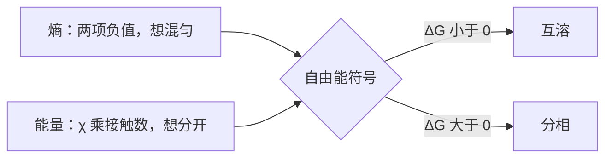

---
tags:
  - 化学
  - 高分子物理
  - 软物质
  - 统计力学
  - 标度理论
关联:
  - "[渗流框架：从凝胶点到冰共晶的隔间化](../生物学/渗流框架：从凝胶点到冰共晶的隔间化.md)"
  - "[无膜细胞器：没有膜的区室——相分离、凝聚体与细胞内的化学组织](../生物学/无膜细胞器：没有膜的区室——相分离、凝聚体与细胞内的化学组织.md)"
  - "[酚类：可逆的氧化——石炭酸、单宁与黑色素共享的一只羟基](酚类：可逆的氧化——石炭酸、单宁与黑色素共享的一只羟基.md)"
---

# θ 溶剂、良溶剂与分子标度指数：一根柔性链如何在溶剂里决定自己的形状

> **根节点**：同一根链、同样的化学组成，只换一种溶剂、或者只把温度改十几度，它的尺寸就能从 $N^{1/3}$ 变到 $N^{1}$；而且这些数字几乎不依赖「这是聚苯乙烯还是聚乙烯」——为什么一根链的形状，可以被一两个数字说完？
>
> **叙事逻辑**：变量与指数 → 溶剂三档 → Flory 推导 → θ 点的精确含义 → 塌缩球 → 怎么测 → 普适性从哪来 → 两个 ν 的撞名 → 跨学科征用 → 收束
>
> **立场说明**：以教材级结论（Flory、de Gennes、Rubinstein & Colby）与实验综述为主；指数数值给出适用范围与精度，凡属「模型依赖」「仍在争论」的内容会显式标注；数值演示使用理想化参数，只用于看数量级，不作为实测数据。
>
> **来源标注**：Flory《Principles of Polymer Chemistry》1953；de Gennes《Scaling Concepts in Polymer Physics》1979；Rubinstein & Colby《Polymer Physics》2003；Yu 等 2023 年《Nature》核孔原位测量；详见文末「参考来源」。整理时间：2026-11-18。

## 知识树

```txt
根节点：只换溶剂或只改温度，同一根链的尺寸为什么能从 N^(1/3) 变到 N^1？
│
├── 〇、锚点（先建立量级坐标）
│   ├── 数字锚点（ν = 1/3 / 1/2 / 0.588 / 1；a = 3ν − 1；χ = 1/2；θ = 34.5 °C）
│   └── 时间锚点（1938 Mark–Houwink → 1949 θ 温度 → 1972 n→0 → 2023 核孔）
│
├── 一、把一根链压成一个指数（变量与定义）
│   ├── 四个长度：轮廓长、端距、回转半径、持久长度
│   ├── ν 的定义：R ∝ N^ν，只管「链多长」，不管「链是什么」
│   └── 标度区：ν 只在长链极限成立
│
├── 二、溶剂的三档（先补熵的账，再谈好坏）
│   ├── 熵 = 排法数：一间教室的 10^29 种摆法
│   ├── 混合熵：M!/(N1!N2!) 到 R ln 2
│   ├── 平移熵：一条链只交一次停车费
│   ├── 迁移到 Flory：N = 1 时精确退回小分子公式
│   ├── χ 与第二维里系数 A₂：一条判据线
│   ├── 温度轴：UCST / LCST，θ 温度不是「某种液体」
│   └── 四档对照：良 / θ / 劣 / 棒
│
├── 三、Flory 的一招（3/5 是怎么来的）
│   ├── 两力平衡：熵弹性 vs 排斥能
│   ├── 通用式 ν = 3/(d+2)：d = 2 → 3/4，d = 3 → 3/5，d = 4 → 1/2
│   └── 为什么 0.6 比精确值 0.588 略大：平均场丢掉了涨落
│
├── 四、θ 点的精确含义（三个等价说法与四条误读）
│   ├── A₂ = 0 / χ = 1/2 / 尺寸回到 N^(1/2)
│   ├── 不是「没有相互作用」：二体抵消，三体主导，带对数修正
│   └── θ 点 ≠ 临界点：χ_c = ½(1 + N^(−1/2))²
│
├── 五、劣溶剂与塌缩球（ν = 1/3 的那一端）
│   ├── 表面张力 vs 熵弹性：塌缩球有确定密度
│   ├── 珍珠项链：局部塌缩串成的中间态
│   └── 生物学对应：球蛋白、凝聚体内部、变性剂梯度
│
├── 六、这些指数怎么测出来（五个实验入口）
│   ├── 黏度：Mark–Houwink，a = 3ν − 1
│   ├── 光散射与 DLS：R_g、A₂、D ∝ N^(−ν)
│   ├── SEC 普适校准：[η]M ∝ R³
│   └── SAXS/SANS、单分子 FRET、AFM
│
├── 七、普适性从哪来（自避行走与 n→0）
│   ├── 排除体积是一种「沿链传播」的相互作用
│   ├── de Gennes 1972：高分子 = O(n) 模型的 n→0 极限
│   └── θ 点 = 三临界点；普适类对照
│
├── 八、两个 ν 的撞名（最容易混的一处）
│   ├── 渗流的 ν：ξ ∝ |p − p_c|^(−ν)，3D ≈ 0.88
│   ├── 高分子的 ν：R ∝ N^ν，3D ≈ 0.588
│   └── 判定口诀：看横坐标是「链长」还是「离阈值的距离」
│
├── 九、被谁征用（工业、生物、配方）
│   ├── 工业：GPC 选溶剂、涂料增稠、聚合物刷、交联网络
│   ├── 生物：IDP、核孔 FG-Nup（ν = 0.56）、染色质、凝聚体
│   └── 配方：蛋白聚集、结晶、冻干保护
│
└── 十、收束（七条误读 / 归因 / 延伸 / 个体坐标）
    ├── 误读清单
    ├── 归因：长链把局部化学「平均掉」
    └── 个体坐标：读到 ν 先问三件事
```

## 〇、锚点：先建立量级坐标

在进入定义之前，先把全文要反复用到的数字和时间排成一张表。**这些数字不是装饰，它们是判断「一句话里的 ν 到底在说什么」的坐标**。

### 0.1 数字锚点

| 数字 | 含义 | 在本文的作用 |
|:---|:---|:---|
| $\nu = 1/3$ | 塌缩球的尺寸指数 | 劣溶剂端的上界 |
| $\nu = 1/2$ | 理想链、θ 状态 | 溶剂分档的基线 |
| $\nu = 0.588$ | 三维自避行走的精确值 | 良溶剂端的真值 |
| $\nu = 3/5 = 0.6$ | Flory 平均场结果 | 教科书常引用的近似值 |
| $\nu = 1$ | 完全伸直的刚性棒 | 上限 |
| $a = 3\nu - 1$ | 黏度指数 | 0.5（θ）/ 0.76（良）/ 约 1.8（棒） |
| $\chi = 1/2$ | 平均场下的 θ 判据 | 三档溶剂的开关位置 |
| $A_2 = 0$ | θ 点的实验定义 | 可测量的判据 |
| $N = 1000$ | 本文数值演示用的链长 | 看指数的数量级差别 |
| $0.56 \pm 0.03$ | 核孔 FG-Nup 的实测 ν | 生物体系实例 |
| 34.5 °C | 聚苯乙烯/环己烷的 θ 温度 | 经典 UCST 实例 |
| 约 32 °C | PNIPAM 水溶液的 LCST | 经典 LCST 实例 |

**这张表的读法**：先记住 1/3、1/2、0.588、1 这四个刻度，后面任何体系报出一个 ν，你都能立刻判断它落在哪一档附近。

### 0.2 时间锚点

| 时间 | 事件 | 为什么值得记 |
|:---|:---|:---|
| 1938–1940 | Mark 与 Houwink 给出 $[\eta]$–$M$ 幂律 | 最早的「指数」测量 |
| 1941–1942 | Flory 与 Huggins 各自给出格子模型 | $\chi$ 参数的来历 |
| 1949 | Flory 提出 θ 温度 | 溶剂分档出现分界线 |
| 1953 | Flory《Principles of Polymer Chemistry》 | 理论被教科书化 |
| 1956 | Zimm 模型处理流体力学相互作用 | 动力学指数有了框架 |
| 1967 | Benoit 等提出 SEC 普适校准 | 工业表征的基石 |
| 1972 | de Gennes 用 Wilson 方法算排除体积指数 | 标度理论正式进入高分子 |
| 1975 | Daoud 等用中子散射验证 | 实验跟上了理论 |
| 1978 | Lifshitz–Grosberg–Khokhlov 处理线圈–球转变 | 塌缩端有了理论 |
| 1982 | Nienhuis 给出二维 $\nu = 3/4$ 的精确值 | 标度理论的精确解样本 |
| 2023 | Yu 等测得核孔 FG-Nup 的 $\nu = 0.56$ | 生物体系实例 |
| 2024 | Yu 等续作称其为「细胞内类液态」 | 争论仍在延续 |

**这张表的读法**：高分子物理的「指数时代」起点在 1949 年的 θ 温度，终点在 1972 年的 n→0 之后——**前半段是化学家在做，后半段是统计场论在做**，这个分工一直延续到今天。

---

## 一、把一根链压成一个指数

### 1.1 四个长度，别混

一根高分子链有四个经常被混用的长度。它们的区别，是后面一切讨论的地基：

| 长度 | 符号 | 定义 | 典型量级 | 谁在测 |
|:---|:---|:---|:---|:---|
| 轮廓长度 | $L$ | 沿链走完的总长 $Nb$ | 微米量级 | 理论上算 |
| 端距 | $R$ | 两端点之间的直线距离 | 数十纳米 | 单分子实验 |
| 回转半径 | $R_g$ | 各单体到质心的均方根距离 | 数十纳米 | 光散射、SAXS |
| 持久长度 | $l_p$ | 方向关联衰减的特征长度 | 0.4 nm 到 50 nm | 散射、AFM |

> 📌 **Kuhn 段（Kuhn segment）**：把真实链粗粒化成一个「有效单体」，其长度 $b$ 叫 Kuhn 长度。蠕虫状链里 $b = 2l_p$。这个粗粒化是标度理论的第一步——**一旦链被换成 $N$ 个长度为 $b$ 的直棒，化学细节就被压缩掉了**。

> 📌 **回转半径（radius of gyration, $R_g$）**：散射实验直接测到的量，自由连接链满足 $R_g^2 = R^2/6$。文献里报「链的尺寸」时默认指 $R_g$，而不是端距。**读论文时要先确认报的是哪一个**，两者差 $\sqrt{6} \approx 2.45$ 倍。

这张表的收束：**持久长度决定「从多长的尺度开始，链才像一根柔性的线」**——DNA 的 $l_p \approx 50$ nm，所以质粒 DNA 在微米尺度上是柔性链，在 50 nm 尺度上却是硬棒。

### 1.2 一个幂律说完形状

> 📌 **分子标度指数（molecular scaling exponent, $\nu$）**：描述单根链尺寸随链长（分子量）增长的幂律指数。它把「一万个什么单体、什么序列」压缩成一个数字。本文用它作为判断溶剂质量的坐标。

$$
R \sim b\,N^{\nu}
$$

- **$R$**：链的尺寸（端距或回转半径的量级，nm）；
- **$b$**：Kuhn 段长度，即「有效单体」的尺寸；
- **$N$**：Kuhn 段的数目，正比于聚合度与分子量；
- **$\nu$**：分子标度指数——本文的主角；
- **$\sim$**：量级意义上的正比，忽略前置系数与有限链长修正。

**数值代入**：取 $b = 1$ nm、$N = 1000$，则

- 良溶剂（$\nu = 0.588$）：$R \approx 1000^{0.588} \approx 58$ nm；
- θ 溶剂（$\nu = 0.5$）：$R \approx 1000^{0.5} \approx 32$ nm；
- 劣溶剂（$\nu = 1/3$）：$R \approx 1000^{1/3} \approx 10$ nm。

**同一根链，只换溶剂，尺寸差 5.8 倍，体积差约 200 倍。**

再看链长变化的影响：

| 链长 $N$ | 良溶剂 $\nu = 0.588$ | θ 溶剂 $\nu = 0.5$ | 塌缩球 $\nu = 1/3$ |
|:---:|:---:|:---:|:---:|
| 100 | 15 nm | 10 nm | 4.6 nm |
| 1000 | 58 nm | 32 nm | 10 nm |
| 10000 | 225 nm | 100 nm | 21.5 nm |

**这张表的收束**：链长从 1000 增到 10000（10 倍），良溶剂里尺寸涨 3.9 倍，塌缩球只涨 2.15 倍。**指数只差 0.25，长链上就能差出一个数量级**——这就是为什么「指数」值得单独研究。

### 1.3 标度区：ν 只在长链极限成立

$R \sim bN^\nu$ 不是对任何链长都成立的定理，而是**渐近律**。它成立的范围叫**标度区（scaling regime）**：

- 链必须足够长，让 $N \gg 1$；
- 观察尺度必须大于 Kuhn 长度、小于整链尺寸；
- 有限链长会带来修正项，写成 $R^2 = b^2N\,(1 + \text{修正})$。

> ⚠️ **常见误读**：把 $\nu$ 当成材料的常数。$\nu$ 是**溶剂质量 + 温度 + 链长范围**共同决定的指数；短链、刚性链、带电荷的链都可能给出偏离 0.588 的表观值。

---

## 二、溶剂的三档：好、θ、坏

### 2.1 先讲一间教室：熵就是「排法数」

一间教室有 100 个座位，50 个座位牌是红色、50 个是蓝色。

- 要求「红牌全在左半边、蓝牌全在右半边」——只有 **1 种**摆法；
- 随便摆——有 $\binom{100}{50}\approx 1.0\times10^{29}$ 种摆法。

**「混着摆」比「分两边摆」多出约 $10^{29}$ 倍。** 所以只要没人管，教室一定变成混摆。不是因为红蓝互相吸引，而是因为**混合的排法更多**。

> 📌 **熵（entropy, $S$）**：体系「有多少种微观排法」的对数度量。它不是一种力，而是统计的结果。

$$S=k_B\ln W$$

- **$S$**：熵，单位 J/K；
- **$k_B=1.38\times10^{-23}$ J/K**：玻尔兹曼常数，把「排法数」换算成能量/温度的单位；
- **$W$**：微观排法数（微观状态数）；
- **$\ln$**：自然对数，可以理解成「把天文数字压成一个普通数」——$10^{29}$ 的 $\ln$ 只有约 67。

**数值代入**：$W=10^{29}$ 时，$S=1.38\times10^{-23}\times67\approx9.2\times10^{-22}$ J/K。这是 100 个分子的总熵，数量级极小；乘上阿伏伽德罗常数后才成为宏观量。

本节收束：**熵不推着分子跑，它只是数排法的结果**——分子随机乱走，而「混匀」的排法占压倒多数，于是看起来像被推着走。

### 2.2 混合熵：小分子的完整推导

> 📌 **混合熵（entropy of mixing）**：两种或多种组分混合时，因排法数增加而带来的熵增。

把 $M$ 个格子分给 $N_1$ 个 A 分子和 $N_2$ 个 B 分子，$M=N_1+N_2$。排法数是组合数：

$$W=\frac{M!}{N_1!\,N_2!}$$

- **$M!$**：$M$ 个格子的全排列；
- **$N_1!$**：同种 A 分子互换不算新排法，除掉；
- **$N_2!$**：同种 B 分子互换不算新排法，除掉。

取对数，并用斯特林近似 $\ln N!\approx N\ln N-N$：

$$\ln W=-N_1\ln\frac{N_1}{M}-N_2\ln\frac{N_2}{M}$$

于是

$$\Delta S_{\text{mix}}=-k_B\left(N_1\ln x_1+N_2\ln x_2\right)$$

- **$N_1,N_2$**：两种分子的个数；
- **$x_1=N_1/M,\ x_2=N_2/M$**：各自的分数；
- **负号**：因为 $\ln x<0$，所以 $\Delta S_{\text{mix}}>0$——混合总是让熵增加。

换成每摩尔：

$$\Delta S_{\text{mix}}=-R\left(n_1\ln x_1+n_2\ln x_2\right)$$

**数值代入**：等摩尔混合，$\Delta S=R\ln2\approx5.76$ J/(K·mol)；300 K 时 $T\Delta S\approx1.73$ kJ/mol。

**这里最重要的一点**：整个推导**没有用到任何能量**。即使 A–A、B–B、A–B 三种接触的能量完全相同，两种东西照样会混合——仅仅因为混合的排法更多。这就是「理想溶液」自发混合的全部原因。

### 2.3 平移熵：一条链只交一次「停车费」

> 📌 **平移熵（translational entropy）**：一个分子（或一整条链）作为整体，在空间里能放的位置数所带来的熵。

最直观的例子是气体膨胀：

$$\Delta S=nR\ln\frac{V_2}{V_1}$$

- **$n$**：摩尔数；
- **$R=8.31$ J/(K·mol)**：气体常数，等于 $N_Ak_B$；
- **$V_1,V_2$**：膨胀前后的体积。

**数值代入**：1 mol 气体体积翻倍，$\Delta S=R\ln2\approx5.76$ J/K；300 K 时 $T\Delta S\approx1.73$ kJ/mol。这就是「气体为什么自动充满容器」的定量版本。

日常画面：一滴墨水滴进水里散开，不是因为墨水「想」散开，而是**散开的排法比聚成一滴多得多**。

**高分子在这里有一个关键差别**：整条链只有一个质心。链的平移熵，就是「这个质心能停在哪些位置」。一条链不管多长，都只交一次「停车费」。

简化的计数如下。设 $M$ 个格点、$N_p$ 条不可区分的链，且把每条链看成一个整体：

$$W\sim\frac{M^{N_p}}{N_p!},\qquad \frac{S}{k_B}\sim N_p\ln\frac{M}{N_p}+N_p$$

- **$M^{N_p}$**：每条链的质心有 $M$ 个位可选；
- **$N_p!$**：同种链互换不算新排法；
- **$M/N_p$**：平均每条链分到的候选位置数。

因为 $N_p=\phi M/N$，所以 $M/N_p=N/\phi$，于是

$$\frac{S}{k_B}\sim N_p\ln\frac{1}{\phi}+N_p\ln N+\cdots$$

**与组成有关的只有 $N_p\ln(1/\phi)$ 这一项**——即每条链的平移熵约为 $k_B\ln(1/\phi)$，**与链长 $N$ 无关**。

> ⚠️ 这是平均场式的计数：严格推导还要乘上「链段不能重叠」的因子，它们会和溶剂项合并。**但组成依赖的领头项就是 $N_p\ln\phi$，这一点严格成立。**

小火车比喻：100 个独立的人，每人能在 100 个座位里任选；一列 100 节的小火车只能整体停，能停的位置只有少数几个。**所以链越长，同样的体积分数下链的条数越少，平移的总排法也越少。**

### 2.4 把混合熵完整迁移到 Flory–Huggins

现在把 2.2 的公式原样搬进高分子溶液。迁移只改两件事：**「溶质分子」换成「整条链」**，**「摩尔分数」换成「体积分数」**。

| 小分子混合 | 高分子溶液 | 迁移规则 |
|:---|:---|:---|
| $M$ 个格子 | $M$ 个格子 | 不变 |
| $N_1$ 个溶剂分子 | $N_s$ 个溶剂分子 | 每个占 1 格 |
| $N_2$ 个溶质分子 | $N_p$ 条链 | 「分子」换成「整条链」 |
| $x_1=N_1/M$ | $1-\phi$ | 分数照旧，改用体积分数 |
| $x_2=N_2/M$ | $\phi$ | 同上 |
| $-k_B(N_1\ln x_1+N_2\ln x_2)$ | $-k_B\left[N_s\ln(1-\phi)+N_p\ln\phi\right]$ | 形式完全不变 |
| 每条溶质的熵 | 每条链 $-k_B\ln\phi$（即 $k_B\ln(1/\phi)$，正值） | 链只算一次 |
| — | 除以 $M$ | 得到每格点形式 |

**这张表的收束**：小分子公式里的 $N_2$ 是「分子个数」，到高分子里换成「链的条数」；$x_2$ 换成体积分数 $\phi$。**形式一个字没改，只是把「分子」理解成「整条链」。**

因为 $N_p/M=\phi/N$、$N_s/M=1-\phi$，除以 $M$ 后得到每格点的混合熵：

$$\frac{\Delta S_{\text{mix}}}{k_B}=-\left[\frac{\phi}{N}\ln\phi+(1-\phi)\ln(1-\phi)\right]$$

**注意符号**：方括号里两项都是负的，前面再乘一个负号，熵才是正的。**同一个方括号在 $\Delta G$ 里以正号出现**，因为自由能里装的是 $-T\Delta S$。

**两个自洽检验**：

- **$N=1$**：第一项变成 $\phi\ln\phi$，整条式子精确退化成 2.2 的小分子公式——**这说明迁移没有丢东西**；
- **$N\to\infty$**：第一项趋于 0，只剩溶剂项——**高分子「不参与」混合熵，熵只剩一半的发言权**。

接下来补能量项。随机混合下，异类接触的概率是 $2\phi(1-\phi)$，最近邻对总数是 $zM/2$，所以异类对数约为 $zM\phi(1-\phi)$。每个异类接触多花 $\Delta\varepsilon$，于是每格点：

$$\frac{\Delta U}{k_BT}=\frac{z\Delta\varepsilon}{k_BT}\,\phi(1-\phi)\equiv\chi\,\phi(1-\phi)$$

- **$z$**：配位数（简立方 $z=6$）；
- **$\Delta\varepsilon$**：异类接触相对同类接触的能量差；
- **$\chi\equiv z\Delta\varepsilon/(k_BT)$**：每个接触对的净相互作用。

**数值代入**：$z=6$、$\Delta\varepsilon=0.083\,k_BT$，则 $\chi\approx0.5$——正好是 θ 点。**每个邻居只差 0.08 $k_BT$，六个邻居加起来就够把体系推到 θ。**

两项相加，得到完整的 Flory–Huggins 式：

$$\frac{\Delta G_{\text{mix}}}{k_BT}=\frac{\phi}{N}\ln\phi+(1-\phi)\ln(1-\phi)+\chi\,\phi(1-\phi)$$

- **$\Delta G_{\text{mix}}$**：混合自由能；
- **$\phi$**：高分子的体积分数（0 到 1）；
- **$N$**：一条链占的格子数，正比于分子量；
- **$\chi$**：每个接触对的净相互作用（以 $k_BT$ 为单位）；
- **第一项**：高分子的平移熵，被 $1/N$ 削弱；
- **第二项**：溶剂的混合熵；
- **第三项**：接触的「电费」，$\chi>0$ 表示「同类相吸、异类相厌」。

**整条式子的画面是一场拔河**：



**按每条链算，为什么链越长越容易分相**：

| 量 | $N=1000$ 的链 | $N=1$ 的小分子 |
|:---|:---:|:---:|
| 平移熵（想混） | $2.3\,k_BT$ | $2.3\,k_BT$ |
| $\chi$ 从 0.5 增到 0.6 的接触能（想分） | $9\,k_BT$ | $0.009\,k_BT$ |
| 谁赢 | 能量赢，分相 | 熵赢，不分相 |

**这张表的收束**：同样是 $\chi$ 变化 0.1，小分子根本不在乎，高分子却直接分相——**这就是为什么高分子溶液稍微降温就浑浊**。

> ⚠️ 一个容易漏掉的前提：Flory–Huggins 假设「链的形状不随浓度改变」，所以链的**构象熵**在混合前后互相抵消，只剩**平移熵**。真实体系里链会溶胀或收缩，这一项就不再完全抵消——这正是后来的修正方向。

### 2.5 χ 与第二维里系数 A₂：一条判据线

溶剂「好不好」，本质是**链段–链段接触 vs 链段–溶剂接触谁更划算**；上一节的 $\chi$ 就是这件事的单一参数。

> 📌 **Flory–Huggins 参数（$\chi$）**：无量纲的相互作用参数，正值表示高分子与溶剂「互相讨厌」。它是本文三档溶剂的总开关，也是 [无膜细胞器：没有膜的区室——相分离、凝聚体与细胞内的化学组织](../生物学/无膜细胞器：没有膜的区室——相分离、凝聚体与细胞内的化学组织.md) 里判断相分离的同一个 χ。

实验上不直接测 χ，而测**第二维里系数**：

$$
A_2 = \frac{\bar v^2}{V_1}\left(\frac{1}{2} - \chi\right)
$$

- **$A_2$**：第二维里系数，稀溶液渗透压展开的第二项系数；
- **$\bar v$**：高分子的偏比容（单位质量的体积）；
- **$V_1$**：溶剂的摩尔体积；
- **$\left(\tfrac{1}{2} - \chi\right)$**：判据本身——它的符号就是溶剂档位。

**数值代入**：$\chi = 0.4 \Rightarrow A_2 > 0$（良溶剂）；$\chi = 0.5 \Rightarrow A_2 = 0$（θ 溶剂）；$\chi = 0.6 \Rightarrow A_2 < 0$（劣溶剂）。$A_2$ 的常见量级是 $10^{-4} \sim 10^{-3}\ \mathrm{mL\cdot mol/g^2}$，符号比数值更重要。

> 📌 **第二维里系数（second virial coefficient, $A_2$）**：描述「两团高分子彼此是排斥还是吸引」的系数。$A_2 > 0$ 排斥、$A_2 = 0$ 无净作用、$A_2 < 0$ 吸引。**它是 θ 点最硬的实验定义**：θ 温度就是 $A_2 = 0$ 的那个温度。

这条判据线的收束：**χ、$A_2$、ν 是同一件事的三种说法**——理论用 χ，实验用 $A_2$，构象用 ν。

### 2.6 温度轴：UCST 与 LCST

χ 随温度变化，所以「溶剂好不好」可以由温度调：

| 类型 | 升温的效果 | 经典体系 | θ 的位置 |
|:---|:---|:---|:---|
| **UCST**（上临界溶解温度） | χ 减小，溶剂变好 | 聚苯乙烯/环己烷 | 34.5 °C |
| **LCST**（下临界溶解温度） | χ 增大，溶剂变差 | PNIPAM/水 | 约 32 °C |

- **UCST 体系**：低于 θ 温度时链塌缩、体系分相；高于 θ 温度时是良溶剂。聚苯乙烯在环己烷里 34.5 °C 以上舒展、以下收缩。
- **LCST 体系**：反过来。聚（N-异丙基丙烯酰胺）PNIPAM 在水里低于约 32 °C 是良溶剂，加热到 32 °C 以上链突然塌缩——这是温敏水凝胶与药物释放的物理基础。

> 📌 **θ 温度（theta temperature，又称 Flory 温度）**：使 $A_2 = 0$ 的温度。**它不是「某种液体的属性」，而是「某溶剂 + 某高分子 + 某压力」共同定义的一个状态点**。同一个溶剂对不同高分子有不同的 θ 温度；同一对溶剂/高分子改变压力也能移动 θ。

这张表的收束：**「良溶剂」和「劣溶剂」不是两种液体，而是同一个体系在不同温度下的两个区间**——这就是为什么温度改十几度，链的尺寸能变一倍以上。

### 2.7 四档总表

把三档溶剂加一个「刚性棒」极限放在一起比较，才能看清 ν 的两端各自对应什么物理：

| 维度 | 良溶剂 | θ 溶剂 | 劣溶剂 | 刚性棒 |
|:---|:---|:---|:---|:---|
| $\chi$ | $< 1/2$ | $= 1/2$ | $> 1/2$ | — |
| $A_2$ | $> 0$ | $0$ | $< 0$ | — |
| $\nu$ | 0.588 | 0.5 | 1/3 | 1 |
| 分形维数 $d_f = 1/\nu$ | 1.70 | 2 | 3 | 1 |
| 构象 | 溶胀线团 | 理想线团 | 塌缩球 | 直棒 |
| 黏度指数 $a$ | 0.76–0.8 | 0.5 | 低于 0.5 | 约 1.8 |
| 典型体系 | 聚苯乙烯/甲苯 | 聚苯乙烯/环己烷 34.5 °C | 聚苯乙烯/环己烷 25 °C | 双螺旋 DNA、芳纶 |

**这张表的收束**：最关键的一列不是 ν，而是**分形维数**——它把构象翻译成几何：$d_f = 2$ 是理想线团，$d_f = 3$ 是实心球，$d_f = 1.7$ 介于两者之间。**ν 描述「链有多占地方」，$d_f$ 描述「它占的地方有多像实体」。**

> 🔗 **横向关联**：本节用 χ 给溶剂分档，与 [无膜细胞器：没有膜的区室——相分离、凝聚体与细胞内的化学组织](../生物学/无膜细胞器：没有膜的区室——相分离、凝聚体与细胞内的化学组织.md) §2.2 的 Flory–Huggins 是**同一个参数的两个尺度**——那边用它判断「溶液会不会分成两相」，本文用它判断「单根链会不会溶胀」。**一个是集体行为，一个是单链行为；先把两者分开，再谈核孔与凝聚体才不会混。**

### 2.8 边界情形：共溶剂、盐、混合溶剂

三档模型之外还有几种常见边界：

- **共非溶剂（co-nonsolvency）**：两种良溶剂混在一起反而变成劣溶剂。经典例子是 PNIPAM 在甲醇–水混合体系中的塌缩——两种液体各自都能溶，混起来却不行。
- **盐析与盐溶**：Hofmeister 序列的离子会改变水的结构，从而移动 χ；这是蛋白质盐析沉淀的物理基础之一。
- **混合溶剂调 θ**：二元溶剂改变组成就能连续调 χ，方便在实验中「扫过」θ 点。

**这一小节的收束**：θ 点不是只有温度一个旋钮；**组成、压力、盐浓度都可以把体系推过同一条判据线**。

---

## 三、Flory 的一招

### 3.1 两力平衡

Flory 的推导只有一项核心思想：**链的尺寸由两个自由能竞争决定**——熵弹性想把链收成无规线团，排斥能想把链撑开。

$$
F(R) \sim k_BT\,\frac{R^2}{Nb^2} + k_BT\,\frac{vN^2}{R^3}
$$

- **$F$**：链的自由能；
- **$k_BT$**：热能量纲；
- **第一项**：熵弹性。把无规线团拉到尺寸 $R$ 的构象熵代价，$R^2/(Nb^2)$ 是「拉伸参数的平方」；
- **第二项**：排斥能。$N/R^3$ 是链内单体浓度，$N \cdot (N/R^3)$ 是接触对数，$v$ 是每个接触对的排除体积；
- **$v$**：排除体积（单位体积），量级上 $v \sim b^3(1 - 2\chi)$。**θ 点就是 $v = 0$**。

对 $R$ 求极值：

$$
\frac{\partial F}{\partial R} = 0
\;\Rightarrow\;
\frac{2R}{Nb^2} = \frac{3vN^2}{R^4}
\;\Rightarrow\;
R^5 \sim v\,b^2N^3
\;\Rightarrow\;
R \sim N^{3/5}\,v^{1/5}\,b^{2/5}
$$

**数值代入**：若 $v = b^3$，则 $R \sim bN^{0.6}$；若排除体积小 10 倍（$v = 0.1b^3$），尺寸只降到 $0.1^{1/5} \approx 0.63$ 倍。**排除体积变 10 倍，ν 几乎不动**——这就是为什么 0.588 和 0.6 这么接近，也是为什么「溶剂质量」是一个连续旋钮而不是开关。

> 📌 **排除体积（excluded volume）**：一根链不能穿过自己，等效于单体之间存在排斥。它和普通溶液里的二体相互作用不同——**它沿着链传播**：一个单体排斥另一个单体，而链的连通性把这种排斥累积成整条链的溶胀。

### 3.2 通用维度：ν = 3/(d+2)

把 $R^3$ 换成 $R^d$，同样的推导给出 Flory 公式：

$$
\nu = \frac{3}{d+2}
$$

| 空间维数 $d$ | Flory 预测 | 精确值或数值 | 状态 |
|:---:|:---:|:---:|:---|
| 1 | 1 | 1 | 精确 |
| 2 | 3/4 = 0.75 | 0.75 | 精确（Nienhuis 1982） |
| 3 | 0.6 | 0.5876 | 近似，偏高约 2% |
| 4 | 0.5 | 0.5 | 精确（上临界维数） |

**这张表的收束**：Flory 公式在 $d = 1, 2, 4$ 都是精确的，**唯独在我们生活的 $d = 3$ 有 2% 的偏差**——这是一个著名的巧合，也是后面「重整化群」出场的理由。

### 3.3 0.6 与 0.588：平均场丢掉了什么

Flory 的推导里有一个隐含假设：**链内的单体浓度是均匀的 $N/R^3$**。真实链不是均匀的：

- 链内部有大大小小的「孔洞」，局部浓度低于平均值；
- 单体之间存在关联，浓度涨落不能用平均值代替；
- 这些涨落让链比 Flory 预测的更紧一点。

所以 $\nu$ 从 0.6 修正到 0.5876。**2% 的差别在单链上很小，但它是「平均场不是终点」的第一个证据**，也预告了 de Gennes 的登场。

---

## 四、θ 点的精确含义

### 4.1 三个等价说法

同一个 θ 点有三种说法，分别对应理论、实验、构象：

1. **实验说法**：第二维里系数 $A_2 = 0$；
2. **理论说法**（平均场、$N \to \infty$）：$\chi = 1/2$；
3. **构象说法**：尺寸回到 $R \propto N^{1/2}$，与理想链相同。

三种说法互相翻译，就得到本文最实用的一句话：**θ 状态 = 「链不胀不缩」的状态**。

### 4.2 θ 不是「没有相互作用」

这是最容易误解的一点。θ 点的意思是**二体排斥恰好被二体吸引抵消**，不是所有相互作用都消失：

- 二体项为零；
- 三体排斥仍在，它阻止链继续塌缩；
- 因此 θ 点的尺寸不是严格的 $N^{1/2}$，而是带**对数修正**（三维恰好是三临界点的上临界维数，修正为 $\ln N$ 的幂）。

> 📌 **理想链（ideal chain）**：忽略排除体积的链模型，等价于随机行走，$R \propto N^{1/2}$。θ 溶剂里的真实链「近似」是理想链——**近似，不是相等**。

一个类比：理想气体不是「没有分子」，而是「没有分子间相互作用」；θ 溶剂不是「没有溶剂效应」，而是「二体效应恰好抵消」。

### 4.3 θ 点不是临界点

这两个概念经常被合并，但它们在有限链长下并不重合。Flory–Huggins 的临界点为

$$
\chi_c = \frac{1}{2}\left(1 + N^{-1/2}\right)^2
$$

- **$\chi_c$**：相分离的临界相互作用参数；
- **$N$**：链长（格子数）；
- **$N^{-1/2}$**：有限链长的修正项。

**数值代入**：$N = 100$ 时 $\chi_c \approx 0.605$；$N = 1000$ 时 $\chi_c \approx 0.532$；$N \to \infty$ 时 $\chi_c \to 0.5$。

**这张表的收束**：θ 点（$\chi = 0.5$）与相分离临界点只在 $N \to \infty$ 时重合。对 UCST 体系，有限链的临界温度略低于 θ 温度——**「链变成理想链」和「溶液开始分相」是两件事，先后差一点点**。

### 4.4 四条常见误读

| 误读 | 实际情况 |
|:---|:---|
| θ 溶剂是最差的溶剂 | 比 θ 更差的是劣溶剂，链会塌缩成球 |
| θ 溶剂不溶解高分子 | 单链仍溶解，只是构象理想；分相是另一回事 |
| θ 是溶剂的性质 | θ 是「溶剂 + 高分子 + 温度 + 压力」共同定义的状态 |
| θ 时没有相互作用 | 二体抵消，三体仍在，还有对数修正 |

**这张表的收束**：四条误读的共同根源，是把 θ 当成一个「点」而不是一个「条件」——**θ 不是溶剂的名字，是体系的状态**。

---

## 五、劣溶剂与塌缩球

### 5.1 表面张力 vs 熵弹性

当 $\chi > 1/2$，二体吸引占优，链开始收缩。收缩到一定程度后，**表面张力**接管：链想把表面积缩到最小，因为界面上的单体接触溶剂不划算。

结果是一个**塌缩球（globule）**：

$$
R \sim N^{1/3}
$$

此时球内密度近似与 $N$ 无关，接近熔体或纯液体。三种状态的内部浓度可以写成 $\phi \sim N/R^3 \sim N^{1-3\nu}$：

| 状态 | 主导项 | $R$ 的标度 | 内部浓度 $\phi$ 的标度 |
|:---|:---|:---|:---|
| 良溶剂 | 二体排斥 | $N^{0.588}$ | $N^{-0.76}$ |
| θ 溶剂 | 二体抵消 | $N^{0.5}$ | $N^{-0.5}$ |
| 劣溶剂 | 表面张力 | $N^{0.33}$ | $N^{0}$（近似熔体） |

**这张表的收束**：**塌缩球是唯一有「确定密度」的状态**——所以蛋白质的天然态、凝聚体内部的链段、以及被压缩的染色质，都更适合用塌缩球的语言描述，而不是线团。

### 5.2 塌缩过程中的间态：珍珠项链

真实链不是均匀的。带疏水嵌段、带电嵌段或两亲性序列的链，在劣溶剂里不会一次性缩成均匀小球，而是先形成**局部塌缩的珠子，再用伸展的链段串起来**——这就是「珍珠项链（pearl-necklace）」构象。


**这张图的收束**：**单链塌缩与多链聚集是两条不同的路**——塌缩是链内的事，沉淀是链间的事。生物学里前者对应蛋白折叠，后者对应淀粉样聚集。

### 5.3 生物体系里的三档

生物学把这三档用得很直接：

- **变性剂梯度**：盐酸胍（GuHCl）或尿素从 0 增到 6 M，相当于把溶剂从「劣」推到「良」，蛋白从天然态（塌缩球）逐步展开成线团（$\nu \approx 0.6$）。
- **内在无序蛋白（IDP）**：在生理条件下就停留在中间档，$\nu$ 常见于 0.4–0.6，既不完全塌缩也不完全舒展。
- **凝聚体内部**：相分离形成的液滴里，链段密度高、接触多，局部更接近 θ 或劣溶剂一侧。

> 🔗 **横向关联**：本节说的「单链塌缩」与 [无膜细胞器：没有膜的区室——相分离、凝聚体与细胞内的化学组织](../生物学/无膜细胞器：没有膜的区室——相分离、凝聚体与细胞内的化学组织.md) §9.1 的「液滴 → 凝胶 → 淀粉样」形成**上下游关系**——**本文解释单根链在坏溶剂里怎么缩，那边解释一群链在一起怎么从液态走向固态**。两层之间用同一个 χ，但一个是单链构象，一个是集体相变。

---

## 六、这些指数怎么测出来

### 6.1 黏度：最便宜的 ν 计

毛细管黏度计测的是**特性黏度** $[\eta]$，它与分子量的关系是 Mark–Houwink 方程：

$$
[\eta] = K M^{a}, \qquad a = 3\nu - 1
$$

- **$[\eta]$**：特性黏度，单位浓度对溶液黏度贡献的外推值（mL/g）；
- **$K$**：与体系有关的常数；
- **$M$**：分子量；
- **$a$**：Mark–Houwink 指数；
- **$3\nu - 1$**：由 $[\eta] \sim R^3/M$ 与 $R \sim N^{\nu}$ 得到。

**数值代入**：同一 $K$ 下，$M = 10^6$ 时 $a = 0.764$ 与 $a = 0.5$ 的比值是 $10^{6 \times 0.264} \approx 38$ 倍；$M = 10^4$ 时只有约 11 倍。**分子量越大，指数差别越明显**——所以黏度法测 ν 要选高分子量样品。

三种典型值：θ 溶剂 $a = 0.5$；良溶剂 $a \approx 0.76$；刚性棒 $a \approx 1.8$。

### 6.2 光散射与 DLS

- **静态光散射**：直接给出 $R_g$ 与 $A_2$；把不同分子量的 $R_g$ 对 $M$ 作双对数图，斜率就是 ν。
- **动态光散射（DLS）**：测扩散系数 $D$，由 Stokes–Einstein 关系

$$
D = \frac{k_BT}{6\pi\eta R_h}
$$

- **$D$**：扩散系数；
- **$k_BT$**：热能量纲；
- **$\eta$**：溶剂黏度；
- **$R_h$**：流体力学半径。

**数值代入**：良溶剂里链长增 10 倍，$D$ 降 $10^{0.588} \approx 3.9$ 倍；θ 溶剂降 3.2 倍；塌缩球只降 2.15 倍。

**DLS 还送一个形状判据**：$R_g/R_h$ 的比值——硬球约 0.78，柔性线团约 1.5，刚性棒远大于 2。**测了尺寸顺手就能判断「它像球还是像线」**。

### 6.3 SEC 普适校准

体积排阻色谱（SEC/GPC）按**流体力学体积**分离，而不是按分子量分离。Benoit 等提出「普适校准」：不同高分子在同一根柱子上，只要 $[\eta]M$ 相同，就在同一保留体积出峰。

而 $[\eta]M \sim R^3$，所以**普适校准本质上是拿黏度指数去换构象体积**。这也是为什么 GPC 选溶剂不是随便选：良溶剂让链舒展、减少吸附；θ 溶剂则用于测「无扰尺寸」。

### 6.4 散射、单分子与成像

- **SAXS/SANS**：测 $R_g$ 与形状因子，适合溶液与软物质；
- **单分子 FRET**：直接测单条链的距离分布，能抓到系综平均看不到的构象分布；
- **AFM/电子显微**：看单个分子的形态，但要注意吸附对构象的改变。

### 6.5 方法总表与三个陷阱

| 方法 | 测什么 | 怎么得到 ν | 主要陷阱 |
|:---|:---|:---|:---|
| 毛细管黏度 | $[\eta]$ | $a = 3\nu - 1$ | 必须外推到零浓度 |
| 静态光散射 | $R_g$、$A_2$ | $R_g$ 对 $M$ 的斜率 | 除尘不彻底会被聚集体主导 |
| 动态光散射 | $R_h$、$D$ | $D$ 对 $M$ 的斜率 | 多分散与多次散射 |
| SAXS/SANS | $R_g$、形状因子 | 绝对强度拟合 | 需要对比匹配 |
| SEC/GPC | 分子量分布 | 普适校准 | 依赖溶剂与柱效 |
| 单分子 FRET | 单链距离 | 距离分布拟合 | 统计量少、标记干扰 |

**这张表的收束**：三个最常踩的坑是**多分散、聚集、剪切**——它们都会让「表观 ν」偏离真值，而且偏的方向不一定相同。**报 ν 时必须同时报分子量范围与误差**，否则这个数字没有意义。

---

## 七、普适性从哪来

### 7.1 排除体积是一种「沿链传播」的相互作用

普通溶液里的二体相互作用是局部的；排除体积不是。**一个单体排斥另一个单体，而这种排斥沿着链的连接累积**，最终表现为整条链的溶胀。

正因为它是「累积」的，结果才不依赖单体的化学细节，只依赖链的拓扑与维度。**这就是普适性的第一层来源**。

### 7.2 de Gennes 的 n→0：高分子就是临界现象

1972 年，de Gennes 用 Wilson 的重整化群方法计算排除体积指数，发现了一件深刻的事：

> **自避行走 = $O(n)$ 模型的 $n \to 0$ 极限。**

- $O(n)$ 模型是 $n$ 分量自旋的磁性模型；
- 取 $n \to 0$，自旋自由度消失，只剩下「图」的拓扑；
- 而自避行走正是一条不能自交的路径。

于是高分子链与临界现象建立了**字典**：

| 高分子语言 | 临界现象语言 |
|:---|:---|
| 链长 $N \to \infty$ | 温度趋近临界点 $T \to T_c$ |
| 链尺寸 $R$ | 关联长度 $\xi$ |
| 尺寸指数 $\nu$ | 关联长度指数 $\nu$ |
| θ 点 | 三临界点 |

**这张表的收束**：注意最后一行——**「同一个 ν」在这里是真的同一个数学对象**，但下一节要讲的渗流 ν 是另一个。**先记住这张字典，再去分辨哪些 ν 是同名同物、哪些只是同名。**

> 🔗 **横向关联**：本节 de Gennes 的 n→0 与 [渗流框架：从凝胶点到冰共晶的隔间化](../生物学/渗流框架：从凝胶点到冰共晶的隔间化.md) §4 第二阶段提到的「de Gennes 1976–1979《高分子物理中的标度概念》」是**同一套语言的两个应用**——那边用它描述凝胶网络在阈值附近的标度，本文用它描述单根链的溶胀。**同一个人、同一套数学，对象不同。**

### 7.3 θ 点 = 三临界点

θ 点在统计场论里有一个精确身份：**三临界点（tricritical point）**。

- 三个相（良溶剂相、两相区、塌缩相）在同一点交汇；
- 三临界点的**上临界维数是 3**；
- 所以在三维，平均场结果（ν = 1/2）只差一个对数修正。

这也解释了为什么 θ 点的 ν 是 0.5 而不是别的数：**它是三临界点的平均场值，恰好落在三维的上临界维数上**。

### 7.4 普适类对照

把几个常见模型的指数放在一起，能看出「普适类」的意思——**微观细节不同，指数相同**：

| 模型 | 序参量 | 上临界维数 | 三维 ν |
|:---|:---|:---:|:---:|
| Ising 模型 | 磁化强度 | 4 | 0.630 |
| 自避行走（$n \to 0$） | 链构象 | 4 | 0.588 |
| θ 点（三临界） | — | 3 | 0.5（带对数修正） |
| 渗流（$q \to 1$ Potts） | 连通概率 | 6 | 0.876 |

**这张表的收束**：**同样是「ν」，四个数字分别是四个不同模型的指数**。它们属于同一个数学家族（临界现象），但不是同一个普适类，**不能互相代用**。

---

## 八、两个 ν 的撞名

### 8.1 渗流的 ν

在渗流理论里，$\nu$ 描述**关联长度**在阈值附近如何发散：

$$
\xi \sim \lvert p - p_c\rvert^{-\nu}, \qquad \nu_{3D} \approx 0.876
$$

- **$\xi$**：关联长度，即「多大范围内还连成一片」；
- **$p$**：占据概率或交联程度；
- **$p_c$**：渗流阈值；
- **$\nu$**：关联长度指数。

它衡量的是「**靠近阈值时，涨落变得多大**」。

### 8.2 高分子的 ν

在高分子物理里，$\nu$ 描述**链尺寸**随链长如何增长：

$$
R \sim N^{\nu}, \qquad \nu_{3D} \approx 0.588
$$

它衡量的是「**链变长时，构象变得多舒展**」。

### 8.3 为什么会撞，以及怎么一眼分开

两者容易混，有三个原因：

1. **同一个字母**：都叫 ν，都写作 ν；
2. **同一套语言**：都来自临界现象与标度理论，都用「幂律 + 普适类」；
3. **确实有亲缘**：自避行走是 $O(n)$ 的 $n \to 0$，渗流是 Potts 的 $q \to 1$——同一个家族的不同成员。

但它们的**自变量不同**，这是最快的分辨方法：

| 维度 | 渗流的 ν | 高分子的 ν |
|:---|:---|:---|
| 定义 | $\xi \sim \lvert p - p_c\rvert^{-\nu}$ | $R \sim N^{\nu}$ |
| 自变量 | 离阈值的距离 | 链长（分子量） |
| 描述什么 | 关联长度发散 | 单链尺寸增长 |
| 三维值 | 0.876 | 0.588 |
| 上临界维数 | 6 | 4 |
| 普适类 | 渗流（$q \to 1$ Potts） | 自避行走（$n \to 0$） |

**这张表的收束**：**看横坐标**——横坐标是 $N$，就是高分子的 ν；横坐标是 $p - p_c$，就是渗流的 ν。**两个 0.88 和 0.59 不能互换，也不能平均。**

> 🔗 **横向关联**：本节与 [渗流框架：从凝胶点到冰共晶的隔间化](../生物学/渗流框架：从凝胶点到冰共晶的隔间化.md) §5.2 的指数表（$\beta \approx 0.41$、$\gamma \approx 1.8$、$\nu \approx 0.88$）以及 §6.4 的核孔测量形成**对照关系**——那边是**阈值附近**的普适标度，本文是**链长方向**的普适标度。**同一篇文献里两种 ν 同时出现，是最容易读错的地方。**

### 8.4 核孔那个 0.56 是哪一个

Yu 等 2023 在《Nature》测得核孔 FG-Nup 的 $\nu = 0.56 \pm 0.03$。这是**高分子的尺寸指数**，不是渗流的关联长度指数：

- 0.56 落在 θ（0.5）与良溶剂（0.588）之间，略偏 θ 一侧；
- 作者说的「near-critical」指**接近 θ 点或相边界**，不是接近渗流阈值；
- 它描述的是「FG 链在孔内有多舒展」，不是「FG 网络在多大范围内连通」。

**核孔当然也可以用渗流语言描述**（FG 网络的连通性、阈值两侧的凝胶/刷子模型），但那是另一个问题。**两套语言可以并存，前提是每次都说清楚「这个 ν 的横坐标是什么」。**

---

## 九、被谁征用

### 9.1 工业与材料

- **GPC/SEC 选溶剂**：良溶剂减少吸附与聚集，θ 溶剂用于测无扰尺寸；普适校准把 $[\eta]M$ 与分离体积连起来。
- **涂料与增稠剂**：聚合物刷、星形聚合物、缔合增稠剂都靠「链在什么溶剂里、有多舒展」来决定流变。
- **纤维与凝胶纺丝**：超高分子量聚乙烯的凝胶纺丝利用半稀溶液的缠结网络，溶剂质量直接影响可纺性。
- **热固性网络**：从线性链到交联网络是另一层物理。

> 🔗 **横向关联**：本节「线性链的构象」与 [酚类：可逆的氧化——石炭酸、单宁与黑色素共享的一只羟基](酚类：可逆的氧化——石炭酸、单宁与黑色素共享的一只羟基.md) §7.2 的酚醛树脂形成**上下游关系**——**那边讲酚与甲醛交联成三维网络，本文讲网络之前的单根链怎么在溶剂里伸展**。交联一旦发生，ν 的讨论就从「单链尺寸」切换到「网络溶胀」。

### 9.2 生物物理

- **内在无序蛋白（IDP）**：生理条件下 $\nu$ 常在 0.4–0.6，介于 θ 与良溶剂之间，序列的电荷与疏水图案决定它落在哪。
- **核孔 FG-Nup**：$\nu = 0.56 \pm 0.03$，接近 θ 条件，是「选择性屏障处在临界附近」的定量证据。
- **染色质**：不同构象模型给出的 $\nu$ 从 1/3（分形球）到 0.6（自避行走）不等，是当前争论的一部分。
- **生物凝聚体**：液滴内部的链段密度、client 的分配系数，都可以用溶剂质量与 χ 的语言描述。

### 9.3 配方与制药

- **高浓度蛋白制剂**：$A_2$ 与排除体积决定黏度与聚集倾向，是皮下注射制剂的核心参数。
- **蛋白结晶**：$A_2$ 的符号决定结晶驱动力；θ 附近往往是最容易长晶体的窗口。
- **冻干保护**：蔗糖、海藻糖通过玻璃化保护蛋白——**这不是 θ 概念，但用的是同一套「溶剂质量 + 相态」的语言**，读文献时要分清。

### 9.4 场景总表

| 场景 | 用到的概念 | 得到什么结论 |
|:---|:---|:---|
| GPC 表征 | $[\eta]$、普适校准 | 分子量与构象体积的换算 |
| 涂料流变 | 聚合物刷、半稀溶液 | 增稠与剪切变稀 |
| 蛋白制剂 | $A_2$、排除体积 | 黏度与聚集倾向 |
| 核孔屏障 | ν = 0.56、θ 条件 | 屏障处于临界附近 |
| 染色质折叠 | ν 的不同取值 | 构象模型的竞争 |
| 生物凝聚体 | χ、双节线 | 相分离与 client 分配 |

**这张表的收束**：同一个 ν，在工业里是「选溶剂的依据」，在生物里是「判断构象状态的证据」——**概念不变，问题的尺度变了**。

---

## 十、收束

### 10.1 七条误读

| # | 误读 | 纠正 |
|:---|:---|:---|
| 1 | ν 是材料的常数 | 它依赖溶剂、温度、链长范围 |
| 2 | θ 是最差的溶剂 | 更差的是劣溶剂，链会塌缩 |
| 3 | 良溶剂 = 溶解度高 | 良溶剂指 $A_2 > 0$，与溶解度不是一回事 |
| 4 | 0.6 是精确值 | 精确值约 0.588，0.6 是 Flory 平均场 |
| 5 | 两个 ν 可以互换 | 一个横坐标是 $N$，一个是 $p - p_c$ |
| 6 | 塌缩 = 沉淀 | 塌缩是链内，沉淀是链间 |
| 7 | 标度律对所有链长成立 | 只在标度区（长链极限）成立 |

**这张表的收束**：七条误读里，第 5 条最危险——**它不会让计算出错，只会让整段论证建立在一个错误的类比上**。

### 10.2 归因：为什么一个指数能管这么多体系

根本原因有三层：

1. **长链把局部化学平均掉了**：链一长，单体的具体化学只影响 $b$ 与前置系数，不影响指数；
2. **相关变量很少**：排除体积、维度、链长——三个变量就决定了构象的普适类；
3. **临界现象的数学是共享的**：自避行走、渗流、Ising 都在同一套重整化群框架里，指数由普适类决定，不由微观细节决定。

**一句话**：**ν 之所以普适，不是因为世界简单，而是因为「长链 + 排斥 + 维度」这三个条件把细节筛掉了。**

### 10.3 延伸：三个仍在动的方向

- **机器学习预测构象**：用序列直接预测 IDP 的 $\nu$ 与 $R_g$，正在挑战「序列 → 构象」的传统链条；
- **单分子测量**：FRET、AFM、纳米孔把系综平均拆成单链分布，暴露出「平均 ν」掩盖的异质性；
- **生物凝聚体**：把 θ 点、$A_2$、双节线带进细胞，正在改写「细胞里的溶剂」这个概念。

### 10.4 个体坐标：读到 ν 先问三件事

1. **横坐标是什么？** 是链长 $N$，还是离阈值的距离 $p - p_c$？
2. **体系在标度区吗？** 链够长吗？有没有刚性、电荷、多分散的干扰？
3. **误差与范围是多少？** 0.56 ± 0.03 与 0.588 的差别，可能小于测量误差，也可能真实存在——**没有误差棒的 ν 不是一个结论，只是一个数字**。

---

## 索引表

| # | 概念/事件 | 时间 | 类型 | 所属维度 | 横向关联笔记 | 重要性 |
|---|---------|------|------|---------|------------|--------|
| 1 | 分子标度指数 ν | — | 概念 | 一 | — | ⭐⭐⭐⭐⭐ |
| 2 | 回转半径 $R_g$ | — | 概念 | 一 | — | ⭐⭐⭐⭐ |
| 3 | 持久长度 $l_p$ | — | 概念 | 一 | — | ⭐⭐⭐ |
| 4 | Kuhn 段 | — | 概念 | 一 | — | ⭐⭐⭐⭐ |
| 5 | 标度区 | — | 概念 | 一 | — | ⭐⭐⭐ |
| 6 | 熵 $S=k_B\ln W$ | — | 概念 | 二 | — | ⭐⭐⭐⭐ |
| 7 | 混合熵 | — | 概念 | 二 | — | ⭐⭐⭐⭐⭐ |
| 8 | 平移熵 | — | 概念 | 二 | — | ⭐⭐⭐⭐⭐ |
| 9 | 格子模型 | — | 概念 | 二 | [无膜细胞器](../生物学/无膜细胞器：没有膜的区室——相分离、凝聚体与细胞内的化学组织.md) | ⭐⭐⭐⭐ |
| 10 | Flory–Huggins 参数 χ | 1941–1942 | 理论 | 二 | [无膜细胞器](../生物学/无膜细胞器：没有膜的区室——相分离、凝聚体与细胞内的化学组织.md) | ⭐⭐⭐⭐⭐ |
| 11 | 第二维里系数 $A_2$ | — | 概念 | 二 | — | ⭐⭐⭐⭐⭐ |
| 12 | θ 温度 | 1949 | 概念 | 二 | — | ⭐⭐⭐⭐⭐ |
| 13 | UCST / LCST | — | 概念 | 二 | — | ⭐⭐⭐⭐ |
| 14 | PNIPAM 温敏塌缩 | — | 实例 | 二 | — | ⭐⭐⭐ |
| 15 | 共非溶剂 | — | 概念 | 二 | — | ⭐⭐⭐ |
| 16 | 排除体积 | — | 概念 | 三 | — | ⭐⭐⭐⭐⭐ |
| 17 | Flory 公式 $\nu = 3/(d+2)$ | 1949 | 理论 | 三 | — | ⭐⭐⭐⭐⭐ |
| 18 | 平均场与涨落 | — | 概念 | 三 | — | ⭐⭐⭐⭐ |
| 19 | 三临界点 | — | 概念 | 四 | — | ⭐⭐⭐⭐ |
| 20 | 对数修正 | 1980s | 理论 | 四 | — | ⭐⭐⭐ |
| 21 | $\chi_c = \tfrac12(1+N^{-1/2})^2$ | — | 公式 | 四 | — | ⭐⭐⭐⭐ |
| 22 | 塌缩球 | — | 概念 | 五 | — | ⭐⭐⭐⭐ |
| 23 | 珍珠项链构象 | — | 概念 | 五 | — | ⭐⭐⭐ |
| 24 | 变性剂梯度 | — | 方法 | 五 | — | ⭐⭐⭐⭐ |
| 25 | Mark–Houwink 方程 | 1938–1940 | 公式 | 六 | — | ⭐⭐⭐⭐⭐ |
| 26 | Stokes–Einstein 关系 | — | 公式 | 六 | — | ⭐⭐⭐⭐ |
| 27 | SEC 普适校准 | 1967 | 方法 | 六 | — | ⭐⭐⭐ |
| 28 | 单分子 FRET | — | 方法 | 六 | — | ⭐⭐⭐ |
| 29 | de Gennes n→0 | 1972 | 理论 | 七 | [渗流框架](../生物学/渗流框架：从凝胶点到冰共晶的隔间化.md) | ⭐⭐⭐⭐⭐ |
| 30 | 自避行走 | — | 概念 | 七 | — | ⭐⭐⭐⭐⭐ |
| 31 | 普适类 | — | 概念 | 七 | — | ⭐⭐⭐⭐ |
| 32 | 渗流关联长度指数 | — | 概念 | 八 | [渗流框架](../生物学/渗流框架：从凝胶点到冰共晶的隔间化.md) | ⭐⭐⭐⭐⭐ |
| 33 | 核孔 FG-Nup ν = 0.56 | 2023 | 实验 | 八 | [渗流框架](../生物学/渗流框架：从凝胶点到冰共晶的隔间化.md) | ⭐⭐⭐⭐⭐ |
| 34 | IDP 的 ν | — | 实例 | 九 | [无膜细胞器](../生物学/无膜细胞器：没有膜的区室——相分离、凝聚体与细胞内的化学组织.md) | ⭐⭐⭐⭐ |
| 35 | 聚合物刷 | — | 概念 | 九 | [渗流框架](../生物学/渗流框架：从凝胶点到冰共晶的隔间化.md) | ⭐⭐⭐ |
| 36 | 酚醛树脂交联网络 | 1907 | 实例 | 九 | [酚类](酚类：可逆的氧化——石炭酸、单宁与黑色素共享的一只羟基.md) | ⭐⭐⭐ |

## 参考来源

1. Flory, P. J. *Principles of Polymer Chemistry*. Cornell University Press, 1953.（θ 温度、Flory 公式、格子模型的经典总结）
2. de Gennes, P.-G. *Scaling Concepts in Polymer Physics*. Cornell University Press, 1979.（标度理论的教科书）
3. de Gennes, P.-G. Exponents for the excluded volume problem as derived by the Wilson method. *Physics Letters A*, 1972, 38(5): 339–340.
4. Rubinstein, M.; Colby, R. H. *Polymer Physics*. Oxford University Press, 2003.（ν、黏度、光散射的教材级推导）
5. Doi, M.; Edwards, S. F. *The Theory of Polymer Dynamics*. Oxford University Press, 1986.（Zimm/Rouse 动力学）
6. Grosberg, A. Yu.; Khokhlov, A. R. *Statistical Physics of Macromolecules*. AIP Press, 1994.（标度与普适类）
7. Lifshitz, I. M.; Grosberg, A. Yu.; Khokhlov, A. R. Some problems of the statistical physics of polymer chains with volume interaction. *Reviews of Modern Physics*, 1978, 50(3): 683.
8. Daoud, M. et al. Solutions of flexible polymers: neutron experiments and interpretation. *Macromolecules*, 1975, 8(6): 804–818.
9. Nienhuis, B. Exact critical exponents of the O(n) model in two dimensions. *Physical Review Letters*, 1982, 49(15): 1062.
10. Flory, P. J. The configuration of real polymer chains. *Journal of Chemical Physics*, 1949, 17(3): 303–310.
11. Huggins, M. L. Solutions of long chain compounds. *Journal of Chemical Physics*, 1941, 9(5): 440.
12. Mark, H. Der feste Körper. *Zeitschrift für Elektrochemie*, 1938.（Mark–Houwink 关系的源头之一）
13. Benoit, H. et al. 关于 SEC 普适校准的原始工作，1967.（转引自 Rubinstein & Colby 与综述）
14. Yu, I. et al. Visualizing the disordered nuclear transport machinery in situ. *Nature*, 2023, 617: 162–169. doi:10.1038/s41586-023-05990-0.
15. Yu, I. et al. 核孔屏障的「细胞内类液态」后续工作，*Biophysical Journal*, 2024.（转引自 [渗流框架](../生物学/渗流框架：从凝胶点到冰共晶的隔间化.md) §6.4）
16. Schäfer, L. Excluded Volume and Theta Point. In: *Physical Properties of Polymers Handbook*, Springer, 2007.（指数与 θ 点的综述章节）
17. Heskins, M.; Guillet, J. E. Solution properties of poly(N-isopropylacrylamide). *Journal of Macromolecular Science: Part A*, 1968, 2(8): 1441–1455.（PNIPAM 的 LCST）
18. 用户提供材料：关于核孔 FG-Nup 与渗流框架的整理笔记，见 [渗流框架：从凝胶点到冰共晶的隔间化](../生物学/渗流框架：从凝胶点到冰共晶的隔间化.md)。
19. Schroeder, D. V. *An Introduction to Thermal Physics*. Addison-Wesley, 2000.（熵、斯特林近似与混合熵的入门推导）
