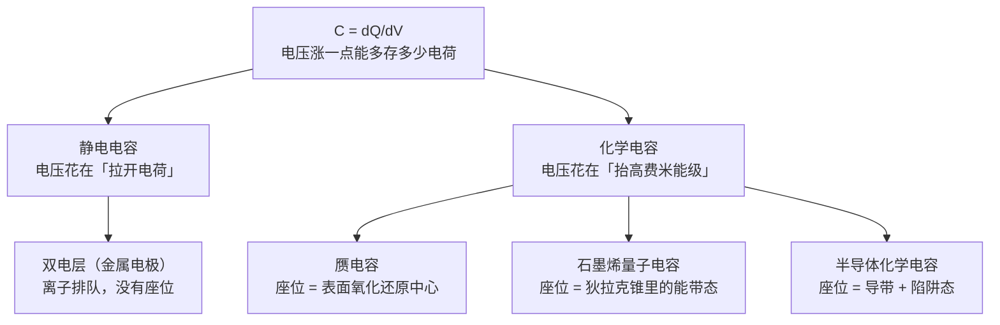

---
tags:
  - 化学
  - 电化学
  - 半导体
  - 储能
  - 物理化学
关联:
  - "[赝电容：一条 Nernst 曲线如何冒充电容](赝电容：一条 Nernst 曲线如何冒充电容——机制、判据与「假电容」的边界.md)"
  - "[Nernst方程：59 mV 的来历、三种写法与它失效的四道边界](Nernst方程：59 mV 的来历、三种写法与它失效的四道边界.md)"
  - "[水与膜上的自发电位：从冻结电势到化学渗透](水与膜上的自发电位：从冻结电势到化学渗透——电荷分离的三种手法与三层膜电位.md)"
  - "[醌类：芳香性的赎金](醌类：芳香性的赎金——呼吸链的心脏、染料母体与药毒同源的弹头.md)"
---

# 化学电容：四种电容的「座位表」——静电与化学的分水岭

> **根节点**：双电层、赝电容、石墨烯的量子电容、半导体的化学电容——四样东西从界面化学一路跨到半导体物理，凭什么都被叫作「电容」？它们的电压，究竟花在哪儿？

> **叙事逻辑**：地基（电容 / 电压的两种花销 / 化学势与态密度）→ 一个公式管四家 → 四个成员逐个解剖（双电层 / 赝电容 / 石墨烯量子电容 / 半导体化学电容）→ 一张总表与三条判据 → 收束

> **立场说明**：公式与教科书结论属于可查证内容；所有数值都写明了代入的假设，属于量级估算；「机理优势只有几倍」这类判断是由量级推算得到的分析，不是实验结论。

> **来源标注**：Bisquert 2003 关于化学电容（$\mu$-capacitance）的表述、Conway 1999 的赝电容专著、Bard & Faulkner 的《电化学方法》、Bockris & Reddy 的双电层章节、Xia 等 2009 的石墨烯量子电容测量；整理于 2026-11-19。

## 知识树

```txt
根节点：四种完全不同的东西，凭什么都叫「电容」？
│
├── 一、地基：把「电容」拆成两笔花销
│   ├── C = Q/V 与 C = dQ/dV（水缸的底面积）
│   ├── 电压的两种花法：拉开电荷 vs 塞进座位
│   └── 三个新词：化学势 / 费米能级 / 态密度
│
├── 二、一个公式管四家：Cμ = q²·dn/dμ = q²g(EF)
│   ├── 为什么是 q²
│   └── 两笔花销串联：1/C = 1/Ces + 1/Cμ
│
├── 三、双电层：唯一没有座位的电容
│   ├── 两排电荷隔层水
│   ├── C = εrε0A/d 与德拜长度
│   └── 为什么金属的化学电容可以忽略
│
├── 四、赝电容：座位是表面氧化还原中心
│   ├── 一排亮度不同的灯泡
│   ├── Langmuir → 钟形：C = n²F²Γx(1−x)/RT
│   └── 为什么叫「赝」：与电池的三条边界
│
├── 五、石墨烯量子电容：座位是狄拉克锥里的态
│   ├── 越往上越宽的喇叭
│   ├── CQ = e²D(EF)
│   └── 与双电层串联 → V 形曲线
│
├── 六、半导体化学电容：座位是导带与陷阱态
│   ├── 大厅水位 + 墙上钩子
│   ├── q²n/kBT 与 q²Ntf(1−f)/kBT
│   └── 单位陷阱：F/cm³ → F/cm²
│
├── 七、总表与三条判据
│   ├── 座位在哪 / 随电压怎么变 / 什么时候看得见
│   └── 五个常见混淆
│
└── 八、收束：电压降在哪一侧
    ├── 归因：静电看空间，化学看座位
    ├── 延伸：纳米半导体电极、石墨烯器件、术语治理
    └── 个体坐标：读到「电容」先问五件事
```

## 〇、锚点：先建立量级坐标

### 0.1 数字锚点

| 数字 | 含义 | 在本文中的作用 |
|---|---|---|
| **0.3–1 nm** | 双电层的厚度（紧密层 ≈ 0.3 nm，扩散层 ≈ 德拜长度） | 为什么双电层电容能到几十 μF/cm² |
| **0.304/√I nm** | 1:1 电解质、25 ℃ 的德拜长度（$I$ 为 mol/L） | 双电层厚度的估算式 |
| **10–40 μF/cm²** | 双电层的面电容（按真实面积） | 所有电容比较的基准线 |
| **≈30 μF/cm²** | 用 $\varepsilon_r=10$、$d=0.3$ nm 代入的结果 | 模型自洽的检验 |
| **96.5 μC/cm²** | 单层位点、每点 1 个电子的电荷密度 | 赝电容的机理天花板 |
| **0.94 mF/cm²** | 单层赝电容的峰值微分电容 | 比双电层大 20–90 倍（峰值） |
| **3–10 倍** | 同电压窗口下的电荷总量之比 | 拆穿「大 1000 倍」的叙事 |
| **90.7 mV** | 单一位点、单电子、25 ℃ 的峰半高宽 | 为什么真实材料的包更宽 |
| **2.7 μF/cm²** | 石墨烯在 $n=10^{12}$ cm⁻² 时的量子电容 | 与双电层同量级 |
| **0–10 μF/cm²** | 石墨烯量子电容的可调范围 | 狄拉克点处为 0 |
| **62 mF/cm³** | 半导体 $n=10^{16}$ cm⁻³ 的化学电容（体积量） | 乘厚度才是 F/cm² |
| **6.2 μF/cm²** | 上式乘 1 μm 厚度的结果 | 与双电层同量级 |
| **25.9 meV** | 室温的 $k_BT$ | 化学电容与亚阈值摆幅共同的分母 |
| **59.5 mV/decade** | MOSFET 亚阈值摆幅的热力学下限 | 同一个 $k_BT$ 的另一种刻度 |

### 0.2 时间锚点

| 年份 | 事件 | 为什么值得记 |
|---|---|---|
| **1879** | Helmholtz 提出平板型双电层模型 | 第一个「界面 = 电容器」的图像 |
| 1910 / 1913 | Gouy 与 Chapman 分别加入扩散层 | 双电层从一层变成两层 |
| 1924 | Stern 把紧密层与扩散层串联 | 现代双电层模型的骨架 |
| **1962–63** | Conway 与 Gileadi 提出赝电容的动力学理论 | 「吸附等温线的微分就是电容」 |
| 1971 | Trasatti 与 Buzzanca 报告 RuO₂ 的电容行为 | 第一个氧化物赝电容材料 |
| **2003** | Bisquert 把化学电容系统化为「$\mu$-capacitance」 | 让赝电容、量子电容、半导体电容共用一条公式 |
| 2004 | Novoselov 与 Geim 分离出单层石墨烯 | 狄拉克锥从理论走进实验室 |
| **2009** | Xia 等直接测得石墨烯的量子电容 | 化学电容第一次被「看见」V 形 |

### 0.3 图示导览

| 图 | 位置 | 一句话 |
|---|---|---|
| 分类树（Mermaid，无图号） | §一 | 两大家族、四个成员 |
| 串联等效（Mermaid，无图号） | §二 | 电压的两笔花销如何分账 |

## 一、地基：把「电容」拆成两笔花销

这一节只做一件事：把高中物理里的「电容」拆开，看看一个器件把电荷装进去时，**电压到底涨在哪儿**。四类电容的全部区别，都藏在这个问题的答案里。

### 1.1 电容是「水缸的底面积」

最基础的定义：

$$
C=\frac{Q}{V}
$$

- **$C$**：电容，单位法拉（F），1 F = 1 C/V；
- **$Q$**：一个极板上存了多少电荷（C）；
- **$V$**：两极之间的电压（V）。

**画面**：一个横截面积固定的水缸，每倒进一升水，水面就升高固定的一截。底面积越大，同样的水量升得越少——底面积就是电容。

但真实器件的水缸常常是**上宽下窄**的：水面越高，再涨一厘米需要的水越多。所以真正的定义要用微分：

$$
C=\frac{\mathrm{d}Q}{\mathrm{d}V}
$$

**「电压再涨 1 V，还能多存多少库仑」**——这一句话就是本篇的全部。

### 1.2 电压的两种花法

把电荷装进一个器件，能量可以花在两个完全不同的地方。

**（a）静电花法**：把正负电荷硬拉开。拉开要克服库仑引力做功，能量存在**电场**里。电压 = 电场做的功除以电荷。

**（b）化学花法**：把电子塞进材料里的一个「座位」。塞进去要付能量，这笔能量叫**化学势 $\mu$**；材料里电子海的「液面」叫**费米能级 $E_F$**。电压 = 每个电子的能量账单：

$$
V=\frac{\mu}{q}
$$

- **$q=1.602\times10^{-19}$ C**：一个电子（或质子）带的电荷量。

**为什么这条式子好用**：以「电子伏特（eV）」为能量单位时，1 eV 的账单正好对应 1 V。高中物理里的「电子伏特」，在这里就是电压与能量之间的汇率。

**两个对比例子**：

| 操作 | 电荷去了哪 | 电压花在哪 | 分类 |
|---|---|---|---|
| 给金属电极加负电 | 电子挤在金属表面，反离子排在溶液里 | 把两排电荷拉开 | **静电** |
| 把锂塞进石墨 | 电子进入碳层的能带态 | 抬高费米能级 | **化学** |

**收束句**：同一个「电容」，可以是弹簧（拉开电荷），也可以是剧院（塞进座位）。**先问电压花在哪，再谈电容多大。**

### 1.3 三个新词：化学势、费米能级、态密度

要读懂「化学花法」，只需要三个词。

**（a）化学势 $\mu$**：再往系统里放一个粒子，要付的自由能。**「票价」**。

**（b）费米能级 $E_F$**：电子版的化学势，可以想成**电子海的液面**——液面以下基本坐满，液面以上基本空着。

**（c）态密度 $g(E)$**：每单位体积、每单位能量有多少个**可以坐的座位**。

三者由费米–狄拉克分布连起来：

$$
f(E)=\frac{1}{1+\exp\!\left(\dfrac{E-E_F}{k_BT}\right)}
$$

- **$f(E)$**：能量为 $E$ 的座位被电子占据的概率（0–1）；
- **$k_B=1.381\times10^{-23}$ J/K**：玻尔兹曼常数；
- **$T$**：绝对温度（K）；
- **$k_BT$**：热噪声的「零钱」，室温约 **25.9 meV**。它决定费米能级附近多宽的一条带会被热「抹平」。

**一个关键直觉**：**电容的大小，就是「在当前票价附近，还有多少个空座位」。** 座位多的材料，稍微抬一点费米能级就能塞进一大把电子——电容大；座位少的材料，抬同样的高度只能塞进几个——电容小。**这就是化学电容的全部内容。**

### 1.4 座位表：这一篇的骨架

把四类电容排在一起，它们问的是同一个问题，答案却各不相同：



**收束句**：**静电电容看「空间」，化学电容看「座位」。** 下面四节逐个拆。

## 二、一个公式管四家

### 2.1 从 $Q=qn$ 与 $V=\mu/q$ 出发

化学电容的定义只有一行：

$$
C_\mu=q^2\frac{\mathrm{d}n}{\mathrm{d}\mu}=q^2g(E_F)
$$

推导只用两步：电荷 = 座位数 × 每个座位的电荷，$Q=qn$；电压 = 能量账单，$V=\mu/q$。于是

$$
C=\frac{\mathrm{d}Q}{\mathrm{d}V}
=\frac{q\,\mathrm{d}n}{\mathrm{d}\mu/q}
=q^2\frac{\mathrm{d}n}{\mathrm{d}\mu}
$$

**逐符号拆解**：

| 符号 | 含义 | 单位 |
|---|---|---|
| $C_\mu$ | 化学电容（下标 $\mu$ 来自化学势） | F/cm³（$n$ 为体密度）或 F/cm²（$n$ 为面密度） |
| $q$ | 元电荷，$1.602\times10^{-19}$ C | C |
| $n$ | 已经塞进去的载流子数密度 | 个/cm³ 或 个/cm² |
| $\mu$ | 化学势；对电子就是费米能级 $E_F$ | J（除以 $q$ 就是 V） |
| $\mathrm{d}n/\mathrm{d}\mu$ | 费米能级抬高 1 J 能多塞几个电子 | 个/J |
| $g(E_F)$ | 费米能级处的态密度（每单位体积、每单位能量的座位数） | 个/(cm³·J) |

**为什么是 $q^2$**：电荷 $Q=qn$ 贡献一个 $q$；电压 $V=\mu/q$ 在分母上又带来一个 $q$。两个 $q$ 相乘，就是公式里那个显眼的 $q^2$。**「电压是每库仑的能量账单」这句话，数学上就是这两个 $q$。**

### 2.2 两笔花销是串联的

真实器件里，两种花销同时存在：电压一部分掉在界面上（静电），一部分花在塞座位上（化学）。等效电路是两个电容**串联**：

$$
\frac{1}{C_{\text{总}}}=\frac{1}{C_{\rm es}}+\frac{1}{C_\mu}
$$


- **$C_{\rm es}$**：静电电容（electrostatic），由几何与介电常数决定；
- **$C_\mu$**：化学电容，由态密度决定。

**串联的规则是「谁小谁主导」**：两个电容串联，总电容小于任何一个，且接近更小的那一个。于是：

- 金属电极上 $C_\mu$ 很大（费米海很满），总电容 ≈ 双电层；
- 石墨烯上 $C_\mu$ 很小（狄拉克点附近几乎没有座位），总电容被它拖住——这就是 V 形曲线的来源。

**收束句**：**一个公式，两笔花销，谁难谁说话。** 下面四个成员，只是这条式子的四种代数值。

## 三、双电层：唯一没有「座位」的电容

### 3.1 画面：两排电荷隔着一层水

把一块金属插进盐水。金属表面的电子往表面挤（或被抽走），溶液里的 Na⁺、Cl⁻ 立刻排队靠过来。于是一排电子、一排离子，中间只隔着约 0.3 nm 的一层水分子——**这本身就是一个极板间距只有几个原子的平行板电容器**。

它没有「座位」，只有「排队」：电荷不坐在任何能级上，只是被库仑力拉开。

### 3.2 公式与参数

$$
C_{\rm dl}=\frac{\varepsilon_r\varepsilon_0 A}{d}
$$

- **$C_{\rm dl}$**：双电层电容（double layer）；
- **$\varepsilon_0=8.854\times10^{-12}$ F/m**：真空介电常数；
- **$\varepsilon_r$**：相对介电常数——把电场削弱多少倍。体相水是 80，但在电极强场下被压到 **6–30**（水分子被电场钉住，转不动了）；
- **$A$**：真实可润湿面积（多孔碳能到 1000 m²/g，这是「F/g 很大」的真正原因）；
- **$d$**：双电层厚度，量级 0.3–1 nm。

### 3.3 德拜长度：d 怎么估

盐水中，离子云把电场屏蔽掉的距离叫**德拜长度**：

$$
\lambda_D=\frac{0.304}{\sqrt{I}}\ \text{nm}
$$

- **$\lambda_D$**：德拜长度（nm）；
- **$I$**：离子强度（mol/L）。1:1 电解质、25 ℃ 时用这个式子；
- 数量级：1 mM 的稀盐水中约 10 nm；0.1 M 时约 1 nm；海水（约 0.5 M）不到 0.5 nm。

**严谨一点的说法**：真实双电层是「紧密层（Helmholtz，约 0.3 nm）+ 扩散层（约 $\lambda_D$）」两层串联：

$$
\frac{1}{C_{\rm dl}}=\frac{1}{C_{\rm H}}+\frac{1}{C_{\rm D}}
$$

- **$C_{\rm H}$**：紧密层电容（离子贴在电极表面）；
- **$C_{\rm D}$**：扩散层电容（离子云按浓度梯度铺开）。

盐越浓，扩散层越薄、$C_{\rm D}$ 越大，总电容越接近紧密层的上限。

### 3.4 为什么它可以被当成纯静电

因为容量只由 $A$、$d$、$\varepsilon_r$ 三个几何/介质量决定，**与费米能级高低无关**——所以 CV 是矩形，$C$ 与电位无关。

**一个必须交代的细节**：严格说，金属也有自己的化学电容 $C_Q=q^2g(E_F)$。但金属的费米海已经填到很满，这项通常被并入「双电层」一起处理、不单独命名。**「双电层 = 静电电容」是极好的近似，不是定义。**

> 🔗 **横向关联**：本节的 $\lambda_D=0.304/\sqrt I$ 与 [水与膜上的自发电位](水与膜上的自发电位：从冻结电势到化学渗透——电荷分离的三种手法与三层膜电位.md) 的「四层膜电位辨析」是**同一个几何的两种用途**——那篇用它算界面电位（10–100 mV），本篇用它算界面电容。**同一个德拜长度，一边出电压，一边出电容。**

### 3.5 基准线：10–40 μF/cm²

代入 $d\approx0.3$ nm、$\varepsilon_r\approx10$：

$$
\frac{C}{A}=\frac{10\times8.854\times10^{-12}}{0.3\times10^{-9}}
\approx0.295\ \mathrm{F/m^2}\approx30\ \mathrm{\mu F/cm^2}
$$

与实测的 10–40 μF/cm² 同量级。**这个数字几乎是电化学里最硬的一个常数**：所有「超高比电容」的宣传，最后都要和它算账。

**收束句**：双电层是四者中唯一的**静电**电容——容量看几何，不看座位；它也是其余三者的比较基准。

## 四、赝电容：座位是表面的氧化还原中心

### 4.1 画面：一排亮度不同的灯泡

电极表面的每个原子是一个**可以反复充电的座位**——比如 RuO₂ 里的 Ru，可以可逆地收一个电子加一个质子，从 +4 价变 +3 价再变回来。

关键在于：表面、次表面、缺陷旁、晶面拐角处的座位，**「收费」各不相同**。所以这些座位不是在同一电压上一起点亮，而是像一排亮度不同的灯泡，**一个接一个地亮**——电压连续上升，而不是跳一个平台。

### 4.2 从 Langmuir 到钟形

设表面有 $\Gamma$ 个位点（mol/cm²），已氧化的比例是 $x$。Langmuir 型平衡给出：

$$
\frac{x}{1-x}=\exp\!\left[\frac{nF(E-E^\circ)}{RT}\right]
$$

- **$x$**：已氧化的位点比例（0–1）；
- **$n$**：每个位点转移的电子数；
- **$F=96485$ C/mol**：法拉第常数；
- **$R=8.314$ J/(mol·K)**：气体常数；
- **$T$**：温度（K）；
- **$E^\circ$**：该位点的标准电位（V）。

求导后得到微分电容：

$$
C=\frac{\mathrm{d}Q}{\mathrm{d}E}=\frac{n^2F^2\Gamma}{RT}\,x(1-x)
$$

$$
C_{\max}=\frac{n^2F^2\Gamma}{4RT}
$$

- **$\Gamma$**：位点面密度（mol/cm²）——**座位有多少**；
- **$x(1-x)$**：抛物线因子，在 $x=1/2$ 时最大，两端趋零。

**画面**：$x(1-x)$ 是「半满时最容易再塞」的数学表达。空位太多时没人可氧化，塞满时又没地方可塞，**最舒服的是坐了一半的时候**。

### 4.3 同一件事，两种写法

把位点的「个数」面密度记作 $\Gamma_N$（个/cm²），则 $\Gamma_N=N_A\Gamma$，上面的式子可以改写成化学电容的标准形式：

$$
C=\frac{n^2F^2\Gamma}{RT}\,x(1-x)
=\frac{n^2q^2\Gamma_N}{k_BT}\,x(1-x)
$$

- **$N_A=6.022\times10^{23}$ mol⁻¹**：阿伏伽德罗常数；
- 两式完全等价：$F=N_Aq$、$RT=N_Ak_BT$。

**这正是「化学电容」这个词的用处**：它把赝电容和半导体电极、石墨烯放进同一个公式框架里。

### 4.4 为什么叫「赝」：三条边界

赝电容不是「假电容」，而是**本质是法拉第反应、外表却像电容**。三条硬边界（详见 [赝电容](赝电容：一条 Nernst 曲线如何冒充电容——机制、判据与「假电容」的边界.md) §一）：

| # | 边界 | 排除谁 |
|---|---|---|
| 1 | 有电子转移（法拉第） | 双电层 |
| 2 | 不涉及新相的形核与长大 | 电池 |
| 3 | $\mathrm{d}Q/\mathrm{d}V$ 有限且为正 | 电池（平台处 $C\to\infty$） |

**收束句**：它是**化学**电容，只是因为签名像电容才被叫作「赝」——**叫「赝」说的是测量结果，不是物理本质。**

### 4.5 数字

取 $\Gamma=10^{-9}$ mol/cm²、$n=1$、25 ℃：

$$
C_{\max}=\frac{1^2\times96485^2\times10^{-9}}{4\times8.314\times298}\approx0.94\ \mathrm{mF/cm^2}
$$

- 峰值电容：0.94 mF/cm²，是双电层的 20–90 倍；
- 但每个位点最多一个电子，**总量**是 $nF\Gamma=96.5$ μC/cm²；同电压窗口（按 1 V 算）下双电层能存 10–40 μC/cm²——**机理优势只有 3–10 倍**。

> 🔗 **横向关联**：本节的质子耦合与 [醌类](醌类：芳香性的赎金——呼吸链的心脏、染料母体与药毒同源的弹头.md) §4.2「质子耦合：−59 mV 的魔咒」形成定量对接——**醌的 $n=2$ 让峰高变 4 倍、峰宽变一半，同时 $E$ 随 pH 以 −59 mV/pH 平移。** 醌既是「最好的分子赝电容位点」，也是最敏感于环境的位点。

## 五、石墨烯量子电容：座位是狄拉克锥里的态

### 5.1 画面：越往上越宽的喇叭

石墨烯的电子能量与动量成**正比**（不是平方），能带是一个上下对顶的圆锥——**狄拉克锥**。锥尖（狄拉克点）附近几乎没有座位，越往上座位越密。

把电子灌进去，就像往一个**越往上越宽的喇叭**里倒水：水位（费米能级）越高，反而越好灌。

### 5.2 公式与参数

$$
D(E)=\frac{2\vert E\vert}{\pi\hbar^2v_F^2}
$$

$$
C_Q=e^2D(E_F)
=\frac{2e^2}{\pi(\hbar v_F)^2}\vert E_F\vert
=\frac{2e^2}{\hbar v_F}\sqrt{\frac{n}{\pi}}
$$

- **$C_Q$**：量子电容（quantum capacitance），单位 F/cm²；
- **$D(E)$**：态密度（每焦耳每平方米的座位数）；
- **$E$**：相对狄拉克点的能量；
- **$\hbar=1.055\times10^{-34}$ J·s**：约化普朗克常数；
- **$v_F\approx10^6$ m/s**：费米速度——石墨烯里的电子像「无质量的相对论粒子」，速度只有光速的 1/300；
- **$n$**：载流子面密度（m⁻²）；
- **$e$**：元电荷。

**为什么 $\vert E\vert$ 外面有绝对值**：狄拉克锥上下对称（电子与空穴），所以态密度只看离锥尖多远，不看在哪一侧。

### 5.3 数字与 V 形曲线

| $n$（cm⁻²） | $E_F$（eV） | $C_Q$（μF/cm²） |
|---|---|---|
| $10^{12}$ | 0.12 | 2.7 |
| $10^{13}$ | 0.37 | 8.7 |
| 狄拉克点 | 0 | 0 |

**为什么测出来是 V 形**：石墨烯电极的总电容是量子电容与双电层电容**串联**——

$$
\frac{1}{C}=\frac{1}{C_Q}+\frac{1}{C_{\rm dl}}
$$

在狄拉克点附近 $C_Q\to0$，把总电容拉到最低；离狄拉克点越远 $C_Q$ 越大，总电容回升。**一条纯量子力学的态密度，就这样直接画在了电化学测量上**（Xia 等 2009 首次直接测得）。

### 5.4 为什么叫「量子」

「量子」二字说的是**座位表来自量子力学的能带结构**——$D(E)$ 不是几何面积，而是薛定谔方程的解。按 $C_\mu=q^2g(E_F)$ 的定义，它**就是**化学电容的电子版：电压全部花在抬高费米能级上。

**收束句**：量子电容 = 「费米能级附近的座位密度」的直读仪；它把能带结构翻译成了法拉。

## 六、半导体化学电容：座位是导带与陷阱态

### 6.1 画面：大厅水位 + 墙上钩子

把半导体想成一栋楼：

- **导带**（conduction band）= 一楼大厅，电子可以自由走动；
- **陷阱态**（trap states）= 墙上的钩子，缺陷会把电子抓住不放；
- **费米能级** = 大厅里的水位。

加电压就是把水位往上抬：大厅里电子变多（$n$ 上升）；同时钩子一个一个被占满。

### 6.2 一般式与两种具体形式

一般式（对所有态成立）：

$$
C_\mu=q^2\int g(E)\left(-\frac{\partial f}{\partial E}\right)\mathrm{d}E
\quad\xrightarrow{T\to0}\quad q^2g(E_F)
$$

- **$g(E)$**：态密度（个/(cm³·J)）；
- **$f(E)$**：费米–狄拉克占据概率；
- **$-\partial f/\partial E$**：只有费米面附近约几个 $k_BT$ 宽的窗口「有变化」，其余座位非满即空，不贡献电容；
- **低温极限**：窗口缩成一条线，电容只剩费米面那一层。

两种最常见的形式：

$$
C_\mu=\frac{q^2n}{k_BT}\ \text{（导带自由电子）},
\qquad
C_t=\frac{q^2N_t\,f(1-f)}{k_BT}\ \text{（陷阱）}
$$

- **$n$**：导带电子浓度（cm⁻³）；
- **$N_t$**：陷阱态密度（cm⁻³）；
- **$f$**：陷阱被电子占据的概率（0–1）；
- **$f(1-f)$**：与赝电容的 $x(1-x)$ **是同一个抛物线**——半满时最容易再塞，塞满了就变硬。

### 6.3 单位陷阱：F/cm³ 还是 F/cm²

态密度是三维的，所以化学电容天然是**体积量 F/cm³**。要变成器件上的 F/cm²，必须乘厚度：

$$
C_{\rm areal}=C_\mu\times L
$$

- **$L$**：膜厚（cm）。

例：$n=10^{16}$ cm⁻³、$T=300$ K：

$$
C_\mu=\frac{(1.602\times10^{-19})^2\times10^{16}}{1.381\times10^{-23}\times300}
\approx62\ \mathrm{mF/cm^3}
$$

1 μm 厚的膜 → $62\ \mathrm{mF/cm^3}\times10^{-4}\ \mathrm{cm}\approx6.2\ \mathrm{\mu F/cm^2}$，与双电层同量级；但它会随偏压**指数式**变化。

**这就是为什么介孔半导体膜（染料敏化太阳能电池的 TiO₂、钙钛矿电池的电子传输层）能给出 mF/cm² 量级的化学电容**：真实面积被粗糙度放大，陷阱又贡献了一条额外的态密度。

### 6.4 与赝电容同构

把两节的公式并排放：

| | 赝电容 | 半导体陷阱 |
|---|---|---|
| 座位数 | $\Gamma_N$（个/cm²） | $N_t$（个/cm³） |
| 占据比例 | $x$ | $f$ |
| 抛物线因子 | $x(1-x)$ | $f(1-f)$ |
| 电容 | $n^2q^2\Gamma_N x(1-x)/k_BT$ | $q^2N_t f(1-f)/k_BT$ |
| 量纲 | F/cm²（表面） | F/cm³（体积） |

**收束句**：**同一座钟，只是钟挂在墙上（二维表面）还是埋在大厅里（三维体积）。** 这就是「化学电容」这个词能把赝电容和半导体物理放在一起的原因。

> 🔗 **横向关联**：本节的 $k_BT$ 与 [Nernst 方程](Nernst方程：59 mV 的来历、三种写法与它失效的四道边界.md) §10.1「同一个 59 mV 在半导体里」共用同一个统计——**化学电容的分母 $k_BT$，就是亚阈值摆幅 59.5 mV/decade 的来源。** 那篇从 Nernst 走到 MOSFET，本篇从赝电容走到半导体，终点是同一个玻尔兹曼尾。

## 七、总表与三条判据

### 7.1 四种电容，一张座位表

| 名称 | 电荷坐在哪 | 电压花在哪 | 电容由什么决定 | 核心公式 | 量级 | 家族 |
|---|---|---|---|---|---|---|
| **双电层**（金属电极） | 界面离子云（无座位） | 拉开电荷（电场） | 面积 / 间距 / 介电常数 | $\varepsilon_r\varepsilon_0A/d$ | 10–40 μF/cm² | **静电** |
| **赝电容** | 表面氧化还原中心 | Nernst（化学势） | 位点数 $\Gamma$ | $n^2F^2\Gamma x(1-x)/RT$ | 0.1–1 mF/cm² | **化学** |
| **石墨烯量子电容** | 狄拉克锥中的能带态 | 抬高费米能级 | 态密度 $D(E_F)$ | $e^2D(E_F)$ | 0–10 μF/cm² | **化学** |
| **半导体化学电容** | 导带 + 陷阱态 | 抬高费米能级 | 态密度 / 陷阱数 | $q^2n/k_BT$；$q^2N_tf(1-f)/k_BT$ | 1–100 μF/cm²（随厚度） | **化学** |

**这张表的收束句**：**静电电容看「空间」，化学电容看「座位」。** 前者问「极板多大、离多远」，后者问「费米能级附近还有多少空位」。

### 7.2 三条判据

| # | 问什么 | 静电电容 | 化学电容 |
|---|---|---|---|
| 1 | 座位在哪 | 没有座位，只有离子排队 | 表面位点 / 能带态 / 陷阱 |
| 2 | 电容随电压怎么变 | 基本不变（矩形 CV） | 钟形（位点）/ 随 $\vert E_F\vert$ 上升（石墨烯）/ 指数上升（导带） |
| 3 | 什么时候看得见 | μs–ms 就响应 | ms–s，常在低频才完整出现（填座位要时间） |

**第 3 条为什么重要**：双电层只是离子挪个位置，极快；化学电容要把电子送进/送出某个态，涉及界面电荷转移与陷阱的俘获/释放，**时间常数大得多**。这就是 EIS 上能在不同频段把两类电容分开的原因。

### 7.3 五个常见混淆

| # | 混淆 | 真相 |
|---|---|---|
| 1 | 「比电容 1000 F/g，是活性炭的十倍」 | 多半是把体相反应算成了化学电容，再把面积放大算进质量 |
| 2 | 「CV 是矩形所以是电容」 | 矩形只说明 $C$ 是常数；宽包、尖峰也都是电容的合法形状 |
| 3 | 「EIS 相位角接近 −90° 就是理想电容」 | 化学电容在低频也可以接近 −90°，但它的物理是法拉第反应 |
| 4 | 「石墨烯电容随电压不变」 | 它随 $\vert E_F\vert$ 线性上升，狄拉克点处归零——V 形 |
| 5 | 「F 和 mAh 可以随便换算」 | $C=\mathrm{d}Q/\mathrm{d}V$ 是**微分**量；平台处 $C\to\infty$，只能改用容量 |

**收束句**：**看到任何一组 F/cm²，先问一句：它量的是空间，还是座位？**

## 八、收束

### 8.1 归因：电压降在哪一侧

四类电容的差别，可以压缩成一张二乘二的表：

| | 电压降在界面（静电） | 电压降在材料内部（化学） |
|---|---|---|
| **座位表由几何决定** | **双电层** | —（几乎不存在） |
| **座位表由态密度决定** | —（金属屏蔽长度极短） | **赝电容 / 量子电容 / 半导体化学电容** |

- 静电电容的能量存在**电场**里，容量正比于 $A/d$；
- 化学电容的能量存在**填态**里，容量正比于 $g(E_F)$。

**所以「化学电容」不是一个比喻，而是一个可测的量**：$C_\mu=q^2\,\mathrm{d}n/\mathrm{d}\mu$。它和几何无关，只和费米面附近的座位表有关。

### 8.2 延伸：三条仍在动的线

1. **纳米半导体电极**：染料敏化太阳能电池、钙钛矿太阳能电池里的化学电容直接决定开路电压与电子寿命；测量它已经成为表征陷阱态的标准手段。
2. **二维材料器件**：石墨烯、MoS₂ 的量子电容决定了晶体管与超级电容器的性能上限，「狄拉克点附近电容归零」甚至被用来标定费米能级。
3. **术语治理**：把「电容」当成一个可测量的行为（$C=\mathrm{d}Q/\mathrm{d}V$ 有限且为正），而不是一种材料标签——这是 2010 年代以来电化学储能领域最持续的争论。

### 8.3 个体坐标：读到「电容」先问五件事

| 自检 | 问什么 | 会被骗成什么样 |
|---|---|---|
| **座位** | 电荷坐在态上，还是只是排队？ | 把化学电容当静电电容 |
| **电压** | $C$ 随电压变不变？ | 用单一数字概括整条曲线 |
| **频率** | 是在高频还是低频测的？ | 把陷阱的慢响应算成双电层 |
| **量纲** | 是 F/cm³ 还是 F/cm²？乘厚度了吗？ | 把体积量当面积量报 |
| **形状** | CV 是矩形、钟形还是尖峰？ | 把电池的平台算成电容 |

**最后一句话**：**电容不是一种材料，而是一种「电压涨一点、电荷能多存多少」的行为。** 看懂电压花在哪一侧，比记住任何一个 F/g 数字都有用。

## 索引表

| # | 概念/事件 | 时间 | 类型 | 所属维度 | 横向关联笔记 | 重要性 |
|---|---|---|---|---|---|---|
| 1 | $C=Q/V$ 与 $C=\mathrm{d}Q/\mathrm{d}V$ | — | 概念 | 一 | — | ⭐⭐⭐⭐⭐ |
| 2 | 电压的两种花法（静电 / 化学） | — | 判据 | 一 | — | ⭐⭐⭐⭐⭐ |
| 3 | 化学势、费米能级、态密度 | — | 概念 | 一 | [Nernst 方程](Nernst方程：59 mV 的来历、三种写法与它失效的四道边界.md) | ⭐⭐⭐⭐⭐ |
| 4 | 费米–狄拉克分布 $f(E)$ | — | 公式 | 一 | — | ⭐⭐⭐⭐ |
| 5 | **化学电容 $C_\mu=q^2g(E_F)$** | 2003 | 公式 | 二 | — | ⭐⭐⭐⭐⭐ |
| 6 | 两笔花销串联 | — | 判据 | 二 | — | ⭐⭐⭐⭐⭐ |
| 7 | 双电层 $C=\varepsilon_r\varepsilon_0A/d$ | 1879 | 公式 | 三 | [水与膜](水与膜上的自发电位：从冻结电势到化学渗透——电荷分离的三种手法与三层膜电位.md) | ⭐⭐⭐⭐⭐ |
| 8 | 德拜长度 $0.304/\sqrt I$ nm | — | 公式 | 三 | [水与膜](水与膜上的自发电位：从冻结电势到化学渗透——电荷分离的三种手法与三层膜电位.md) | ⭐⭐⭐⭐ |
| 9 | 紧密层 + 扩散层串联 | 1924 | 模型 | 三 | — | ⭐⭐⭐ |
| 10 | 10–40 μF/cm² 基准线 | — | 数字 | 三 | [赝电容 §8](赝电容：一条 Nernst 曲线如何冒充电容——机制、判据与「假电容」的边界.md) | ⭐⭐⭐⭐⭐ |
| 11 | Langmuir 型钟形 $x(1-x)$ | 1962–63 | 公式 | 四 | [赝电容 §5](赝电容：一条 Nernst 曲线如何冒充电容——机制、判据与「假电容」的边界.md) | ⭐⭐⭐⭐⭐ |
| 12 | $C_{\max}=n^2F^2\Gamma/4RT$ | — | 公式 | 四 | — | ⭐⭐⭐⭐⭐ |
| 13 | 0.94 mF/cm²（单层单电子） | — | 数字 | 四 | — | ⭐⭐⭐⭐ |
| 14 | 96.5 μC/cm² 与 3–10 倍 | — | 数字 | 四 | [赝电容 §8](赝电容：一条 Nernst 曲线如何冒充电容——机制、判据与「假电容」的边界.md) | ⭐⭐⭐⭐⭐ |
| 15 | 赝电容三条硬边界 | 2018 | 判据 | 四 | [赝电容 §1](赝电容：一条 Nernst 曲线如何冒充电容——机制、判据与「假电容」的边界.md) | ⭐⭐⭐⭐⭐ |
| 16 | 质子耦合 −59 mV/pH | — | 公式 | 四 | [醌类 §4.2](醌类：芳香性的赎金——呼吸链的心脏、染料母体与药毒同源的弹头.md) | ⭐⭐⭐⭐ |
| 17 | 狄拉克锥与 $D(E)\propto\vert E\vert$ | 2004 | 概念 | 五 | — | ⭐⭐⭐⭐ |
| 18 | 量子电容 $C_Q=e^2D(E_F)$ | 2009 | 公式 | 五 | — | ⭐⭐⭐⭐⭐ |
| 19 | 石墨烯 2.7 μF/cm² @1e12 | — | 数字 | 五 | — | ⭐⭐⭐⭐ |
| 20 | 量子电容与双电层串联 → V 形 | 2009 | 判据 | 五 | — | ⭐⭐⭐⭐⭐ |
| 21 | 导带 / 陷阱态 / 费米能级 | — | 概念 | 六 | — | ⭐⭐⭐⭐ |
| 22 | $C_\mu=q^2n/k_BT$ | — | 公式 | 六 | — | ⭐⭐⭐⭐⭐ |
| 23 | 陷阱电容 $q^2N_tf(1-f)/k_BT$ | — | 公式 | 六 | — | ⭐⭐⭐⭐ |
| 24 | $f(1-f)=x(1-x)$ 同构 | — | 判据 | 六 | [赝电容 §5](赝电容：一条 Nernst 曲线如何冒充电容——机制、判据与「假电容」的边界.md) | ⭐⭐⭐⭐⭐ |
| 25 | F/cm³ × L = F/cm² | — | 判据 | 六 | — | ⭐⭐⭐⭐⭐ |
| 26 | 62 mF/cm³ 与 6.2 μF/cm² | — | 数字 | 六 | — | ⭐⭐⭐⭐ |
| 27 | 亚阈值摆幅 59.5 mV/decade | — | 数字 | 六 | [Nernst 方程 §10.1](Nernst方程：59 mV 的来历、三种写法与它失效的四道边界.md) | ⭐⭐⭐⭐ |
| 28 | 四种电容总表 | — | 判据 | 七 | — | ⭐⭐⭐⭐⭐ |
| 29 | 五个常见混淆 | — | 判据 | 七 | — | ⭐⭐⭐⭐ |
| 30 | 电压降在哪一侧 | — | 分析 | 八 | — | ⭐⭐⭐⭐⭐ |

## 参考来源

1. Bisquert, J.：〈Chemical capacitance of nanostructured semiconductors: its origin and significance for nanocomposite solar cells〉，*Phys. Chem. Chem. Phys.* 5（2003）：5360–5364（化学电容即 $\mu$-capacitance 的系统化表述；卷期页码**待核实**）。
2. Conway, B. E.：*Electrochemical Supercapacitors: Scientific Fundamentals and Technological Applications*，Kluwer/Plenum，1999（赝电容的 $C$–$E$ 关系与三类机制）。
3. Conway, B. E. & Gileadi, E.：赝电容与高覆盖度电极反应的动力学理论，*J. Chem. Phys.* / *Trans. Faraday Soc.*，1962–1963（卷期页码**待核实**）。
4. Bard, A. J. & Faulkner, L. R.：*Electrochemical Methods*，2nd ed.，Wiley，2001（表面吸附、Langmuir 等温线、CV 峰形）。
5. Bockris, J. O'M. & Reddy, A. K. N.：*Modern Electrochemistry*，2nd ed.，Kluwer/Plenum，1998（双电层结构、德拜长度、电动现象）。
6. Helmholtz, H.：双电层平板模型（1879）；Gouy, G.（1910）与 Chapman, D. L.（1913）的扩散层模型；Stern, O.（1924）的合成模型。
7. Xia, J., Chen, F., Li, J., Tao, N.：〈Measurement of the quantum capacitance of graphene〉，*Nano Letters* 9（2009）：3191–3195。
8. Novoselov, K. S. et al.：〈Electric field effect in atomically thin carbon films〉，*Science* 306（2004）：666–669。
9. Trasatti, S. & Buzzanca, G.：〈Ruthenium dioxide: a new interesting electrode material〉，*J. Electroanal. Chem.* 29（1971）：App. 1–5。
10. Dunn, B. & Simon, P.：〈Where do batteries end and supercapacitors begin?〉，*Science* 343（2014）：1210–1211。
11. Gogotsi, Y. & Penner, R. M.：〈Energy storage in nanomaterials – capacitive, pseudocapacitive, or battery-like?〉，*ACS Nano* 12（2018）：2081–2083。
12. 用户本地笔记：[赝电容](赝电容：一条 Nernst 曲线如何冒充电容——机制、判据与「假电容」的边界.md)、[Nernst 方程](Nernst方程：59 mV 的来历、三种写法与它失效的四道边界.md)、[水与膜上的自发电位](水与膜上的自发电位：从冻结电势到化学渗透——电荷分离的三种手法与三层膜电位.md)、[醌类](醌类：芳香性的赎金——呼吸链的心脏、染料母体与药毒同源的弹头.md)（作为库内互证材料）。

## 待核实

1. Bisquert 2003 的卷期页码（PCCP 5: 5360–5364）按记忆填写，未逐字核对。
2. 石墨烯量子电容的数值按 $v_F=10^6$ m/s、单粒子近似估算；实际样品因衬底、无序与有限温度而不同。
3. 半导体 62 mF/cm³ 的计算假设非简并统计与三维态密度；强简并或低维体系需改写。
4. 双电层 10–40 μF/cm² 依赖金属种类、晶面取向与离子特性吸附，不同体系差别明显。
5. 赝电容峰宽 90.7 mV 假设 Langmuir 型、无位点间相互作用；真实材料常落在 100–300 mV。
6. 染料敏化 TiO₂ 介孔膜化学电容的典型量级（mF/cm²）随膜厚与粗糙度变化，未给出统一数值。

