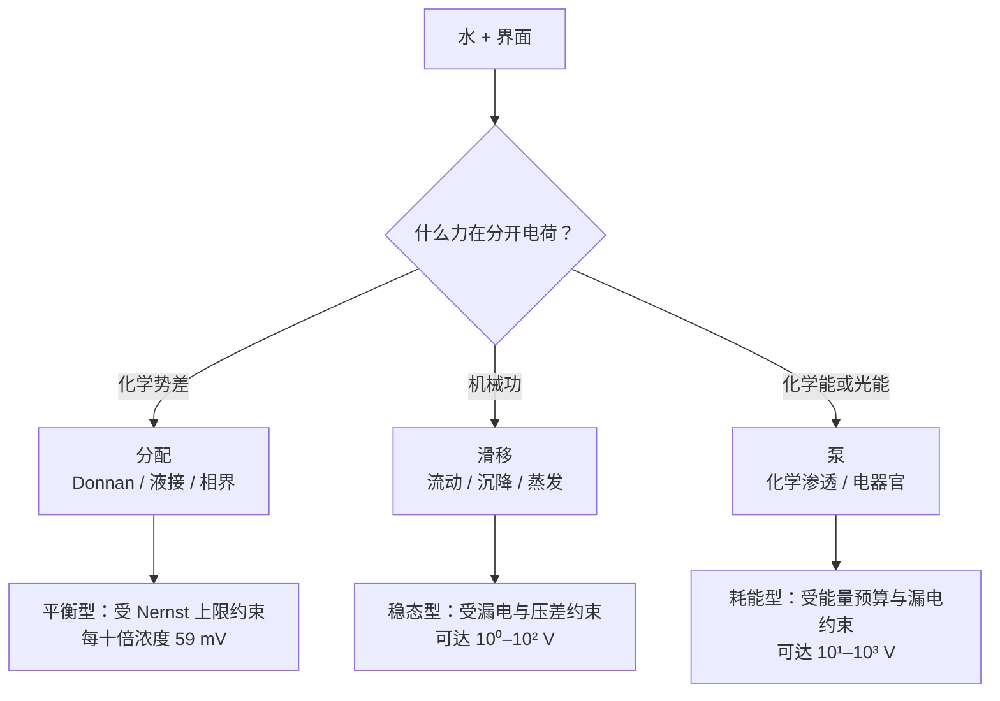

---
tags:
  - 化学
  - 物理化学
  - 电化学
  - 界面化学
  - 生物电
  - 膜电位
  - 水
关联:
  - "[化学渗透理论](../生物学/化学渗透理论.md)"
  - "[第四相水与生命的必然涌现：从界面物理到自组织选择的统一框架](../生物学/第四相水与生命的必然涌现：从界面物理到自组织选择的统一框架.md)"
  - "[渗流框架：从凝胶点到冰共晶的隔间化](../生物学/渗流框架：从凝胶点到冰共晶的隔间化.md)"
  - "[无膜细胞器：没有膜的区室——相分离、凝聚体与细胞内的化学组织](../生物学/无膜细胞器：没有膜的区室——相分离、凝聚体与细胞内的化学组织.md)"
  - "[醌类：芳香性的赎金——呼吸链的心脏、染料母体与药毒同源的弹头](醌类：芳香性的赎金——呼吸链的心脏、染料母体与药毒同源的弹头.md)"
  - "[酚类：可逆的氧化——石炭酸、单宁与黑色素共享的一只羟基](酚类：可逆的氧化——石炭酸、单宁与黑色素共享的一只羟基.md)"
  - "[辅因子：金属离子、维生素衍生物与酶的化学外挂](../生物学/辅因子：金属离子、维生素衍生物与酶的化学外挂.md)"
---

# 水与膜上的自发电位：从冻结电势到化学渗透——电荷分离的三种手法与三层膜电位

> **根节点**：一杯稀盐水和一张界面，为什么能凭空造出从 $10^{-6}$ V 到 $10^{2}$ V 的电压？冻结电势、流动电势、Donnan 电势、偶极电势、化学渗透——这些名字听起来分属冰物理、胶体化学、膜生物物理与细胞代谢，它们到底是五台不同的机器，还是同一台机器的五个挡位？
>
> **叙事逻辑**：定义与边界（什么叫「自发电位」） → 水的三个常数（为什么偏偏是水） → 相变界面（冰、汽、液滴） → 电动现象（流体与电荷错身而过） → 浓差与选择透过（膜电位的家族） → 三层膜电位（能测到的与测不到的） → 主动泵（化学能换成电压） → 量级坐标与天花板（谁在限制电位） → 收束
>
> **立场说明**：机制层面的教科书共识、有实验支撑但机制未定的现象、以及纯属争议的内容，正文用 ✅ / ⚠️ 显式分级；所有数值都标明条件依赖，取常引量级，不写成确定常数。凡涉及「某某发电技术」的功率，一律同时给电压与电流——只给电压的报道在本文一律视为信息不全。
>
> **来源标注**：经典教材（Bockris & Reddy、Hunter 的 Zeta Potential in Colloid Science、Blank 的 Bioelectricity）、界面化学综述、原始文献（Workman & Reynolds 1950；Wilson & Haymet 2008；Posey et al. 2024），以及库内已有的 [渗流框架](../生物学/渗流框架：从凝胶点到冰共晶的隔间化.md) 与 [第四相水](../生物学/第四相水与生命的必然涌现：从界面物理到自组织选择的统一框架.md) 两篇笔记的文献核对结果。整理时间：2026-11-18。

## 知识树

```txt
根节点：水加一张界面，为什么能凭空造出 10⁻⁶ 到 10² V 的电压？
│
├── 〇、锚点：先建立量级坐标
│   ├── 数字锚点（ε_r 78.4 / kT 25.7 meV / 1 pmol·cm⁻² / 230 V / 59 mV per decade）
│   └── 时间锚点（1889 Nernst → 1903 Gouy → 1911 Donnan → 1950 Workman–Reynolds → 1961 Mitchell → 2017 水伏）
│
├── 一、定义与边界：什么叫「自发电位」
│   ├── 电位就是电荷分离的同义词（谁正、谁负、为什么没复合）
│   ├── 三种手法：分配 / 滑移 / 泵
│   └── 五条边界：不是电池、不必有膜、不专属于生物、电压≠能量、与「水的记忆」无关
│
├── 二、为什么偏偏是水：三个常数
│   ├── ε_r ≈ 78：电荷分离的静电成本降到 kT
│   ├── K_w = 10⁻¹⁴：纯水自带 5.5 μS/m 的微弱电导
│   └── 氢键网络：Grotthuss 跳跃让 H⁺ 比 K⁺ 快五倍
│
├── 三、相变界面：冰、汽与液滴
│   ├── 冻结电势（230 V / 约 1 μA / 严格非平衡）
│   ├── 冰的热电势与 Bjerrum 缺陷
│   ├── 表面预融层（QLL）
│   ├── 蒸发生电（水伏，0.1–1 V，机制有争议）
│   └── 液滴破裂与 Lenard 效应
│
├── 四、电动现象：让流体与电荷错身而过
│   ├── 流动电势（公式、符号拆解与数值例子）
│   ├── 沉降电势与电渗：三兄弟互逆
│   ├── 骨头里的流动电势（Wolff 律的候选机制）
│   └── 反电渗析与压力延迟渗透：把它做成电站
│
├── 五、浓差与选择透过：膜电位的家族
│   ├── 液接电势：最常见的 1–10 mV 误差源
│   ├── Donnan 电势：没有膜的膜电位
│   ├── 相界电势与离子载体（valinomycin 与离子选择电极）
│   └── Nernst 与 GHK：静息电位 −70 mV 的算术
│
├── 六、三层膜电位：能测到的与测不到的
│   ├── Δψ：电极能读到的跨膜电位
│   ├── ψ_s：电极读不到、通道能读到的表面电势
│   ├── ψ_d：连通道都在膜内读到的偶极电势
│   └── 四层总表与三种常见混淆
│
├── 七、主动泵：把化学能换成电压
│   ├── 化学渗透与质子动力势（Δp = Δψ − 59ΔpH）
│   ├── 细菌视紫红质：最小的光电压发生器
│   ├── 电器官：把 0.1 V 串联成 600 V
│   ├── 耳蜗内电位：+80 mV 的上皮电池
│   └── 皮肤电池与损伤电流
│
├── 八、量级与天花板：谁在限制电位
│   ├── 二十二种现象的总表（家族 / 量级 / 电流能力）
│   ├── 平衡的天花板是 Nernst，动力学的天花板只是漏电
│   └── 高压不等于大能量（230 V × 1 μA = 230 μW）
│
└── 九、收束：误读、归因与个体坐标
    ├── 七条误读
    ├── 归因：三种手法与一个分母
    ├── 延伸：水伏机制、非平衡冰电与合成细胞
    └── 个体坐标：看新闻、读数与身体
```

## 〇、锚点：先建立量级坐标

读「某某能发电」的报道之前，先把量级刻在脑子里。下面两张表只留三件事：**水的介电常数让电荷便宜地分开；膜的电容小到 1 pmol/cm² 的离子就能充出 100 mV；所有平衡型电位的涨价速度都是每十倍 59 mV。**

### 0.1 数字锚点

| 项 | 数值 | 为什么记它 |
|---|---|---|
| 水的相对介电常数 $\varepsilon_r$（25 ℃） | 78.4 | 决定水中静电作用的强弱，是全部水相生电的前提 |
| 热涨落 $kT$（25 ℃） | 25.7 meV | 判断一个电位能否被热噪声淹没的尺子 |
| 相距 1 nm 的 ±e 在水中的库仑能 | 约 0.019 eV ≈ 0.7 $kT$ | 电荷在水中「几乎免费」地分开 |
| 纯水电导率 | 0.055 μS/cm ≈ 5.5×10⁻⁶ S/m | 纯水不是绝缘体，只是电阻很大 |
| H⁺ 极限摩尔电导率 | 349.6 S·cm²/mol | 比 K⁺（73.5）快约 4.8 倍 |
| 脂双层的比电容 | 0.5–1 μF/cm² | 换算成电荷：约 1 pmol/cm² 即可充到 100 mV |
| 静息膜电位 | 约 −70 mV | 细胞电学的零点 |
| Nernst 斜率（一价离子，25 ℃） | 59.2 mV / 十倍浓度 | 所有平衡型电位的涨价速度 |
| 双电层厚度 $\lambda_D$ | 0.304/√I nm | 淡水约 10 nm，海水约 0.4 nm |
| 偶极电势 | 0.2–0.5 V | 存在但测不到的那一层 |
| 质子动力势 Δp | 150–200 mV | 线粒体与细菌的能量货币面值 |
| 冻结电势（Workman–Reynolds） | 最高约 230 V，电流约 1 μA | 本文量级轴的高端 |
| 水伏开路电压（炭黑/纳米碳） | 约 1 V，短路电流 nA–μA | 「发电」新闻的常客 |
| 耳蜗内电位 | 约 +80 mV | 上皮自己造的电池 |
| 电鳗放电 | 约 600 V（最高记录 860 V） | 串联的极限示范 |
| 雷云对地电位差 | 约 10⁸ V（量级） | 量级轴的终点 |

### 0.2 时间锚点

| 时间 | 事件 | 为什么值得记 |
|---|---|---|
| 1889 | Nernst 给出电极电位与浓差电位的对数式 | 「平衡电位的天花板」从此有了公式 |
| 1910 / 1913 | Gouy 与 Chapman 分别给出扩散双电层模型 | 所有界面电位的几何底图 |
| 1911 | Donnan 描述带固定电荷膜的平衡 | 后来成为「无膜膜电位」的语言 |
| 1915 | Lenard 观察水滴破裂带电 | 瀑布附近「负离子」的物理来源 |
| 1948–1950 | Workman 与 Reynolds 测到冻结电势 230 V | 相变生电的经典实验 |
| 1961 / 1978 | Mitchell 提出化学渗透；1978 年获诺奖 | 膜电位的生物学意义被确立 |
| 1971 / 1974 | 细菌视紫红质被发现；人工膜上测到光电位 | 最小的「光→电压」转换器 |
| 1982 | Barker 等提出「皮肤电池」 | 上皮电位的现代起点 |
| 2008 | Wilson 与 Haymet 精确测量单晶冰面 | 证明冻结电势是严格非平衡现象 |
| 2017 | 纳米碳蒸发诱导发电（水伏） | 把「蒸发」拉进发电清单 |
| 2019 | 电鳗 860 V 记录 | 串联电胞的生理上限 |
| 2024 | 凝聚体内部测到 Donnan 电势（+22 mV） | 证明不需要膜也能有膜电位量级的电位 |

## 一、定义与边界：什么叫「自发电位」

### 1.1 电位就是电荷分离的同义词

把「电压」翻译成一句大白话：**某处正电荷多了一点，另一处负电荷多了一点，而它们暂时没能复合**。任何「能产生电势」的机制，都必须回答同样三个问题：

1. **谁带正电、谁带负电**——电荷被分到了哪两个地方；
2. **靠什么力分开**——是离子的化学势差、流体的剪切、还是泵消耗 ATP；
3. **为什么没有马上复合**——是界面挡住了、扩散太慢，还是持续有能量输入。

这三个问题就是本文的骨架。看起来五花八门的现象，答案只有三类。

> 📌 **自发电位（spontaneous potential / self-generated potential）**：不需要外加电源，由体系内部的化学势差、相变、流动或代谢活动自行建立的电位差。它与「加电压后产生的电流」相对——后者是电化学，前者是电化学的逆问题：不问「电压能驱动什么」，而问「什么能驱动出电压」。

### 1.2 三种手法：分配 / 滑移 / 泵

为什么比较这三类？因为绝大多数「水 + 界面生电」的教材分章（胶体化学、冰物理、膜生物物理）各讲各的，读者很难看出它们是同一套动作的不同变体。下面这张表是本文的总纲。

| 手法 | 驱动力 | 电荷分离发生在哪 | 是否平衡 | 天花板 | 代表现象 |
|---|---|---|---|---|---|
| **分配**（partition） | 化学势差：离子在不同相/不同侧的活度不同 | 两相界面或选择性膜的两侧 | 可以是平衡（也可被动力学钉住） | Nernst 上限，约 59 mV/decade | Donnan、液接、相界、跨膜扩散电位 |
| **滑移**（slip） | 机械功：流体相对带电界面运动 | 双电层的扩散层被剪切 | 稳态非平衡，需要持续流动 | 由压差与电导率决定 | 流动电势、沉降电势、蒸发、水滴 |
| **泵**（pump） | 化学能或光能 | 泵把电荷逆着电化学梯度搬运 | 稳态非平衡，需要持续供能 | 由能量预算与漏电决定 | 化学渗透、细菌视紫红质、电器官 |



**这张图的收束句**：三种手法的差别不在「有没有膜」，而在「电荷被什么力按住的」。膜只是分配手法最常用的一种几何；冰面、毛细管、凝胶、甚至一团凝聚体都能替代它。

### 1.3 五条边界

初学者最容易在这五个地方滑倒。先把边界钉死，后面的分类才不会乱。

| 常见说法 | 为什么不对 | 更准确的说法 |
|---|---|---|
| 「必须有膜才能有膜电位」 | Donnan 电位不需要膜，只需要「固定电荷 + 半透性」 | 膜只是实现半透性的一种结构；凝胶、凝聚体、冰晶间隙都可以 |
| 「自发电位是一种电池」 | 电池要能对外持续做功；很多自发电位是高内阻的静电现象 | 有电位不等于有功率，见 §8.3 |
| 「这是生物电，非生物体系做不出来」 | 流动电势、冻结电势、Donnan 电位在纯物理化学体系里全部可复现 | 「生物电」是同一批机制在演化中被选中的结果 |
| 「电压越高能量越大」 | 电压是每单位电荷的价码，功率还要乘电流 | 230 V × 1 μA = 230 μW，远小于一节干电池 |
| 「冻结电势说明水能记住电场/信息」 | 电位随冰的生长而出现，停止生长就归零 | 这是严格非平衡现象，没有滞后、没有记忆 |

**最后一条值得多说一句。** Wilson 与 Haymet 2008 年在单晶冰面上的精确测量给出一个干净判据：**冰既不生长也不融化时，电压为零**。所以「冻结电势」不是水在固态下保存了某种电荷印记，而是凝固前沿在持续把离子分成两堆；生长一停，漏电就把这堆电荷抹平了。任何把冻结电势当作「水的记忆」证据的推论，都在这一步上断裂。

## 二、为什么偏偏是水：三个常数

### 2.1 ε_r ≈ 78：让电荷分离变得便宜

两个元电荷相距 $r$ 时的库仑能是

$$
U = \frac{1}{4\pi\varepsilon_0\varepsilon_r}\cdot\frac{e^2}{r}
$$

- **$U$**：静电相互作用能，单位 eV；数值越大表示正负电荷越「愿意」待在一起；
- **$e$**：元电荷，$1.602\times10^{-19}$ C；
- **$\varepsilon_0$**：真空介电常数，$8.854\times10^{-12}$ F/m；
- **$\varepsilon_r$**：介质的相对介电常数，水在 25 ℃ 约 **78.4**，真空为 1；
- **$r$**：两电荷间距，单位 nm。

代入具体数字：$r=1$ nm 时，真空里 $U\approx1.44$ eV，水里 $U\approx1.44/78.4\approx0.018$ eV——只有 $kT$（0.0257 eV）的 **0.7 倍**。

**这意味着什么**：在水中，热涨落足以把一对正负电荷撕开到纳米尺度；而在真空或低介电介质（脂双层内部 $\varepsilon_r\approx2$–4）里，同样的分离要付出几十个 $kT$ 的代价。**水是电荷的「低摩擦路面」**：离子自由游动、盐自由解离、电位自由建立。所有水相生电现象的第一块地基，就是这一个数。

### 2.2 K_w = 10⁻¹⁴：纯水也是微弱导体

纯水并非绝缘体。自电离

$$
\mathrm{H_2O \rightleftharpoons H^+ + OH^-},\qquad K_w = [\mathrm{H^+}][\mathrm{OH^-}] \approx 10^{-14}\ (25\ ^\circ\mathrm{C})
$$

在 pH 7 时给出各 $10^{-7}$ mol/L 的载流子，对应电导率 **0.055 μS/cm**。这个数字有两个后果，方向相反：

- **它保证了「高电压」**：电阻率约 $1.8\times10^{7}$ Ω·cm，所以冻结电势那种电荷分离能维持到上百伏而不被短路；
- **它也设定了「小电流」**：同样因为电阻高，230 V 只能输出约 1 μA。**低电导是电压的朋友、电流的敌人**——这条会在 §8 反复用到。

### 2.3 氢键网络：Grotthuss 跳跃

质子的传输不走「离子拖着一圈水慢慢挪」的路线，而是沿氢键网络接力跳跃（Grotthuss 机制），因此迁移率异常高。

| 载流子（25 ℃） | 极限摩尔电导率 / S·cm²·mol⁻¹ | 相对 K⁺ |
|---|---|---|
| H⁺ | 349.6 | 4.8× |
| OH⁻ | 199.1 | 2.7× |
| K⁺ | 73.5 | 1.0 |
| Na⁺ | 50.1 | 0.7 |
| Cl⁻ | 76.4 | 1.0 |

**这张表的收束句**：生物选 H⁺ 当能量货币（而不是 Na⁺ 或 K⁺），物理上有一个便宜的理由——**它能以最快的速度在膜两侧建立和撤除梯度**，让「充电」与「放电」的时间尺度匹配代谢需求。

> 🔗 **横向关联**：本节「H⁺ 的高迁移率让梯度能快速建立」与 [化学渗透理论](../生物学/化学渗透理论.md) §2 的「质子动势由 Δψ 与 ΔpH 两部分组成」形成**上下游关系**——那篇讲 PMF 如何驱动 ATP 合酶，本篇讲 PMF 之所以能用 H⁺ 而不是别的离子来记，物理前提是什么。

## 三、相变界面：冰、汽与液滴

水的相变会重排离子与电荷，这是最容易被忽略的一类生电方式：它不需要膜、不需要电极、不需要生物，只需要**一个正在移动的相界面**。

### 3.1 冻结电势：Workman–Reynolds 效应

**现象**：稀水溶液定向冻结时，生长的冰晶与剩余液体之间出现可观电位差。Workman 与 Reynolds 1950 年在 *Physical Review* 上的测量给出：**最高约 230 V，冻结速率约 1 cc/min 时电流约 1 μA**；电位的符号与大小取决于溶质种类和浓度——有的盐让冰侧带负电，有的带正电。

**机制（共识部分）**：冰晶格与液相在接纳离子时的「偏好」不同（分配系数不同）。凝固前沿每推进一层，就把一部分离子排进液体、另一部分锁进晶格，于是界面两侧出现净电荷；而冰的电导又极低，这层电荷没法立刻复合，电位就一路涨上去。

> 📌 **冻结电势（freezing potential / Workman–Reynolds effect）**：水溶液凝固时，由于冰相与液相离子分配系数不同而在凝固前沿建立的电位差。它的本质是**分配手法在相变几何下的极端版本**：不是两种溶液隔着膜，而是固相与液相隔着正在推进的界面。

**三个控制变量**（都已被实验确认）：

| 变量 | 影响 | 证据强度 |
|---|---|---|
| 溶质种类与浓度 | 决定电位的**符号**与大小；某些体系可反号 | ✅ 反复观测 |
| 冻结速率 | 速率太快则离子来不及分选，电位反而下降；存在最优化区间 | ✅ |
| 冰晶取向与晶面 | 不同晶面纳入离子的能力不同 | ✅ 单晶实验 |
| 是否在生长 | **不生长、不融化时电位为零** | ✅ Wilson & Haymet 2008 |

> 🔗 **横向关联**：本节「230 V 与 1 μA」与 [渗流框架：从凝胶点到冰共晶的隔间化](../生物学/渗流框架：从凝胶点到冰共晶的隔间化.md) §7.5「冰还能产生电势」形成**互证关系**——那篇在讨论冰共晶的隔间化时顺带记录了同一组数据并强调其非平衡性质，本篇把它放回「三种电荷分离手法」的统一坐标里；两篇合起来说明：冰既可以是反应器，也可以是电源。

**为什么它能超过 Nernst 上限**：这是全篇最重要的一处对照。平衡型电位的价格是每十倍浓度 59 mV，想凑出 230 V 需要 $10^{3888}$ 倍的浓度比——宇宙里没有这么多原子。所以冻结电势必然是**非平衡的动力学电位**：它不是「浓度差已经平衡」，而是「分离仍在进行，而漏电还没追上」。**平衡给天花板，动力学只给漏电上限。**

### 3.2 冰的热电势与 Bjerrum 缺陷

冰不是完美的质子晶格。质子可以以两种缺陷形式存在：**L 缺陷**（缺一个质子，相当于 OH⁻ 型）与 **D 缺陷**（多一个质子，相当于 H₃O⁺ 型）。这两种缺陷的迁移热不同，于是在温度梯度下会发生定向迁移，建立电位。

- **量级**：约 **1–2 mV/K**（随温度与冰的纯度变化）；
- **意义**：这是「热」直接换成「电」的少见例子，且不依赖任何电子导体；
- **与冻结电势的关系**：都靠质子缺陷导电，但一个是浓度梯度驱动、一个是温度梯度驱动。

### 3.3 表面预融层（QLL）

即使在 −20 ℃，冰的表面也不是干的：存在一层纳米到几十纳米厚的**准液体层（quasi-liquid layer, QLL）**，分子仍能移动，质子仍能跳跃。

> 📌 **准液体层（quasi-liquid layer, QLL）**：冰表面在 0 ℃ 以下仍然保持的、厚度约 1–100 nm 的无序水层。它让冰表面具有类似液体的离子迁移能力，是冰的摩擦、烧结、以及冰-颗粒碰撞起电（雷暴起电的重要环节）的共同物理基础。

这一层的存在解释了两件事：为什么冰的表面电导远高于体相；为什么冰粒碰撞能转移电荷。雷暴中的「非感应起电」机制，本质上就是冰晶与霰粒在 QLL 参与下的电荷转移；而冻结电势则提供了同一家族的另一条路线。

### 3.4 蒸发生电：水伏效应

**现象**：纳米结构碳（炭黑）、氧化石墨烯、木材、织物等材料，只要一端接触水、另一端暴露在空气中持续蒸发，就能产生 **0.1–1 V** 的开路电压和 nA–μA 的短路电流。2017 年 *Nature Nanotechnology* 的炭黑薄膜工作让这一现象进入主流视野。

**机制（⚠️ 仍有争议）**，至少有三条候选：

| 候选机制 | 大意 | 支持点 | 困难 |
|---|---|---|---|
| 伪流动电势 | 蒸发驱动水在双电层内流动，把离子拖走、留下净电荷 | 与流动电势的符号、盐依赖一致 | 蒸发通量能产生的压差是否够大 |
| 离子扩散（diffusiophoresis 一类） | 蒸发端与湿端的离子浓度不同，阴、阳离子扩散速度不同 | 与浓度梯度实验吻合 | 难以解释长期稳定输出 |
| 电子拖曳 / 表面电荷重排 | 水分子在材料表面的吸附-脱附直接改变材料的载流子密度 | 部分石墨烯实验 | 材料依赖性太强，普适性存疑 |

> ⚠️ **读这类报道时的判据**：先看它给的是开路电压还是功率密度。1 V 的开路电压配 10 nA 短路电流，功率是 $10^{-8}$ W 量级；「一杯水点亮灯泡」通常靠的是升压电路与电容储能，不是持续功率。

### 3.5 液滴破裂与 Lenard 效应

雨滴在气流中破裂、瀑布冲击、喷泉喷雾，都会让水滴分裂成大小不一的碎片。**小碎片带负电、大残滴带正电**（Lenard 1915 年对瀑布的经典观察），这就是「瀑布附近空气负离子多」的物理来源之一，也是雷暴电荷分离的一个贡献项。

- **量级**：单滴电荷 pC 级；云雾尺度的电场可达 $10^{2}$ V/m；
- **机制**：水滴表面的双电层在断裂时被「劈开」，表面层（带负电）更多分给小碎片；
- **与冻结电势的关系**：同属「界面被机械/相变地一分为二，双电层来不及重排」这一类。

**本节收束**：相变生电的共同结构是——**一个界面在移动或断裂，而电荷的重排速度跟不上界面的速度**。这解释了为什么这一类电位可以远超平衡值，也解释了为什么它们一律是高内阻、小电流。

## 四、电动现象：让流体与电荷错身而过

### 4.1 流动电势

把水压过一根带电的毛细管或一张多孔膜，管壁会拖着扩散层里的净电荷一起走，出口端因此比入口端多出一点电荷，电位差就出现了。

$$
\frac{\Delta V}{\Delta P} = \frac{\varepsilon_r \varepsilon_0 \zeta}{\eta \kappa}
$$

- **$\Delta V$**：两端的流动电势，单位 V；
- **$\Delta P$**：驱动流体的压差，单位 Pa；
- **$\varepsilon_r$**：水的相对介电常数（约 78.4）；
- **$\varepsilon_0$**：真空介电常数（$8.854\times10^{-12}$ F/m）；
- **$\zeta$**（zeta 电位）：滑动面处的电位，代表「被流体拖走的那一层」的净电势，胶体化学的核心参数，单位 V；符号决定电位方向；
- **$\eta$**：流体动力黏度，水在 20 ℃ 约 $10^{-3}$ Pa·s；
- **$\kappa$**：流体电导率，单位 S/m——**它是分母，所以含盐量升高会直接杀死这个效应**。

**代入数字**：取 $\zeta=-50$ mV、$\varepsilon_r=78.4$、$\eta=10^{-3}$ Pa·s，则

- 若 $\kappa=10^{-3}$ S/m（稀溶液），$\Delta V/\Delta P \approx 3.5\times10^{-5}$ V/Pa，**10 kPa 的压差给出约 0.35 V**；
- 若 $\kappa=10^{-1}$ S/m（生理盐水），同样的压差只剩 **约 3.5 mV**——小了一百倍。

> 📌 **zeta 电位（$\zeta$-potential）**：带电颗粒或孔壁周围，流体开始「相对滑动」的那个面上的电位。它不是壁面电位，也不是溶液电位，而是两者之间的一个折中值；胶体的稳定性、流动电势的大小都由它决定。测它通常靠电泳或流动电势本身——这也是一个漂亮的循环：**用效应去测决定效应的参数**。

### 4.2 沉降电势与电渗：三兄弟互逆

电动现象是一组可逆对，理解它们的互逆关系比死记公式有用。

| 现象 | 施加 | 得到 | 用途 |
|---|---|---|---|
| **流动电势** | 压差 $\Delta P$ | 电位 $\Delta V$ | 测 zeta 电位、渗漏监测 |
| **电渗**（electro-osmosis） | 电场 | 流体流动 | 毛细管电泳的驱动力、微流控泵、土壤排水 |
| **沉降电势**（Dorn 效应） | 重力沉降 | 电位（μV–mV） | 测颗粒电荷、判断沉降行为 |
| **电泳**（electrophoresis） | 电场 | 颗粒运动 | 分离与表征（凝胶电泳、毛细管电泳） |

**这张表的收束句**：前两行是同一枚硬币的两面，后两行是另一枚；它们的共同前提都是「双电层 + 相对运动」，只是谁驱动谁不同。

### 4.3 骨头里的流动电势

骨不是死的矿物块。受力时，组织液被迫穿过骨小管与骨陷窝构成的网络（lacunocanalicular system），这个过程会产生 **mV 级**的流动电势；同时，胶原纤维本身还有一层**压电效应**（pC/N 量级）。

两者合起来，是「Wolff 律」（骨按受力重塑）最常被引用的物理候选机制：**力学 → 电位 → 成骨/破骨细胞的行为**。哪一层占主导仍有争论：流体剪切本身就能激活骨细胞，电位可能只是同一件事的伴随现象，而不是唯一信号。

> ⚠️ **证据分级**：流动电势在骨内**确实存在**（✅ 直接测量）；它是否是 Wolff 律的**主要**传导机制（⚠️ 仍有争议，流体剪切与初级纤毛的贡献同样强）。

### 4.4 反电渗析与压力延迟渗透

同一套物理可以做成电站。把海水与淡水交替夹在阴、阳离子交换膜之间：Na⁺ 只能走阳膜、Cl⁻ 只能走阴膜，两种离子的定向迁移在两端堆出电位。

- **反电渗析（reverse electrodialysis, RED）**：靠盐度差，单个膜对约 **0.1 V**，数百对串联到 10² V 量级；
- **压力延迟渗透（pressure retarded osmosis, PRO）**：靠渗透压差驱动水穿过半透膜，再用涡轮发电；
- **共同瓶颈**：膜的选择性与污染，而不是热力学上限。

> 🔗 **横向关联**：本节「膜 + 浓度梯度 → 电」与 [化学渗透理论](../生物学/化学渗透理论.md) §1 的「呼吸链把 H⁺ 泵到一侧 → 梯度 → ATP」形成**镜像关系**——工程上是用现成的盐度差换电，生物里是用代谢能造出盐度差再换 ATP；两者的器件结构（选择性膜 + 两侧梯度）几乎是同一个。

## 五、浓差与选择透过：膜电位的家族

### 5.1 液接电势：最常见的 1–10 mV 误差源

两种组成不同的电解质溶液直接接触时，界面处会出现**液接电势（liquid junction potential）**。原因是各离子的迁移率不同：K⁺ 和 Cl⁻ 的迁移率接近，所以 KCl 溶液两侧的液接电势很小；H⁺ 和 Cl⁻ 差别大，所以 HCl 溶液两侧的液接电势明显。

- **量级**：1–10 mV；
- **工程对策**：参比电极用 **3 M KCl 盐桥**，把液接电势压到 1–2 mV 量级；
- **为什么重要**：膜电位测量、pH 测量、离子选择电极，全部要把这项误差算进去。**用两支电极「测」出的 5 mV 差异，可能全部来自液接。**

### 5.2 Donnan 电势：没有膜的膜电位

当一个体系里有**不能透过的固定电荷**（凝胶网络上的羧基、软骨的糖胺聚糖、细胞内的蛋白质与核酸），可透过的盐离子就会在两侧不对称分配，建立平衡电位：

$$
\Delta\psi_{\mathrm{Donnan}} = \frac{RT}{zF}\ln\frac{c_{\mathrm{in}}}{c_{\mathrm{out}}}
$$

- **$\Delta\psi_{\mathrm{Donnan}}$**：两相之间的 Donnan 电位，单位 V；
- **$R$**：气体常数，8.314 J·mol⁻¹·K⁻¹；
- **$T$**：绝对温度，单位 K；25 ℃ 时为 298.15 K；
- **$z$**：可透过离子的电荷数（K⁺ 为 +1）；
- **$F$**：法拉第常数，96485 C/mol；
- **$c_{\mathrm{in}}$ / $c_{\mathrm{out}}$**：该离子在固定电荷相内、外的浓度。

**代入数字**：$z=1$、25 ℃ 时，系数 $RT/F\approx25.7$ mV；换成十进对数就是 **59.2 mV/decade**。若凝胶内 K⁺ 浓度是外面的 10 倍，$\Delta\psi\approx+59$ mV。

这个电位的意义被低估了很久。它说明：**只要有一团带电的大分子网络，不需要膜、不需要泵，就能造出与细胞膜同量级的电位。**

> 🔗 **横向关联**：本节「固定电荷 → Donnan 电位」与 [第四相水与生命的必然涌现：从界面物理到自组织选择的统一框架](../生物学/第四相水与生命的必然涌现：从界面物理到自组织选择的统一框架.md) §1.1「机制A：Donnan 电位与离子富集」形成**上下游关系**——那篇用 Donnan 电位解释凝胶界面为什么能把 K⁺ 富集 10–1000 倍，本篇把它归入「分配手法」并提供公式与数值；同一条物理在那边是「生命起源的富集服务」，在这边是「一张电位清单里的一行」。

**2024 年的新证据**：Posey 等人在 *JACS* 上直接测量了生物分子凝聚体稠密相与稀相之间阳、阴离子的活度差，证明存在 Donnan 平衡。hnRNPA1 低复杂度区凝聚体在 120 mM NaCl 下的 Donnan 电位约 **+22 mV**，在 500 mM 时降到 **+9 mV**；作者指出，这个数值**与有膜细胞器的膜电位处于同一数量级**。

> 📌 **凝聚体 Donnan 电位（condensate Donnan potential）**：相分离形成的稠密相富集了带电大分子（RNA 的磷酸骨架、蛋白的带电残基），把反离子拉进来、把同号离子推出去，于是在两相之间建立的电势差。它的存在意味着：**「有没有膜」不是产生膜电位的必要条件，「有没有固定电荷 + 半透性」才是。**

> 🔗 **横向关联**：本节「凝聚体也有 Donnan 电位」与 [无膜细胞器：没有膜的区室——相分离、凝聚体与细胞内的化学组织](../生物学/无膜细胞器：没有膜的区室——相分离、凝聚体与细胞内的化学组织.md) 的「三层选择性」框架形成**互证关系**——那篇讲凝聚体如何选择性地招募客户分子，本篇给出其中一层（静电/离子选择性）的定量语言：离子种类不同，电势的正负都可能变。

### 5.3 相界电势与离子载体

如果界面两侧对某个离子的「溶解度」不同，离子就会在界面两侧重新分配，建立**相界电势（phase-boundary potential）**。这正是**离子选择电极**的工作原理：

- 钾电极的液膜里溶有 **valinomycin（缬氨霉素）**，它把 K⁺ 包在环状空腔里、把水化壳剥掉，于是 K⁺ 进入有机相的代价大幅降低，而 Na⁺ 没有这个待遇；
- 结果是电极电位对 K⁺ 活度呈 Nernst 响应：**每十倍浓度 59 mV**；
- 生物体系里也有同类分子（离子载体型抗生素，如革兰霉素、莫能菌素），它们的工作方式就是把「相界电势」这套物理搬进细胞膜。

> 📌 **离子载体（ionophore）**：能选择性地把特定离子「包裹」并运过脂质膜的分子。它的存在说明：**选择性不一定来自通道孔，也可以来自「给离子换一件外套」的化学。**

### 5.4 Nernst 与 GHK：静息电位 −70 mV 的算术

单个离子的平衡电位由 Nernst 方程给出：

$$
E_{\mathrm{ion}} = \frac{RT}{zF}\ln\frac{[\mathrm{ion}]_{\mathrm{out}}}{[\mathrm{ion}]_{\mathrm{in}}}
$$

- **$E_{\mathrm{ion}}$**：该离子的平衡电位（膜内相对于膜外），单位 V；
- **$z$**：离子价数（K⁺ 为 +1，Ca²⁺ 为 +2）；
- **$[\mathrm{ion}]_{\mathrm{out}}$ / $[\mathrm{ion}]_{\mathrm{in}}$**：膜外、膜内浓度。

**代入哺乳动物神经元**：K⁺ 内 140 mM、外 5 mM，$E_K = 59.2\times\log_{10}(5/140)\approx-85$ mV；Na⁺ 外 145 mM、内 12 mM，$E_{Na}\approx+64$ mV。

真实静息电位约 **−70 mV**，落在 $E_K$ 与 $E_{Na}$ 之间、更靠近 $E_K$——因为静息膜对 K⁺ 的通透性远高于 Na⁺。**Goldman–Hodgkin–Katz（GHK）方程**就是把「各离子各自的 Nernst 电位」按通透性加权平均：

$$
V_m = \frac{RT}{F}\ln\frac{P_K[\mathrm{K^+}]_{\mathrm{out}}+P_{Na}[\mathrm{Na^+}]_{\mathrm{out}}+P_{Cl}[\mathrm{Cl^-}]_{\mathrm{in}}}{P_K[\mathrm{K^+}]_{\mathrm{in}}+P_{Na}[\mathrm{Na^+}]_{\mathrm{in}}+P_{Cl}[\mathrm{Cl^-}]_{\mathrm{out}}}
$$

- **$V_m$**：跨膜电位（膜内减膜外）；
- **$P_K, P_{Na}, P_{Cl}$**：各离子的膜通透性，单位任意但需同一标度；
- **注意 Cl⁻ 的分子分母是反的**：因为它是阴离子，浓度项的方向相反。

**这一节的意义**：GHK 说明膜电位不是一个「电池」的固定电压，而是**一组通透性比值决定的加权平均**。改变一个通道的开放概率，就等于改变权重——这就是神经信号的全部算术。

**本节收束**：液接、Donnan、相界、跨膜扩散，四者的公式长得几乎一样（都是 $59\log_{10}$ 的形式），差别只在「哪一层界面在做选择」。**同一个对数，四种几何。**

## 六、三层膜电位：能测到的与测不到的

### 6.1 Δψ：电极能读到的跨膜电位

这是教科书里的「膜电位」：两根 Ag/AgCl 电极，一根在膜外、一根在膜内（或刺入细胞），读到的差值，典型 **−70 mV**。

它的来源是 §5.4 的 GHK；它的物理实体是**膜两侧的电荷分布**——膜本身是一个约 5 nm 厚、比电容 0.5–1 μF/cm² 的电容。这个电容小得惊人：**每平方厘米只需转移约 1 pmol 的一价离子，就能把膜充到 100 mV**。这解释了为什么细胞在动作电位期间只需要极少的离子流动，就能产生很大的电位变化——离子的浓度几乎不变，变的只是「膜上那一层电荷」。

### 6.2 ψ_s：电极读不到、通道能读到的表面电势

膜的外表面并非电中性：磷脂酰丝氨酸（PS）带负电、唾液酸带负电、糖萼带负电。这些固定电荷在膜外形成双电层，产生**表面电势** $\psi_s$。

- **量级**：10–100 mV，衰减长度就是德拜长度（生理盐水中约 0.8 nm）；
- **谁感受得到**：离子通道的门口、配体的结合位点、吸附在膜上的酶；
- **具体例子**：若 $\psi_s=-30$ mV，则膜表面的 K⁺ 浓度是本体的 $e^{30/25.7}\approx3.2$ 倍。**通道「以为」外面有 3 倍高的钾**，它的门控与电流都会随表面电荷改变。

### 6.3 ψ_d：连通道都在膜内读到的偶极电势

脂质头基与酯键的偶极子有取向地排列在膜内，产生一个跨过疏水核心的电位跃变，叫**偶极电势** $\psi_d$。

- **量级**：0.2–0.5 V（依脂质组成变化，含胆固醇与鞘脂的膜可更高）；
- **方向**：通常膜内侧为正；
- **影响谁**：疏水离子、脂肪酸、亲脂性药物、以及穿膜肽的分配系数。**同一个分子，换一种脂质组成，跨膜速率可以差几倍。**

### 6.4 为什么 $\psi_d$ 不进电极读数

这是最容易混的一点，值得单独拆开。

假设一根电极在膜外溶液、一根在膜内溶液，电压表读的是「两根电极之间的电化学势差」。偶极层是一层**取向的电荷片**：它的正端与负端**都埋在膜内部**，膜外溶液与膜内溶液并不直接跨过它。因此，$\psi_d$ 确实改变了膜内部的电位剖面（离子要穿过去必须爬这个坡），但它**不改变两端溶液之间的总电位差**——电压表读不到。

一个比喻：**你站在一栋楼的两侧门外量台阶高度，量到的是两侧地面的高差；楼内的楼梯再陡，也不进这个读数——但搬家具上楼的人必须爬它。**

| 层次 | 位置 | 典型量级 | 电极能测到？ | 谁感受得到 | 决定因素 |
|---|---|---|---|---|---|
| **Δψ** 跨膜电位 | 膜两侧溶液之间 | −70 mV | ✅ 是 | 全细胞、通道、泵 | 离子浓度 + 通透性比值（GHK） |
| **ψ_s** 表面电势 | 膜外 0.5–2 nm | 10–100 mV | ⚠️ 间接（改变局部活度） | 通道口、配体、吸附蛋白 | 表面固定电荷密度 + 离子强度 |
| **ψ_d** 偶极电势 | 膜内疏水区 | 0.2–0.5 V | ❌ 否 | 穿膜的疏水离子与药物 | 脂质头基与羰基的取向偶极 |
| **Donnan 项** | 细胞内固定电荷 | 10–50 mV | ✅ 混在 Δψ 里 | 全细胞 | 蛋白质/核酸的净负电荷 |

**这张表的收束句**：**一张膜上同时存在四个数量级相近、但回答不同问题的电位；把它们统称「膜电位」，等于把「楼外高差、门口台阶、楼内楼梯、家具重量」混成一个数。**

### 6.5 三种常见混淆

1. **把 $\psi_d$ 当成「膜电位的一部分」**：它不进跨膜总电位，但进跨膜**分配系数**——药物化学里的「膜内电位」多指后者。
2. **用本体浓度算表面反应**：酶动力学、通道门控若发生在膜表面，必须用 $\psi_s$ 修正后的局部浓度，否则会出现「同样的离子浓度、不同细胞活性不同」的怪现象。
3. **忽略多糖与糖萼**：糖萼的固定负电荷把 $\psi_s$ 再推低一截，且随细胞类型变化——这是「同一种通道在不同细胞里行为不同」的一个被低估的原因。

## 七、主动泵：把化学能换成电压

前面五类都属于「被动」：电荷顺着已有的势能走。最后一类是**主动**的：消耗 ATP 或光子，把电荷逆着梯度搬过去，把电位「充」起来。

### 7.1 化学渗透与质子动力势

Mitchell 的化学渗透理论把「膜电位」和「pH 梯度」合并成一个量：

$$
\Delta p = \Delta\psi - \frac{2.303RT}{F}\Delta\mathrm{pH}
$$

- **$\Delta p$**：质子动力势（proton motive force, PMF），单位 V；它是「每摩尔质子回流能放出的自由能」除以 $F$ 后的电势当量；
- **$\Delta\psi$**：跨膜电位，取 $\psi_{\mathrm{in}}-\psi_{\mathrm{out}}$；线粒体基质侧为负，所以 $\Delta\psi\approx-150$ 至 $-180$ mV；
- **$\Delta\mathrm{pH}$**：取 $\mathrm{pH}_{\mathrm{in}}-\mathrm{pH}_{\mathrm{out}}$；基质偏碱，所以 $\Delta\mathrm{pH}\approx+0.5$ 至 $+1$；
- **$2.303RT/F$**：25 ℃ 时约 **59 mV**，把 pH 单位（十倍）换算成伏特；
- **$2.303$**：自然对数换十进对数的系数。

**代入线粒体**：$\Delta p=-150-59\times0.5\approx-180$ mV（量级 $-150$ 至 $-200$ mV）。负号表示质子回流的驱动力指向基质侧；文献里常取绝对值说「$\Delta p\approx150$–$200$ mV」。线粒体的能量约 80% 存在 $\Delta\psi$ 里、20% 在 $\Delta\mathrm{pH}$ 里；叶绿体正好相反——类囊体膜上有 Cl⁻ 等伴随移动，把 $\Delta\psi$ 抵消掉大半，于是 $\Delta\mathrm{pH}$ 可以大到 3 个单位，$\Delta p$ 主要来自浓度项。

> 📌 **质子动力势（proton motive force, PMF）**：跨膜质子电化学势差的电势当量，把「电荷差」与「浓度差」两项合成一个数。它的重要性在于：**膜电位与 pH 梯度不是两个独立的现象，而是同一笔能量预算的两个账户，可以互相兑换。**

> 🔗 **横向关联**：本节「Δp 是 Δψ 与 ΔpH 的合并账户」与 [化学渗透理论](../生物学/化学渗透理论.md) §2 的「不同生物中两者贡献比例完全不同」形成**互证关系**——那篇给出线粒体与叶绿体的贡献比例，本篇给出这个比例的物理来源（膜对伴随离子的通透性）与量级。

同一套语言也解释了 [醌类](醌类：芳香性的赎金——呼吸链的心脏、染料母体与药毒同源的弹头.md) 里那条「电子瀑布」为什么必须存在：电子从 NADH（−0.32 V）一路下落到 O₂（+0.82 V），落差约 1.1 V，正好够把质子泵出膜、把 $\Delta p$ 充到 200 mV 量级。

### 7.2 细菌视紫红质：最小的光电压发生器

*Halobacterium salinarum* 的紫膜里只有一种蛋白：**细菌视紫红质（bacteriorhodopsin）**。它吸收一个光子，视黄醛发色团异构，把质子从胞内侧泵到胞外侧——**一个蛋白、一个光子、一个质子**。

- **1971 年**由 Oesterhelt 与 Stoeckenius 鉴定；
- 在人工黑膜上，光照可产生 **10¹ mV 量级**的光电位；
- 意义：它是「光 → 电化学梯度 → ATP」这条路线的最小模型，也是后来光遗传学工具（channelrhodopsin）的远亲。

### 7.3 电器官：把 0.1 V 串联成 600 V

电鳗的发电器官由成千上万个**电胞（electrocyte）**串联而成。每个电胞本质上是一个被「极性化」的细胞：

1. 面向一侧的膜上密布 Na⁺/K⁺ 泵，把电位充好；
2. 神经末梢只支配另一侧，乙酰胆碱受体通道一开，那一侧瞬间去极化；
3. 由于两侧的通道分布不对称，单个电胞能贡献约 **0.1 V** 的跨细胞电位；
4. 数千个串联，总电压到 **600 V**（2019 年报道的 *Electrophorus voltai* 达 860 V），瞬时电流可达安培级。

> 📌 **电胞（electrocyte）**：由肌肉细胞演化而来的发电单元。它的关键不是「产生更大的电位」，而是「让两侧的膜做不同的事」——一侧充电、一侧放电，于是细胞整体变成一个电池。**串联提高电压，并联提高电流**，这条电路常识在演化里被精确执行。

> ⚠️ **注意**：电鳗的高电压来自**串联**，不是来自「更强的泵」。单个电胞的电位仍是 0.1 V 量级——它没有违反 Nernst 上限，只是把许多个受上限约束的单元叠起来。

### 7.4 耳蜗内电位：+80 mV 的上皮电池

内耳蜗管内的内淋巴维持着约 **+80 mV** 的正电位（相对于外淋巴与血浆），由**血管纹（stria vascularis）**的 K⁺ 分泌与紧密连接维持。

- 这个电位是毛细胞工作的「偏置电压」：K⁺ 从内淋巴（高电位、高 K⁺）流入毛细胞，驱动机械-电转导；
- 它由代谢供能维持，缺氧或药物（如袢利尿剂）会迅速使其下降，导致听力损失；
- 意义：**它是一个由上皮细胞堆出来的、与被测细胞分离的电池**——生物体可以把「电源」和「传感器」做成两个器官。

### 7.5 皮肤电池与损伤电流

皮肤的表皮层不是电中性的：角质层与活性表皮之间存在**经表皮电位**（transepidermal potential），人类约 **10–60 mV**（Barker 等 1982 年在豚鼠无毛皮肤上测得更高值）。皮肤破损时，这个电位在伤口处短路，形成**损伤电流**与伤口电场（数十 mV/mm 量级）。

- **功能假说**：这个内生电场可以引导上皮细胞、成纤维细胞与免疫细胞定向迁移（电趋性，electrotaxis），参与伤口愈合；
- **证据强度**：电位与电场**确实存在**（✅）；「外用电场加速愈合」的临床效果**仍有争议**（⚠️），不同试验差异很大。

**本节收束**：主动泵的共同点是——**它们都先把能量存成「电荷分离」，再让电荷通过一个受控的通道回流**。泵负责充电，通道负责放电，两者之间的时间差就是信号。

## 八、量级与天花板：谁在限制电位

### 8.1 二十二种现象的总表

把前面所有条目放进一张表，才看得出「家族」的意义。注意最后一列：**电压与电流必须一起看**。

| # | 现象 | 家族 | 量级 | 电流能力 | 备注 |
|---|---|---|---|---|---|
| 1 | 冻结电势 | 相变·分配 | 10¹–10² V | μA | 严格非平衡，最高 230 V |
| 2 | 冰的热电势 | 相变·热扩散 | 1–2 mV/K | — | Bjerrum 缺陷 |
| 3 | 表面预融层 | 相变·表面 | mV 级 | — | 0 ℃ 附近的 QLL |
| 4 | 水伏（蒸发生电） | 相变·滑移 | 0.1–1 V | nA–μA | 机制仍有争议 |
| 5 | 液滴破裂（Lenard） | 相变·断裂 | 场强 10² V/m | pC/滴 | 瀑布负离子 |
| 6 | 流动电势 | 滑移 | mV–V | μA | 与电导率成反比 |
| 7 | 沉降电势（Dorn） | 滑移 | μV–mV | — | 颗粒沉降 |
| 8 | 电渗 | 滑移（逆） | — | — | 电场驱动流动 |
| 9 | 骨内流动电势 | 滑移 | mV | — | Wolff 律候选 |
| 10 | 液接电势 | 分配 | 1–10 mV | — | 盐桥可压制 |
| 11 | Donnan 电势 | 分配 | 10–50 mV | — | 固定电荷凝胶 |
| 12 | 凝聚体 Donnan 电势 | 分配 | 9–22 mV | — | 2024 年实测 |
| 13 | 相界电势（离子选择电极） | 分配 | 10² mV | — | 载体介导 |
| 14 | 表面电势 $\psi_s$ | 分配·界面 | 10–100 mV | — | Gouy–Chapman |
| 15 | 偶极电势 $\psi_d$ | 取向 | 0.2–0.5 V | — | 膜内，电极测不到 |
| 16 | 静息膜电位 | 选择透过 | −70 mV | pA–nA | GHK |
| 17 | 质子动力势 | 泵 | 150–200 mV | pA | 化学渗透 |
| 18 | 细菌视紫红质光电位 | 泵（光） | ~0.1 V | pA | 最小光电压模型 |
| 19 | 电器官 | 泵 + 通道 | 10² V | A 级（爆发） | 数千电胞串联 |
| 20 | 耳蜗内电位 | 泵 | +80 mV | — | 血管纹 |
| 21 | 皮肤电池 / 损伤电流 | 泵 | 10–60 mV | μA/cm² 级 | 伤口电场 |
| 22 | 雷云对地 | 相变 + 滑移 | 10⁸ V | kA | 冰粒碰撞起电 |

**这张表的收束句**：从 μV 到 10⁸ V 跨了 14 个数量级，但真正的分类线只有一条——**前 15 行几乎都是高电压/低电流或低电压/低电流，第 19、22 行才是「同时高电压又大电流」，而它们都靠「并联/串联 + 大量电荷储备」而不是靠更强的单个机制。**

### 8.2 平衡的天花板是 Nernst，动力学的天花板只是漏电

对任何一种一价离子的平衡电位，浓度比给出硬上限：

$$
|\Delta\psi| \le \frac{RT}{F}\left|\ln\frac{c_{\max}}{c_{\min}}\right| \approx 59\ \mathrm{mV}\times\log_{10}\frac{c_{\max}}{c_{\min}}
$$

- **$c_{\max}$ / $c_{\min}$**：体系内该离子能达到的最高与最低浓度；
- **59 mV**：25 ℃ 时每十倍浓度对应的电位。

现实浓度比最多三到四个数量级，所以平衡电位最多约 **±200 mV**。而冻结电势是 230 V，比这个上限高三个数量级——它只能来自「持续分离 + 低漏电」，而不是「浓度已经平衡」。

| 类型 | 例子 | 上限由谁决定 | 能否超过 200 mV |
|---|---|---|---|
| 平衡型 | Donnan、液接、Nernst、相界 | 浓度比（Nernst） | ❌ 不能 |
| 稳态动力学型 | 流动电势、水伏、冻结电势 | 分离速率 / 漏电速率 | ✅ 能 |
| 耗能型 | 化学渗透、电器官 | 能量预算 / 漏电 | ✅ 能（但受供能限制） |

**这张表的收束句**：**凡是「平衡」的，都贵在浓度；凡是「持续」的，都便宜在漏电。** 看到某个电位远超 200 mV，第一反应应该是——它一定在持续消耗某种梯度，而不是「水记住了什么」。

### 8.3 高压不等于大能量

电压是「每单位电荷的价码」，功率还要乘电流：

$$
P = V \times I
$$

- **$P$**：功率，单位 W；
- **$V$**：电位差，单位 V；
- **$I$**：电流，单位 A。

| 现象 | 电压 | 电流 | 功率 |
|---|---|---|---|
| 冻结电势 | 230 V | 约 1 μA | 约 2.3×10⁻⁴ W |
| 水伏薄膜 | 1 V | 10 nA–1 μA | 10⁻⁸–10⁻⁶ W |
| 单次神经动作电位 | 0.1 V | 约 10⁹ 个 Na⁺/次 | 约 10⁻¹¹ J/次（能量，不是功率） |
| 电鳗一次放电 | 600 V | 约 1 A | 约 6×10² W（持续不到 10 ms） |
| 一次闪电 | 约 10⁸ V | 约 3×10⁴ A | 瞬时 10¹² W，总能量约 10⁸ J |

**这张表的收束句**：**冻结电势是「静电」，不是「电源」**——它能打疼你（静电放电），但撑不起一个灯泡。任何宣称「XX 效应可以大规模发电」的说法，必须给出**持续电流密度**，否则就还停在「能测到」的阶段。

## 九、收束：误读、归因与个体坐标

### 9.1 七条误读

| 误读 | 纠正 |
|---|---|
| 「有膜才有膜电位」 | Donnan 电位与凝聚体电位证明：固定电荷 + 半透性就够了 |
| 「电位越高能量越大」 | 必须乘电流；230 V × 1 μA 只有 230 μW |
| 「冻结电势说明水有记忆」 | 冰不生长时电位为零，没有滞后，没有存储 |
| 「偶极电势就是膜电位」 | 它在膜内，电极测不到；它影响的是疏水离子的分配 |
| 「表面电势可以忽略」 | 它能把通道口的局部离子浓度改变数倍 |
| 「水伏已经能发电」 | 电压漂亮、电流很小，机制尚未定论 |
| 「生物电是生命独有的」 | 同一批机制在非生物体系里全部可复现 |

### 9.2 归因：三种手法与一个分母

把全文压成一句话：**所有「水 + 界面」生电，都是把正负电荷分到两个地方，然后靠一个分母（电导率）决定它能不能被看见。**

| 手法 | 一句话 | 被谁征用 |
|---|---|---|
| 分配 | 让离子「愿意」待在不同侧 | Donnan、液接、相界、跨膜电位 |
| 滑移 | 让流体拖着电荷走 | 流动电势、沉降、蒸发、水滴 |
| 泵 | 烧能量逆梯度搬电荷 | 化学渗透、电器官、耳蜗、皮肤 |

而分母是同一个：**电导率越低，电压越高、电流越小**。这条权衡贯穿从冰到神经的全部尺度，也是「为什么高电压现象总是低功率」的根本原因。

### 9.3 延伸：三个仍在动的方向

- **水伏的机制之争**：流动电势、离子扩散、电子拖曳三条候选，谁能解释「盐浓度依赖」与「材料普适性」，目前没有定论；
- **非平衡冰电**：冻结电势与雷暴起电的关系仍是活跃课题，尤其是 QLL 在电荷转移中的角色；
- **合成细胞的「电源」**：如果要在脂质体里重建「膜电位」，需要同时解决泵、泄漏与缓冲——这正是 origin-of-life 研究里最工程化的一块。

> 🔗 **横向关联**：本节「合成细胞需要泵 + 泄漏 + 缓冲」与 [第四相水与生命的必然涌现：从界面物理到自组织选择的统一框架](../生物学/第四相水与生命的必然涌现：从界面物理到自组织选择的统一框架.md) §5「阶段6：膜-泵系统接管」形成**上下游关系**——那篇把「泵接管」当作生命起源的一个阶段，本篇给出这个阶段在电学上到底要满足什么条件。

### 9.4 个体坐标：五条可操作的判断

1. **看「发电」新闻，先找电流**：只给电压不给电流密度的，一律当作「能测到」而非「能用」。
2. **测膜电位时，先想液接**：两支电极之间的 5 mV，可能全部来自盐桥之外的液接电势。
3. **膜片钳的读数只代表 Δψ**：药物结合、通道门控发生在膜表面，要用 $\psi_s$ 修正；穿膜药物的分配，要看 $\psi_d$。
4. **电解质饮料的作用不是「导电」**：它改变的是细胞外离子浓度与渗透压，进而改变 GHK 方程里的权重，而不是「给身体通电」。
5. **静电与电击要分开想**：冬天摸门把手的痛感是 kV 级、nC 级的放电；它和 220 V 市电的危险完全不是一个量级——**电压高不代表能量大，能量才伤人。**

## 索引表

| # | 概念/现象 | 关键数值 | 类型 | 所属维度 | 横向关联 | 重要性 |
|---|---|---|---|---|---|---|
| 1 | 自发电位的定义 | 电荷分离 | 概念 | 一 | — | ⭐⭐⭐⭐⭐ |
| 2 | 三种手法（分配/滑移/泵） | — | 框架 | 一 | — | ⭐⭐⭐⭐⭐ |
| 3 | 双电层 | $\lambda_D=0.304/\sqrt{I}$ nm | 概念 | 一/四 | 第四相水 §1.1 | ⭐⭐⭐⭐⭐ |
| 4 | 水的介电常数 | 78.4 | 常数 | 二 | — | ⭐⭐⭐⭐⭐ |
| 5 | 纯水电导率 | 5.5×10⁻⁶ S/m | 常数 | 二 | — | ⭐⭐⭐⭐ |
| 6 | Grotthuss 机制 | H⁺ 349.6 S·cm²/mol | 机制 | 二 | 化学渗透 §2 | ⭐⭐⭐⭐ |
| 7 | 冻结电势 | ≤230 V，约 1 μA | 现象 | 三 | 渗流框架 §7.5 | ⭐⭐⭐⭐⭐ |
| 8 | 冻结电势的非平衡性 | 不生长即为零 | 判据 | 三 | — | ⭐⭐⭐⭐⭐ |
| 9 | 冰的热电势 | 1–2 mV/K | 现象 | 三 | — | ⭐⭐⭐ |
| 10 | 准液体层 QLL | 1–100 nm | 概念 | 三 | — | ⭐⭐⭐ |
| 11 | 水伏效应 | 0.1–1 V | 现象 | 三 | — | ⭐⭐⭐⭐ |
| 12 | Lenard 效应 | pC/滴 | 现象 | 三 | — | ⭐⭐⭐ |
| 13 | 流动电势 | $\Delta V/\Delta P=\varepsilon_r\varepsilon_0\zeta/\eta\kappa$ | 公式 | 四 | — | ⭐⭐⭐⭐⭐ |
| 14 | zeta 电位 | mV 级 | 概念 | 四 | — | ⭐⭐⭐⭐ |
| 15 | 沉降电势 / 电渗 | μV–mV | 现象 | 四 | — | ⭐⭐⭐ |
| 16 | 骨内流动电势 | mV | 现象 | 四 | — | ⭐⭐⭐ |
| 17 | 反电渗析 | 约 0.1 V/膜对 | 技术 | 四 | 化学渗透 §1 | ⭐⭐⭐ |
| 18 | 液接电势 | 1–10 mV | 现象 | 五 | — | ⭐⭐⭐⭐ |
| 19 | Donnan 电势 | 59 mV/decade | 公式 | 五 | 第四相水 §1.1 | ⭐⭐⭐⭐⭐ |
| 20 | 凝聚体 Donnan 电位 | +22 mV @120 mM | 证据 | 五 | 无膜细胞器 | ⭐⭐⭐⭐ |
| 21 | 相界电势 / 离子载体 | 59 mV/decade | 机制 | 五 | — | ⭐⭐⭐⭐ |
| 22 | Nernst 方程 | −85 mV（K⁺） | 公式 | 五 | — | ⭐⭐⭐⭐⭐ |
| 23 | GHK 方程 | −70 mV | 公式 | 五 | — | ⭐⭐⭐⭐⭐ |
| 24 | 跨膜电位 Δψ | 0.5–1 μF/cm² | 概念 | 六 | — | ⭐⭐⭐⭐⭐ |
| 25 | 表面电势 ψ_s | 10–100 mV | 概念 | 六 | — | ⭐⭐⭐⭐⭐ |
| 26 | 偶极电势 ψ_d | 0.2–0.5 V | 概念 | 六 | — | ⭐⭐⭐⭐⭐ |
| 27 | 质子动力势 Δp | 150–200 mV | 公式 | 七 | 化学渗透 §2 | ⭐⭐⭐⭐⭐ |
| 28 | 细菌视紫红质 | ~0.1 V | 现象 | 七 | — | ⭐⭐⭐⭐ |
| 29 | 电器官 | 600–860 V | 现象 | 七 | — | ⭐⭐⭐⭐ |
| 30 | 耳蜗内电位 | +80 mV | 现象 | 七 | — | ⭐⭐⭐ |
| 31 | 皮肤电池 | 10–60 mV | 现象 | 七 | — | ⭐⭐⭐ |
| 32 | Nernst 天花板 | 约 ±200 mV | 判据 | 八 | — | ⭐⭐⭐⭐⭐ |
| 33 | 电压≠功率 | 230 V × 1 μA = 230 μW | 判据 | 八 | — | ⭐⭐⭐⭐⭐ |

## 参考来源

1. Bockris J. O'M., Reddy A. K. N. *Modern Electrochemistry*, 2nd ed. Kluwer/Plenum, 1998（双电层、电动现象、电极电位）.
2. Hunter R. J. *Zeta Potential in Colloid Science: Principles and Applications*. Academic Press, 1981（流动电势、电渗与 zeta 电位）.
3. Blank M. (ed.) *Bioelectricity*. Plenum Press, 1986（生物电位的物理化学基础）.
4. Workman E. J., Reynolds S. E. Electrical phenomena occurring during the freezing of dilute aqueous solutions and their possible relationship to thunderstorm electricity. *Physical Review*, 1950, 78: 254–259. doi:10.1103/PhysRev.78.254.
5. Wilson P. W., Haymet A. D. J. 关于单晶冰面冻结电势的精确测量. *Journal of Physical Chemistry B*, 2008, 112(37): 11750（具体标题待补，卷期与页码据库内《渗流框架》文献核对）。
6. Posey A. E., Bremer A., Erkamp N. A., Pant A., Knowles T. P. J., Dai Y., Mittag T., Pappu R. V. Biomolecular condensates are characterized by interphase electric potentials. *JACS*, 2024. doi:10.1021/jacs.4c08946.
7. Mitchell P. Coupling of phosphorylation to electron and hydrogen transfer by a chemiosmotic type of mechanism. *Nature*, 1961, 191: 144–148.
8. Oesterhelt D., Stoeckenius W. Rhodopsin-like protein from the purple membrane of *Halobacterium halobium*. *Nature New Biology*, 1971, 233: 149–152.
9. Drachev L. A. et al. Direct measurement of electric current generation by cytochrome oxidase, H⁺-ATPase and bacteriorhodopsin. *Nature*, 1974, 249: 321–324.
10. Barker A. T., Jaffe L. F., Vanable J. W. The glabrous epidermis of cavies contains a powerful battery. *American Journal of Physiology*, 1982, 242: R358–R366.
11. Xue G. et al. Water-evaporation-induced electricity with nanostructured carbon materials. *Nature Nanotechnology*, 2017, 12: 317–321.
12. de Santana C. D. et al. Unexpected species diversity in electric eels with a description of the strongest living bioelectricity generator. *Nature Communications*, 2019, 10: 4000（860 V 记录）.
13. Hodgkin A. L., Huxley A. F. A quantitative description of membrane current and its application to conduction and excitation in nerve. *Journal of Physiology*, 1952, 117: 500–544.
14. Lenard P. Über Wasserfallelektrizität und über die Oberflächenbeschaffenheit der Flüssigkeiten. *Annalen der Physik*, 1915.
15. 库内笔记：[渗流框架：从凝胶点到冰共晶的隔间化](../生物学/渗流框架：从凝胶点到冰共晶的隔间化.md)（§7.5 冰的电势）、[第四相水与生命的必然涌现](../生物学/第四相水与生命的必然涌现：从界面物理到自组织选择的统一框架.md)（§1.1 Donnan 与双电层）、[化学渗透理论](../生物学/化学渗透理论.md)（§2 PMF 的两项分解）.

> **待核实项**：① 水伏的具体机制仍未有共识，本文只列候选；② 骨内流动电势与压电效应对 Wolff 律的相对贡献仍有争论；③ 皮肤电池的临床电刺激疗效证据不一致，本文标为 ⚠️；④ 冰的热电势系数随温度与杂质变化，1–2 mV/K 只是常引范围；⑤ 细菌视紫红质在人工膜上的光电位依实验体系差异较大，本文只给量级；⑥ 雷云对地电位差的数值随测量方式与云型差异很大，本文按常引量级。
