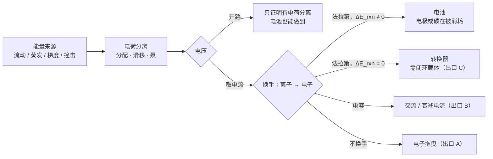

---
tags:
  - 化学
  - 物理化学
  - 电化学
  - 界面化学
  - 水
  - 水伏
  - 能量
关联:
  - "[水与膜上的自发电位：从冻结电势到化学渗透——电荷分离的三种手法与三层膜电位](水与膜上的自发电位：从冻结电势到化学渗透——电荷分离的三种手法与三层膜电位.md)"
  - "[第四相水与生命的必然涌现：从界面物理到自组织选择的统一框架](../生物学/第四相水与生命的必然涌现：从界面物理到自组织选择的统一框架.md)"
  - "[渗流框架：从凝胶点到冰共晶的隔间化](../生物学/渗流框架：从凝胶点到冰共晶的隔间化.md)"
  - "[文献笔记02_水微滴中的肽链与手性起源](../生物学/文献笔记02_水微滴中的肽链与手性起源.md)"
  - "[醌类：芳香性的赎金——呼吸链的心脏、染料母体与药毒同源的弹头](醌类：芳香性的赎金——呼吸链的心脏、染料母体与药毒同源的弹头.md)"
  - "[化学渗透理论](../生物学/化学渗透理论.md)"
---

# 水伏发电与瀑布起电：EZ 之后——电荷怎样被分开、怎样换手、谁在付账

> **根节点**：瀑布底下的空气为什么带负电？一张炭黑膜吸着水蒸发，为什么能读出 1 V？如果 Pollack 的"第四相水（EZ）"不再可信，这两件事要靠什么解释——扩散泳够不够？更深一层：膜里流的是离子，导线里流的是电子，**离子电流到底怎样变成外电路里持续的电子电流**？这一步是不是归根到底就是"电极"和"电池"的问题？
>
> **叙事逻辑**：起点问题（EZ 是否放弃，扩散泳能解释什么）→ 瀑布起电（表面双电层被剪切）→ 水伏的电压从哪来（四条通路）→ 水伏的电流怎样换手（基尔霍夫逼出的问题）→ 换手就是电化学：电极 ≠ 电池，判据是谁在付账 → 不是电池的三个出口 → 未解决问题与判别实验 → 收束：四种现象一套语法，外加第四个环节"换手"
>
> **立场说明**：✅ 经检索核对过原文或摘要；△ 凭记忆，未逐字核对；⚠️ 有实验但机制或可靠性有争议；**推断**是本笔记自己的分析，未见文献以同样方式论证。所有电压都尽量同时给电流；所有"持续发电"的说法都追问"累计电荷是多少、谁被消耗了"。
>
> **来源标注**：本笔记整理自 2026-11-19 的三轮讨论（EZ 与扩散泳 → 水伏的换手问题 → 换手是否就是电极/电池问题），文献通过 Exa 检索核对（Beattie 2016；Meng & Zare 2025；Fang & Guo 2023；Anwar & Tagliabue 2024；Lizée et al. 2023；Yin et al. 2014；Yan & Qi 2023；Zheng et al. 2023；Yao & Song 2025；Li et al. 2025 等），并整合库内 [自发电位](水与膜上的自发电位：从冻结电势到化学渗透——电荷分离的三种手法与三层膜电位.md)、[第四相水](../生物学/第四相水与生命的必然涌现：从界面物理到自组织选择的统一框架.md)、[渗流框架](../生物学/渗流框架：从凝胶点到冰共晶的隔间化.md)、[文献笔记02](../生物学/文献笔记02_水微滴中的肽链与手性起源.md) 的已有结论。

## 知识树

```txt
根节点：瀑布与水伏，电荷怎样被分开、怎样换手、谁在付账？
│
├── 〇、锚点
│   ├── 数字锚点（λ_D、τ = ε/κ、0.018 eV/分子、1 mg 碳 = 32 C …）
│   └── 时间锚点（1861 Quincke → 1892 Lenard → 2014 拖动电势 → 2017 水伏 → 2023 电子风/电极质疑 → 2025 微闪电）
│
├── 一、起点：EZ 是否应彻底放弃
│   ├── EZ 的三层：现象 / 结构解释 / 万能解释
│   ├── 分类错误：扩散泳产出速度，不产出电压
│   ├── EZ 宽度的正确标尺：扩散长度，而非德拜长度
│   └── 放弃清单、保留清单、复活条件
│
├── 二、瀑布起电（Lenard 效应）
│   ├── 现象：小滴负、大滴正；破裂是必要条件
│   ├── 机制：表面双电层被剪切劈开
│   ├── 定量检验：λ_D 与电荷弛豫时间 τ
│   ├── 反例：加盐反号 → EZ 失败、经典吸附成立
│   ├── 未解：纯水气-水界面为何带负电
│   └── 2025 微闪电（Zare）
│
├── 三、水伏：电压从哪来
│   ├── 交流型 vs 直流型
│   ├── 四条通路：流动电势 / 浓差扩散 / 移动边界赝电容 / 电子拖曳
│   └── 反例：官能团反号
│
├── 四、水伏：电流怎样换手
│   ├── 基尔霍夫：每个串联元件每秒都要过 I/e 个电荷
│   ├── 三种换法：法拉第 / 电容 / 不换手
│   ├── 量级：微克级反应物就能冒充"持续发电"
│   └── 碳骨架把流动电势内部短路
│
├── 五、换手就是电化学：电极 ≠ 电池
│   ├── 四类电化学器件谱系
│   ├── 判据：V_oc = ΔE_rxn + ΔE_grad
│   ├── 电压指纹：Al > Fe > Cu
│   ├── 阳极问题：有氧水里谁交出电子
│   ├── 蒸发每分子只有 0.018 eV；光系统 II 旁证
│   └── 碳本身是燃料 → 修正"累计电荷"判据
│
├── 六、不是电池的三个出口
│   ├── A 内部走电子（拖曳）
│   ├── B 电容 + 周期边界（交流）
│   └── C 闭环氧化还原载体（未见有人做）
│
├── 七、未解决问题（八条）
├── 八、判别实验总表
└── 九、收束
    ├── 四种现象，同一套语法
    ├── 第四个环节：换手
    ├── 呼吸链对照：燃料与载体
    └── 个体坐标：读水伏新闻的四道检查
```

## 〇、锚点

### 0.1 数字锚点

| 项 | 数值 | 为什么记它 |
|---|---|---|
| 纯水德拜长度 $\lambda_D$ | 约 1 μm | 和瀑布纳米水团、微滴尺寸相比较的尺子 |
| 1 mM NaCl 的 $\lambda_D$ | 约 10 nm | 加一点盐，双电层就薄两个数量级 |
| 纯水电荷弛豫时间 $\tau=\varepsilon/\kappa$ | 约 0.13 ms | 撕裂比它快，电荷分离才能被"冻住" |
| 海水 $\tau$ | 约 0.1 ns | 海浪飞沫起电弱的原因之一 |
| 盐离子扩散 10 分钟走多远 | 约 1 mm | EZ 宽度（100–600 μm）的正确标尺 |
| 瀑布负离子 / 正离子 | ≥ 10 : 1，主体是 < 30 nm 的纳米水团 | Kolarz 2012（经 Beattie 2016 转引）|
| 气-水 / 油-水界面电荷密度 | 约 5 μC/cm²（约每 3 nm² 一个 OH⁻） | Beattie 的 OH⁻ 吸附图景 |
| 炭黑水伏开路电压 | 约 1 V；短路电流 nA–μA | Xue 2017 |
| 流动电势对水伏电压的贡献 | 约一半 | Fang 2023 |
| 电子风"电流体电导率" | 2.8–21.6 nA·s/μm² | Lizée 2023，需偏压 |
| RH 50% 时蒸发自由能 | 1.7 kJ/mol ≈ **0.018 eV/分子** | 远低于氧化水所需的 1.23 eV |
| 自然蒸发可用自由能 | 约 2–5 W/m² | 器件实际 10⁻⁵–10⁻² W/m²，效率 10⁻⁶–10⁻³ |
| 100 nA 跑一年 | 3.2 C ≈ 1 mg Zn | 微量腐蚀就能冒充"长期发电" |
| 1 mg 碳完全氧化成 CO₂ | 约 32 C ≈ 100 nA × 10 年 | 碳基器件的"燃料储量" |
| C/CO₂ 与 O₂/H₂O 的标准电位 | +0.21 V vs +1.23 V | 阳极上碳在热力学上先于水被氧化 |

### 0.2 时间锚点

| 时间 | 事件 | 为什么值得记 |
|---|---|---|
| 1861 | Quincke：水中气泡电泳向正极走 | 气-水界面带负电的最早证据 |
| 1890–1892 | Elster & Geitel 观察阿尔卑斯瀑布起电；Lenard 1892 系统研究，命名 Wasserfall-Elektrizität | 瀑布起电的起点 |
| 1895 | 《Scientific American》转述：**加少量食盐，空气从带负电变成带正电** | 本笔记最重要的反例 |
| 1914 | Nolan：飞溅起电的符号与大小取决于溶质，浓度升高则趋于零 | 离子特异性 |
| 2003 | △ Ghosh, Sood & Kumar：碳纳米管在流动液体中产生电压 | 液体流动在碳里生电的早期报告 |
| 2006 | Zheng, Chin, Khijniak & Pollack：EZ"能与溶液无限期共存" | 第四相水的核心主张 |
| 2013–2014 | Schurr；Florea 等；Huszár 等：EZ = 离子交换驱动的扩散泳，会耗尽 | EZ 被经典物理接管 |
| 2014 | Yin, Guo 等：拖动电势（移动边界赝电容） | 第一个干净的"离子→电子"转换机制 |
| 2017 | Xue 等：炭黑膜蒸发诱导发电 | "水伏"进入主流 |
| 2020 | Elton 等 *IJMS* 综述 | EZ 证据的系统清点 |
| 2023 | Lizée 等：电子风（声子拖曳）；Yan & Qi、Zheng 等：活泼电极在偷偷当电池；Fang 等：流动电势只占一半 | 水伏机制争论的分水岭 |
| 2024 | Anwar & Tagliabue：盐度依赖的 PNP 建模 | 经典理论能处理的部分 |
| 2025 | Meng & Zare：喷雾微滴"微闪电"；Yao & Song：呼吁"可持续机制" | 两个前沿 |

## 一、起点：EZ 是否应彻底放弃

### 1.1 EZ 是三层东西，不是一个

| 层 | 内容 | 现状 | 处理 |
|---|---|---|---|
| ① 现象 | 亲水/离子交换表面旁有 100–600 μm 的颗粒排斥区 | ✅ 多个实验室复现（Elton 2020） | **保留**，改称"扩散泳排斥区" |
| ② 结构解释 | 水在那里变成有序新相（H₃O₂、液晶态），能无限期存在 | ❌ 密度、力场、耗尽、高盐四项检验不支持 | **放弃** |
| ③ 万能解释 | 用 EZ 的"负电外壳"解释云、雨滴、瀑布、"水电池" | ❌ 只预言"负"，遇到反号就失败（§2.4、§3.3） | **放弃** |

第二层的逐项证据已在 [第四相水 §1.2](../生物学/第四相水与生命的必然涌现：从界面物理到自组织选择的统一框架.md) 的主张状态表里，这里只记最关键的三条：

- ✅ Huszár 等 2014：持续冲洗 Nafion 后，排斥能力约 **2 小时**耗尽，一夜后完全消失——"无限期共存"不成立；
- ✅ Florea 等 2014：EZ 宽度严格按 $\sqrt{t}$ 增长，"离子交换 → 离子扩散 → 扩散泳"三步模型定量拟合；
- ✅ 光镊测得排斥力**随距离衰减**，而新相应给出区内均匀、边界突变的力。

### 1.2 一个分类错误：扩散泳不产出电压

反驳一个万能理论时，最容易犯的错误是换上另一个万能理论。"扩散泳能不能解释瀑布和水伏"这个问法本身需要先修正。

| | 扩散泳 | 瀑布起电 / 水伏 |
|---|---|---|
| 输入 | 已经存在的溶质浓度梯度 | 流动、破裂、蒸发 |
| 输出 | **颗粒的速度** | **电压与电流** |
| 在"分配/滑移/泵"中的位置 | 电泳分量 = 扩散电势（分配类，非平衡）；化学泳分量 = 双电层滑移（滑移类） | 滑移 + 分配，外加"换手"（§四） |

所以准确的说法是：**扩散泳本身不能解释瀑布起电和水伏；能解释它们主体的，是扩散泳所属的那一族物理——双电层 + Nernst–Planck 离子输运 + 流动。** 同一套 Nernst–Planck–Poisson–Stokes 方程，换边界条件就得到不同的现象。

### 1.3 EZ 的宽度并不神秘：拿错了尺子

Pollack 的核心直觉是"几百微米远超双电层（纳米级），所以必然有新相"。但比较对象选错了。EZ 是**离子交换释放的离子梯度**驱动的，它的尺度应当和**扩散长度**比：

$$
L \approx \sqrt{D t}
$$

- **$L$**：离子在时间 $t$ 内扩散的典型距离；
- **$D$**：扩散系数，NaCl 约 $1.5\times10^{-9}$ m²/s，H⁺ 约 $9.3\times10^{-9}$ m²/s；
- **$t$**：时间。

代入 $t=600$ s：$L\approx\sqrt{1.5\times10^{-9}\times600}\approx0.95$ mm。**10 分钟的扩散长度正好覆盖 100–600 μm 的 EZ 宽度**，而且 $L\propto\sqrt{t}$ 正是 Florea 2014 测到的生长律。

### 1.4 放弃、保留与复活条件

**用 Lakatos 的话说**：EZ 是一个退化中的研究纲领——遇到反例就加辅助假设，却拿不出新的、有风险的定量预测；而扩散泳模型预测出了 $\sqrt{t}$ 增长和耗尽。放弃的理由不是它每个细节都错，而是**预测能力严重不对等**。

| 项目 | 处理 | 理由 |
|---|---|---|
| 第四相、H₃O₂、无限期共存 | 放弃 | 可证伪的主张已被证伪 |
| 云、瀑布、"水电池"的万能解释 | 放弃 | 不给定量预测，遇反号即失败 |
| 排斥区现象本身 | 保留 | 有工程价值：✅ Shin 等 2017 用 CO₂ 扩散泳做无膜过滤；✅ Esplandiu 等 2022 做出以盐为燃料的微泵 |
| 光驱动 EZ 增长、排斥盐离子 | 列为待验证的异常 | 判别实验见 [第四相水 §1.2](../生物学/第四相水与生命的必然涌现：从界面物理到自组织选择的统一框架.md) |

**EZ 可以"复活"的条件**（三项同时成立才值得重新考虑）：
1. 竖直装置（排除对流）、Nafion 离子交换容量已耗尽之后，单靠光照仍能产生排斥区；
2. 用 $\zeta\approx0$ 的两性离子探针（扩散泳对它几乎无效）也观察到排斥；
3. 排斥力在区内均匀、在边界突变。

**"界面水特殊"这个直觉对在哪**：它在**纳米尺度**是对的——△ 纳米受限水的介电常数可降到约 2（Fumagalli 2018 *Science*）；气-水界面的强电场与异常酸碱（[文献笔记02 §三](../生物学/文献笔记02_水微滴中的肽链与手性起源.md)）。错误在于把纳米尺度的特殊性外推到几百微米。

## 二、瀑布起电：Lenard 效应

### 2.1 现象

✅ Elster 与 Geitel 1890 年在阿尔卑斯瀑布附近观察到强烈起电；Lenard 1892 年系统研究并命名为 *Wasserfall-Elektrizität*（瀑布电）。要点：

- 瀑布底部升起的**细雾带负电**，靠近水面的较大飞沫带正电；
- ✅ 1895 年《Scientific American》转述 Lenard：平静湖面虽然一直在蒸发，却**测不到**空气起电；单纯的水柱穿过空气、或水沿光滑斜面滑下，起电也微不足道；**水滴必须撞上坚硬的湿表面并破碎成细滴**；
- ✅ Beattie 2016 转引 Kolarz 2012：小于 30 nm 的正、负纳米水团都会增加，但**负的数量是正的十倍以上**；
- ✅ Xia 等 2024（*J. Phys. Chem. A*）用高速相机拍下喷雾液滴在均匀电场中的轨迹，直接看到"小滴负、大滴正"。

> 📌 **Lenard 效应（Lenard effect / waterfall / balloelectric / spray electrification）**：液体在破碎、飞溅、鼓泡时，细小碎片与残余大滴带上相反电荷的现象。对纯水和稀溶液，细雾通常带负电。它的必要条件是**破裂**，不是蒸发，也不是流过空气。

### 2.2 机制：表面双电层被剪切劈开

主流图景分三步（✅ Beattie 2016；✅ Meng & Zare 2025 引言中的概述）：

1. 气-水界面自发带一层净电荷（纯水偏负），反离子分布在内侧的扩散层里；
2. 水滴撞击破裂时，剪切把**最外层表皮**撕成极小碎片带走——小碎片带走表面的负电荷，留下的大残滴带正电；
3. 撕裂必须快于电荷重排，分离才能被"冻住"。

在 [自发电位 §1.2](水与膜上的自发电位：从冻结电势到化学渗透——电荷分离的三种手法与三层膜电位.md) 的三分法里，它属于**滑移**的极端版本：不是流体沿界面滑过，而是界面本身被撕开。

### 2.3 定量检验：两个时间与长度尺度

$$
\lambda_D \approx \frac{0.304}{\sqrt{I}}\ \mathrm{nm},\qquad \tau = \frac{\varepsilon_r\varepsilon_0}{\kappa}
$$

- **$\lambda_D$**：德拜长度，双电层扩散层的厚度；
- **$I$**：离子强度，单位 mol/L；纯水约 $10^{-7}$；
- **$\tau$**：电荷弛豫时间，过剩电荷被导电抹平所需的时间；
- **$\varepsilon_r\varepsilon_0$**：水的介电常数，约 $6.9\times10^{-10}$ F/m；
- **$\kappa$**：电导率，单位 S/m。

| 条件 | $\lambda_D$ | $\tau$ | 推论 |
|---|---|---|---|
| 纯水（$\kappa=5.5\times10^{-6}$ S/m） | 约 1 μm | 约 0.13 ms | 纳米碎片可以整块带走表面过剩电荷，几乎得不到补偿 |
| 1 mM NaCl | 约 10 nm | 约 55 ns | 碎片接近电中性，效应变弱 |
| 海水 | 约 0.4 nm | 约 0.1 ns | 碎片几乎完全中性 |

Kolarz 测到的负离子主体是 < 30 nm 的纳米水团，**和稀水的 $\lambda_D$ 同一量级**——一个碎片可以整块切走扩散层的外缘。盐越多，$\lambda_D$ 越薄，碎片越接近中性。✅ Nolan 1914 观察到"溶液浓度升高，起电最终趋于零"，与此一致。

> ⚠️ 2026 年 arXiv 上的一项液滴撞击钢网实验（arXiv:2608.05828）给出：电荷输出随 NaCl 浓度**先升后降**，1 mM 时最大（0.78 pC/mg），之后到 1 M 逐渐下降。低浓度端的上升可能来自电导率太低时电荷无法被引出到测量电极，说明"盐越少效应越强"只在一定区间成立。

### 2.4 反例：加盐反号——EZ 失败、经典吸附成立

✅ 1895 年的转述："**加入少量食盐，就足以完全改变效应，使空气带正电而不是负电。**" ✅ Nolan 1914：极稀溶液中，电荷的**符号和大小都取决于溶解的物质**及其浓度。

| | 经典双电层 + 离子特异性吸附 | EZ |
|---|---|---|
| 符号为什么能反转 | 不同离子进入界面层的倾向不同（Hofmeister 序列），净表面电荷可以变号 | 有序水壳在结构上只预言"负"，无法反号 |
| 界面类型 | 气-水是疏水界面，有自己的电荷 | Pollack 说 EZ 要靠**亲水**表面成核，气-水界面不满足前提 |
| 定量预测 | $\lambda_D$、$\tau$ 给出盐度依赖 | 无 |

✅ Loeb 的经典综述还记载了一个旁证：鼓泡收集极稀 NaCl 溶液的飞沫，在阴极上得到 Na₂O/NaOH 沉积、阳极上什么都没有——说明细雾里的负电荷载体是 OH⁻ 或电子这类"不留残渣"的东西，而 Na⁺ 留在正电荷一侧。

### 2.5 真正没解决的：纯水气-水界面为何带负电 ⚠️

这是一个真实的争议，但它发生在**纳米尺度**，和第四相水无关。

| 候选 | 主张 | 证据与困难 |
|---|---|---|
| **OH⁻ 优先吸附**（Beattie 等） | 自电离产生的 OH⁻ 被"涨落-关联"色散力推向低介电界面；表面电荷约 5 μC/cm²，等电点约 pH 3 | ✅ 气泡、油滴电泳自 1861 年以来一直带负电；✅ Colussi 组水射流实验显示界面酸碱等电点从 pH 7 移到 pH 3 |
| **H₃O⁺ 表面倾向**（△ Jungwirth、Saykally 等） | 光谱与分子模拟显示表面更偏酸 | 与电动测量**正面矛盾**，至今未调和 |
| **水分子间电荷转移**（△ Vácha 等 2012） | 界面不对称氢键造成每分子约 0.01 e 量级的电荷转移 | 有模拟支持，无决定性实验 |
| **与空气的电子转移**（Zare 组 2025） | 接触起电：液滴失去电子带正电 | ⚠️ 单一实验室；"转移的是电子还是离子"本身是接触起电领域的未解问题 |
| Lenard 原始模型 | 表面水偶极取向，负端朝外 | ✅ Beattie 指出没有独立证据支持这种取向 |

### 2.6 微闪电：瀑布起电的一个前沿推论 ⚠️

✅ Meng, Xia, Xu & Zare 2025（*Science Advances*，doi:10.1126/sciadv.adt8979）：

- 声悬浮单个水滴，压扁使其分裂；接 ±4 kV 电极时，所有小碎片飞向正极，证实小滴带负电；
- 分裂过程中，带相反电荷的大小液滴靠得极近时**放电发光**，光子计数从约 100 counts/s 升到约 300 counts/s；水滴撞击 PTFE 表面飞溅时也能拍到；
- COMSOL 模拟：16 μm 正滴与 4 μm 负滴相距 0.1–5 nm 时，间隙电场超过 $8\times10^{9}$ V/m；
- 在 N₂/CH₄/CO₂/NH₃ 混合气中喷雾，检测到 HCN、氰基乙炔、甘氨酸、尿素、尿嘧啶；**只让水汽冷凝成单个液滴、不发生分裂时，检测不到 HCN**；
- 作者认为初始带电主要来自液滴与空气的接触起电，称这一现象为"微闪电"（microlightning），并把它作为前生物分子合成的一条候选路径。

**谨慎点**：单一实验室；微液滴化学领域本身有"人为假象"的争论（△ 例如 H₂O₂ 的来源）；光子信号只是暗计数的约 3 倍。它和 [文献笔记02](../生物学/文献笔记02_水微滴中的肽链与手性起源.md) 的界面强电场属于同一家族，但可信度不宜标得比"有明确实验、待独立复现"更高。

### 2.7 扩散泳在瀑布里起什么作用

**基本不起作用。** 瀑布起电是剪切劈开双电层（滑移 + 断裂），不需要颗粒在浓度梯度里迁移。把它归给扩散泳，和把它归给 EZ 犯的是同一类错误。

## 三、水伏：电压从哪来

### 3.1 先分清交流型和直流型

| 类型 | 代表 | 离子→电子的方式 | 争议程度 |
|---|---|---|---|
| 液滴撞击发电（交流脉冲） | △ Xu, Wang Zuankai 等 2020 *Nature*，单滴峰值约 140 V | **静电感应**：带电 PTFE 与液滴组成可变电容，液滴铺开、回缩，电荷来回流 | 基本无争议 |
| 拖动 / 插拔石墨烯（准直流，mV–0.1 V） | ✅ Yin 等 2014 | 移动边界赝电容（§3.2 通路三） | 机制较清楚 |
| **蒸发发电（稳态直流）** | ✅ Xue 等 2017，炭黑膜约 1 V | **未定** | **核心争议** |
| **吸湿发电**（MEG，moisture-enabled generator） | 氧化石墨烯、蛋白纳米线、水凝胶等 | **未定**，且大量混入电极腐蚀 | 争议最大 |

交流器件不需要净电荷穿过界面，电容来回充放即可。**稳态直流必须有净电荷持续通过**，所以只有直流器件被逼着回答"离子怎样变成电子"（§四）。

### 3.2 四条候选通路

#### 通路一：流动电势与伪流动电势（滑移）

蒸发在孔道里拉出毛细流，把孔壁双电层的扩散层冲向蒸发端：

$$
\frac{\Delta V}{\Delta P} = \frac{\varepsilon_r\varepsilon_0\zeta}{\eta\kappa}
$$

- **$\Delta V$ / $\Delta P$**：流动电势 / 驱动压差；
- **$\zeta$**：孔壁 zeta 电位，**符号决定电压方向**；
- **$\eta$**：黏度；**$\kappa$**：电导率，在分母上，盐越多效应越弱。

✅ Fang, Lu, Chu & Guo 2023（*Nano Research Energy*）：
- 把炭黑膜夹在两块玻璃间、用压力推水，能测到电压和电流，压力撤掉立即消失——流动电势在这种膜里**确实存在**；
- NaCl 低于 $10^{-4}$ M 时电压饱和，高于后下降，符合双电层重叠时纳米通道的流动电势规律；膜的 zeta 电位为 −25.5 mV；
- 但**流动电势只贡献蒸发电压的约一半**，且集中在固-液-气三相共存的部分润湿区。

#### 通路二：离子浓度梯度与扩散电势（分配）

材料一侧官能团密度更高（如氧化石墨烯含氧基团梯度），吸水后解离出 H⁺；H⁺ 扩散快、固定负电荷不动，于是建立电压。✅ Lee 等 2025 综述把亲水型水伏分为"流动"与"扩散"两类，后者靠官能团或吸湿材料**人为维持**离子梯度。

它和扩散泳的电泳分量**用的是同一个电场**——这是"扩散泳家族"在水伏里唯一直接出场的地方。问题是梯度本身**有限储量**：吸湿饱和、H⁺ 分布均匀后电流就停止，必须靠干湿循环重新"充电"（和 EZ 会耗尽是同一逻辑，见 [第四相水 机制D](../生物学/第四相水与生命的必然涌现：从界面物理到自组织选择的统一框架.md)）。

#### 通路三：移动边界上的赝电容（Guo 组"拖动电势"）

✅ Yin 等 2014（*Nature Nanotechnology*）：在单层石墨烯条带上拖动一滴 0.6 M NaCl，产生几毫伏电压，正比于速度与液滴数，随石墨烯层数增加急剧下降。✅ 同组 2014 年 *Nat. Commun.*（经 Liu 2015 *NSR* 评述）：石墨烯插入或拔出溶液，**一条移动边界就能产生最高 0.1 V**；**石墨烯完全浸没在流动液体中时，没有电压**——既无压差，也无移动边界。

机制：液滴中的 Na⁺ 吸附在石墨烯上，石墨烯里聚集电子作为镜像电荷，形成间隙极窄、电容极大的赝电容。

$$
\frac{dC_F}{dt}=C_0Wv,\qquad \frac{dC_R}{dt}=-C_0Wv
$$

- **$C_F$ / $C_R$**：液滴前沿 / 后沿下方的界面电容；
- **$C_0$**：单位面积界面电容；**$W$**：液滴宽度；**$v$**：移动速度。

前沿不断新建电容（吸电子），后沿不断拆除电容（放电子），电子在石墨烯内部从后沿流向前沿。**电荷不需要穿过界面**；代价是边界必须一直移动，消耗推动液滴的机械功。

**套到蒸发器件上的困难（推断）**：稳态蒸发时润湿前沿宏观上**静止**。要用这条机制，必须论证分子尺度上持续的吸附-脱附等效于一条不断移动的边界。Fang 2023 把电压定位在三相区，与这种思路相容，但无人做出定量推导。

#### 通路四：拖曳——根本不需要换手

| 机制 | 主张 | 证据 |
|---|---|---|
| 库仑拖曳 | 液体中运动的离子或偶极，通过库仑作用拖动碳里的电子 | △ Král & Shapiro 2001 *PRL* 理论；△ Ghosh 等 2003 *Science* |
| **声子拖曳 / 电子风** | 液-固黏性摩擦把动量交给晶格声子，声子经电子-声子耦合把费米面附近的电子顺流推走 | ✅ Lizée, Bocquet, Siria 等 2023 *Phys. Rev. X* 13: 011020 |

✅ Lizée 2023 的两个反例式结果：
- **离子液体、甘油、非极性硅油给出同量级电流**——液-固库仑作用不是必需的，"离子"在这里可能根本不重要；
- **有褶皱的石墨烯电流很强，平整的几乎没有**；同一样品高褶皱区与低褶皱区对比也是如此——褶皱是把液体动量交给声子的"把手"。

另外：电流正比于液滴速度，也**正比于外加偏压**，零偏压时很小或可忽略；电流体电导率 2.8–21.6 nA·s/μm²。这是唯一一条**原理上可以无限持续**的通路，但它在宏观蒸发器件中是否主导，**无人证明**。

### 3.3 反例：换官能团，电压反号

✅ Fang 2023：**羧基化炭黑与氨基化炭黑蒸发时给出相反符号的电压**；第一性原理计算显示，水分子吸附在两种表面上的电荷转移方向相反。

| | 经典电动学 | EZ |
|---|---|---|
| 解释 | 羧基表面带负电、氨基表面带正电，$\zeta$ 变号，流动电势跟着变号 | 两者都亲水，都应长出带负电的 EZ |
| 能否预测反号 | ✅ 能 | ❌ 不能 |

这和 §2.4 的"加盐反号"是同一类反例：**一个只预言"负"的理论，遇到符号可调的现象就失败。**

### 3.4 盐度：经典理论能处理的部分

✅ Anwar & Tagliabue 2024（*Device*）用 Poisson–Nernst–Planck（PNP）方程加表面化学平衡建模：

| 条件 | 结论 |
|---|---|
| 淡水（约 1 mM） | 需要双电层重叠，即纳米级受限通道 |
| 海水（10–100 mM） | 调节表面电荷后，孔径 > 100 nm 也能达到最优 |
| > 1 M | 表面电荷可反转；但长期运行会结晶、吸附离子，表面性质改变 |

这是目前最成熟的工程方向。但它算的是**孔液里的离子分布与电势**，没有算电极上的转换——那是 §四 的问题。

### 3.5 四条通路汇总

| 通路 | 电压来源 | 离子→电子在哪发生 | 能否持续 | 现状 |
|---|---|---|---|---|
| 流动电势 | 滑移 | 电极上的法拉第反应 | 仅当反应可逆并被再生 | ✅ 存在，约占一半 |
| 浓差扩散 | 分配 | 同上 | 梯度会耗尽 | ✅ 存在，储量有限 |
| 移动边界赝电容 | 电容几何 | 移动的电容边界，不换手 | 边界移动即可持续 | ✅ 液滴尺度成立；推广到蒸发 ⚠️ |
| 声子 / 库仑拖曳 | 动量传递 | 不换手 | ✅ 原理上可持续 | ✅ 微观存在；宏观主导 ⚠️ |

## 四、水伏：电流怎样换手

### 4.1 基尔霍夫逼出的问题

✅ 2020 年 *Joule* 综述《Hydrovoltaic Energy on the Way》点明：流动电流的经典测量用 Ag/AgCl 等**不可极化电极**，由电极反应把溶液里的离子电流转成导线里的电子电流；而水伏器件直接用金属或碳纳米管膜作电极读电流，"**界面上的离子/质子运动或积累，怎样在材料里产生恒定的电子电流**"是最重要的缺失环节。

一个水伏器件是一条串联电路：

```txt
外电路（电子） → 电极A ┃界面A┃ 多孔膜：孔液走离子 / 碳骨架走电子 ┃界面B┃ 电极B → 外电路（电子）
```

稳态直流电流 $I$ 必须**每秒**通过每一个串联元件。凡是载流子从电子换成离子的界面，每秒都要完成 $I/e$ 次换手。物理上只有三种换法：

| 换法 | 本质 | 代价 | 能否持续 |
|---|---|---|---|
| **法拉第反应** | 电子真正穿过界面，使某物质氧化或还原 | 每秒消耗 $I/(nF)$ mol 反应物 | 仅当反应物被循环再生 |
| **电容充电** | 电子停在电极侧、离子停在溶液侧，组成双电层 | 累计电荷 $\int I\,dt\le C\Delta V$，充满后电流归零 | ❌ 只能给衰减电流 |
| **不换手** | 整条电流路径都是电子导体，驱动力直接作用在电子上 | 消耗流体动量 | ✅ 原理上可持续，但效应弱 |

### 4.2 量级：微量反应物就能冒充"持续发电"

以 100 nA 的典型短路电流估算：

| 输出 | 累计电荷 | 等效锌消耗（Zn → Zn²⁺） | 等效电容（ΔV = 0.5 V） |
|---|---|---|---|
| 100 nA × 1 周 | 0.06 C | 约 0.02 mg | 0.12 F |
| 100 nA × 1 年 | 3.2 C | 约 1 mg | 6 F |

炭黑比表面积几百 m²/g，双电层比电容约 10 μF/cm²，折合约 10–100 F/g，**1 mg 炭黑就有 0.01–0.1 F**（推断）。也就是说：碳器件单靠电容放电就能撑几小时到几天的准直流；微克级金属腐蚀撑一周；毫克级撑一年。**"持续输出 X 天"本身证明不了任何东西。**

✅ Yao & Song 2025 提出判据：**累计输出的电荷或能量，必须超过器件材料中可能储存的化学能**；并直言目前演示过的电流持续性还没有达到普通化学电池的水平。（这个判据对碳器件有漏洞，见 §5.6。）

### 4.3 碳骨架把流动电势内部短路（推断）

炭黑本身是电子导体，于是：

- 扩散层里的阳离子顺流移向蒸发端，形成正向离子电流；
- 碳里作为它们镜像电荷的电子跟着一起顺流移动，形成反向电子电流；
- **两者在局部相互抵消**——碳骨架把流动电势在内部短路了。

所以碳电极读到的稳态电压**不可能是纯流动电势**。它只能来自：(a) 碳的费米能级随局部环境（含水量、pH、官能团质子化）沿长度变化——即 Fang 2023 计算的"吸附水改变碳的载流子"；(b) 拖曳；(c) 碳表面的法拉第反应。这也解释了为什么 Fang 2023 的电压集中在**三相区**：只有那里，碳所处的局部环境沿长度急剧变化。

## 五、换手就是电化学：电极 ≠ 电池

### 5.1 为什么换手一定是电化学

器件内部只有两条回路：

| 内部回路 | 载流子 | 是否换手 | 属于哪类物理 |
|---|---|---|---|
| 碳骨架 | 电子 | 不需要 | 固体物理（拖曳、费米能级梯度） |
| 孔液 | 离子 | **两端各换一次** | 电化学 |

走第二条时，电子在一端离开碳进入溶液（还原），在另一端从溶液回到碳（氧化）。**此时多孔碳膜本身就是一对分布在膜内的电极**，金属电极只是接在上面的导线。所以即便用金电极、金完全不碰水，也绕不开电化学——碳-水界面会接手这项工作。

电子交给离子只有三种方式：法拉第反应、电容充电、两者混合的赝电容。**稳态直流只能靠法拉第反应。** 问题于是收窄为：**稳态直流水伏的法拉第反应是什么？它有没有被再生？谁在付账？**

### 5.2 电极 ≠ 电池：四类成熟的电化学器件

电化学早就造过"电极只是转换器、能量来自别处"的器件：

| 器件 | 电极反应 | 一个循环后电极净变化 | 能量来源 | 能否持续 |
|---|---|---|---|---|
| **一次电池**（Zn–空气） | 阳极 Zn 氧化，阴极 O₂ 还原 | Zn 被消耗 | 电极材料的化学能 | ❌ |
| **遇水激活电池**（△ Mg/AgCl 海水电池，救生衣灯、声呐浮标） | 同上，加水才开始 | 同上 | 同上，水只是"开关" | ❌ |
| **浓差电池**（△ 反电渗析常用两端 Ag/AgCl） | 一端 Ag→AgCl，另一端 AgCl→Ag | 净反应为零，Ag 从一端搬到另一端 | **盐度梯度** | 需定期反转极性 |
| **氧化还原液流 / 热电池**（△ Fe(CN)₆³⁻/⁴⁻ 热电池；反电渗析电站的循环电极液） | 同一电对在两端一边还原、一边氧化，并在两端间循环 | 零 | **梯度或温差** | ✅ |
| **电容混合**（△ CapMix，Brogioli 2009 *PRL*） | 无法拉第反应，交替充放电 | 无 | 盐度梯度 | ✅ 但输出交流 |

### 5.3 判据：开路电压的两项分解

$$
V_{\mathrm{oc}} = \Delta E_{\mathrm{rxn}} + \Delta E_{\mathrm{grad}}
$$

- **$V_{\mathrm{oc}}$**：器件开路电压；
- **$\Delta E_{\mathrm{rxn}}$**：两端发生**不同**反应时，两对氧化还原电对标准电位之差，可达 0.5–2 V；
- **$\Delta E_{\mathrm{grad}}$**：两端发生**同一**反应、只是局部条件（浓度、pH、温度、流动）不同时的电位差；平衡型上限受 Nernst 约束，约每十倍 59 mV（[自发电位 §8.2](水与膜上的自发电位：从冻结电势到化学渗透——电荷分离的三种手法与三层膜电位.md)）。

> 📌 **判据**：$\Delta E_{\mathrm{rxn}}\neq0$ 的是**电池**；$\Delta E_{\mathrm{rxn}}=0$、只靠 $\Delta E_{\mathrm{grad}}$ 的才是**转换器**。

### 5.4 电压指纹：电压跟着电极材料走

- ✅ Yan & Qi 2023（*ACS Appl. Electron. Mater.*）：湿纸巾配**碳电极不发电**；换成 Al、Fe、Cu 顶电极，输出分别为 0.78、0.51、0.21 V——**排序与金属标准电极电位（Al −1.66、Fe −0.44、Cu +0.34 V）一致**；TiO₂ 平面器件结果相同；而且用活泼电极后，**器件对湿度不再敏感**。
- ✅ Zheng, Fang, Chu 等 2023（*Nano Research*）：空气铺网纸器件配 Zn 电极，电压约 1.26–1.52 V，电流最高约 75.69 μA，落在锌-空气电池的量级；作者建议水伏研究只用 Au、Pt 等惰性电极。
- ✅ 2025 年 *Adv. Funct. Mater.* 综述（Qiao 等）干脆把"氧化还原型吸湿发电"单列一类，承认 Al、Zn、Cu 被腐蚀就是能量来源；其中一例用 LiCl 吸湿、铜电极，输出 216 μW。
- ✅ Li, Cheng, Yang & Qu 2025 综述：功能材料与电极界面上的离子-电子转换"**受到的关注很少**"，并主张避免使用活泼电极。

**电压跟着电极材料走、而不是跟着湿度或蒸发速率走，就是 $\Delta E_{\mathrm{rxn}}$ 在主导——这些器件本质上是遇水激活电池，只是换了名字。**

### 5.5 阳极问题：有氧的水里，谁交出电子

**阴极**不缺反应物：空气中的 O₂ 取之不尽，O₂ + 4H⁺ + 4e⁻ → 2H₂O（E° = 1.23 V），碳表面本身就能催化（生成 H₂O 或 H₂O₂）。

**阳极**必须有东西交出电子：

| 阳极电子供体 | 反应 | 电位（vs SHE） | 结果 |
|---|---|---|---|
| 活泼金属 | Zn → Zn²⁺ + 2e⁻ | −0.76 V | 电池（§5.4） |
| **碳本身** | C + 2H₂O → CO₂ + 4H⁺ + 4e⁻ | **+0.21 V** | 慢速的碳-空气电池 |
| 表面氢醌基团 | QH₂ → Q + 2H⁺ + 2e⁻ | 约 0.2–0.7 V | 储量有限的赝电容 |
| 杂质、有机污染物 | 各异 | — | 储量有限 |
| **水** | 2H₂O → O₂ + 4H⁺ + 4e⁻ | **+1.23 V**，另需几百 mV 过电位 | 动力学上被堵死 |

**关键是"碳本身"这一行**：碳的氧化电位比水低约 1 V，阳极电位一旦被推高，**热力学上碳先于水被氧化**。

> ⚠️ **动力学补充**：室温下碳的整体氧化非常慢（燃料电池里碳载体的明显腐蚀通常要在约 1 V 以上的高电位下才显著）。但水伏只需要 **nA 级**电流——对应的反应速率极低，表面官能团、边缘碳、无定形碳的缓慢氧化就足够支撑。"慢"不等于"不够"。

还剩一种理论可能：两端都用 O₂/H₂O 这一对电对组成浓差电池，净反应为零。但两端过电位加起来要 0.7 V 以上，而梯度能提供的 $\Delta E_{\mathrm{grad}}$ 只有几十到一百多 mV，付不起（推断）。

### 5.6 蒸发每分子只有 0.018 eV

$$
\frac{\Delta\mu}{N_A}=\frac{RT\ln(1/\mathrm{RH})}{N_A}\approx\frac{1.7\ \mathrm{kJ/mol}}{6.02\times10^{23}\ \mathrm{mol^{-1}}}\approx0.018\ \mathrm{eV}
$$

- **$\Delta\mu$**：每摩尔水从液态蒸发到空气中可做的最大功，RH = 50%、25 ℃ 时约 1.7 kJ/mol；
- **RH**：相对湿度；**$N_A$**：阿伏伽德罗常数；
- **0.018 eV**：约 0.7 $kT$。

从水里拿出一个电子至少要 1.23 eV，相当于把约 **70 个**水分子的蒸发能量集中到一个电子上。原理上"攒能量"可以做到（ATP 合酶就把多个质子的能量攒成一个 ATP），但需要精密的分子变速箱，**炭黑里没有这种结构**。

**生物学旁证**：地球上唯一能在常温下持续以水为电子供体的系统，是光系统 II 的 Mn₄CaO₅ 放氧中心——每个电子用一个约 1.8 eV 的光子，每放一个 O₂ 要累积四次氧化。**演化花了巨大代价才解决的"阳极问题"，一张炭黑膜不可能顺手解决。**

**宏观能量账**（推断）：自然蒸发每天约 2–5 mm，折算可用自由能约 **2–5 W/m²**；目前最好的器件约 μW/cm²（$10^{-2}$ W/m²），多数在 nW/cm²（$10^{-5}$ W/m²）。效率只有 $10^{-6}$–$10^{-3}$。**热力学余量很大，瓶颈不在能源，而在耦合方式。** 蒸发同时会降温，所以还要扣除热电（Seebeck）与离子热扩散（Soret）的贡献；碳的 Seebeck 系数只有 μV/K 级，几开尔文的温差远不足以给出 1 V，可排除为主导，但仍需对照实验。

### 5.7 修正判据：碳本身就是燃料

§4.2 引用的"累计电荷 > 材料可储存量"判据，对碳器件要重新算储量：

$$
Q=\frac{nFm}{M}
$$

- **$Q$**：可释放电荷，单位 C；
- **$n$**：每个碳原子交出的电子数，完全氧化成 CO₂ 为 4；
- **$F$**：法拉第常数，96485 C/mol；
- **$m$**：碳的质量；**$M$**：12 g/mol。

| 情形 | 1 mg 碳可放出 | 以 100 nA 计能撑 |
|---|---|---|
| 完全氧化成 CO₂ | 约 32 C | **约 10 年** |
| 只氧化表面一层，每个碳交 1 个电子（炭黑约 250 m²/g，推断） | 约 1.5 C | **约半年** |

**结论**：对碳基器件，"累计电荷大于储量"几乎不可能被满足，也就几乎排除不了任何东西。碳器件必须改用**直接检测产物**的方法（§八：¹³C 示踪、XPS、惰性气氛）。

### 5.8 隐藏的电池：惰性电极也不保险（推断）

**差异充气电池**：即使两个电极都用惰性金属，器件本身也**不对称**——一端湿、一端干，两个电极所处的局部 pH、离子浓度和**氧气供应**都不同。腐蚀学里的差异充气电池（Evans 电池）正是这种结构：供氧多的一端做阴极；只要阳极一侧有可氧化之物（碳表面有机基团、杂质、碳骨架本身），就构成一个慢速消耗的电池。它是 Fang 2023 那"另一半"电压的候选来源之一。**判别**：在 N₂ 或 Ar 中重复蒸发实验。

**表面醌基是隐藏的离子-电子转换器**（未见文献）：炭黑表面富含醌/氢醌基团，可发生 Q + 2H⁺ + 2e⁻ ⇌ QH₂。这正是 [醌类](醌类：芳香性的赎金——呼吸链的心脏、染料母体与药毒同源的弹头.md) 里呼吸链用的**质子耦合电子转移**——生物用醌把电子流变成质子流，碳膜可能在反向使用同一件工具。它是有限储量的赝电容；只有一端被空气中的 O₂ 重新氧化、另一端被还原形成循环，它才能持续——而那又回到差异充气电池。**判别**：用肼或高温氢气还原表面醌基，或改用无含氧基团的石墨化碳，看输出是否明显下降；再把循环伏安测得的赝电容储量与器件累计电荷对比。

## 六、不是电池的三个出口

把 §5.1 的回路表与 §5.2 的器件表合起来，水伏要摆脱"电池"身份只有三条路：

| 出口 | 怎样绕开阳极问题 | 电极的角色 | 输出 | 现状 |
|---|---|---|---|---|
| **A. 内部回路走电子** | 不换手，驱动力直接作用在碳里的电子上（声子拖曳、库仑拖曳、费米能级梯度） | 欧姆接触，**不是电化学电极** | 直流 | ✅ Lizée 2023 微观可见；宏观主导 ⚠️ 未证明 |
| **B. 电容 + 周期边界** | 不让净电荷穿过界面，靠边界移动或干湿交替来回充放 | 电容 | **交流**（或脉冲） | ✅ 液滴撞击发电、拖动电势，机制清楚 |
| **C. 闭环氧化还原载体** | 两端同一电对，载体在两端间循环，$\Delta E_{\mathrm{rxn}}=0$ | 转换器 | 直流 | **未见水伏领域有人这样做**（推断，也可能是检索遗漏） |

### 6.1 出口 C 可以拿来做检验（推断）

在供水中加入 K₃/K₄Fe(CN)₆，电极用惰性电极：

- 若蒸发梯度真的在做功，这对电对会接管换手，**电流应当变大并长期稳定**；而两端是同一电对，器件不可能是电池；
- 若加入后输出不变或只短暂变化，说明原输出不是"梯度驱动 + 电极转换"。

困难：蒸发流单向，会把 Fe(CN)₆ 推向蒸发端堆积。载体能否循环取决于反向扩散能否平衡对流（Péclet 数 $Pe = uL/D$），这本身是一个可计算的设计问题。

### 6.2 与四条通路的对应

| 通路（§3.2） | 归到哪里 |
|---|---|
| 流动电势 + 可逆电极 | 电化学：浓差电池（C 的弱化版）或消耗型电池 |
| 浓差扩散 | 同上，且梯度本身会耗尽 |
| 移动边界赝电容 | 出口 B |
| 声子 / 库仑拖曳 | 出口 A |

**"水伏的换手是不是电极/电池问题"的精确回答**：前两条通路就是电极与电池的问题；后两条不是，但一条只能给交流，另一条尚未在宏观器件中被证实。

✅ Yao & Song 2025 提出另一种可能：水分子在固体表面持续吸附-脱附本身就是一种气-固**接触起电**（估计电荷转移速率约 μC/(cm²·s)），在吸附梯度下形成起电梯度；**如果转移的是电子**，就能构成不需要氧化还原的闭合电流——它在形式上属于出口 A 的一个变体。但"水-固接触起电转移的是电子还是离子"本身未定，和 §2.5 的问题是同一个。

## 七、未解决的问题

| # | 问题 | 现状 | 指向 |
|---|---|---|---|
| 1 | 电极是不是在偷偷当电池 | ✅ 已证实是普遍干扰（§5.4） | 活泼电极的数据需要整体重估 |
| 2 | 开路电压测的是膜的物理，还是两支电极的电位差 | 未解 | 与 [自发电位 §5.1](水与膜上的自发电位：从冻结电势到化学渗透——电荷分离的三种手法与三层膜电位.md) "两支电极间 5 mV 可能全来自液接"是同一陷阱，放大到 1 V；需 Kelvin 探针扫描膜表面电势，或两支电极都放干端 |
| 3 | 碳膜内离子电流与电子电流怎样耦合 | 未解（§4.3） | 碳骨架内部短路流动电势；剩余电压来自费米能级梯度、拖曳或法拉第反应 |
| 4 | 表面醌基是否是隐藏转换器 | 未见文献（§5.8） | 还原醌基对照实验 |
| 5 | 能量从哪来，效率为何低至 $10^{-6}$–$10^{-3}$ | 未解（§5.6） | 瓶颈在耦合，不在能源；需扣除 Seebeck、Soret |
| 6 | Debye 长度与盐度的权衡 | ✅ 经典理论可处理（§3.4） | 但未算电极转换 |
| 7 | 吸附接触起电能否持续供电 | ⚠️ 设想（§6.2） | 与 Lenard 效应"电子 vs 离子"同一问题 |
| 8 | 报告方式制造噪音 | ✅ 多篇综述批评 | 只报开路电压、只报几分钟电流、用活泼电极和 LiCl 刷指标 |

**一个贯穿性的未解问题**：纯水气-水界面为何带负电（§2.5）。它同时卡住瀑布起电的分子机制、微闪电的初始电荷来源、以及"水-固接触起电"能否作为水伏的可持续通路。

## 八、判别实验总表

### 8.1 水伏器件属于哪一类

| 实验 | 消耗型电池 | 浓差/氧化还原转换器（C） | 电子拖曳（A） | 电容（B） |
|---|---|---|---|---|
| 换电极金属 | 电压跟标准电位变 | 基本不变 | 不变 | 不变 |
| 在 N₂ / Ar 中重复 | **下降**（阴极失去 O₂） | 视载体而定 | 不变 | 不变 |
| ¹³C 标记碳膜测 ¹³CO₂；XPS 看 O/C 比随时间上升 | **检测得到** | 检测不到 | 检测不到 | 检测不到 |
| 密封腔测 O₂ 消耗 / H₂O₂ 生成 | 与电荷量按化学计量对应 | 无 | 无 | 无 |
| 电极只接触干碳、完全不碰液体 | 大幅下降 | 下降 | **不变** | 下降 |
| 加入 Fe(CN)₆ 载体 | 影响不大 | **增强并持续** | 影响不大 | 影响不大 |
| 停止蒸发（RH 100%） | 仍有缓慢残余电流 | 停止 | 停止 | 反向放电后归零 |
| 外加偏压反向充电后再测 | 输出被"充回来" | 影响小 | 影响小 | 输出被充回来 |
| 换成会挥发的非极性液体 | 依离子的部分消失 | 消失 | **仍应有信号** | 消失 |

**最有判别力的两项**：¹³C 示踪（碳是否被当燃料）与惰性气氛（阴极是否在用空气中的 O₂）。

### 8.2 EZ 与扩散泳

| 实验 | 第四相水预测 | 扩散泳预测 |
|---|---|---|
| EZ 宽度随时间 | 与时间关系不确定 | $\propto\sqrt{t}$ |
| 持续冲洗离子交换表面 | 无限期存在 | 数小时耗尽 |
| 加盐到 0.5 M | 仍存在 | 消失 |
| 光镊测区内力场 | 均匀，边界突变 | 随距离衰减 |
| $\zeta\approx0$ 的两性离子探针 | 仍被排斥 | 几乎不被排斥 |
| 等效电阻加热替代光照 | 效应消失 | 效应基本相同 |

### 8.3 瀑布起电

| 实验 | 预测 |
|---|---|
| 逐步加入不同盐（NaCl、KI、Na₂SO₄ …） | 符号与大小按离子特异性变化，可能反号 |
| 改变撞击速度 / 碎片尺寸，与 $\lambda_D$ 比较 | 碎片尺寸接近或小于 $\lambda_D$ 时荷质比最大 |
| 改变 pH | 表面 OH⁻ 吸附图景预测等电点附近（约 pH 3）效应减弱或反号 |
| 惰性气体氛围下分裂（检验接触起电是否转移电子） | 若初始电荷来自与空气的电子转移，换气体应改变带电量 |

## 九、收束

### 9.1 四种现象，同一套语法

[自发电位 §3.5](水与膜上的自发电位：从冻结电势到化学渗透——电荷分离的三种手法与三层膜电位.md) 已写出"界面移动或断裂，电荷重排跟不上"。把 EZ 也放进来：

| 现象 | 储存的不平衡 | 谁来重建 | 时间尺度 | 结局 |
|---|---|---|---|---|
| **EZ（Nafion 排斥区）** | 离子交换释放的 H⁺ 梯度 | **无人重建** | 扩散长度 $\sqrt{Dt}$，10 分钟约 1 mm | 约 2 小时耗尽 |
| **水伏** | 流动 + 离子梯度 | **持续蒸发** | 稳态 | 能长期输出电压，但电流需换手（§四） |
| **Lenard 起电** | 表面双电层 | 每一次撞击 | 撕裂快于 $\tau=\varepsilon/\kappa$ | 一次性冻结在碎片上 |
| **冻结电势** | 冰与液体的离子分配差 | 凝固前沿推进 | 生长期间 | 不生长时为零 |

**要点**：EZ 是没有充电源的瞬态版本，水伏是由蒸发持续充电的稳态版本。方程相同，差别只在边界条件。这正好接上 [第四相水 机制D](../生物学/第四相水与生命的必然涌现：从界面物理到自组织选择的统一框架.md) 的"循环是必要条件"——蒸发本来就在那张"充电来源"表里。

### 9.2 第四个环节：换手



"分配 / 滑移 / 泵"解释**电压**从哪来；要解释**电流**，还需要第四个环节——换手。而换手属于电化学，电化学有自己的能量账本：**燃料在哪里，载体怎样循环。**

### 9.3 呼吸链对照

细胞是现成的对照：呼吸链本质上是一个**燃料电池**——NADH 是燃料，O₂ 是阴极反应物，泛醌是在膜内循环的闭环氧化还原载体（[醌类](醌类：芳香性的赎金——呼吸链的心脏、染料母体与药毒同源的弹头.md)；[化学渗透理论](../生物学/化学渗透理论.md)）；反电渗析电站用 Fe²⁺/Fe³⁺ 电极液做同一件事。细胞从不假装自己"从水里免费发电"。**水伏还没有找到自己的可循环载体——这就是它和电池之间的分界。**

### 9.4 方法论：同一种思路贯穿全篇

放弃 EZ 与审查水伏用的是同一个动作：**先找出隐藏的能量储备（离子交换容量、金属电极、碳本身），再看现象能否超出这部分储备的解释范围。** 超不出，就不需要新物理。

### 9.5 个体坐标：读水伏新闻的四道检查

1. **先找电流**：只给开路电压的，一律视为"能测到"而非"能用"（[自发电位 §8.3](水与膜上的自发电位：从冻结电势到化学渗透——电荷分离的三种手法与三层膜电位.md)）；
2. **看电极材料**：Al、Zn、Fe、Cu 电极的数据，先当电池处理；电压排序若与标准电位一致，就是 $\Delta E_{\mathrm{rxn}}$ 指纹；
3. **问阳极电子供体是谁**：有氧水里阴极不缺 O₂，阳极必须有东西被氧化；碳器件要问"碳是不是燃料"；
4. **看是否做过惰性气氛或同位素对照**：没做过的，"持续 X 天"不构成证据。

## 索引表

| # | 概念/现象 | 关键数值 | 类型 | 所在节 | 横向关联 | 重要性 |
|---|---|---|---|---|---|---|
| 1 | EZ 三层拆分 | — | 框架 | 1.1 | 第四相水 §1.2 | ⭐⭐⭐⭐⭐ |
| 2 | 扩散泳不产出电压 | — | 判据 | 1.2 | 第四相水 §1.1 机制C | ⭐⭐⭐⭐⭐ |
| 3 | EZ 宽度 = 扩散长度 | $\sqrt{Dt}$，10 min ≈ 1 mm | 公式 | 1.3 | — | ⭐⭐⭐⭐ |
| 4 | EZ 复活条件 | 三项同时成立 | 判据 | 1.4 | 渗流框架 §9.5 | ⭐⭐⭐ |
| 5 | Lenard 效应 | 负:正 ≥ 10:1，< 30 nm | 现象 | 2.1–2.2 | 自发电位 §3.5 | ⭐⭐⭐⭐⭐ |
| 6 | $\lambda_D$ 与 $\tau$ 检验 | 纯水 1 μm / 0.13 ms | 公式 | 2.3 | 自发电位 §0.1 | ⭐⭐⭐⭐ |
| 7 | 加盐反号 | 1895 / Nolan 1914 | 反例 | 2.4 | — | ⭐⭐⭐⭐⭐ |
| 8 | 气-水界面负电之谜 | 约 5 μC/cm² | 未解 | 2.5 | 文献笔记02 §三 | ⭐⭐⭐⭐ |
| 9 | 微闪电 | > 8×10⁹ V/m | 前沿 ⚠️ | 2.6 | 文献笔记02 | ⭐⭐⭐ |
| 10 | 交流型 vs 直流型水伏 | — | 分类 | 3.1 | — | ⭐⭐⭐⭐ |
| 11 | 流动电势约占一半 | ζ = −25.5 mV | 证据 | 3.2 | 自发电位 §4.1 | ⭐⭐⭐⭐ |
| 12 | 移动边界赝电容 | mV–0.1 V | 机制 | 3.2 | — | ⭐⭐⭐⭐ |
| 13 | 电子风 / 声子拖曳 | 2.8–21.6 nA·s/μm² | 机制 | 3.2 | — | ⭐⭐⭐⭐ |
| 14 | 官能团反号 | — | 反例 | 3.3 | — | ⭐⭐⭐⭐ |
| 15 | 基尔霍夫换手 | 每秒 $I/e$ 次 | 框架 | 4.1 | — | ⭐⭐⭐⭐⭐ |
| 16 | 微量反应物冒充 | 100 nA·年 ≈ 1 mg Zn | 量级 | 4.2 | — | ⭐⭐⭐⭐⭐ |
| 17 | 碳骨架内部短路 | — | 推断 | 4.3 | — | ⭐⭐⭐⭐ |
| 18 | $V_{oc}=\Delta E_{rxn}+\Delta E_{grad}$ | — | 判据 | 5.3 | 自发电位 §8.2 | ⭐⭐⭐⭐⭐ |
| 19 | 电压指纹 Al > Fe > Cu | 0.78 / 0.51 / 0.21 V | 证据 | 5.4 | — | ⭐⭐⭐⭐⭐ |
| 20 | 阳极问题 | C +0.21 V vs H₂O +1.23 V | 判据 | 5.5 | — | ⭐⭐⭐⭐⭐ |
| 21 | 蒸发每分子能量 | 0.018 eV | 量级 | 5.6 | — | ⭐⭐⭐⭐ |
| 22 | 光系统 II 旁证 | 每电子 1.8 eV 光子 | 对照 | 5.6 | 化学渗透理论 | ⭐⭐⭐ |
| 23 | 碳是燃料 | 1 mg ≈ 32 C | 量级 | 5.7 | — | ⭐⭐⭐⭐⭐ |
| 24 | 差异充气电池 / 醌基转换器 | — | 推断 | 5.8 | 醌类 | ⭐⭐⭐⭐ |
| 25 | 三个出口 A/B/C | — | 框架 | 六 | — | ⭐⭐⭐⭐⭐ |
| 26 | 四现象同一语法 | — | 统一 | 9.1 | 第四相水 机制D | ⭐⭐⭐⭐⭐ |
| 27 | 第四个环节：换手 | — | 框架 | 9.2 | 自发电位 §1.2 | ⭐⭐⭐⭐⭐ |

## 参考来源

**EZ 与扩散泳**（详见 [第四相水 附录](../生物学/第四相水与生命的必然涌现：从界面物理到自组织选择的统一框架.md)）
1. Schurr J. M. *J. Phys. Chem. B*, 2013, 117(25): 7653–7674.
2. Florea D., Musa S., Huyghe J. M. R., Wyss H. M. *PNAS*, 2014, 111(18): 6554–6559. doi:10.1073/pnas.1322857111.
3. Huszár I. N. et al. *Entropy*, 2014, 16: 4322.
4. Elton D. C. et al. *Int. J. Mol. Sci.*, 2020, 21(14): 5041. doi:10.3390/ijms21145041.
5. Esplandiu M. J., Reguera D., Fraxedas J. *Soft Matter*, 2020, 16: 3717；Esplandiu M. J. et al. *Nat. Commun.*, 2022, 13: 2812.
6. Shin S. et al. *Phys. Rev. X*, 2017, 7: 041038.
7. △ Fumagalli L. et al. Anomalously low dielectric constant of confined water. *Science*, 2018, 360: 1339–1342.

**瀑布起电**
8. Lenard P. Über die Electricität der Wasserfälle. *Annalen der Physik*, 1892；Über Wasserfallelektrizität und über die Oberflächenbeschaffenheit der Flüssigkeiten. *Annalen der Physik*, 1915.
9. Recent Science. *Scientific American*, 1895-08-03（转述 Lenard 的盐致反号）.
10. Nolan J. J. Electrification of water by splashing and spraying. *Proc. R. Soc. A*, 1914, 90: 531.
11. Loeb L. B. Static charging by spray electrification. In: *Static Electrification*, Springer.
12. Beattie J. K. The mechanism of spray electrification: the waterfall effect. *Atmos. Chem. Phys. Discuss.*, 2016. doi:10.5194/acp-2015-892（预印本，含 Kolarz 2012、Quincke 1861、Colussi 组工作的转引）.
13. Xia Y. et al. Visualization of the charging of water droplets sprayed into air. *J. Phys. Chem. A*, 2024. doi:10.1021/acs.jpca.4c02981.
14. Meng Y., Xia Y., Xu J., Zare R. N. Spraying of water microdroplets forms luminescence and causes chemical reactions in surrounding gas. *Sci. Adv.*, 2025. doi:10.1126/sciadv.adt8979.
15. Drop Spray Electrification. arXiv:2608.05828（盐浓度先升后降，1 mM 最大）.
16. △ Vácha R. et al. 关于界面水分子间电荷转移的模拟工作，*J. Am. Chem. Soc.*, 2012.

**水伏：机制**
17. Xue G. et al. Water-evaporation-induced electricity with nanostructured carbon materials. *Nat. Nanotechnol.*, 2017, 12: 317–321.
18. Yin J., Li X., Yu J., Zhang Z., Zhou J., Guo W. Generating electricity by moving a droplet of ionic liquid along graphene. *Nat. Nanotechnol.*, 2014. doi:10.1038/nnano.2014.56.
19. △ Yin J. et al. Waving potential in graphene. *Nat. Commun.*, 2014；Liu Z. Advances in electrokinetics revealed in graphene. *Natl. Sci. Rev.*, 2015. doi:10.1093/nsr/nwv007.
20. Lizée M., Marcotte A., Coquinot B., Kavokine N., …, Bocquet L., Siria A. Strong electronic winds blowing under liquid flows on carbon surfaces. *Phys. Rev. X*, 2023, 13: 011020.
21. Fang S., Lu H., Chu W., Guo W. Mechanism of water-evaporation-induced electricity beyond streaming potential. *Nano Res. Energy*, 2024. doi:10.26599/nre.2024.9120108.
22. Anwar T., Tagliabue G. Salinity-dependent interfacial phenomena toward hydrovoltaic device optimization. *Device*, 2024.
23. Hydrovoltaic energy on the way. *Joule*, 2020（S2542435120303330）.
24. Lee Y. et al. Hydrovoltaic power generation depend on wettability at the liquid–solid interface. 2025. PMC12087396.
25. △ Král P., Shapiro M. Nanotube electron drag in flowing liquids. *Phys. Rev. Lett.*, 2001, 86: 131；△ Ghosh S., Sood A. K., Kumar N. Carbon nanotube flow sensors. *Science*, 2003, 299: 1042.
26. △ Xu W. et al. A droplet-based electricity generator with high instantaneous power density. *Nature*, 2020, 578: 392–396.

**水伏：电极与可持续性**
27. Yan H., Qi R. Effect of non-noble-metal electrode on moisture-enabled electric generator. *ACS Appl. Electron. Mater.*, 2023. doi:10.1021/acsaelm.3c01263.
28. Zheng C., Fang S., Chu W., Tan J., Tian B. et al. Role of electrodes in study of hydrovoltaic effects. *Nano Res.*, 2023. doi:10.1007/s12274-023-5881-x.
29. Yao J., Song Y. Calling for sustainable mechanisms in moisture-based hydrovoltaic devices. 2025. PMC12512126.
30. Li P., Cheng H., Yang Z., Qu L. Moisture-enabled electricity generation. 2025. PMC12512127.
31. Qiao L. et al. Ion-valence engineering in moisture-enabled electric generator. *Adv. Funct. Mater.*, 2025. doi:10.1002/adfm.202528270.
32. △ Brogioli D. Extracting renewable energy from a salinity difference using a capacitor. *Phys. Rev. Lett.*, 2009, 103: 058501.

**库内笔记**
33. [水与膜上的自发电位](水与膜上的自发电位：从冻结电势到化学渗透——电荷分离的三种手法与三层膜电位.md)（§1.2 三种手法；§3.4–3.5；§5.1 液接；§8.2–8.3 天花板与功率）
34. [第四相水与生命的必然涌现](../生物学/第四相水与生命的必然涌现：从界面物理到自组织选择的统一框架.md)（§1.1 机制C/D；§1.2 主张状态表）
35. [渗流框架](../生物学/渗流框架：从凝胶点到冰共晶的隔间化.md)（§9.5 EZ 三种候选解释）
36. [文献笔记02](../生物学/文献笔记02_水微滴中的肽链与手性起源.md)（§三 水-气界面强电场）
37. [醌类](醌类：芳香性的赎金——呼吸链的心脏、染料母体与药毒同源的弹头.md)、[化学渗透理论](../生物学/化学渗透理论.md)

> **待核实项**：① △ 条目（Fumagalli 2018、Vácha 2012、Xu 2020、Brogioli 2009、Král & Shapiro 2001、Ghosh 2003、Yin 2014 *Nat. Commun.*）卷期页码凭记忆，需逐字核对；② Lenard 1892 原文标题未核对；③ Yao & Song 2025、Li 等 2025 只核对了 PMC 编号，期刊名待补；④ 炭黑表面单层碳原子数、比电容 10–100 F/g 为估算；⑤ 室温下碳在 nA 级电流下的氧化速率是否足以支撑长期输出，未见直接测量；⑥ 出口 C（闭环氧化还原载体）"未见有人做"可能是检索遗漏；⑦ 醌基作为隐藏转换器、差异充气电池作为"另一半电压"来源，均为本笔记推断，未见文献论证；⑧ 微闪电为单一实验室结果，待独立复现。
