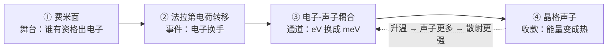
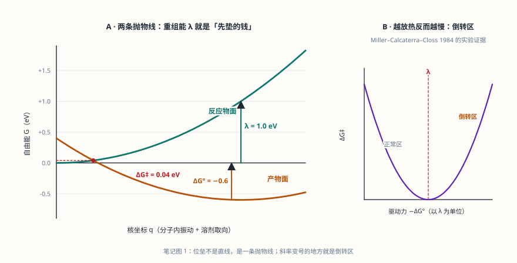
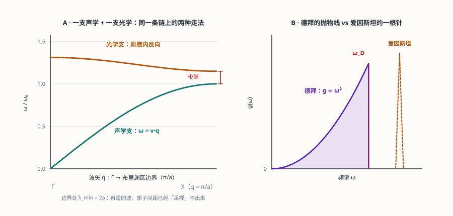
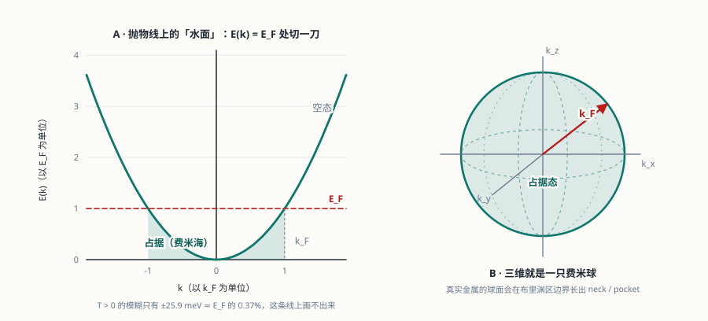
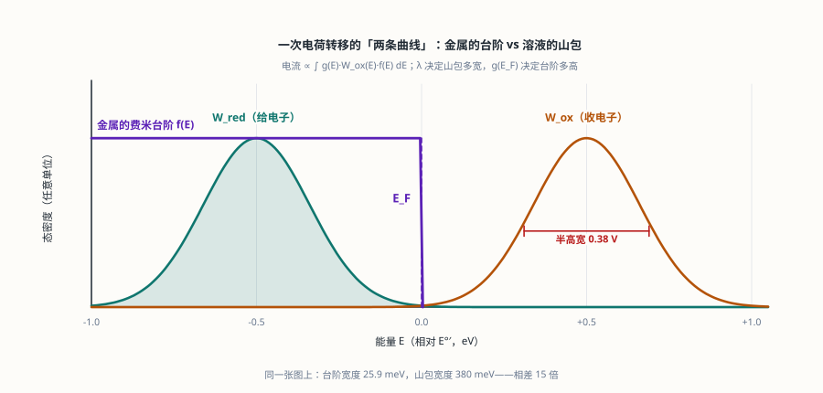

---
tags:
  - 化学
  - 电化学
  - 固体物理
  - 声子
  - 费米面
  - 电荷转移
关联:
  - "[赝电容：一条 Nernst 曲线如何冒充电容——机制、判据与「假电容」的边界](赝电容：一条 Nernst 曲线如何冒充电容——机制、判据与「假电容」的边界.md)"
  - "[化学电容：四种电容的「座位表」——静电与化学的分水岭](化学电容：四种电容的「座位表」——静电与化学的分水岭.md)"
  - "[Nernst方程：59 mV 的来历、三种写法与它失效的四道边界](Nernst方程：59 mV 的来历、三种写法与它失效的四道边界.md)"
  - "[水伏发电与瀑布起电：EZ之后——电荷怎样被分开、怎样换手、谁在付账](水伏发电与瀑布起电：EZ之后——电荷怎样被分开、怎样换手、谁在付账.md)"
  - "[醌类：芳香性的赎金——呼吸链的心脏、染料母体与药毒同源的弹头](醌类：芳香性的赎金——呼吸链的心脏、染料母体与药毒同源的弹头.md)"
  - "[二极管、三极管、MOS 管与 IGBT](../电子、计算机和通信/二极管%20%20三极管%20%20MOS%20%20IGBT.md)"
---

# 法拉第电荷转移、晶格声子、电子-声子耦合与费米面：一次电子换手的四层账本

> **根节点**：一次「电子从电极跳到分子上」的电荷转移，电子到底从哪里来、要跳过什么、多出来的能量最后交给了谁？为什么四个看起来分属电化学与固体物理的词，必须放在同一张账本上读？

> **叙事逻辑**：四个词条怎么咬合 → 法拉第电荷转移（事件本身）→ 晶格声子（能量落到哪）→ 电子-声子耦合（能量怎么传）→ 费米面（谁有资格参与）→ 合起来算一次完整的账 → 常见误读 → 索引

> **立场说明**：公式、常数与文献年份属于可查证内容；由量级推算得到的判断（如「动力学想跑 4.7 A/cm²，实际被传质卡在 0.2 mA/cm²」）标为分析并给出全部假设；具体材料的 λ、k⁰ 等数值差异较大，统一列入文末「待核实」。

> **来源标注**：固体物理侧取 Kittel、Ashcroft–Mermin、Grimvall 的标准表述；电化学侧取 Bard–Faulkner、Marcus 1956/1965、Chidsey 1991、Gerischer 1960；超导取 BCS 1957、McMillan 1968；整理于 2026-11-19。

## 知识树

```txt
根节点：一次法拉第电荷转移，电子从哪儿来、跳过多高的坎、能量最后交给谁？
│
├── 〇、四个词条怎么咬合（四层账本）
│   ├── 舞台 / 事件 / 通道 / 收款人
│   └── 时间尺度与能量尺度差 10¹⁴
│
├── 一、法拉第电荷转移（事件：电子换手）
│   ├── 记账：Q = nFN，96.5 μC/cm² 是单层上限
│   ├── 速率：Butler–Volmer、Tafel、交换电流 j₀
│   └── 势垒：Marcus 重组能 λ，抛物线不是直线
│
├── 二、晶格声子（收款：能量变成热）
│   ├── 3N 个自由度拆成声学支与光学支
│   ├── 布里渊区边界 = 奈奎斯特：λ_min = 2a
│   └── 德拜温度、T³ 热容、κ = ⅓Cvl
│
├── 三、电子-声子耦合（通道：eV 换 meV）
│   ├── λ 一个数，四种结局：散射 / 变重 / 配对 / 失稳
│   ├── 动量弛豫 25 fs，能量弛豫 1 ps
│   └── 边界：λ 太大反而毁掉超导
│
├── 四、费米面（舞台：谁有资格出电子）
│   ├── 只有 kT 厚的壳层能改变状态（Cu：0.55%）
│   ├── g(E_F) 决定热容、量子电容、电极动力学
│   └── Gerischer：费米台阶 25.9 meV vs 山包 380 meV
│
├── 五、合起来：一次电子换手的完整账本
│   ├── 费米账 / 动力学账 / 传质账 / 热账 / 时间账
│   └── 三个推论：薄电极、宽包、半导体电极为什么慢
│
└── 六、常见误读（六条）
    └── 声子≠热、费米能级≠费米能、金属电容≠无穷大
```

---

## 〇、四个词条怎么咬合

### 0.1 一句话：同一笔交易的四本账

一次法拉第电荷转移不是「电子从 A 点跑到 B 点」这么简单。它至少包含四件事：

1. **谁有资格出这个电子**——金属里不是所有电子都能动，只有费米面附近约 $k_BT$ 厚的壳层能改变状态；
2. **这笔交易怎么发生**——电子跨越电极/溶液界面，同时改变化学态，按 Faraday 定律记账；
3. **多出来的能量怎么传出去**——电子不可能把 eV 级的差额直接塞给一个原子，必须由电子-声子耦合把它拆成一叠 meV 的零钱；
4. **能量最后落到哪**——落到晶格声子上，最终变成热。



这张图的因果方向不是随意的：**电子转移发生得最快（fs），能量弛豫稍慢（ps），热扩散最慢（ms）**。把四个词按时间顺序摆开，就能看出「为什么一个 10⁻¹⁵ s 的事件，会被一个 10⁻¹² s 的过程决定它热不热」。

### 0.2 四层账本总表

四个词的适用范围完全不同，先分清楚各自的「辖区」，后面才不会互相越界。下表按「回答的问题—角色—关键量—失效边界」四列对照：

| 词条 | 回答的问题 | 一句话角色 | 关键量 | 失效 / 边界 |
|---|---|---|---|---|
| **费米面** | 哪个电子能参与？ | 舞台：只有 $E_F$ 附近 $kT$ 薄壳可动 | $k_F$、$g(E_F)$ | 超导开隙、Mott 绝缘体、有限温度模糊 |
| **法拉第电荷转移** | 事件怎么发生？ | 交易：电子跨界面并改变化学态 | $n$、$F$、$k^0$、$\lambda$ | 双电层（非法拉第）、纯离子迁移 |
| **电子-声子耦合** | 能量怎么传？ | 通道：把 eV 拆成 meV | $\lambda$、$\tau$、$\ell$ | $\lambda$ 过大 → 极化子局域、晶格失稳 |
| **晶格声子** | 能量最后到哪？ | 收款：热库，最终变成热 | $\theta_D$、$\omega_D$、$C_v$ | 液体无横声子、非晶有玻色峰 |

**最关键的差异点**：费米面与声子都是**状态**（一个在 k 空间，一个在频率空间），电荷转移与电子-声子耦合都是**过程**（一个换电子，一个换能量）。把状态当过程讲，或者把过程当状态算，是这一组概念最常见的混用。

### 0.3 时间与能量：跨 14 个数量级的阶梯

为什么这四个词总被讲混？因为它们共享同一个能量区间（meV–eV），却在完全不同的时间尺度上工作。先把尺子摆出来：

| 步骤 | 时间尺度 | 能量尺度 | 主要角色 |
|---|---|---|---|
| 电子相干 / 穿越界面 | $10^{-16}$–$10^{-15}$ s | 1 eV = 8065 cm⁻¹ = 96.5 kJ/mol | 电子 |
| 电子-声子动量散射 | $10^{-14}$ s（Cu 25 fs） | 10–100 meV | 电子 + 声子 |
| 电子-声子能量弛豫 | $10^{-12}$ s（1 ps） | meV | 电子 + 声子 |
| 声子-声子（Umklapp） | $10^{-11}$–$10^{-10}$ s | meV | 声子 |
| 溶液扩散 / 宏观传质 | $10^{-2}$–$10^{2}$ s | 热能 $kT$ | 离子 |
| 宏观热扩散 | $10^{-3}$–$10^{0}$ s | 热能 $kT$ | 声子 |

**收束句**：一次电子换手从 1 fs 走到「你摸到的热」，中间跨了 14 个数量级；任何一句「电子转移放热」如果不指定在哪一层，都是含糊的。

### 0.4 图示导览

| 图 | 位置 | 一句话 |
|---|---|---|
| 图 1 · Marcus 抛物线 | §一 | 位垒是抛物线；驱动力超过 λ 后，越放热反而越慢 |
| 图 2 · 声子色散与态密度 | §二 | 声学支管搬、光学支管抖；德拜的 ω² 与爱因斯坦的一根针 |
| 图 3 · 费米球与 E(k) | §四 | 抛物线切一刀，切出的边界就是费米面；占据态在「水面」以下 |
| 图 4 · Gerischer 重叠 | §四 | 金属的台阶只有 25.9 meV，溶液的 Gaussian 山包有 380 meV |

---

## 一、法拉第电荷转移（Faradaic Charge Transfer）

**法拉第电荷转移**是指==电子（有时连同质子等离子）跨越电极与电解液的界面、并使反应物的氧化态发生改变的那部分电荷转移；它按 Faraday 定律以每摩尔 $nF$ 库仑记账，因而与只给双电层充放电、不改变氧化态的「非法拉第」过程相对==。

> 🔗 **横向关联**：本词条的「电子跨界面 + 改变化学态」与 [赝电容笔记](赝电容：一条 Nernst 曲线如何冒充电容——机制、判据与「假电容」的边界.md) §一的定义形成**上下游关系**——赝电容的全部合法性都建立在「有法拉第电荷转移」这一条上，它再额外要求「没有新相」与「$\mathrm{d}Q/\mathrm{d}V$ 连续」；本篇补上的，是这件事在**一个电子、一个位点**的尺度上到底怎么发生、要付多少能量。

> 🔗 **横向关联**：本词条的「一次转移只搬一个电子」与 [攒能量：ATP 合酶的分子变速箱与光系统 II 放氧中心](../生物学/攒能量：ATP 合酶的分子变速箱与光系统 II 放氧中心.md) §六的 Kok 循环形成**镜像关系**——放氧中心连续做四次单电子氧化，把四个「洞」攒在 Mn₄CaO₅ 上，正因为单次转移只能搬一个电子、且每一步的电位不同，才需要一座四级的「蓄水池」；本篇讲一步的代价，那篇讲四步怎么拼成一个 1.23 V 的反应。

### 1.1 核心要素与运作机制（Mechanism）

**（1）记账规则：Faraday 定律是硬约束。**

$$Q = nFN \qquad\Longleftrightarrow\qquad N = \frac{Q}{nF}$$

- **式中四个符号**：$Q$ 是转移的总电荷（C）；$n$ 是**每个反应事件转移的电子数**（无量纲，单电子反应 $n=1$，醌的 $2e^-/2H^+$ 反应 $n=2$）；$F=96\,485$ C/mol 是**法拉第常数**（1 mol 电子所带的电荷，$F=N_Ae$）；$N$ 是**发生反应的物质的量**（mol）。量纲检查：$\mathrm{mol}\times(\mathrm{C/mol})=\mathrm{C}$，$n$ 只是计数，不带单位。
- **两种等价写法**：微分形式 $i=\dfrac{\mathrm{d}Q}{\mathrm{d}t}=nF\dfrac{\mathrm{d}N}{\mathrm{d}t}$（电流 = 换手速率 × 每摩尔电荷）；换成面密度则是 $\dfrac{Q}{A}=nF\Gamma$（$\Gamma$ 为表面位点密度，mol/cm²）。部分教材用 $z$ 代替 $n$，写成 $Q=zFN$。
- 1 mol 电子 = 96 485 C；1 个电子 = 1.602×10⁻¹⁹ C。
- 换成面密度：单层位点约 $1\ \mathrm{nmol/cm^2}$（0.6–1.2×10¹⁵ 个/cm²），每个位点转移 1 个电子，就恰好是 **96.5 μC/cm²**。这个数在赝电容笔记 §八已经用过，它是「表面法拉第反应」的天花板，不是起点。
- 推论：**法拉第电荷转移是「计件」的，不是「计容」的**——它卖的是「多少个电子换了手」，不是「能存多少电荷」。

**（2）速率：Butler–Volmer 把「电位」翻译成「速率」。**

$$j = j_0\left[\exp\!\left(\frac{\alpha_a F\eta}{RT}\right)-\exp\!\left(-\frac{\alpha_c F\eta}{RT}\right)\right],\qquad j_0 = Fk^0C$$

- **符号**：$j$ 电流密度（A/cm²）；$j_0$ 交换电流密度；$\alpha_a,\alpha_c$ 阳极/阴极传递系数（无量纲，常各取 0.5，且 $\alpha_a+\alpha_c=1$）；$\eta$ 过电位（V）；$F$ 法拉第常数；$R=8.314$ J mol⁻¹K⁻¹；$T$ 绝对温度（K）。
- $j_0$ 是交换电流密度：平衡时正逆两个方向各跑多快；$k^0$ 是标准速率常数；$C$ 是反应物浓度。
- 强极化时只剩一项，取对数得 **Tafel 方程**：$\eta = \frac{2.303RT}{\alpha F}\log\frac{j}{j_0}$。25 ℃ 时 $2.303RT/F = 59.2$ mV，所以 $\alpha=0.5$ 时斜率 **118 mV/decade**。
- 小过电位下线性化：$R_{ct} = \frac{RT}{nFj_0}$。**交换电流越大，电荷转移电阻越小**。

同样按 α=0.5、n=1、10 mM 计算，$k^0$ 每掉 4 个数量级，$R_{ct}$ 就涨 4 个数量级：

| $k^0$（cm/s） | 典型类型 | $j_0$（10 mM） | $R_{ct}$ |
|---|---|---|---|
| 1 | 极快外球（理想氧化还原对） | 0.97 A/cm² | 0.027 Ω·cm² |
| 0.1 | 快外球（如 Ru(NH₃)₆³⁺/²⁺） | 97 mA/cm² | 0.27 Ω·cm² |
| 10⁻⁴ | 慢内球（多步、构型重排大） | 97 μA/cm² | 270 Ω·cm² |
| 10⁻⁸ | 极慢（大 λ、强吸附、多电子） | 9.6 nA/cm² | 2.7 MΩ·cm² |

**（3）势垒：Marcus 的重组能才是「票价」。**

电子要换手，前后两个状态的**核构型不同**（键长、键角、溶剂取向都变了）。电子跳得比核快得多，所以只能「垂直跃迁」——落在产物势能面上尚未松弛的位置。这部分能量必须先垫付，叫**重组能 $\lambda$**：

$$\Delta G^\ddagger = \frac{(\lambda+\Delta G^\circ)^2}{4\lambda},\qquad \lambda=\lambda_i+\lambda_o$$

- **三个符号**：$\Delta G$ 泛指过程的吉布斯自由能变；$\Delta G^\circ$ 是**标准自由能变**，即反应的「驱动力」，负值表示自发（放热），电化学里 $\Delta G^\circ=-nF\Delta E^\circ$（$\Delta E^\circ$ 为标准电位差，V）；$\Delta G^\ddagger$ 是**活化自由能**，即势垒高度，从反应物最低点量到两条抛物线的交点，恒 $\ge 0$，速率 $k\propto e^{-\Delta G^\ddagger/RT}$。
- **记号**：上标 $\ddagger$ 是过渡态的双剑号（double dagger），不是「加号」；$\Delta G^\ne$ 是同一意思的另一种写法。
- $\lambda_i$：分子内振动（键长、键角），0.1–0.5 eV；
- $\lambda_o$：溶剂取向重排，0.3–1.0 eV，可由 Marcus 公式估算：

$$\lambda_o=\frac{e^2}{8\pi\varepsilon_0}\left(\frac{1}{a}-\frac{1}{R}\right)\left(\frac{1}{\varepsilon_{op}}-\frac{1}{\varepsilon_s}\right)$$

- **符号**：$e$ 元电荷；$\varepsilon_0$ 真空介电常数；$a$ 反应物半径、$R$ 电子转移距离（m）；$\varepsilon_{op}$ 光学（高频）介电常数、$\varepsilon_s$ 静态介电常数（相对值，无量纲）；$\lambda_o$ 单位 eV。
- $\Delta G^\circ=0$ 时 $\Delta G^\ddagger=\lambda/4$：λ=0.5 eV → 势垒 0.125 eV，速率被压到无势垒时的 $e^{-0.125/0.0257}\approx 1/130$。
- 当 $-\Delta G^\circ=\lambda$ 时势垒降为零；**再放热反而变慢**——这就是 1960 年预言、1984 年由 Miller–Calcaterra–Closs 实验证实的**倒转区**。



> **怎么读这张图（横轴 + 三根「长度」）**
> - **横轴 $q$ = 核构型的「变形完成度」**：$q=0$ 是反应物的平衡构型，$q=1$ 是产物的平衡构型，$q=0.5$ 是两者插值到一半的形状。它是无量纲的进度条，把**所有**键长、键角、溶剂取向打包成一个数。**电子不在这条轴上**——电子只在「竖直跳」的那一瞬间换状态。
> - 它不是时间、不是反应产率、也不是电子转移距离（那是 $a$、$R$）。图上画到 $q<0$ 只是外推：极端放热时交点会落到 $q<0$，意思是「得先把反应物往产物相反的方向掰一点，两条曲线才相交」。
> - 两个谷底的竖直落差 = $\Delta G^\circ$（驱动力；负值表示产物谷更低）。
> - 把反应物的姿势**掰成产物的形状、但电子仍留在原处**，需要垫付的能量 = $\lambda$（两条抛物线在 $q=1$ 处的竖直间距）。
> - 两条曲线的交点 = 过渡态；从反应物谷底爬到交点的高度 = $\Delta G^\ddagger$。
> - 一眼记住（**翻花绳**）：绳子 = 所有原子核，手指 = 电子态；同一根绳子，两种「舒服的图案」。$\lambda$ 是**手指不换、只把绳子硬撑成另一个图案**要做的张力功；$\Delta G^\circ$ 是两个图案稳定后的能量差；$\Delta G^\ddagger$ 是翻到中途绳子绷得最紧、最容易崩手的那一下。
>
> $\Delta G^\circ=0$ 时两条抛物线的形状一样、只差半个格，交点正好在正中，所以 $\Delta G^\ddagger=\lambda/4$——这也是为什么「没有驱动力时，势垒仍然存在」。

**（4）时间上的先后：Franck–Condon 决定了「能量必须有个去处」。**

- 电子跃迁约 **1 fs**（1 eV 对应 1.5×10¹⁵ rad/s）；
- 分子振动周期 **10–100 fs**；
- 溶剂取向弛豫 **ps** 量级。

所以顺序永远是：**电子先垂直跳过去 → 环境再慢慢松弛 → 多余的能量必须在这条链上被拿走**。这条「拿走」的通道，就是本篇第二节的声子与第三节的电子-声子耦合。

**（5）内球与外球、绝热与非绝热。**

| 类型 | 电子跳越的距离 | $k^0$ 典型范围 | 特点 |
|---|---|---|---|
| 外球（outer-sphere） | > 0.5 nm，配位层不变 | 10⁻²–1 cm/s | 只靠溶剂重排，λ 小、可逆性好 |
| 内球（inner-sphere） | 共享配体/桥连，配位层改变 | 10⁻⁹–10⁻⁴ cm/s | λ 大、常分多步，催化与钝化都在这里 |

电子耦合矩阵元 $H_{AB}$ 太小则进入**非绝热**区，速率正比于 $|H_{AB}|^2$；$H_{AB}$ 足够大则为**绝热**区，速率由核运动频率与位垒决定。这也是「电极材料不同、同样的分子却快慢差 10⁴ 倍」的微观原因。

**（6）边界：什么不是法拉第电荷转移。**

- **双电层充放电**：电子没有跨界面，只是把电极表面的电荷密度改了；遵守 $Q=C\Delta V$，不遵守 Faraday 定律。
- **离子迁移**：离子在溶液或膜内移动，不改变氧化态；它不是电荷转移，只是传质。
- **多步反应**：一次「总反应」可能包含多个单电子步骤（Kok 循环是 4 步），每一步都有自己的 $k^0$ 与 λ。

### 1.2 形象化解构：比喻与具体实例（Metaphor & Example）

* **形象比喻**：**跨栏换乘**。电子坐地铁到终点站（电极表面），要换乘对面的公交（溶液里的分子）。换乘通道的台阶高度就是 $\Delta G^\ddagger$；你要先自己垫钱买一张「重组票」（λ），才能过闸机。过电位就是你额外补的差价——补得越多，过闸的人越多。
  * 如果目的地太「香」（$-\Delta G^\circ$ 很大），闸机反而会被挤爆后再收费——这就是倒转区：放热太多，位垒重新升高。

* **具体实例**：同样是「一个电子」，换成不同的接受者，速度可以差 10⁴ 倍。
  * Ru(NH₃)₆³⁺ + e⁻ → Ru(NH₃)₆²⁺：外球、配位层不变，$k^0\approx0.1$ cm/s，10 mM 下 $j_0\approx97$ mA/cm²，$R_{ct}\approx0.27$ Ω·cm²；
  * O₂ 的还原：内球、多步、要断 O=O 键，$k^0$ 可以低到 10⁻⁸ cm/s 量级，$R_{ct}$ 涨到 MΩ·cm² 量级。
  * **不是电子懒，是路径贵**——这正是催化剂要解决的问题：它不改变热力学，只换一条 λ 更小的路。

### 1.3 多维度对比表格（Comparison）

初学者最常把「有电流」当成「有法拉第反应」。把两类电流并排放在同一张表里，就能看出它们从记账方式到温度依赖全都不同：

| 维度 | 法拉第电荷转移 | 非法拉第（双电层充放电） |
|---|---|---|
| 电子是否跨界面 | ✅ 是 | ❌ 否，只在电极表面积累 |
| 是否改变化学态 | ✅ 是（氧化/还原） | ❌ 否 |
| 记账方式 | $Q=nFN$（计件） | $Q=C\Delta V$（计容） |
| 面电荷量级 | 单层 1e⁻/位点 = 96.5 μC/cm² | 10–40 μC/cm² |
| 电化学签名 | 峰、平台或宽包（有 Nernst 台阶） | 矩形 CV、近似常数 C |
| 温度依赖 | 指数型（$k^0$、λ） | 弱（主要随介电常数变） |
| 频率响应 | 有 $R_{ct}$、可能受扩散限制 | 接近理想电容，相角 −90° |

**最关键的差异点**：**法拉第过程有一个「化学反应」写在账本上，非法拉第过程只有一个「电荷密度」写在账本上**。判别方法也很朴素：把电位停在没有反应的窗口里扫一圈，剩下的那部分电流才是纯非法拉第的。

### 💡 记忆锚点与口诀

- **核心拆解**：Faraday = 有电子换手，账按 $nF$ 记；double layer = 只挪电荷，账按 $C$ 记。
- **极简公式**：$Q=nFN$；$j=j_0e^{\alpha f\eta}$；$\Delta G^\ddagger=(\lambda+\Delta G^\circ)^2/4\lambda$。
- **记忆口诀**：**「先付重组费，再换电子手；过电位是补差价，放热太多也发愁。」**

---

## 二、晶格声子（Lattice Phonon）

**晶格声子**是指==晶格原子集体振动的量子化元激发：把 $N$ 个原子的 $3N$ 个自由度分解成 $3$ 支声学波（原胞整体位移）与 $3(p-1)$ 支光学波（原胞内部相对位移），每一支的波矢在布里渊区内取离散值，能量 $\hbar\omega$ 通常在 1–100 meV，服从玻色统计==。

> 🔗 **横向关联**：本词条的「波矢上限 $q=\pi/a$、最短波长 $\lambda_{\min}=2a$」与 [香农采样定理与信息论：数字世界的两条底层定律](../电子、计算机和通信/香农采样定理与信息论：数字世界的两条底层定律.md) 中的**奈奎斯特判据**形成**同构关系**——离散的原子阵列就是一台采样器：一个波长至少要两个原子才能被「采」出来，所以晶格天然给声子谱设了一个最高频率。**香农限制的是信号能携带多少信息，晶格限制的是热振动能切成多少份。**

> 🔗 **横向关联**：本词条的「温度升高 → 声子密度增大」与 [二极管、三极管、MOS 管与 IGBT](../电子、计算机和通信/二极管%20%20三极管%20%20MOS%20%20IGBT.md) §1.3 的**击穿温度系数**形成**因果链**——那篇讲的是：晶格振动加剧 → 载流子平均自由程缩短 → 碰撞电离来不及发生 → 需要更高电场，于是击穿电压呈正温度系数。本篇补上的，是「声子密度」这个幕后的计分板。

### 2.1 核心要素与运作机制（Mechanism）

**（1）从 3N 个弹簧到 3N 个简正模。**

原子之间有回复力，位移之间互相耦合；解耦之后得到 $3N$ 个独立的简正坐标，每个简正模量子化后就是一个声子。**声子不是「一个原子在抖」，而是「所有原子按同一个相位关系一起抖」**。而且**声子没有「位置」**：它由波矢 $\mathbf{q}$ 与支（极化）标记，是一列集体波的量子，不是一颗在晶格里飞行的小球。

**为什么「会量子化」**：每个简正模都把「所有原子按同一相位摆动」压缩成一个**谐振子**——有等效质量、有等效劲度，能量对位移是二次的。谐振子的能级等间距：$E_n=(n+\tfrac12)\hbar\omega$（$E_n$ 第 $n$ 个能级，$n=0,1,2,\dots$ 为量子数，$\hbar$ 约化普朗克常数，$\omega$ 角频率）。所以晶格从一出生就是量子的；宏观振动的 $n$ 极大（如 $10^{20}$），台阶看不见。到了晶体里，$\hbar\omega$ 在 meV 量级、室温 $k_BT$ 也在 meV 量级，台阶就露出来了——30 meV 的模在 300 K 时 $\langle n\rangle\approx0.46$，4 K 时 $\approx10^{-38}$，「有没有一个声子」是能数出来的。

> 📌 **振子与「独立」**：**振子（oscillator）** = 有稳定平衡点、回复力与位移成正比（$F=-kx$）的系统；它的运动是正弦，角频率 $\omega=\sqrt{k/m}$（$k$ 劲度，N/m；$m$ 质量，kg）。**「独立」不是空间上分开，而是哈密顿量里没有交叉项**——两个振子之间不交换能量，可以各自数自己的量子数。$N$ 个原子靠键耦合时本来不独立；换成简正坐标后，$3N$ 个简正模彼此独立，每个简正模就是一个振子——参与它的原子可以成千上万，但整块晶体里只有这一个「自由度」在摆。

**数学上到底做了什么**：把 $N$ 个原子的位移拼成**一个 $3N$ 维向量** $\mathbf U$（每个原子贡献 $x,y,z$ 三个分量），运动方程是

$$\mathbf M\ddot{\mathbf U}=-\mathbf K\mathbf U$$

（$\mathbf M$：$3N\times3N$ 质量矩阵，kg；$\mathbf K$：力常数矩阵，N/m；**非对角项就是「原子之间相互关联」**）。解广义本征值问题 $\mathbf K\mathbf e_s=\omega_s^2\mathbf M\mathbf e_s$，得到 $3N$ 个本征矢 $\mathbf e_s$ 与本征频率 $\omega_s$；再把 $\mathbf U(t)=\sum_s Q_s(t)\mathbf e_s$ 代回去，方程就变成 $3N$ 个互不耦合的振子（$Q_s$ 为简正坐标，$\mathbf e_s$ 为该模式的位移图案）。

**「拼成」只是记账**：若只有 2 个原子，原子 1 的位移是 $(0.01,-0.02,0)$ Å、原子 2 是 $(0,0.03,-0.01)$ Å，就把它们首尾接起来写成 $\mathbf U=(0.01,-0.02,0,\;0,0.03,-0.01)$ Å——一个 6 维向量；$\mathbf K$ 就是 $6\times6$ 矩阵。这个向量的每个分量不是空间坐标，而是「某个原子在某个方向挪了多少」；向量整体代表**整块晶体此刻的形变快照**。

所以不是「把每个原子的三维向量拆开」，而是**把整个 $3N$ 维构型空间旋转到一组集体图案上**——每个图案里所有原子一起动，但图案之间不再交换能量。

**「互相垂直」是什么意思**：本征矢满足 $\mathbf e_s^\top\mathbf M\mathbf e_t=0$（$s\neq t$，$\mathbf e_s$ 为第 $s$ 个模式的 $3N$ 维位移图案，$\mathbf M$ 为质量矩阵）——不是普通空间里的垂直，而是**质量加权内积为零**：两个形变图案「不重叠」，能量不会从一个模式漏进另一个。晶体里再利用周期性，把 $3N\times3N$ 的大问题拆成 $N$ 个 $3p\times3p$ 的小问题：对每个波矢 $\mathbf q$ 构造动力学矩阵 $\mathbf D(\mathbf q)$（$3p\times3p$，$p$ 为原胞原子数），对角化它得到的 $3p$ 个频率，就是该 $\mathbf q$ 上的 $3p$ 支声子。

其平均占据数由玻色分布给出：

$$\langle n\rangle = \frac{1}{e^{\hbar\omega/k_BT}-1}$$

- **符号**：$\langle n\rangle$ 平均声子数（无量纲）；$\hbar$ 约化普朗克常数；$\omega$ 声子角频率（rad/s）；$k_B$ 玻尔兹曼常数；$T$ 温度（K）。

**（2）色散关系与两支的分工。**

> 📌 **原胞（primitive cell）**：晶格中能通过整数倍格矢平移、无缝隙无重叠地铺满整块晶体的**最小重复单元**；体积 $V=|\mathbf a_1\cdot(\mathbf a_2\times\mathbf a_3)|$（$\mathbf a_1,\mathbf a_2,\mathbf a_3$ 为三个基矢，m）。**每个原胞平均含 1 个格点**，但这个格点上可以挂多个原子（基元）——所以原胞里的**原子数 $p$ 可以大于 1**，这正是光学支的来源（$3(p-1)$ 支）。它不等于化学/晶体学习惯用的「晶胞（conventional cell）」：例如 fcc 铜的惯用立方胞含 4 个原子，原胞只含 1 个。展开见 [原胞与晶胞：同一块晶体，为什么有两套数法](../物理/原胞与晶胞：同一块晶体，为什么有两套数法——格点、基元与布里渊区.md)。

- 声学支：$\omega\to0$ 当 $q\to0$，长波极限就是声波，$\omega=vq$；一支纵波、两支横波，共 3 支。**为什么正好 3 支**：三维空间只有 3 个独立平移方向，整体平移不拉伸任何键 → 回复力为零 → $\omega\to0$。
- 光学支：$q=0$ 时 $\omega\neq0$，原胞内部原子反向振动；有 $3(p-1)$ 支（$p$ 为原胞原子数）。离子晶体中光学支带净电偶极矩，能与电磁波耦合（红外吸收、拉曼散射）。
- **$q$ 与 $a$ 是什么**：$q=\dfrac{2\pi}{\lambda}$ 是**波矢**（单位 rad/m 或 m⁻¹；有些书用不带 $2\pi$ 的波数，那时边界写成 $1/2a$）；$a$ 是**相邻同种原子的间距**（一维链的晶格常数，m）；$\lambda$ 是这列原子位移波的波长（m）。把第 $n$ 个原子的位移写成 $u_n=A\cos(qna)$（$u_n$ 位移、$A$ 振幅、$n$ 为整数编号），立刻能看出：$q$ 与 $q+2\pi/a$ 给出**完全一样**的位移序列——离散晶格分不清这两者，所以只需取 $|q|\le\pi/a$（第一布里渊区，即「折叠」后的唯一表示）。
- **边界上发生了什么**：$q=\pi/a$ 时 $u_n=A(-1)^n$，相邻原子正好反相，对应最短波长 $\lambda_{\min}=2a$——每个波长只有两个原子在采样，正是奈奎斯特极限。数值例：$a=3$ Å → $\lambda_{\min}=6$ Å、$q_{\max}=1.05$ Å⁻¹；若声速 $v=5000$ m/s，则 $\omega_{\max}=vq_{\max}\approx5.2\times10^{13}$ rad/s，即 $\approx8.3$ THz $\approx34$ meV。

**（3）态密度与德拜模型。**

- 三维声子态密度 $g(\omega)=\dfrac{3\omega^2}{2\pi^2v^3}$，直到截断频率 $\omega_D$。
- $\omega_D = v(6\pi^2 n)^{1/3}$，德拜温度 $\theta_D=\hbar\omega_D/k_B$。自由电子气里 $k_D=1.26k_F$——费米波矢与德拜波矢只差 26%，原因是它们都由同一个数密度决定。
- 常用值：Pb 105 K、Cu 343 K、Al 428 K、Si 645 K、金刚石 2230 K。

换算到实验里真正用的单位：$1\ \mathrm{THz}=4.136$ meV $=33.36$ cm⁻¹；室温 $kT=25.85$ meV $=6.25$ THz $=208.5$ cm⁻¹。

| 材料 | $\theta_D$（K） | 最高声子频率（THz） | $\hbar\omega_D$（meV） |
|---|---|---|---|
| Pb | 105 | 2.19 | 9.05 |
| Cu | 343 | 7.15 | 29.6 |
| Si | 645 | 13.4 | 55.6 |
| 金刚石 | 2230 | 46.5 | 192 |



**（4）热容：3R 是天花板，T³ 是入口。**

- 高温（$T\gg\theta_D$）：每个简正模 $k_B$，共 $3N$ → $C_v\to3R=24.94$ J mol⁻¹K⁻¹（Dulong–Petit）。
- 低温（$T\ll\theta_D$）：只有低频声子被激发，$C_v=\frac{12\pi^4}{5}R\left(\frac{T}{\theta_D}\right)^3$——**T³ 定律**。
- Cu 在 300 K 时 $C_v\approx24.4$ J mol⁻¹K⁻¹，几乎已满额；金刚石只有约 6 J mol⁻¹K⁻¹，因为 $T/\theta_D=0.13$，大量声子还冻着。

**（5）热导：声子版的「高速公路」。**

$$\kappa=\frac{1}{3}C_v v \ell$$

- **符号**：$\kappa$ 热导率（W m⁻¹K⁻¹）；$C_v$ 单位体积热容（J m⁻³K⁻¹）；$v$ 声子平均速度（m/s）；$\ell$ 声子平均自由程（m）。

$\ell$ 是声子平均自由程，受两类碰撞限制：杂质/边界（与温度无关）与**Umklapp 过程**（声子-声子，随温度升高而增强）。因此完美晶体的 κ 在低温升高、在高温按 $1/T$ 下降。量级：Cu 401、Si 150、金刚石 2000、玻璃 1 W m⁻¹K⁻¹。金属里电子也导热，且往往占主导（Wiedemann–Franz）。

**（6）边界：声子不是什么。**

- 液体没有横波声子（不能承受剪切），只有纵声波；等离激元、磁振子、光子是别的元激发，不要混用。
- 非晶体没有严格定义的 $q$，声子谱模糊化，热容在几 K 出现「玻色峰」。
- **声子 ≠ 热**：热是统计概念（能量分布），声子是量子概念（能量的一份份）。温度是声子数的计分板，不是声子本身。

### 2.2 形象化解构：比喻与具体实例（Metaphor & Example）

* **形象比喻**：**体育场人浪**。
  * 声学支：整片看台按同一相位依次起立，波长很长——传播出去就是声音；
  * 光学支：相邻两排你起我坐、原地反向，整体不动，但「内部在打架」——所以它能和光（电磁场）耦合；
  * 声子：人浪最小的一次「起立」量子。德拜温度：人浪最快能传到的频率上限，超过这个频率，观众（原子）跟不上了。

* **具体实例**：一块铜和一块金刚石，室温下都在「抖」，但抖法完全不同。
  * 铜：$\theta_D=343$ K 只比室温高一点，几乎所有声子模都被激发，热容接近 $3R$，声子-声子碰撞频繁，$\ell$ 短；
  * 金刚石：$\theta_D=2230$ K，室温下 $T/\theta_D\approx0.13$，大部分声子还冻结，热容只有约 6 J mol⁻¹K⁻¹；但正因为声子少、Umklapp 少，$\ell$ 极长、声速极高，热导率反而达到 ~2000 W m⁻¹K⁻¹。
  * **一句话：热容看「有多少声子被激发」，热导看「这些声子能跑多远」，两者不是一回事。**

### 2.3 多维度对比表格（Comparison）

声学支与光学支都叫「声子」，但一个负责搬运、一个负责耦合，混淆它们会直接把热导与红外光谱讲错：

| 维度 | 声学支（acoustic） | 光学支（optical） |
|---|---|---|
| 原胞内位移 | 同向（整体平移） | 反向（内部相对运动） |
| 色散起点 | $\omega\to0$（$q\to0$） | $\omega(0)>0$，常有带隙 |
| 支数 | 3 | $3(p-1)$ |
| 长波极限 | 声波（可听/超声） | 与电磁波耦合（红外/拉曼） |
| 主要职责 | 搬动量、搬热（大部分 κ） | 抖出电偶极矩、与电子强耦合 |
| 典型例子 | Cu、Al 的整个声子谱 | NaCl、Si、SiO₂ 的高频支 |

**最关键的差异点**：**声学支管「搬」，光学支管「抖」**——搬动量与热的是声学支，抖出电偶极矩、把电子拖住的是光学支（尤其是离子晶体里的纵光学模，Fröhlich 耦合）。

**为什么有些晶体没有光学支**：光学支的数目是 $3(p-1)$（$p$ 为原胞内原子数）。$p=1$ 时这一项为零，只剩 3 支声学支——Cu、Al 这类 fcc/bcc 金属就是如此，所以金属的红外光谱里没有「光学声子吸收」这一项；要看到光学支，原胞里至少要有两个原子（Si、金刚石、NaCl）。

### 💡 记忆锚点与口诀

- **核心拆解**：3 支声学（同向走）+ $3(p-1)$ 支光学（对着抖）；$\lambda_{\min}=2a$ 是奈奎斯特，不是物理极限。
- **极简公式**：$\theta_D=\hbar\omega_D/k_B$；高温 $3R$、低温 $T^3$；$\kappa=\frac13C_vv\ell$。
- **记忆口诀**：**「声学同向走，光学对着抖；3R 封顶，T³ 开场。」**

---

## 三、电子-声子耦合（Electron–Phonon Coupling）

**电子-声子耦合**是指==传导电子与晶格振动之间的相互作用：电子的电荷使离子实发生位移，位移又反过来改变电子的能量与散射率；其强度用无量纲耦合常数 $\lambda$ 表征，它同时控制电阻率的温度依赖、载流子的有效质量、超导配对温度与晶格的结构稳定性==。

> 🔗 **横向关联**：本词条的「电子把动量/能量交给声子」与 [水伏发电与瀑布起电：EZ之后](水伏发电与瀑布起电：EZ之后——电荷怎样被分开、怎样换手、谁在付账.md) 的机制表（**声子拖曳 / 电子风**一行）形成**同一机制的两个方向**——那篇讲液体把动量先交给晶格声子，声子再经电子-声子耦合把费米面附近的电子顺流推走；本篇讲的是同一个耦合在电极内部如何把电荷转移的能量反向灌回晶格。**谁先谁后，取决于哪一侧的化学势更高。**

> 🔗 **横向关联**：本词条的「核坐标必须重排，电子才能落位」与 [醌类：芳香性的赎金](醌类：芳香性的赎金——呼吸链的心脏、染料母体与药毒同源的弹头.md) §4.2 的**质子耦合电子转移**形成**分子版对照**——醌的 2e⁻/2H⁺ 反应里，质子位置改变就是一次核坐标移动；本篇的 λ 是它的能量标价，声子是它的能量出口。

### 3.1 核心要素与运作机制（Mechanism）

**（1）耦合从哪里来：Born–Oppenheimer 在金属里失效。**

绝热近似假设「电子瞬间跟上核」，但金属里电子屏蔽离子实、离子实又跟着电子畸变走，两者互相拖拽。描述它的两个常用语言：
- 形变势耦合（长波声学声子）：晶格体积变化 → 能带边移动；
- Fröhlich 耦合（极性光学声子）：离子位移产生宏观电场 → 直接作用于电子。

强度汇总为一个谱函数 $\alpha^2F(\omega)$，其归一化矩就是耦合常数：

$$\lambda = 2\int_0^{\omega_{\max}}\frac{\alpha^2F(\omega)}{\omega}\,\mathrm{d}\omega$$

- **符号**：$\alpha^2F(\omega)$ 电子-声子谱函数（$\alpha$ 为电声矩阵元、$F$ 为声子态密度）；$\omega_{\max}$ 谱的最高频率；$\lambda$ 无量纲耦合常数。
**（2）一个 λ，四种结局。**

| 后果 | 微观过程 | 宏观观测量 | 典型判据 / 材料 |
|---|---|---|---|
| **散射（电阻）** | 电子被声子改变动量 | $\rho(T)$、迁移率 $\mu(T)$ | 高温 $\rho\propto T$，低温 $T^5$；Cu 25 fs |
| **变重（极化子）** | 电子拖着自己的晶格畸变一起走 | 有效质量 $m^*$、迁移率 | $m^*/m=1+\lambda$；LiFePO₄ 小极化子跳跃 |
| **配对（超导）** | 两个电子通过交换声子产生吸引 | $T_c$、能隙 $2\Delta$ | BCS：$T_c\approx1.13\theta_De^{-1/NV}$；Pb 7.2 K |
| **失稳（软化）** | $2k_F$ 处声子软化，晶格自己畸变 | 软模、CDW 超晶格 | Kohn anomaly；NbSe₂、1T-TaS₂ |

**（3）散射：电阻率的温度曲线是 λ 的指纹。**

**微观图像：不是「撞球」，是「被移动的光栅衍射」。** 离子位移 $\mathbf u$ 会让电子看到的势能产生一个随位置与时间周期变化的附加项 $\delta V\propto\nabla V\cdot\mathbf u$（$\nabla V$ 为势能梯度，$\mathbf u$ 为离子位移，m）。电子在这个「行波光栅」上衍射，从 Bloch 态 $\mathbf k$ 转到 $\mathbf k\pm\mathbf q$，同时吸收或放出一个能量 $\hbar\omega_q$ 的声子（$\mathbf k$ 电子波矢，$\mathbf q$ 声子波矢，m⁻¹）。动量由声子提供（$\hbar q$ 可达 $k_F$ 量级），能量只差 meV——所以是「大角度、几乎弹性」的偏转。

Bloch–Grüneisen 定律：高温（$T\gtrsim\theta_D/2$）$\rho\propto T$；低温（$T\lesssim\theta_D/10$）$\rho\propto T^5$；极低温趋于残余电阻（杂质与缺陷）。

用铜做一次数量级核算（$n=8.49\times10^{22}$ cm⁻³，$\rho=1.68$ μΩ·cm）：

| 量 | 数值 | 怎么来的 |
|---|---|---|
| 迁移率 $\mu$ | 44 cm² V⁻¹s⁻¹ | $\mu=1/(ne\rho)$ |
| 散射时间 $\tau$ | 25 fs | $\tau=m^*\mu/e$ |
| 平均自由程 $\ell$ | 39 nm | $\ell=v_F\tau$，$v_F=1.57\times10^6$ m/s |
| 77 K 的 $\ell$ | ≈150 nm | $\tau\propto1/T$ |
| 4 K（RRR≈100）的 $\ell$ | ≈3.9 μm | 残余电阻主导 |

**上限**：取平均自由程的下限为原子间距 $a\approx2.56$ Å（即电子每走一个原子间距就散射一次），得到 $\rho_{\max}\approx257$ μΩ·cm；严格的 Mott–Ioffe–Regel 判据 $k_F\ell\sim1$ 给出的也是同一量级。它约为铜室温电阻率的 150 倍，而许多「坏金属」的电阻率确实在 100–300 μΩ·cm 附近饱和，不再随温度线性上升。

**（4）变重：极化子。**

电子走到哪里，周围的离子就被它拉歪一点，于是它变成「电子 + 畸变云」的复合体：
- **大极化子**（Fröhlich，长程）：畸变摊在多个原胞上，$m^*/m\approx1+\alpha/6$，迁移率仍较高；
- **小极化子**（Holstein，局域在一个格点）：必须以**跳跃**方式移动，$\mu\propto\exp(-E_a/k_BT)$，$E_a\approx E_p/2$。
- 经典案例：LiFePO₄ 的室温电子电导率约 10⁻⁹ S/cm，正是小极化子 + 一维链的结果；碳包覆与纳米化解决的是「电子怎么到达每个颗粒」，而不是把极化子消灭。

**（5）配对：超导是「声子当红娘」。**

BCS 图像：一个电子走过的晶格畸变，能把第二个电子吸引过来，形成束缚对；配对打开能隙，费米面附近不再有单粒子态。弱耦合下 $2\Delta/k_BT_c\approx3.53$。McMillan 公式把 λ 与 $T_c$ 接起来：

$$T_c=\frac{\theta_D}{1.45}\exp\left[-\frac{1.04(1+\lambda)}{\lambda-\mu^*(1+0.62\lambda)}\right]$$

- **符号**：$T_c$ 超导临界温度（K）；$\theta_D$ 德拜温度（K）；$\lambda$ 无量纲耦合常数；$\mu^*$ 库仑赝势（无量纲，通常 0.1–0.15，起压制作用）；1.45 与 1.04 为 McMillan 拟合常数。
| 材料 | $\theta_D$（K） | $\lambda$（约） | $T_c$（K） |
|---|---|---|---|
| Al | 428 | 0.43 | 1.18 |
| Nb | 275 | ≈1.0 | 9.26 |
| Pb | 105 | 1.55 | 7.19 |
| MgB₂ | ~800（E₂g 模） | ~0.8（双能隙） | 39 |
| 铜氧化物 | — | 非声子机制 | 90–130 |

这张表最值得看的是**Al 与 Pb 的对比**：Al 的德拜温度是 Pb 的 4 倍，$T_c$ 却只有 Pb 的 1/6——因为 λ 差 3.6 倍，出现在指数的分母上。**决定超导的是 λ，不是 θ_D。**

**（6）失稳：耦合太强，晶格自己动手。**

- **Kohn anomaly**：当声子波矢 $q=2k_F$ 时，电子气的屏蔽能力出现奇点，声子频率下凹；
- **Peierls 转变**：一维金属在 $2k_F$ 处发生周期性畸变，在原费米面位置打开能隙，金属变绝缘体；
- **CDW**：二维/准一维材料里的电荷密度波（NbSe₂、1T-TaS₂），常伴随超晶格与电阻异常。
- **一句话：电子-声子耦合的极限，不是「更超导」，而是「晶格把费米面切掉」。**

**（7）两种时间：动量弛豫 25 fs，能量弛豫 1 ps。**

这是最容易被忽略、却最关键的一条：
- **动量**由每次散射重新分配，时间尺度是 $\tau\sim10^{-14}$ s；
- **能量**必须真正交给晶格，需要多次散射累积，时间尺度是 $\tau_{e-ph}\sim10^{-12}$ s（铜约 1 ps）。

所以飞秒激光加热金属时，会出现一个短暂的**双温状态**：电子温度上千 K，晶格仍是 300 K，约 1 ps 后才对齐。宏观上「金属摸起来是一个温度」，微观上电子与晶格从来不是同一个温度。

**（8）为什么偏偏是声子，而不是光子？**

电子被散射时，能量几乎不变（只能在 $E_F$ 附近挪几 meV），动量却要大幅改变（$k_F$ 量级）。这要求激发同时满足「小能量 + 大动量」：

- 30 meV 的**声子**：$\omega=30\ \mathrm{meV}/\hbar\approx4.6\times10^{13}$ rad/s，波矢 $q=\omega/v_s\approx9\times10^{9}$ m⁻¹（$v_s=5000$ m/s）；
- 同样 30 meV 的**光子**：$q=\omega/c\approx1.5\times10^{5}$ m⁻¹。

两者相差约 $6\times10^{4}$ 倍。**声子是「低能量、高动量」的搬运工**，正好匹配电子散射的需求；光子动量太小，几乎无法让电子转向。这就是为什么固体里的能量弛豫与散射，主角是声子而不是光。

（符号：$\omega$ 角频率，rad/s；$\hbar$ 约化普朗克常数；$v_s$ 声速，m/s；$c$ 光速，m/s；$q$ 波矢，m⁻¹。）

| 维度 | 声子（phonon）| 光子（photon）|
|---|---|---|
| 本质 | 晶格集体振动的量子 | 电磁场的量子 |
| 存在介质 | 只在晶格中 | 真空或介质均可 |
| 色散 | 声学支 $\omega=v_sq$；光学支 $\omega(0)\neq0$ | $\omega=cq$ |
| 传播速度 | ~10³ m/s | 3×10⁸ m/s |
| 典型能量 | 1–100 meV | 可见光 2–3 eV |
| 同能量下的波矢 | **大 ~10⁵ 倍** | 小 |
| 能否大幅改变电子方向 | ✅ 能（$q\sim k_F$）| ❌ 几乎不能 |
| 统计 | 玻色，化学势为 0 | 玻色，化学势为 0 |
| 动量性质 | 晶体动量 $\hbar q$（可交给晶格）| 真实动量 $\hbar k$ |

### 3.2 形象化解构：比喻与具体实例（Metaphor & Example）

* **形象比喻**：**翻译官 + 收银台**。电子手里拿的是 eV 级的整钱，晶格收银台只收 meV 级的零钱，而且一次只收一份。电子-声子耦合就是那位翻译官：把一张整钱拆成一叠零钱，一份份递过去。
  * 翻译官太弱（λ 小）：钱花不出去，电子一直「热着」，热化慢；
  * 翻译官太强（λ 大）：电子干脆被零钱埋住，走不动了——这就是极化子；
  * 翻译官恰到好处：零钱正好能把两个电子粘成一对——这就是超导。

* **具体实例**：回到电极。设过电位 0.2 V、电流 1 mA/cm²，则每个电子多付的能量是 0.2 eV = 19.3 kJ/mol = **7.7 个 $kT$**。若声子能量取 30 meV，一个电子要造出 **6–7 个声子**才能把账结清；宏观上 $0.2\ \mathrm{V}\times1\ \mathrm{mA/cm^2}=0.2$ mW/cm² 全部变成热。**「过电位发热」这句话的微观版本，就是「每个电子造 6–7 个声子」。**

### 3.3 多维度对比表格（Comparison）

同一个 λ 在不同材料里表现成完全不同的现象，最容易让人误以为是四种不同的物理。把它们并排放，才能看出「强度」这条隐藏的横轴：

| 维度 | 弱耦合（金属） | 中耦合（超导） | 强耦合（极化子） | 极强（结构失稳） |
|---|---|---|---|---|
| 代表材料 | Cu、Al | Pb、Nb、MgB₂ | LiFePO₄、部分氧化物 | NbSe₂、1T-TaS₂、一维链 |
| λ 量级 | 0.1–0.4 | 0.4–1.5 | 2–10（局域） | 强到声子频率软化到 0 |
| 电子的样子 | 准粒子，偶尔被撞 | 组成 Cooper 对 | 拖着一团畸变跳 | 被周期性畸变「锁死」 |
| 标志性现象 | $\rho\propto T$ | 零电阻、Meissner | 电导率指数激活 | CDW、Peierls 绝缘体 |
| 对电荷转移的意义 | 决定 $R_{ct}$ 的欧姆部分 | 电极可能零电阻（但能隙冻结单电子转移） | 载流子少、动力学慢 | 电极结构本身变了 |

**最关键的差异点**：**这四列不是四种机制，而是同一个 λ 的四个档位**——弱了是电阻，中了是超导，强了是极化子，再强是晶格失稳。读材料时先问 λ 有多大，比先问「它是什么材料」更有用。

### 💡 记忆锚点与口诀

- **核心拆解**：λ 是「电子和晶格握手的力度」；$m^*/m=1+\lambda$；$T_c\propto\theta_De^{-1/\lambda}$。
- **极简公式**：$\lambda=2\int\alpha^2F(\omega)\frac{\mathrm{d}\omega}{\omega}$；$\tau_{e-ph}\sim1$ ps。
- **记忆口诀**：**「弱散、中配、强局、极失——一个 λ，四种命。」**

---

## 四、费米面（Fermi Surface）

**费米面**是指==绝对零度下 k 空间中占据态与空态的分界面（$E(\mathbf{k})=E_F$ 的等能面）；只有界面附近约 $k_BT$ 厚的壳层里的电子能够改变状态、参与输运与电荷转移，因此费米面的形状与费米能级处的态密度 $g(E_F)$ 决定了金属的全部低能性质==。

> 🔗 **横向关联**：本词条的「费米能级 = 电子占据概率 50% 的水位线」与 [Nernst方程：59 mV 的来历](Nernst方程：59 mV 的来历、三种写法与它失效的四道边界.md) 中的化学势表述形成**同一枚硬币的两面**——那篇把「两个化学势之差」换算成伏特，得到 59 mV/decade；本篇补上这个化学势在 k 空间里的形状：**Nernst 方程量的是水位差，费米面画的是水面形状。** 电极电位移动 1 V，本质上就是把整片费米海抬高 1 eV。

> 🔗 **横向关联**：本词条的「$g(E_F)\neq0$ 才有费米面」与 [二极管、三极管、MOS 管与 IGBT](../电子、计算机和通信/二极管%20%20三极管%20%20MOS%20%20IGBT.md) §0「能带与费米能级」形成**对照关系**——半导体的费米能级落在带隙里，$g(E_F)\approx0$，所以它没有费米面；正因为「有水位、没有水面」，金属-半导体接触才会长出肖特基势垒与耗尽层。

### 4.1 核心要素与运作机制（Mechanism）

**（1）定义与分布：T=0 的刀切，T>0 的模糊。**

$$f(E)=\frac{1}{1+e^{(E-\mu)/k_BT}}$$

- **符号**：$f(E)$ 能量 $E$ 处的电子占据概率（无量纲，0–1）；$E$ 能量（eV 或 J）；$\mu$ 化学势（有限温度下的「水位」，0 K 时等于 $E_F$）；$k_B$ 玻尔兹曼常数；$T$ 温度（K）。

> 📌 **占据态 / 空态 / 水位 / 水面**：**态**由（能带、波矢 $\mathbf k$、自旋）标记，是一个「电子座位」，每个座位最多坐 1 个电子（自旋相反算两个座位）；**占据态** = 坐了电子，**空态** = 空着。**水位** = 费米能级 $E_F$（0 K 时电子填到的最高高度）；**水面** = 费米面 = k 空间中 $E(\mathbf k)=E_F$ 的等能面。半导体里 $E_F$ 落在带隙中，带隙里没有座位（$g(E)=0$），所以「有水位、没有水面」。

绝对零度时 $f(E)$ 是一个台阶：$E<E_F$ 全占、$E>E_F$ 全空。300 K 时台阶被抹开约 $\pm k_BT=\pm25.9$ meV；相对 Cu 的 $E_F=7.04$ eV，这只占 0.37%。

**（2）自由电子气的一串数字（Cu）。**

| 量 | 公式 | 数值 |
|---|---|---|
| 电子密度 $n$ | 1 个传导电子/原子 | $8.49\times10^{22}$ cm⁻³ |
| 费米波矢 $k_F$ | $(3\pi^2n)^{1/3}$ | 1.36 Å⁻¹ |
| 费米波长 $\lambda_F$ | $2\pi/k_F$ | 4.62 Å |
| 费米能 $E_F$ | $\hbar^2k_F^2/2m$ | 7.04 eV |
| 费米速度 $v_F$ | $\hbar k_F/m$ | $1.57\times10^6$ m/s（约 0.5% c） |
| 费米温度 $T_F$ | $E_F/k_B$ | $8.17\times10^4$ K |
| 态密度 $g(E_F)$ | $3n/2E_F$ | $1.81\times10^{22}$ eV⁻¹cm⁻³ |
| $kT$ 壳层占比 | $\frac32kT/E_F$ | **0.55%** |

> 📌 **波矢 $\mathbf k$ 与态密度 $g(E)$**：$\mathbf k$ 是**波矢**，$k=2\pi/\lambda$（$\lambda$ 为波长，方向即传播方向），单位 Å⁻¹ 或 m⁻¹；在晶体里它是标记 Bloch 态的量子数，对应**晶体动量** $\hbar\mathbf k$，取值范围是第一布里渊区。$g(E)$ 是**态密度**：单位体积、单位能量间隔内的电子座位数（eV⁻¹cm⁻³）；$g(E_F)$ 就是「水面那一层还剩多少座位」。自由电子气里 $g(E_F)=\dfrac{3n}{2E_F}$（$n$ 电子密度，cm⁻³；$E_F$ 费米能，eV）——因子 $3/2$ 来自 $g\propto\sqrt E$ 的积分 $\int_0^{E_F}\sqrt E\,\mathrm dE=\tfrac23E_F^{3/2}$。

**这里有一个必须纠正的直觉**：金属里所有电子都在以 $v_F\approx10^6$ m/s 狂奔，但**只有费米面附近 0.55% 的电子能改变状态**——因为深处的电子要跳出来，必须找到一个空位，而空位只在水面以上。所以「电子多」不等于「电子活」。



**（3）$g(E_F)$ 决定五件事。**

1. 电子热容：$C_V^{el}=\frac{\pi^2}{3}k_B^2g(E_F)T=\gamma T$。Cu 的 $\gamma=0.695$ mJ mol⁻¹K⁻²，300 K 时只有 0.21 J mol⁻¹K⁻¹——是晶格热容 24.4 的 **0.84%**。这解释了为什么室温下金属的比热几乎完全由声子贡献。
2. Pauli 磁化率：$\chi\propto g(E_F)$。
3. 量子电容：$C_Q=e^2g(E_F)$（按厚度折算），见下。
4. 电极动力学：Gerischer 模型里电流正比于 $g(E_F)$ 与溶液态密度的重叠，见下。
5. 超导：$T_c$ 的指数里含 $g(E_F)$（$N(0)V$）。

**（4）量子电容：金属的电容不是无穷大。**

把电极看作「电子水库」：往里面加电荷就要抬高水位 $E_F$。若把厚度 $t$ 的金属膜整体当作一个水库，等效量子电容是：

$$C_Q=e^2g(E_F)\cdot t\quad(\text{三维，}g\text{ 为体态密度})$$

- **符号**：$C_Q$ 量子电容（F/cm²）；$e$ 元电荷（1.602×10⁻¹⁹ C）；$g(E_F)$ 费米能级处体态密度（eV⁻¹cm⁻³ 或 J⁻¹m⁻³）；$t$ 膜厚（cm 或 m，必须与 $g$ 的单位配套）；$e^2g$ 的量纲是 F/m³（或 F/cm³）。
| 电极 | $g(E_F)$ | 等效 $C_Q$ | 与双电层（10–40 μF/cm²）比 |
|---|---|---|---|
| Cu，10 nm 膜 | $1.81\times10^{22}$ eV⁻¹cm⁻³ | ≈2.9×10³ μF/cm² | 更大，不限制总电容 |
| Cu，单原子层（0.25 nm） | 同上 | ≈72 μF/cm² | 同量级，开始有影响 |
| 石墨烯（$10^{13}$ cm⁻²） | $5.4\times10^{13}$ eV⁻¹cm⁻² | ≈8.7 μF/cm² | **同量级，必须算** |
| 半导体（带隙中） | ≈0 | 很小 | 由耗尽层主导（Mott–Schottky） |

> 🔗 **横向关联**：本节的「$C_Q=e^2g(E_F)t$ 与双电层串联」与 [化学电容：四种电容的「座位表」](化学电容：四种电容的「座位表」——静电与化学的分水岭.md) §五、§六的量子电容/半导体化学电容形成**同一公式的两个侧面**——那篇从 $V=\mu/q$ 出发，把「电压花在拉开电荷还是塞进座位」写成 $1/C=1/C_{es}+1/C_\mu$ 的两笔串联；本篇补的是「座位」在 k 空间里的形状：$g(E_F)$ 是金属水面的厚度，狄拉克锥与导带则是另外两张座位表。

**必须加一句限定**：三维金属的 $C_Q$ 依赖你取多厚的膜，本身没有唯一值；真正与厚度无关的是 $g(E_F)$。对块体金属，工程上把它当成「不限制总电容」即可；但在超薄金属膜、二维材料与低态密度金属上，$C_Q$ 会掉到与双电层同一量级，必须串进去算。

**最常见的错误是「金属电极的电容是无穷大，所以可以彻底忽略」**：按等效口径它的确比双电层大 1–2 个数量级，但「无穷大」的直觉在石墨烯这类二维电极上会直接失效——那里 $C_Q$ 就是那个「看不见的串联电容」。

**（5）Gerischer 模型：把费米面与重组能放进同一张图。**

溶液侧的氧化态/还原态不是一条线，而是以 $\lambda$ 展宽的高斯分布（$\lambda\gg k_BT$，所以山包比金属台阶宽一个数量级以上）：

$$W_{ox}(E)=\frac{1}{\sqrt{4\pi\lambda k_BT}}\exp\left[-\frac{(E-E_{ox})^2}{4\lambda k_BT}\right]$$

- **符号**：$W_{ox}(E)$ 氧化态（可接受电子）的态密度分布（eV⁻¹）；$E_{ox}$ 分布的中心能量（eV）；$\lambda$ 重组能（eV）；$k_BT$ 热能（eV）；分母的 $\sqrt{4\pi\lambda k_BT}$ 是归一化因子。
于是电流是两条曲线的重叠积分：

$$j\propto\int g(E)\,W_{ox}(E)\,f(E)\,\mathrm{d}E$$

- λ=0.5 eV → 高斯标准差 $\sqrt{2\lambda k_BT}=0.161$ eV，半高全宽 **0.38 V**；
- 金属侧的费米台阶只有 **25.9 meV**；
- 两者相差 **15 倍**——这就是为什么电极动力学对「费米面有多陡」不敏感，却对「λ 有多大」极其敏感。



**（6）形状学：球只是起点。**

- 自由电子：球；$k_F$ 由密度定。
- Cu：球面在 [111] 方向长出「脖子」（neck），碰到布里渊区边界——这也是铜的各向异性与 de Haas–van Alphen 频谱的来源。
- Al：第三区有小口袋；Bi/Sb：半金属，费米面是几个极小的椭球，载流子极少。
- Cr：费米面嵌套（nesting）→ 自旋密度波。
- 石墨烯：二维狄拉克点，费米「面」退化成一个点（或一个圆，视掺杂）；拓扑绝缘体表面态则是「费米弧」。
- **形状不是装饰**：嵌套矢量决定 CDW/SDW 的周期，口袋大小决定载流子数与热电系数。

**（7）测量与定理。**

- de Haas–van Alphen 效应：磁化率随 $1/B$ 振荡，频率 $F=\frac{\hbar}{2\pi e}A_{ext}$，直接量出费米面的极值截面积；
- ARPES：直接拍出 $E(k)$ 与费米面；
- Luttinger 定理：费米面围住的体积正比于电子数，即使强关联也成立（除非对称性自发破缺）。

**（8）边界：什么时候「费米面」这个概念会失效。**

- **超导**：费米面处打开能隙，单粒子态被清空；低能激发只剩准粒子。
- **Mott 绝缘体**：能带论说有半满带，强关联却把电子锁在格点上，费米面不存在——「有电子、有能带、没有水面」。
- **有限温度**：模糊层 $kT$ 把刀子变成斜坡；只有 $kT\ll E_F$ 时「面」才有意义。
- **非费米液体**：奇异金属里准粒子寿命不再 $\propto1/T^2$，但费米面体积仍可由 Luttinger 计数定义。

### 4.2 形象化解构：比喻与具体实例（Metaphor & Example）

* **形象比喻**：**满座的剧场**。座位从下往上坐满，最后一排靠过道的观众就是费米面；只有他们能起身离场。你往里加人（掺杂），水面升高、最后一排上移；你加热（升温），最后一排附近的人开始躁动，但深处的人依然动不了。
  * 「费米面是金属的身份证」：有这张面，才有自由电子；面的大小（$g(E_F)$）决定这张身份证有多好用。

* **具体实例**：同样做电极，铜和石墨烯的量子电容差了 300 倍。
  * 铜：常规厚度下等效 $C_Q$ 约 $10^3$ μF/cm²，金属侧不限制总电容，所以你测到的永远是双电层；
  * 石墨烯：$g(E_F)$ 小，$C_Q\approx8.7$ μF/cm²，与双电层同量级，必须串起来算；
  * 半导体：带隙里没有态，$C_Q\approx0$，电容由耗尽层宽度决定，$1/C^2$ 随电位线性变化（Mott–Schottky plot）——这也是测载流子浓度的标准手法。

**「没有水面」怎样一路导向半导体特性**（因果链，别跳步）：

1. $g(E_F)=0$ → 0 K 时费米面附近**没有可动载流子**（价带满、导带空）。
2. 载流子只能靠**热激发跨带隙**：$n\propto e^{-E_g/2k_BT}$（$E_g$ 带隙，eV；$k_B$ 玻尔兹曼常数；$T$ 温度，K）→ 电导率随温度**指数上升**（金属相反，随温度下降）。
3. $g$ 小意味着**少量电荷就能大幅移动 $E_F$**（$C_Q=e^2g$ 很小）→ 掺杂与栅压都能调水位 → n 型/p 型、PN 结、场效应、耗尽层。
4. 反过来，金属 $g$ 极大 → $E_F$ 被钉死、外加电场在约 0.5 Å 内就被屏蔽 → **没有场效应**，所以 MOSFET 必须用半导体。

这四步就是「有水位、没有水面」的全部后果：**没有水面 = 没有现成的自由电子 = 一切都要靠激发、掺杂和外场来调**。

### 4.3 多维度对比表格（Comparison）

「有没有费米面」是区分金属与绝缘体最干净的一刀，但它不是「有没有电子」的问题。把四类材料并排：

| 维度 | 金属 | 半金属 | 半导体 | 绝缘体 |
|---|---|---|---|---|
| 费米面 | ✅ 有，体积大 | ✅ 有，小口袋 | ❌ 无（带隙） | ❌ 无 |
| $g(E_F)$ | $\sim10^{22}$ eV⁻¹cm⁻³ | 小 | ≈0 | 0 |
| $C_Q$ | $10^2$–$10^3$ μF/cm² | 中 | 很小 | ≈0 |
| 电导温度系数 | $\rho\propto T$（声子） | 混合 | 指数激活 | 指数激活 |
| 电极行为 | 电位 = 费米能级，动力学快 | 可调 | 耗尽层、Mott–Schottky | 极化/击穿 |
| 例子 | Cu、Al | Bi、Sb、石墨 | Si、GaAs | SiO₂、金刚石 |

**最关键的差异点**：**费米面不是「有没有电子」的问题，而是「有没有能级空位」的问题**——绝缘体的电子一个不少，只是水位落在带隙里，没有一个能让电子转身的台阶。

### 💡 记忆锚点与口诀

- **核心拆解**：$k_F$ 是水面的半径，$g(E_F)$ 是水面的「厚度」，$C_Q$ 是「抬高水面要多少电荷」。
- **极简公式**：$k_F=(3\pi^2n)^{1/3}$；$E_F=\hbar^2k_F^2/2m$；$C_Q=e^2g(E_F)$。
- **记忆口诀**：**「水面上的浪才能跑；有面才有金属，有态才有电流。」**

---

## 五、合起来：一次电子换手的完整账本

### 5.1 场景设定

铜电极，10 mM Ru(NH₃)₆³⁺，$k^0=0.1$ cm/s，$D=7\times10^{-6}$ cm²/s，扩散层 $\delta=300$ μm，过电位 $\eta=0.2$ V，$\alpha=0.5$。逐层记账。

| 账本 | 问题 | 数字 | 结论 |
|---|---|---|---|
| **费米账** | 电子从哪来？ | $g(E_F)=1.8\times10^{22}$ eV⁻¹cm⁻³；只有 0.55% 在 $kT$ 壳内 | 金属不缺电子，缺的是「能量合适的空位」 |
| **动力学账** | 界面能跑多快？ | $j_0=97$ mA/cm²；$\eta=0.2$ V 给出 $\exp(0.2/0.0514)\approx49$ 倍 → 4.7 A/cm² | 动力学「想」跑 4.7 A/cm² |
| **传质账** | 溶液送得多快？ | $j_{lim}=FDC/\delta=225$ μA/cm² | 实际被卡在 0.2 mA/cm²，差 **4 个数量级** |
| **热账** | 能量去哪？ | 0.2 eV/电子 = 19.3 kJ/mol = 7.7 kT | 每个电子造 6–7 个 30 meV 声子 |
| **宏观热账** | 有多热？ | 0.2 V × 0.225 mA/cm² = 45 μW/cm² | 全部进入声子 → 晶格 → 溶液 |
| **时间账** | 各步多快？ | 1 fs → 25 fs → 1 ps → 129 s | 从电子到扩散，跨 14 个数量级 |

其中扩散时间 $\tau_D=\delta^2/D=(3\times10^{-2}\ \mathrm{cm})^2/7\times10^{-6}\ \mathrm{cm^2/s}\approx129$ s——**两个数量级的时间都花在「送货」上，而不是「换手」上。**

### 5.2 三个推论

**（1）薄电极与高比表面为什么是刚需。**
$\tau_D\propto\delta^2$：把扩散层从 300 μm 压到 10 μm，时间从 129 s 降到 0.14 s，$j_{lim}$ 提高 30 倍。赝电容笔记里「薄膜数字不能外推到厚电极」的根子就在这里——不是材料变了，是送货距离变了。

**（2）赝电容的宽包有三个宽度来源，不要都推给「Nernst 失效」。**

| 宽度来源 | 典型宽度 | 物理 |
|---|---|---|
| 单一位点的 Nernst 台阶 | 90.7 mV（单电子，25 ℃） | 热力学极限 |
| 重组能 λ 的展宽（Gerischer） | 0.38 V（λ=0.5 eV） | 核坐标重排 |
| 位点能量分布 | 可 >0.5 V | 材料不均匀性 |

**三者叠加才是真实材料的 0.8 V 宽包。** 换句话说：宽包不是一条 Nernst 曲线被拉宽，而是**许多条 Nernst 曲线 + 每一条自己的 λ 展宽**。

**（3）半导体电极为什么慢、超导电极为什么在低温「冻结」。**
- 半导体：$g(E_F)\approx0$，界面处还要先解决耗尽层与表面态；电荷转移的「水库」变小，$R_{ct}$ 上升。
- 超导：$E_F$ 处打开能隙，$g(E_F)\to0$；低温下单电子转移被冻结，只剩热激发的准粒子——这也是 STM 能看能隙的原因。

### 5.3 四句话收束

1. **费米面**回答「谁有资格」：只有 $kT$ 壳层内的电子能改变状态。
2. **法拉第电荷转移**回答「怎么换手」：跨界面、改变化学态、按 $nF$ 记账，代价是重组能 λ。
3. **电子-声子耦合**回答「能量怎么传」：把 eV 拆成 meV，动量 25 fs、能量 1 ps。
4. **晶格声子**回答「最后到哪」：变成热，热容 3R 封顶、热导 $\kappa=\frac13C_vv\ell$。

**一句话把它们串起来**：*电子从费米面出发，付了重组能的过路费，穿过电子-声子耦合这道收费站，把整钱换成一叠声子零钱，最后变成一个你摸得到的温度。*

**从过程类型上说**：它是一次**热激活 + 量子跃迁**的混合过程——核靠热涨落抖到两条曲线的交点（尝试频率约 $10^{12}$–$10^{13}$ s⁻¹），电子在交点处用飞秒级跃迁穿过去，随后环境在皮秒级弛豫，把自由能差变成热（在电池里则有一部分变成电功）。**电子不是被加热后翻过山，而是山被热涨落搬到它脚下时，它顺手跳了过去。**

---

## 六、六种常见误读

这六个说法都在「听起来对」和「实际上错」之间，列在一起便于自查：

| # | 误读 | 为什么错 | 正确说法 |
|---|---|---|---|
| 1 | 「声子就是热」 | 热是统计分布，声子是量子化的元激发 | 温度是声子数的计分板，不是声子 |
| 2 | 「电子-声子耦合只跟超导有关」 | 它同时决定电阻率、迁移率、有效质量、结构失稳 | 一个 λ，四种结局 |
| 3 | 「费米能级就是费米能」 | $E_F$ 是 T=0 的值，$\mu(T)$ 才随温度变 | 有限温度下用化学势 $\mu$，$E_F$ 只是零温记号 |
| 4 | 「金属电极的电容无穷大」 | $C_Q$ 依赖膜厚，但块体金属确实不限制总电容；二维材料上则同量级 | 常规金属可忽略 $C_Q$，石墨烯/超薄膜必须串上 |
| 5 | 「法拉第电流一定有峰」 | 表面吸附、位点分布、λ 展宽都会把峰摊平 | 峰来自 Nernst 台阶被「采样」，宽包是许多台阶的叠加 |
| 6 | 「电子先弛豫、再跳过去」 | Franck–Condon 恰好相反：电子先垂直跳，环境后松弛 | 能量必须在跳完之后找到出口 |

---

## 索引表

| # | 概念 | 英文/缩写 | 类型 | 所属维度 | 横向关联 | 关键数字/口诀 | 重要性 |
|---|---|---|---|---|---|---|---|
| 1 | 法拉第电荷转移 | Faradaic charge transfer | 电化学 | 一 | [赝电容](赝电容：一条 Nernst 曲线如何冒充电容——机制、判据与「假电容」的边界.md) | 有电子换手，按 $nF$ 记账 | ⭐⭐⭐⭐⭐ |
| 2 | Faraday 定律 | Faraday's law | 公式 | 一 | — | $Q=nFN$；96 485 C/mol | ⭐⭐⭐⭐⭐ |
| 3 | 单层电荷上限 | monolayer charge limit | 数字 | 一 | [赝电容](赝电容：一条 Nernst 曲线如何冒充电容——机制、判据与「假电容」的边界.md) §八 | 96.5 μC/cm² | ⭐⭐⭐⭐ |
| 4 | Butler–Volmer 方程 | Butler–Volmer equation | 公式 | 一 | — | $j=j_0[e^{\alpha f\eta}-e^{-\alpha f\eta}]$ | ⭐⭐⭐⭐⭐ |
| 5 | 交换电流密度 | exchange current density $j_0$ | 参数 | 一 | — | $j_0=Fk^0C$ | ⭐⭐⭐⭐⭐ |
| 6 | Tafel 斜率 | Tafel slope | 判据 | 一 | [Nernst方程](Nernst方程：59 mV 的来历、三种写法与它失效的四道边界.md) | 59.2/α mV/decade | ⭐⭐⭐⭐ |
| 7 | 电荷转移电阻 | charge-transfer resistance $R_{ct}$ | 参数 | 一 | — | $R_{ct}=RT/nFj_0$ | ⭐⭐⭐⭐ |
| 8 | 重组能 | reorganization energy λ | 概念 | 一 | [醌类](醌类：芳香性的赎金——呼吸链的心脏、染料母体与药毒同源的弹头.md) §4.2 | $\lambda=\lambda_i+\lambda_o$ | ⭐⭐⭐⭐⭐ |
| 9 | Marcus 抛物线 | Marcus parabolas | 公式 | 一 | — | $\Delta G^\ddagger=(\lambda+\Delta G^\circ)^2/4\lambda$ | ⭐⭐⭐⭐⭐ |
| 10 | 倒转区 | inverted region | 概念 | 一 | — | $-\Delta G^\circ>\lambda$ 时变慢 | ⭐⭐⭐⭐ |
| 11 | Franck–Condon 原理 | Franck–Condon principle | 概念 | 一 | — | 电子 1 fs，核 10–100 fs | ⭐⭐⭐⭐⭐ |
| 12 | 内球/外球电子转移 | inner/outer-sphere ET | 分类 | 一 | — | $k^0$ 跨 10 个数量级 | ⭐⭐⭐⭐ |
| 13 | 晶格声子 | lattice phonon | 元激发 | 二 | [香农采样定理](../电子、计算机和通信/香农采样定理与信息论：数字世界的两条底层定律.md) | 3N 个模；玻色统计 | ⭐⭐⭐⭐⭐ |
| 14 | 声学支/光学支 | acoustic/optical branch | 分类 | 二 | — | 3 支 / $3(p-1)$ 支 | ⭐⭐⭐⭐⭐ |
| 15 | 布里渊区边界 | Brillouin zone boundary | 概念 | 二 | [香农采样定理](../电子、计算机和通信/香农采样定理与信息论：数字世界的两条底层定律.md) | $q=\pi/a$，$\lambda_{\min}=2a$ | ⭐⭐⭐⭐ |
| 16 | 德拜模型 | Debye model | 模型 | 二 | — | $g\propto\omega^2$，$\theta_D$ | ⭐⭐⭐⭐⭐ |
| 17 | 德拜温度 | Debye temperature | 参数 | 二 | — | Pb 105 / Cu 343 / 金刚石 2230 K | ⭐⭐⭐⭐ |
| 18 | 杜隆–珀蒂定律 | Dulong–Petit law | 定律 | 二 | — | 高温 $3R=24.94$ | ⭐⭐⭐⭐ |
| 19 | T³ 定律 | Debye T³ law | 定律 | 二 | — | 低温热容 | ⭐⭐⭐ |
| 20 | 声子热导 | phonon thermal conductivity | 公式 | 二 | — | $\kappa=\frac13C_vv\ell$ | ⭐⭐⭐⭐ |
| 21 | Umklapp 过程 | Umklapp process | 机制 | 二 | — | 高温 $\kappa\propto1/T$ | ⭐⭐⭐ |
| 22 | 电子-声子耦合常数 | electron-phonon coupling λ | 参数 | 三 | [水伏](水伏发电与瀑布起电：EZ之后——电荷怎样被分开、怎样换手、谁在付账.md) | Cu 0.14 / Pb 1.55 | ⭐⭐⭐⭐⭐ |
| 23 | Bloch–Grüneisen 定律 | Bloch–Grüneisen law | 定律 | 三 | [二极管](../电子、计算机和通信/二极管%20%20三极管%20%20MOS%20%20IGBT.md) §1.3 | 高温 $T$、低温 $T^5$ | ⭐⭐⭐⭐ |
| 24 | 散射时间/自由程 | $\tau$、$\ell$ | 参数 | 三 | — | Cu 25 fs / 39 nm | ⭐⭐⭐⭐ |
| 25 | Mott–Ioffe–Regel 极限 | Mott–Ioffe–Regel limit | 判据 | 三 | — | $k_F\ell\sim1$，$\rho_{\max}\sim257$ μΩ·cm | ⭐⭐⭐ |
| 26 | 极化子 | polaron | 概念 | 三 | — | 大/小极化子；$m^*/m=1+\lambda$ | ⭐⭐⭐⭐⭐ |
| 27 | BCS 理论 | BCS theory | 理论 | 三 | — | $T_c\approx1.13\theta_De^{-1/NV}$ | ⭐⭐⭐⭐⭐ |
| 28 | McMillan 公式 | McMillan formula | 公式 | 三 | — | Al 1.18 / Pb 7.19 / Nb 9.26 K | ⭐⭐⭐⭐ |
| 29 | Kohn anomaly | Kohn anomaly | 现象 | 三 | — | $2k_F$ 处声子软化 | ⭐⭐⭐ |
| 30 | Peierls 转变 | Peierls transition | 现象 | 三 | — | 一维金属 → 绝缘体 | ⭐⭐⭐ |
| 31 | 双温模型 | two-temperature model | 模型 | 三 | — | 电子 1 ps 与晶格对齐 | ⭐⭐⭐⭐ |
| 32 | 费米面 | Fermi surface | 概念 | 四 | [Nernst方程](Nernst方程：59 mV 的来历、三种写法与它失效的四道边界.md) | $E(\mathbf k)=E_F$ 的等能面 | ⭐⭐⭐⭐⭐ |
| 33 | 费米波矢/费米能 | $k_F$、$E_F$ | 参数 | 四 | — | Cu：1.36 Å⁻¹ / 7.04 eV | ⭐⭐⭐⭐⭐ |
| 34 | 费米速度 | Fermi velocity $v_F$ | 参数 | 四 | — | $1.57\times10^6$ m/s | ⭐⭐⭐ |
| 35 | 费米能级处态密度 | $g(E_F)$ | 参数 | 四 | — | Cu $1.81\times10^{22}$ eV⁻¹cm⁻³ | ⭐⭐⭐⭐⭐ |
| 36 | 量子电容 | quantum capacitance $C_Q$ | 概念 | 四 | [化学电容](化学电容：四种电容的「座位表」——静电与化学的分水岭.md) §五 | $C_Q=e^2g(E_F)t$（依赖膜厚） | ⭐⭐⭐⭐⭐ |
| 37 | Gerischer 模型 | Gerischer model | 模型 | 四 | [Nernst方程](Nernst方程：59 mV 的来历、三种写法与它失效的四道边界.md) | 台阶 25.9 meV vs 山包 380 meV | ⭐⭐⭐⭐⭐ |
| 38 | 费米面嵌套 | Fermi surface nesting | 现象 | 四 | — | CDW/SDW 的周期 | ⭐⭐⭐ |
| 39 | Luttinger 定理 | Luttinger theorem | 定理 | 四 | — | 费米体积 ∝ 电子数 | ⭐⭐⭐ |
| 40 | de Haas–van Alphen 效应 | dHvA effect | 方法 | 四 | — | $F=(\hbar/2\pi e)A_{ext}$ | ⭐⭐⭐ |

## 参考来源

1. Kittel, C.：*Introduction to Solid State Physics*，8th ed.，Wiley，2005（费米面、德拜模型、Bloch–Grüneisen、声子色散）。
2. Ashcroft, N. W. & Mermin, N. D.：*Solid State Physics*，Holt–Saunders，1976（第 1–2 章自由电子气与费米面；第 8 章声子；第 26 章超导）。
3. Grimvall, G.：*The Electron-Phonon Interaction in Metals*，North-Holland，1981（λ 的定义与 $\alpha^2F(\omega)$）。
4. Bard, A. J. & Faulkner, L. R.：*Electrochemical Methods: Fundamentals and Applications*，2nd ed.，Wiley，2001（Butler–Volmer、Tafel、内球/外球）。
5. Marcus, R. A.：〈On the theory of oxidation–reduction reactions involving electron transfer I〉，*J. Chem. Phys.* 24（1956）：966–978（重组能与抛物线模型）。
6. Marcus, R. A.：〈On the theory of electron-transfer reactions VI〉，*J. Chem. Phys.* 43（1965）：679–701（倒转区预言）。
7. Miller, J. R., Calcaterra, L. T., Closs, G. L.：〈Intramolecular long-distance electron transfer in radical anions〉，*JACS* 106（1984）：3047–3049（倒转区的实验证据）。
8. Chidsey, C. E. D.：〈Free energy and temperature dependence of electron transfer at the metal/electrolyte interface〉，*Science* 251（1991）：919–922（Marcus–Hush–Chidsey）。
9. Gerischer, H.：〈Zur Theorie der Elektronenübertragung bei Elektrodenreaktionen〉，*Z. Phys. Chem.* 26（1960）：223–247（溶液侧高斯态密度）。
10. Conway, B. E.：*Electrochemical Supercapacitors*，Kluwer/Plenum，1999（赝电容与表面法拉第反应的边界）。
11. Bardeen, J., Cooper, L. N., Schrieffer, J. R.：〈Theory of superconductivity〉，*Phys. Rev.* 108（1957）：1175–1204。
12. McMillan, W. L.：〈Transition temperature of strong-coupled superconductors〉，*Phys. Rev.* 167（1968）：331–344。
13. Allen, P. B. & Dynes, R. C.：〈Transition temperature of strong-coupled superconductors reanalyzed〉，*Phys. Rev. B* 12（1975）：905–922。
14. Kohn, W.：〈Image of the Fermi surface in the lattice-vibration spectrum of a metal〉，*Phys. Rev. Lett.* 2（1959）：393–394（Kohn anomaly）。
15. Ioffe, A. F. & Regel, A. R.：〈Non-crystalline, amorphous and liquid electronic semiconductors〉，*Prog. Semicond.* 4（1960）：237–291（MIR 判据）。
16. Sommerfeld, A.：〈Zur Elektronentheorie der Metalle〉，*Z. Phys.* 47（1928）：1–32（费米–狄拉克统计与电子热容）。
17. Onsager, L.：〈Interpretation of the de Haas–van Alphen effect〉，*Phil. Mag.* 43（1952）：1006–1008。
18. 用户本地笔记：[赝电容](赝电容：一条 Nernst 曲线如何冒充电容——机制、判据与「假电容」的边界.md)、[化学电容](化学电容：四种电容的「座位表」——静电与化学的分水岭.md)、[Nernst 方程](Nernst方程：59 mV 的来历、三种写法与它失效的四道边界.md)、[水伏发电](水伏发电与瀑布起电：EZ之后——电荷怎样被分开、怎样换手、谁在付账.md)、[醌类](醌类：芳香性的赎金——呼吸链的心脏、染料母体与药毒同源的弹头.md)、[攒能量](../生物学/攒能量：ATP 合酶的分子变速箱与光系统 II 放氧中心.md)、[香农采样定理](../电子、计算机和通信/香农采样定理与信息论：数字世界的两条底层定律.md)、[二极管/三极管/MOS/IGBT](../电子、计算机和通信/二极管%20%20三极管%20%20MOS%20%20IGBT.md)（库内互证材料）。

## 待核实

1. 各金属的电子-声子耦合常数 λ 的「标准值」在不同表格里差异较大：Cu 0.10–0.16、Nb 0.9–1.0、Pb 1.5–1.6，本文取常用中值，未逐一核对原始文献。
2. 铜的双温模型电子-声子耦合因子 $G$（约 $10^{16}$–$10^{17}$ W m⁻³K⁻¹）与能量弛豫时间 1 ps 的具体数值，随温度与样品差异明显。
3. LiFePO₄ 的室温电子电导率（约 10⁻⁹ S/cm）与极化子跳跃激活能，不同测量（单晶/多晶/薄膜）分散很大。
4. MgB₂ 的德拜温度与 λ 因双能隙、E₂g 模而难以给单一数字；表中为示意量级。
5. 石墨烯量子电容 8.7 μF/cm² 是按 $n=10^{13}$ cm⁻²、$v_F=10^6$ m/s 的自由狄拉克模型算的，实际样品受杂质、衬底与量子霍尔区间影响。
6. `Ru(NH₃)₆³⁺/²⁺` 的 $k^0$ 随电极材料（Au、Pt、玻碳）与表面处理变化，0.1 cm/s 只作数量级示例。
7. 「金属 MIR 饱和电阻率 ≈257 μΩ·cm」是按 $\ell\approx a\approx2.56$ Å（每个原子间距散射一次）估计的，严格判据 $k_F\ell\sim1$ 给的是同一量级；不同金属的饱和值可差 2–3 倍。
