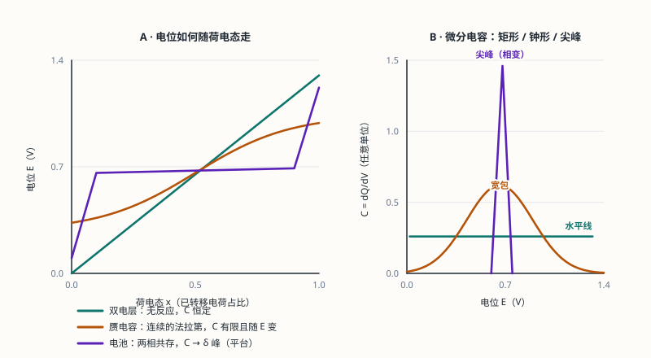
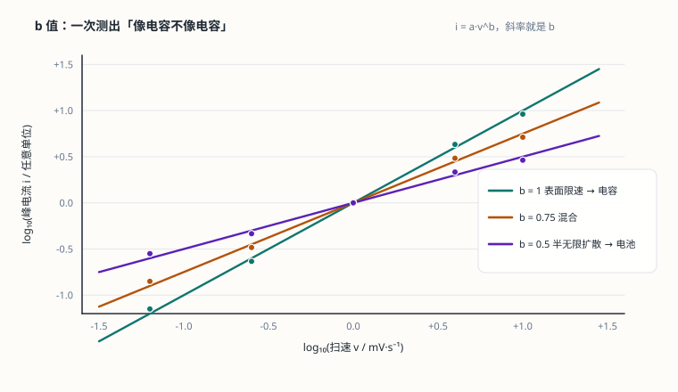

---
tags:
  - 化学
  - 电化学
  - 储能
  - 材料
  - 超级电容
关联:
  - "[Nernst方程：59 mV 的来历、三种写法与它失效的四道边界](Nernst方程：59 mV 的来历、三种写法与它失效的四道边界.md)"
  - "[水与膜上的自发电位：从冻结电势到化学渗透](水与膜上的自发电位：从冻结电势到化学渗透——电荷分离的三种手法与三层膜电位.md)"
  - "[醌类：芳香性的赎金](醌类：芳香性的赎金——呼吸链的心脏、染料母体与药毒同源的弹头.md)"
  - "[酚类：可逆的氧化](酚类：可逆的氧化——石炭酸、单宁与黑色素共享的一只羟基.md)"
  - "[化学电容：四种电容的「座位表」](化学电容：四种电容的「座位表」——静电与化学的分水岭.md)"
---

# 赝电容：一条 Nernst 曲线如何冒充电容——机制、判据与「假电容」的边界

> **根节点**：同一个电极上，为什么有的材料 CV 是矩形、有的是一座宽包、有的是一对尖峰？「赝电容」这个词为什么在文献里被骂得这么狠——它到底指机制、指材料，还是指一种被误用的测量结果？

> **叙事逻辑**：名词与三条边界 → 三种机制的解剖 → Nernst 视角（一条方程三种签名）→ Conway 的三类 → 解析式与峰宽 → 测量判据与误判 → 材料地图 → 电荷上界 → 2018 年的批评 → Ragone 定位 → 收束

> **立场说明**：公式推导、材料数值、文献年份属于可查证内容；「赝电容的优势只有 3–10 倍」这类由量级推算得到的判断标为分析；对二手引用的「理论比电容」标注口径差异与待核实。

> **来源标注**：Conway 的专著与 1962–63 年原始论文、Trasatti 1971/1991 的两篇、Dunn 与 Simon 2014 的 *Science* 评论、Augustyn 2013 的 *Nature Materials*、Gogotsi 与 Penner 2018 的 *ACS Nano* 批评；整理于 2026-11-19。

## 知识树

```txt
根节点：赝电容到底是电容还是电池？它凭什么同时「有法拉第反应」又「像电容」？
│
├── 一、名词与三条边界（一个被骂得最狠的电化学词）
│   ├── 定义：法拉第的、但签名像电容的
│   └── 三条硬边界：有电子转移 / 无新相 / C 有限
│
├── 二、三种机制的解剖（静电、表面法拉第、体相相变）
│   ├── 双电层：纯物理，10–40 μF/cm²
│   ├── 赝电容：法拉第但连续
│   └── 电池：法拉第且两相
│
├── 三、Nernst 视角：一条方程，三种签名（本篇核心）
│   ├── 台阶 = 两相共存（活度被相律钉死）
│   ├── S 形 = 位点能量连续可调
│   └── 常数 = 根本没有反应
│
├── 四、Conway 的三类赝电容（UPD / 氧化还原 / 插层）
│   ├── 各自的物理前提
│   └── 为什么插层型最靠近电池
│
├── 五、解析式：为什么 CV 是一座钟
│   ├── C = n²F²Γ/RT · x(1−x)
│   └── 峰高 0.94 mF/cm²、峰宽 90.7 mV（单层、单电子）
│
├── 六、测量：四个判据与它们的误判
│   ├── b 值 / Dunn 分离 / Trasatti / EIS
│   └── 最可靠的是「有没有新相」
│
├── 七、材料地图与真实数字（RuO₂、MnO₂、MXene、Nb₂O₅、醌）
│   └── 薄膜数字不能外推到厚电极
│
├── 八、上界：每个表面位点最多一个电子
│   ├── 96.5 μC/cm² vs 双电层 10–40 μC/cm²
│   └── 所以机理优势只有 3–10 倍
│
├── 九、2018 年的那场批评（Gogotsi 与 Penner）
│   ├── 三条罪名：术语通胀 / 单位滥用 / 判据缺省
│   └── 该怎么写一篇储能论文
│
├── 十、在 Ragone 图上的真实位置（能量与功率的兑换率）
│   ├── τ = RC 是硬币的正面
│   └── P = V²/4R 是硬币的反面
│
└── 十一、收束：在两个旧机制的边界上开出来的一块地
    ├── 归因：热力学可调 × 动力学无势垒
    ├── 延伸：厚电极、混合器件、原位表征
    └── 个体坐标：读到「赝电容」先问五件事
```

## 〇、锚点：先建立量级坐标

### 0.1 数字锚点

| 数字 | 含义 | 在本文中的作用 |
|---|---|---|
| **10–40 μF/cm²** | 双电层的面电容（按真实面积） | 所有「电容」比较的基准线 |
| **96.5 μC/cm²** | 单层表面位点、每个位点转移 1 个电子的电荷密度 | 赝电容的机理天花板 |
| **≈1 nmol/cm²** | 密堆积单层的位点密度（0.6–1.2×10¹⁵ 个/cm²） | 上式的来源 |
| **0.94 mF/cm²** | 单层赝电容的峰值微分电容 | 说明「比双电层大一个数量级」 |
| **90.7 mV** | 单一位点、单电子、25 ℃ 的峰半高宽 | 为什么真实材料的包比它宽得多 |
| **3–10 倍** | 赝电容相对双电层的机理优势（同真实面积） | 拆穿「大 1000 倍」的叙事 |
| **1110 C/g** | MnO₂ 中每个 Mn 转移 1 个电子的电荷当量 | 换算「理论比电容」的原点 |
| **1370 F/g** | MnO₂ 常被引用的「理论比电容」 | 它其实是**体相**数字（口径待核实） |
| **700–800 F/g** | 含水 RuO₂ 的实测值 | 接近「每个 Ru 一个电子」的上限 |
| **1/4** | 对称两电极器件相对单电极的比电容折扣 | 最常见的论文事故 |
| **0.5 / 1** | b 值的两个端点：扩散 / 表面 | 一条 log–log 直线的斜率 |
| **5–8 / 10–30 / 150–250 Wh/kg** | 双电层 / 赝电容 / 锂电的能量密度 | Ragone 图上的三段 |
| **−90° / −45°** | EIS 相位角：理想电容 / Warburg 扩散 | 频域里最省事的判据 |

### 0.2 时间锚点

| 年份 | 事件 | 为什么值得记 |
|---|---|---|
| **1962–63** | Conway 与 Gileadi 提出赝电容的动力学理论 | 概念诞生：吸附等温线的微分就是电容（卷期待核实） |
| 1971 | Trasatti 与 Buzzanca 报告 RuO₂ 的电容行为 | 第一个「氧化物赝电容」材料 |
| 1991 | Trasatti 发表《陶瓷氧化物的物理电化学》 | 把 UPD 与氧化还原型统一起来 |
| **1999** | Conway 专著《电化学超级电容器》 | 三类赝电容的教科书定型 |
| **2013** | Augustyn 等：Nb₂O₅ 的插层赝电容（*Nat. Mater.*） | 「没有相变的插层」被单独命名 |
| 2013 | Lukatskaya 等：MXene 的阳离子插层电容（*Nature*） | 高体积电容的新家族 |
| **2014** | Dunn 与 Simon《电池与超级电容的界线在哪里》（*Science*） | 明确：赝电容是**行为**，不是材料 |
| 2014 | Augustyn 等：赝电容氧化物的综述（*Energy Environ. Sci.*） | 判据被系统化（b 值、Trasatti） |
| **2018** | Gogotsi 与 Penner 的术语批评（*ACS Nano*） | 把「滥用」正式摆上台面 |

### 0.3 图示导览

| 图 | 位置 | 一句话 |
|---|---|---|
| 图 1 · 三种机制：电位–荷电态与微分电容 | §三 | 直线 / 宽 S / 台阶，对应矩形 / 钟形 / 尖峰 |
| 图 2 · b 值判别 | §六 | 一条 log–log 直线的斜率就能分开「表面」与「扩散」 |

## 一、名词与三条边界

### 1.1 定义

> 📌 **赝电容（pseudocapacitance）**：由**可逆的法拉第电荷转移**产生、但电位随荷电态**连续可微**地变化（不出现两相平台）的电容性行为。等价说法：$C=\mathrm{d}Q/\mathrm{d}V$ 在充放电全程为正、有限、且不出现 δ 峰。

**「赝」不是「假」。** 它不是说这个电容是假的，而是说：**本质上是法拉第反应（电池的物理），外表上却是电容的签名（矩形的 CV、线性的恒流曲线、接近 −90° 的相位角）。** 中国文献也用「假电容」「准电容」，英文里偶见 redox capacitance 的说法。

**三条硬边界**，缺一条就不是赝电容：

| # | 边界 | 排除谁 | 判据 |
|---|---|---|---|
| 1 | 有电子转移（法拉第） | 双电层电容 | 有明确的氧化还原峰/电荷转移电阻 |
| 2 | 不涉及新相的形核与长大 | 电池 | 原位 XRD 无新相；无平台 |
| 3 | $\mathrm{d}Q/\mathrm{d}V$ 有限且为正 | 电池（在平台处 C→∞） | CV 无尖峰；恒流曲线无平台 |

**收束句**：这三条同时成立时，「电容」这个单位（F）才勉强可以用；缺一条，就该改用「容量」（C 或 mAh）。**整场术语争论，本质上就是这三条被违反。**

### 1.2 为什么这个词会被骂

因为在 2010 年代的文献里，「赝电容」逐渐变成了「任何有法拉第反应的纳米材料」的同义词。一个 5 nm 的 LiFePO₄ 颗粒，CV 上仍然是两个尖峰（相变），但有人把它积分成 F/g 报出来，数字大得好看。**这不是赝电容，这是「纳米化的电池」。**

2018 年 Gogotsi 与 Penner 在 *ACS Nano* 上的那篇三页评论，就是冲着这件事去的（详见 §九）。

## 二、三种机制的解剖

### 2.1 一张总表

| 维度 | 双电层（EDL） | 赝电容 | 电池 |
|---|---|---|---|
| 电荷存在哪 | 电极/电解液界面的离子层 | 表面或近表面的氧化还原中心 | 体相晶格 |
| 有无电子转移 | **无**（纯静电） | 有 | 有 |
| 电位–荷电关系 | 线性（$C$ 恒定） | 对数型（Nernst 型 S 曲线） | 台阶（相变，$E$ 恒定） |
| 面电容（真实面积） | 10–40 μF/cm² | 0.1–1 mF/cm² | 不适用 |
| 比电容（质量） | 100–200 F/g | 200–1000 F/g（薄膜） | 以 mAh/g 计 |
| 特征时间 | ms（介孔内 0.1–10 s） | ms–s | 分钟 |
| 循环寿命 | 10⁶ | 10⁴–10⁵ | 10³–10⁴ |
| 能量密度 | 5–8 Wh/kg | 10–30 Wh/kg | 150–250 Wh/kg |

**收束句**：三者不是三种材料，而是**三种「电荷如何被存下来」的路径**——同一块电极在不同电位区间可以走不同的路，同一材料在不同粒径下也可以换路。

### 2.2 双电层：一个纯物理的基线

电极表面过剩电荷，电解液侧被反离子屏蔽，形成厚度约德拜长度的双电层。它的电容近似为平行板电容：

$$
C_{\rm dl}=\frac{\varepsilon_r\varepsilon_0 A}{d}
$$

- **$\varepsilon_r$**：界面层水的相对介电常数（受强场压制，常取 6–30，远低于体相 80）；
- **$\varepsilon_0$**：真空介电常数；
- **$A$**：真实（可润湿）表面积；
- **$d$**：双电层厚度，即德拜长度 $\lambda_D\approx0.304/\sqrt{I}$ nm（$I$ 为离子强度，mol/L）。

> 🔗 **横向关联**：本节「双电层厚度就是德拜长度」与 [水与膜上的自发电位：从冻结电势到化学渗透](水与膜上的自发电位：从冻结电势到化学渗透——电荷分离的三种手法与三层膜电位.md) 的「四层膜电位辨析」形成**同一几何的不同用途**——那篇用它算界面电位（10–100 mV 的 $\psi_s$），本篇用它算界面电容。**同一个 $0.304/\sqrt{I}$，一边是电位，一边是电容。**

代入 $d\approx0.3$ nm、$\varepsilon_r\approx10$ 可得 $C/A\approx30$ μF/cm²——与实测的 10–40 μF/cm² 同量级。**这个数字几乎是电化学里最硬的一个常数**，所有「超高比电容」的宣传，最终都要和它算账（见 §八）。

### 2.3 赝电容：把反应摊平在电位轴上

关键区别：**电池把反应挤在一个电位上（平台），赝电容把同一个反应摊开在一段电位上（宽包）。** 为什么能摊开？因为参与的活性中心彼此不等价——有的是表面原子、有的在 1 nm 深处、有的邻近缺陷、有的被氢键扰动。**位点能量的分布，就是电位轴的分布。**

> 🔗 **横向关联**：本篇只解剖「赝电容」这一支。把双电层、赝电容、石墨烯量子电容、半导体化学电容四种「座位表」放进同一个公式 $C_\mu=q^2g(E_F)$ 里比较，见 [化学电容：四种电容的「座位表」](化学电容：四种电容的「座位表」——静电与化学的分水岭.md)。

## 三、Nernst 视角：一条方程，三种签名

这一节是全篇的骨架，也是与 [Nernst 方程](Nernst方程：59 mV 的来历、三种写法与它失效的四道边界.md) 那份笔记的接口。

### 3.1 同一条方程，只换一个前提

Nernst 方程：

$$
E=E^\circ-\frac{RT}{nF}\ln Q
$$

真正决定「形状」的不是这个式子，而是**其中一个隐含前提**：$Q$ 随荷电态怎么变。

| 情形 | 活度如何随荷电态变 | 得到的 $E(x)$ | 得到的 $C=\mathrm{d}Q/\mathrm{d}V$ | 电化学签名 |
|---|---|---|---|---|
| **电池（两相）** | 被相律钉死，$a$ 恒定 | **水平线** | δ 峰（∞） | 平台、尖峰对 |
| **赝电容（连续）** | 随 $x$ 连续变 | **Nernst 型 S 曲线** | 有限的钟形 | 宽包、弯曲的恒流曲线 |
| **双电层（无反应）** | 不涉及 $Q$（静电） | **直线**（$E\propto Q$） | 常数 | 矩形、三角波 |



*图 1 · A 面板：双电层是直线（E 与 x 成正比）；赝电容是宽的 S 曲线（因为没有单一 E°，位点能量被分散）；电池是台阶（两相共存时活度被钉死）。B 面板：把 A 求导，就得到微分电容——恒定的水平线、钟形的宽包、近似 δ 函数的尖峰。CV 的电流正比于 C，所以 B 面板的形状就是 CV 的形状。*

### 3.2 为什么「平台」必然是尖峰

平台意味着：在很宽的一段荷电区间里，$E$ 纹丝不动。既然 $\mathrm{d}E/\mathrm{d}x=0$，那么 $\mathrm{d}Q/\mathrm{d}V=1/(\mathrm{d}E/\mathrm{d}Q)\to\infty$。

**所以一个材料在 CV 上出现尖峰、在恒流曲线上出现平台，是同一件事的两个视角**，而且都指向同一个物理：**相变**。把这个尖峰积分成一个「比电容」并拿去和活性炭比，等于拿「熔化潜热」去和「比热容」比。

> 🔗 **横向关联**：本节「平台 = 两相」与 [Nernst 方程](Nernst方程：59 mV 的来历、三种写法与它失效的四道边界.md) §七「平台意味着两相，斜坡意味着一相」形成**同一条判据的两次使用**——那篇用它读锂电的充放电曲线，本篇用它读赝电容的 CV。**同一句话，一边是电池设计，一边是术语辨伪。**

### 3.3 单一位点 vs 位点分布：宽包是怎么来的

一个理想的、能量单一的表面氧化还原对，其 Nernst 型 S 曲线只跨约 **240 mV**（$x$ 从 1% 到 99%），对应的微分电容峰半高宽只有 **90.7 mV**（$n=1$，25 ℃，推导见 §五）。

但真实的赝电容材料（MnO₂、RuO₂、聚苯胺）的 CV 是跨越 0.6–1.0 V 的宽包。原因不是「Nernst 失效」，而是**位点不是一种**：

| 来源 | 对 $E^\circ$ 的影响 | 后果 |
|---|---|---|
| 表面 vs 次表面 vs 内层 | 配位数与溶剂化不同 | 一组平移的 $E^\circ$ |
| 缺陷、空位、晶面 | 局部成键能不同 | 连续分布的 $E^\circ$ |
| 质子/阳离子共嵌入 | 局部 pH 或活度不同 | $E^\circ$ 随位置漂移（Nernst 斜率 −59 mV/pH） |
| 颗粒尺寸分布 | 表面能不同 | 几十 mV 的展宽 |

**收束句**：**宽包 = 许多个窄 Nernst 峰的叠加。** 这也解释了为什么「赝电容材料」往往「没有特征峰」——不是没有氧化还原，而是氧化还原太多、太不均匀。

## 四、Conway 的三类赝电容

| 类型 | 物理前提 | 典型体系 | 电化学签名 | 电荷上限 |
|---|---|---|---|---|
| **欠电位沉积（UPD）** | 吸附原子与基底成键，补偿了「在 Nernst 电位之正沉积」的能量 | H/Pt、Pb/Au、Bi/Au、Cu/Au | 一对或多对可逆尖峰，峰间距小 | 一个单层 |
| **氧化还原型** | 表面/近表面原子的价态变化，无新相 | RuO₂·xH₂O、MnO₂、聚苯胺、PEDOT | 宽包 | 表面原子数 |
| **插层型** | 离子插入宿主，宿主**无相变**、固溶区宽 | T-Nb₂O₅、TiO₂(B)、MoO₃ | 宽包 + 高倍率 | 固溶区宽度 |

### 4.1 UPD：为什么可以「提前」沉积

热力学上，金属 M 在自身离子活度 $a$ 下的沉积电位是 Nernst 给出的 $E_{\rm M^{n+}/M}$。但若 M 吸附在**另一种**金属基底上，形成 M–基底键放出的自由能会把沉积电位往正移——于是**在 Nernst 电位之正就能长出单层**。

所以 UPD 并不违反 Nernst，它只是把「纯相 M 的活度 = 1」换成了「吸附层的活度 < 1」。**这正好是 §三 那张表的第三行：活度不再是常数，$E$ 就随覆盖度连续移动。**

### 4.2 氧化还原型：RuO₂ 是教科书

$$
\mathrm{RuO_2}+x\mathrm{H^+}+x\mathrm{e^-}\rightleftharpoons\mathrm{RuO_{2-x}(OH)_x}
$$

- 反应发生在含水 RuO₂ 的水合通道里，**质子可进可出**；
- 电位随 $x$ 连续变化，跨约 1.2 V，没有相变；
- 因此理论上每个 Ru 都能贡献一个电子——这是它 700–800 F/g 的来源；
- 代价：Ru 贵、且只有在**含水**（无定形/水合）状态下才有这条通道，晶态 RuO₂ 是良导体但电容很小。

### 4.3 插层型：最靠近电池的一类

如果把「表面」换成「体相固溶区」，就得到插层赝电容：Li⁺ 进入 T-Nb₂O₅ 的层间通道，**宿主不分解成新相**，化学势随 $x$ 连续变，于是 Nernst 给出斜线而不是平台。

Dunn 组的判据很干脆：**在很高扫速下，电流仍随 $v$ 线性增长（$b\approx1$）**——说明限速步不是固相扩散，而是界面电荷转移。这正是「赝」的动力学含义：**它把电池反应做到了「不被扩散卡住」的速度。**

> 📌 **插层赝电容（intercalation pseudocapacitance）**：离子插入宿主晶格、但不伴随相变的一种法拉第储能行为，其电位随插入量连续变化。**它在本文中的作用**：说明「电池材料」与「赝电容材料」的界线不在化学，而在**有没有相变**与**粒径**。

## 五、解析式：为什么 CV 是一座钟

### 5.1 从 Langmuir 等温线推电容

设表面有 $\Gamma$（mol/cm²）的氧化还原位点，氧化态占比为 $x$。Langmuir 型平衡给出：

$$
\frac{x}{1-x}=\exp\!\left[\frac{nF(E-E^\circ)}{RT}\right]
\quad\Longrightarrow\quad
E=E^\circ+\frac{RT}{nF}\ln\frac{x}{1-x}
$$

把 $E$ 对 $x$ 求导：

$$
\frac{\mathrm{d}x}{\mathrm{d}E}=\frac{nF}{RT}\,x(1-x)
$$

电荷 $Q=nF\Gamma x$，于是微分电容：

$$
C=\frac{\mathrm{d}Q}{\mathrm{d}E}=nF\Gamma\frac{\mathrm{d}x}{\mathrm{d}E}
=\frac{n^2F^2\Gamma}{RT}\,x(1-x)
$$

- **$n$**：每个位点转移的电子数；
- **$F$**：96485 C/mol；
- **$\Gamma$**：位点面密度（mol/cm²）；
- **$R,T$**：气体常数与温度；
- **$x(1-x)$**：一个抛物线因子——它在 $x=1/2$ 处最大，两端趋零。

### 5.2 三个可直接用的数字

**峰值**（$x=1/2$）：

$$
C_{\max}=\frac{n^2F^2\Gamma}{4RT}
$$

取 $\Gamma=1\times10^{-9}$ mol/cm²、$n=1$、$T=298.15$ K：

$$
C_{\max}=\frac{96485^2\times10^{-9}}{4\times8.314\times298.15}
=\frac{9.31}{9916}\approx9.4\times10^{-4}\ \mathrm{F/cm^2}=0.94\ \mathrm{mF/cm^2}
$$

**峰宽**（半高宽，$x(1-x)$ 从 0.25 降到 0.125，即 $x=0.146$ 与 $0.854$）：

$$
\Delta E_{\rm FWHM}=2\times\frac{RT}{nF}\ln\frac{0.854}{0.146}=2\times25.69\times1.766\approx90.7\ \mathrm{mV}
$$

**比例关系**：$C_{\max}\propto n^2\Gamma$、$\Delta E_{\rm FWHM}\propto1/n$。

| 位点类型 | $n$ | 同 $\Gamma$ 下的 $C_{\max}$ | 峰宽 |
|---|---|---|---|
| 单电子金属中心 | 1 | $0.94$ mF/cm² | 90.7 mV |
| 醌/氢醌（2e⁻/2H⁺） | 2 | $3.8$ mF/cm² | 45.4 mV |
| 单层极限（$\Gamma=2$ nmol/cm²） | 1 | $1.9$ mF/cm² | 90.7 mV |

**收束句**：$\Gamma$ 是唯一能「调」的量，而它被表面原子数封死（§八）。**想把电容做大，除了增加面积，唯一的出路是让更多原子参与反应——那就变成了电池。**

> 🔗 **横向关联**：本节的 2e⁻/2H⁺ 行与 [醌类：芳香性的赎金](醌类：芳香性的赎金——呼吸链的心脏、染料母体与药毒同源的弹头.md) §4.2「质子耦合：−59 mV 的魔咒」形成**定量对接**——醌的 $n=2$ 让峰高变 4 倍、峰宽变一半，同时因为耦合两个质子，$E$ 还随 pH 以 −59 mV/pH 平移。**醌同时是「最好的分子赝电容位点」和「最敏感于环境」的位点**，这两件事是同一个耦合项的两面。

## 六、测量：四个判据与它们的误判

### 6.1 b 值：一条直线的斜率

$$
i=a\,v^{b}
\quad\Longrightarrow\quad
\log i=\log a+b\log v
$$

- **$i$**：某电位下的电流（或峰电流）；
- **$v$**：扫速；
- **$b$**：log–log 斜率。$b=1$ 表示电流正比于扫速（表面限速，电容性）；$b=0.5$ 表示正比于 $\sqrt{v}$（半无限扩散，电池性）。



*图 2 · 同一条曲线的数据点落在哪条参考线上，就说明它是哪一类。实心点是模拟的测量值；真实材料常常落在 0.7–0.9 之间，因为欧姆降、孔道传输与双电层贡献会同时存在。*

**必须提醒**：$b$ 值跨的扫速范围若不足两个数量级，拟合出来的 $b$ 不可信；而欧姆降会系统性地把 $b$ 往 0.5 拉——**测出 $b=0.7$ 不等于「混合机制」，也可能是「好电容 + 坏电极」。**

### 6.2 Dunn 分离：把电流拆成两半

$$
i(V)=k_1v+k_2\sqrt{v}
$$

同电位下测多个扫速，作 $i/v$ 对 $\sqrt{v}$ 的直线，截距即 $k_1$（电容贡献），斜率即 $k_2$（扩散贡献）。

- **$k_1v$**：表面过程（双电层 + 赝电容）；
- **$k_2\sqrt{v}$**：半无限扩散（插层/相变）；
- **它分不开「双电层」与「赝电容」**——两者都在 $k_1$ 里。这一点常被忽略。

### 6.3 Trasatti：外推到无穷扫速

总电荷 $q$ 由「外表面（快）」与「内表面（慢，需扩散）」两部分组成。作 $q$ 对 $v^{-1/2}$ 的图，外推到 $v\to\infty$（即 $v^{-1/2}\to0$），截距就是 $q_{\rm outer}$。

| 量 | 含义 | 用途 |
|---|---|---|
| $q_{\rm total}$ | 低扫速下的全部电荷 | 总容量 |
| $q_{\rm outer}$ | 高扫速下仍能拿到的电荷 | 真正的「电容性」部分 |
| $q_{\rm inner}=q_{\rm total}-q_{\rm outer}$ | 需要扩散才能拿到的部分 | 越接近电池 |

### 6.4 EIS 与结构判据

| 判据 | 电容 | 赝电容 | 电池 |
|---|---|---|---|
| Nyquist | 垂直线（近 90°） | 低频接近垂直 + 小半圆 | 中频 45°（Warburg） |
| 相位角（低频） | −90° | −80° ~ −88° | −45° ~ −60° |
| CV 形状 | 矩形 | 宽包 | 尖峰对 |
| 恒流曲线 | 三角形 | 弯曲、无平台 | 平台 |
| **原位 XRD / 电化学膨胀** | 无变化 | **无新相** | **有新相** |

**收束句**：前四项都是**间接**的（都是「像不像」），只有最后一项是**直接**的（「有没有」）。**当 b 值与 CV 形状打架时，信原位结构。**

### 6.5 五个高频误判

| # | 误判 | 为什么会错 | 正确做法 |
|---|---|---|---|
| 1 | 把厚电极的畸变 CV 当「赝电容」 | 欧姆降 + 孔道扩散把峰抹平，看起来像宽包 | 多扫速 + 多载量对照 |
| 2 | 用 CV 积分报 F/g | 有平台的材料积分出巨大「电容」 | 有平台就报 C/g 或 mAh/g |
| 3 | 三电极数据当成器件性能 | 对称器件实际比电容是单电极的 1/4 | 明确电极构型与质量基准 |
| 4 | 只报最好的一圈 | 赝电容常在数百圈后因溶解/膨胀衰减 | 报循环曲线与库仑效率 |
| 5 | 拿薄电极（<0.1 mg/cm²）的数字外推 | 载量增加 10 倍，可利用表面占比骤降 | 必须报载量；商用门槛约 10 mg/cm² |

## 七、材料地图与真实数字

| 材料 | 机制 | 典型比电容 | 电压窗 | 主要问题 |
|---|---|---|---|---|
| **RuO₂·xH₂O** | 质子化氧化还原（连续） | 700–800 F/g | ~1.2 V（水系） | 贵；晶态几乎无电容 |
| **MnO₂** | 表面 Mn(IV)/Mn(III) | 薄膜 700–800；厚电极 100–300 F/g | 0.8–1.0 V | 导电性差；反应只限于表面几纳米 |
| **聚苯胺 / PPy / PEDOT** | 掺杂–去掺杂 | 200–500 F/g | 0.7–1.0 V | 充放电膨胀、溶解 |
| **Ti₃C₂Tₓ（MXene）** | 表面端基氧化还原 + 阳离子插层 | 薄层可达 900–1500 F/g 量级（报道值） | 0.6 V（水系） | 氧化稳定性、片层重堆叠 |
| **T-Nb₂O₅** | 插层赝电容（无相变） | 数百 F/g，但倍率极好 | 1.2–3 V（有机） | 容量中等；电压窗决定能量 |
| **活性炭** | 纯双电层 | 100–200 F/g | 1.0–2.7 V | 能量密度低 |
| **醌/氢醌（分子、导电聚合物侧链）** | 2e⁻/2H⁺ 氧化还原 | 按位点折算可达数百 F/g 当量 | 依 pH | 溶解、导电网络、pH 依赖 |

### 7.1 MnO₂ 的「1370 F/g」是怎么来的

按每个 Mn 转移 1 个电子：

$$
\frac{96485\ \mathrm{C/mol}}{86.94\ \mathrm{g/mol}}\approx1110\ \mathrm{C/g}
$$

在 $\Delta V\approx1.2$ V 的窗口下折成电容，就是常被引用的**约 1370 F/g**（换算口径在文献中并不统一，**待核实**）。

**关键在于**：1110 C/g 的假设是「**每一个 Mn 都参与反应**」——那是**体相**数字，不是表面数字。现实中，只有表面 1–2 nm 内的 Mn 能被电解液接触到。所以：

- 2–5 nm 的薄颗粒 → 大部分 Mn 在表面 → 700–800 F/g 可达到；
- 10 μm 的厚电极 → 只有极少部分 Mn 在工作 → 100–300 F/g，甚至更低。

**「理论比电容」常常是「纳米化到几乎每个原子都在表面」的理想值，而不是材料的固有属性。**

## 八、上界：每个表面位点最多一个电子

### 8.1 两笔账

这是全篇最值得记住的一次量级对比。

| 机制 | 每真实面积的电荷（1 V 窗口） | 折合「每个表面位点的电子数」 |
|---|---|---|
| 双电层（10 μF/cm²） | 10 μC/cm² | 0.10 |
| 双电层（40 μF/cm²） | 40 μC/cm² | 0.41 |
| **单层赝电容（1 e⁻/位点）** | **96.5 μC/cm²** | **1.00** |
| 单层赝电容（2 e⁻/位点，如醌） | 193 μC/cm² | 2.00 |
| 厚电极上宣称的 1000 F/g（0.1 mg/cm²） | 1×10⁵ μC/cm² | **≈1000** |

- **96.5 μC/cm²** 来自 $Q=nF\Gamma=1\times96485\times10^{-9}$ C/cm²；
- 最后一行是「把 1000 F/g 按 0.1 mg/cm² 折算成面电荷」得到的——它要求每个表面位点转移约 **1000 个电子**。

**结论**：**赝电容相对双电层的机理优势只有 3–10 倍**（96.5 对 10–40）。剩下的所有「一个数量级以上的提升」，都不是来自机理，而是来自**面积**或**把体相反应算进来**。

### 8.2 为什么 F/g 可以很大

$$
C_{\rm gravimetric}=C_{\rm areal}\times A_{\rm specific}
$$

取 $C_{\rm areal}=1$ mF/cm²、比表面 1000 m²/g $=10^{7}$ cm²/g：

$$
C_{\rm gravimetric}=10^{-3}\times10^{7}=10^{4}\ \mathrm{F/g}
$$

这是**算术上限**。实际只有 5%–10% 的表面既被电解液润湿、又电连接到集流体，于是落到 500–1000 F/g——正好是文献里最漂亮的那批数字。

**收束句**：**「F/g」是一个被面积和厚度放大的量，不是材料优劣的度量。** 同一种 MnO₂，在 2 nm 薄膜上是 800 F/g，在 20 μm 电极上是 150 F/g，化学没有变，变的是「有多少原子够得着」。

## 九、2018 年的那场批评

### 9.1 三条罪名

Gogotsi 与 Penner 在 *ACS Nano* 2018 的评论里，把当时的乱象归成三类：

| # | 罪名 | 具体表现 | 后果 |
|---|---|---|---|
| 1 | **术语通胀** | 把任何纳米化的法拉第材料都叫「赝电容」 | 掩盖了相变本质，误导读者以为倍率好 |
| 2 | **单位滥用** | 对有平台的材料积分出 F/g | 数学上得到巨大的数，物理上没有意义 |
| 3 | **判据缺省** | 只给一张 CV 和一个 b 值，不报载量、窗口、构型 | 结果不可复现、不可比较 |

### 9.2 该怎么写

同一篇评论给出的最低要求，可以整理成四句话：

1. **先看形状**：有平台 → 报容量（C/g 或 mAh/g），不要报 F/g。
2. **再报条件**：载量（mg/cm²）、电压窗、三电极还是两电极。
3. **判据成组**：CV 形状 + 多扫速 b 值 + 恒流 + 循环，至少给三样。
4. **能级要真**：薄电极数字必须注明，最好再给一个接近商用载量（~10 mg/cm²）的对照。

### 9.3 Dunn 与 Simon 的界定

2014 年 *Science* 的那篇评论给了一个更好用的框架：**赝电容描述的是一种「行为」，不是一类「材料」。** 同一个 LiCoO₂：

- 体相、微米颗粒 → 相变、平台 → 电池；
- 5 nm、大倍率、进入固溶区 → 无平台、$b\approx1$ → 赝电容行为。

**所以「这是不是赝电容材料」是一个坏问题；「在这个粒径、这个倍率、这个电位区间下，它是赝电容行为吗」才是好问题。**

> 🔗 **横向关联**：本节「按行为而非材料分类」与 [Nernst 方程](Nernst方程：59 mV 的来历、三种写法与它失效的四道边界.md) §九「四道失效边界」形成**同一种方法论**——那篇主张「先对号入座边界，再怀疑公式」，本篇主张「先问粒径与倍率，再谈材料」。**两篇的共同点是：把一个名词还原成一组条件。**

## 十、在 Ragone 图上的真实位置

| 器件 | 能量密度（Wh/kg） | 功率密度（W/kg） | 特征时间 | 循环寿命 |
|---|---|---|---|---|
| 电解电容 | 0.01–0.1 | 10⁶ | μs–ms | 10⁹ |
| 双电层电容 | 5–8 | 10⁴ | ~1 s | 10⁶ |
| **赝电容** | **10–30** | **10³** | 1–10 s | 10⁴–10⁵ |
| 锂离子电池 | 150–250 | 250–1000 | 分钟–小时 | 10³–10⁴ |

### 10.1 为什么能量与功率必然对冲

$$
\tau=RC,\qquad P_{\max}=\frac{V^2}{4R},\qquad E=\tfrac12CV^2
$$

- **$\tau$**：器件的时间常数，决定「多快能放完」；
- **$P_{\max}$**：最大功率，出现在负载电阻等于内阻时；
- **$E$**：储存的能量，正比于电容与电压的平方。

**要能量就加厚电极（$C$ 上升），但厚度会抬高 $R$（离子路径变长），于是 $\tau$ 上升、$P_{\max}$ 下降。** 这两个目标在同一个几何里是对冲的——这就是 Ragone 图那条斜线的物理来源。

**赝电容的定位**：它不靠「更大的 $C$」赢，而靠**「没有相变形核势垒」**赢。相变需要形核、需要界面迁移，动力学上永远慢；把反应摊在电位轴上，就绕过了这一步。**它买的是倍率，不是能量。**

> 🔗 **横向关联**：本节「无相变 → 高倍率」与 [醌类：芳香性的赎金](醌类：芳香性的赎金——呼吸链的心脏、染料母体与药毒同源的弹头.md) §10.1「醌类液流电池」形成**同一逻辑的工程版**——那篇讲分子在液相里做 2e⁻/2H⁺ 的可逆氧化还原（没有固相、没有相变、没有形核），本篇把这个逻辑推广成判据：**凡是能把反应做成「连续、可逆、无相变」的体系，倍率都不会被热力学卡住。**

## 十一、收束

### 11.1 归因：它是两个旧机制的交叉点

赝电容不是一种新机制，而是**「热力学可调」与「动力学可达」的交叉点**：

| | 动力学差（有相变） | 动力学好（无相变） |
|---|---|---|
| **热力学不连续** | 体相电池 | 纳米化电池（仍被误叫赝电容） |
| **热力学连续** | —（几乎不存在） | **赝电容 / 双电层** |

- 要有**连续的 $\mathrm{d}E/\mathrm{d}x$**，否则就掉进电池那一格；
- 要有**没有形核势垒的路径**，否则就掉进「动力学差」那一列；
- 剩下的那一格，就是赝电容站的地方。

**所以它天然是一块窄地**：往左一步是电池，往右一步是双电层，往下一步是「纳米化的电池」——而那正是术语被滥用的地方。

### 11.2 延伸：三条仍在动的线

1. **厚电极化**：把赝电容从「0.1 mg/cm² 的漂亮数字」推进到 10 mg/cm² 的商用载量，是当前最硬的工程瓶颈（离子传输 + 电子导电网络）。
2. **混合器件**：锂离子电容器把电池型负极与电容型正极拼起来，用「能量-功率」的不同配比去填 Ragone 图的空白区。
3. **原位表征与机器学习**：用原位 XRD/PDF/电化学膨胀直接判定「有没有新相」，再用高通量计算筛选「宽固溶区 + 低迁移势垒」的宿主——把「像不像」的争论变成「有没有」的数据。

### 11.3 个体坐标：读到「赝电容」三个字，先问五件事

| 自检 | 问什么 | 会被骗成什么样 |
|---|---|---|
| **形状** | CV 有尖峰、恒流有平台吗？ | 有平台还叫赝电容 → 其实是电池 |
| **载量** | 电极每平方厘米多少毫克？ | 0.1 mg/cm² 的数字外推到器件，掉一个数量级 |
| **窗口** | 电压窗多宽？水系还是有机？ | 1.2 V 与 3.0 V 的能量差 6 倍 |
| **构型** | 三电极还是两电极？ | 对称器件忘了除以 4 |
| **寿命** | 循环多少圈、库仑效率多少？ | 前三圈好看，第一千圈崩掉 |

**最后一句话**：赝电容测的是**「反应能不能被摊平在电位轴上」**，不是「电容大不大」。**看懂一条 CV 的形状，比记住任何一个 F/g 数字都有用。**

## 索引表

| # | 概念/事件 | 时间 | 类型 | 所属维度 | 横向关联笔记 | 重要性 |
|---|---|---|---|---|---|---|
| 1 | 赝电容定义与三条边界 | — | 概念 | 一 | — | ⭐⭐⭐⭐⭐ |
| 2 | 术语通胀 | 2010s | 现象 | 一 | — | ⭐⭐⭐⭐ |
| 3 | 双电层电容 10–40 μF/cm² | — | 数字 | 二 | [水与膜](水与膜上的自发电位：从冻结电势到化学渗透——电荷分离的三种手法与三层膜电位.md) | ⭐⭐⭐⭐⭐ |
| 4 | 德拜长度 $\lambda_D=0.304/\sqrt I$ | — | 公式 | 二 | [水与膜](水与膜上的自发电位：从冻结电势到化学渗透——电荷分离的三种手法与三层膜电位.md) | ⭐⭐⭐⭐ |
| 5 | 三种机制的签名对照表 | — | 判据 | 二/三 | — | ⭐⭐⭐⭐⭐ |
| 6 | 平台 ⇒ δ 峰 | — | 判据 | 三 | [Nernst 方程 §七](Nernst方程：59 mV 的来历、三种写法与它失效的四道边界.md) | ⭐⭐⭐⭐⭐ |
| 7 | Nernst 型 S 曲线 | — | 公式 | 三 | [Nernst 方程](Nernst方程：59 mV 的来历、三种写法与它失效的四道边界.md) | ⭐⭐⭐⭐⭐ |
| 8 | 宽包 = 窄峰的叠加 | — | 分析 | 三 | — | ⭐⭐⭐⭐ |
| 9 | UPD（欠电位沉积） | — | 机制 | 四 | — | ⭐⭐⭐ |
| 10 | RuO₂ 的质子化氧化还原 | 1971 | 材料 | 四 | — | ⭐⭐⭐⭐ |
| 11 | 插层赝电容（Nb₂O₅） | 2013 | 机制 | 四 | — | ⭐⭐⭐⭐⭐ |
| 12 | $C_{\max}=n^2F^2\Gamma/4RT$ | — | 公式 | 五 | — | ⭐⭐⭐⭐⭐ |
| 13 | 0.94 mF/cm²（单层单电子） | — | 数字 | 五 | — | ⭐⭐⭐⭐⭐ |
| 14 | 峰宽 90.7 mV | — | 数字 | 五 | [醌类 §4.2](醌类：芳香性的赎金——呼吸链的心脏、染料母体与药毒同源的弹头.md) | ⭐⭐⭐⭐ |
| 15 | $C\propto n^2$、$\Delta E\propto1/n$ | — | 判据 | 五 | — | ⭐⭐⭐⭐ |
| 16 | b 值 $i=av^b$ | — | 方法 | 六 | — | ⭐⭐⭐⭐⭐ |
| 17 | Dunn 分离 $k_1v+k_2\sqrt v$ | 2014 | 方法 | 六 | — | ⭐⭐⭐⭐ |
| 18 | Trasatti 外推 | 1991 | 方法 | 六 | — | ⭐⭐⭐⭐ |
| 19 | EIS 相位角 −90° / −45° | — | 判据 | 六 | — | ⭐⭐⭐ |
| 20 | 原位 XRD 判「有没有新相」 | — | 判据 | 六 | — | ⭐⭐⭐⭐⭐ |
| 21 | 五个高频误判 | — | 判据 | 六 | — | ⭐⭐⭐⭐ |
| 22 | MnO₂ 1110 C/g 与 1370 F/g | — | 数字 | 七 | — | ⭐⭐⭐⭐ |
| 23 | RuO₂ 700–800 F/g | 1999 | 数字 | 七 | — | ⭐⭐⭐ |
| 24 | MXene 的插层电容 | 2013 | 材料 | 七 | — | ⭐⭐⭐ |
| 25 | 分子赝电容（醌） | — | 材料 | 七/十 | [醌类 §10.1](醌类：芳香性的赎金——呼吸链的心脏、染料母体与药毒同源的弹头.md) | ⭐⭐⭐⭐ |
| 26 | 96.5 μC/cm² 单层上界 | — | 数字 | 八 | — | ⭐⭐⭐⭐⭐ |
| 27 | 机理优势 3–10 倍 | — | 分析 | 八 | — | ⭐⭐⭐⭐⭐ |
| 28 | $C_{\rm grav}=C_{\rm areal}\times A_{\rm specific}$ | — | 公式 | 八 | — | ⭐⭐⭐⭐ |
| 29 | Gogotsi–Penner 的三条罪名 | 2018 | 事件 | 九 | — | ⭐⭐⭐⭐⭐ |
| 30 | 「行为而非材料」 | 2014 | 判据 | 九 | [Nernst 方程 §九](Nernst方程：59 mV 的来历、三种写法与它失效的四道边界.md) | ⭐⭐⭐⭐⭐ |
| 31 | Ragone 三段 | — | 数字 | 十 | — | ⭐⭐⭐⭐ |
| 32 | $\tau=RC$、$P=V^2/4R$ | — | 公式 | 十 | — | ⭐⭐⭐⭐ |
| 33 | 两电极 1/4 折扣 | — | 判据 | 六/十 | — | ⭐⭐⭐⭐ |
| 34 | 交叉点分类表 | — | 分析 | 十一 | — | ⭐⭐⭐⭐ |

## 参考来源

1. Conway, B. E.：*Electrochemical Supercapacitors: Scientific Fundamentals and Technological Applications*，Kluwer/Plenum，1999（三类赝电容与 $C$–$E$ 关系式的定型表述）。
2. Conway, B. E. & Gileadi, E.：赝电容与高覆盖度电极反应的动力学理论，*J. Chem. Phys.* / *Trans. Faraday Soc.*，1962–1963（卷期与页码**待核实**）。
3. Trasatti, S. & Buzzanca, G.：〈Ruthenium dioxide: a new interesting electrode material〉，*J. Electroanal. Chem.* 29（1971）：App. 1–5。
4. Trasatti, S.：〈Physical electrochemistry of ceramic oxides〉，*Electrochim. Acta* 36（1991）：225–241。
5. Augustyn, V., Come, J., Lowe, M. A., Kim, J. W., Taberna, P.-L., Tolbert, S. H., Abruña, H. D., Simon, P., Dunn, B.：〈High-rate electrochemical energy storage through Li⁺ intercalation pseudocapacitance〉，*Nature Materials* 12（2013）：518–522。
6. Lukatskaya, M. R. et al.：〈Cation intercalation and high volumetric capacitance of two-dimensional titanium carbide〉，*Nature* 495（2013）：388–392。
7. Dunn, B. & Simon, P.：〈Where do batteries end and supercapacitors begin?〉，*Science* 343（2014）：1210–1211。
8. Augustyn, V., Simon, P., Dunn, B.：〈Pseudocapacitive oxide materials for high-rate electrochemical energy storage〉，*Energy Environ. Sci.* 7（2014）：1597–1614。
9. Gogotsi, Y. & Penner, R. M.：〈Energy storage in nanomaterials – capacitive, pseudocapacitive, or battery-like?〉，*ACS Nano* 12（2018）：2081–2083。
10. Brousse, T., Bélanger, D., Long, J. W.：〈To be or not to be pseudocapacitive?〉，*J. Electrochem. Soc.* 162（2015）：A5185–A5189。
11. Bard, A. J. & Faulkner, L. R.：*Electrochemical Methods*，2nd ed.，Wiley，2001（表面吸附与 Langmuir 等温线、CV 峰形）。
12. Bockris, J. O'M. & Reddy, A. K. N.：*Modern Electrochemistry*，2nd ed.，1998（双电层结构、德拜长度）。
13. 用户本地笔记：[Nernst 方程](Nernst方程：59 mV 的来历、三种写法与它失效的四道边界.md)、[水与膜上的自发电位](水与膜上的自发电位：从冻结电势到化学渗透——电荷分离的三种手法与三层膜电位.md)、[醌类](醌类：芳香性的赎金——呼吸链的心脏、染料母体与药毒同源的弹头.md)、[酚类](酚类：可逆的氧化——石炭酸、单宁与黑色素共享的一只羟基.md)（作为库内互证材料）。

## 待核实

1. Conway 与 Gileadi 提出赝电容理论的原始论文出处（1962 年 *Trans. Faraday Soc.* 还是 1963 年 *J. Chem. Phys.*，卷期页码未确认）。
2. MnO₂「1370 F/g」的换算口径（电压窗取 0.8 V 还是 1.2 V、是否按单电子计），不同综述给出的推导不一致。
3. MXene 「900–1500 F/g」报道值对应的载量与电极构型（多数为超薄薄膜，器件级远低）。
4. 含水 RuO₂ 的上限究竟是「每个 Ru 一个电子」还是存在双电子过程。
5. 商用载量门槛（~10 mg/cm²）在不同器件类型（水系/有机/柔性）下的具体数值。
6. 醌类分子电极在实际器件中「按位点折算的 F/g 当量」——文献口径差异很大。
