---
tags:
  - 化学
  - 有机化学
  - 生物化学
  - 氧化还原
  - 醌类
关联:
  - "[辅因子：金属离子、维生素衍生物与酶的化学外挂](../生物学/辅因子：金属离子、维生素衍生物与酶的化学外挂.md)"
  - "[化学渗透理论](../生物学/化学渗透理论.md)"
  - "[广义生命的四级阶梯：从循环到复制——理论草图](../生物学/广义生命的四级阶梯：从循环到复制——理论草图.md)"
  - "[酚类：可逆的氧化——石炭酸、单宁与黑色素共享的一只羟基](酚类：可逆的氧化——石炭酸、单宁与黑色素共享的一只羟基.md)"
  - "[⚗️ 电喷雾电离质谱（ESI-MS）完整学习笔记](⚗️%20电喷雾电离质谱（ESI-MS）完整学习笔记.md)"
---

# 醌类：芳香性的赎金——呼吸链的心脏、染料母体与药毒同源的弹头

> **根节点**：为什么一个「被氧化坏了的苯环」，既能当生命体通用的电子转盘，又能当染料、药物与毒物的共同母体？换句话说——醌这个结构类型到底靠哪一两个化学属性，被自然与工业反复征用？
>
> **叙事逻辑**：定义与边界 → 非芳香性（代价） → 三态氧化还原（可逆开关） → 电位可调（旋钮） → 亲电性（弹头） → 家族图谱 → 生物中的三座枢纽 → 工业中的四种用途 → 药与毒的同源 → 新战场 → 收束
>
> **立场说明**：结构、命名、标准电位与毒性数据取自公开教材、综述与工业百科；凡是「机理假说」或「流行病学相关」而非既有共识的内容，正文会显式写成「假说」「相关而非因果」；数量级估计统一标「约」。
>
> **来源标注**：IUPAC 金皮书（Quinones 词条）、Ullmann 工业化学百科（Hydrogen Peroxide / Hydroquinone）、Nature 2014 液流电池原始论文、IARC 专著与人用药品资料，详见文末「参考来源」。整理时间：2026-11-14。

## 知识树

```txt
根节点：一个失去芳香性的环，凭什么同时统治电子传递、染料与药毒？
│
├── 〇、锚点（先建立量级坐标：电位、熔点、占比）
│   ├── 数字锚点（+0.699 V / +0.045 V / −59 mV·pH⁻¹ / ≈95%）
│   ├── 时间锚点（1868 茜素 → 1940s 蒽醌法 → 2014 液流电池）
│   └── 图示导览（7 张结构图 + 6 张流程图，先看图再看字）
│
├── 一、定义与边界（它到底是不是一个官能团）
│   ├── 定义：完全共轭的环状二酮
│   ├── 命名法：母体芳香烃 + -quinone，位置前缀
│   └── 三条边界：不是「苯加两个氧」，不是酚，不是「一类药」
│
├── 二、非芳香性（为什么它这么活泼：代价与赎回）
│   ├── 交叉共轭：两段各自独立的烯酮
│   ├── 电子数够 4n，但环电流不成立
│   └── 还原 = 赎回芳香性：反应方向的根本驱动力
│
├── 三、三态氧化还原（醌 / 半醌 / 氢醌：它为什么能当兑换所）
│   ├── 三态对照：电子数、电荷、稳定性
│   ├── 质子条件决定「一步」还是「两步」
│   └── 半醌：既是最危险的中间体，也是最值钱的中间体
│
├── 四、电位可调（取代基与蛋白环境如何给醌调音）
│   ├── 给电子 / 吸电子取代基的旋钮方向
│   ├── 质子耦合：每升一个 pH 单位，电位下滑 59 mV
│   └── 蛋白口袋的「非化学」调音
│
├── 五、亲电性（另一半身份：迈克尔受体）
│   ├── 1,4-加成与硫醇加合
│   ├── 两条解毒路径：GSH 加合 vs NQO1 强制双电子
│   └── 氧化还原循环：从「亲电」升级为「自由基工厂」
│
├── 六、家族图谱（五类母体与代表物）
│   ├── 苯醌（对 / 邻）
│   ├── 萘醌（K 族、胡桃醌、紫草素、指甲花醌）
│   ├── 蒽醌（茜素、胭脂红酸、番泻苷、醌染料）
│   ├── 菲醌与多环醌（丹参酮）
│   └── 非芳香母体醌（泛醌型）与醌亚胺
│
├── 七、生物中的醌（三座电子枢纽）
│   ├── 呼吸链：CoQ 与 Q 循环的分叉反应
│   ├── 光合链：质体醌与「双电子门」
│   ├── 维生素 K：凝血、骨与光系统 I 的一物两职
│   └── 细菌的醌指纹与古菌的替代品
│
├── 八、工业中的醌（看不见的中间体）
│   ├── 蒽醌法双氧水：一个搬运氢气的循环
│   ├── 染料：从茜草根到煤焦油
│   ├── 显影、造纸制浆与纸泛黄
│   └── 合成砌块：Diels–Alder 与维生素 K3
│
├── 九、药与毒（同一枚弹头的两支部队）
│   ├── 越少越好：NAPQI、苯、儿茶酚雌激素、多巴胺醌
│   ├── 越多越好：蒽环、丝裂霉素 C、β-拉帕醌
│   └── 精确制导：阿托伐醌与 Qo 位点
│
├── 十、新战场（醌还能被借多久）
│   ├── 醌类液流电池与质子耦合电子转移
│   ├── 醌基电极材料与分子电子学
│   └── 绿色氧化与生物基醌
│
└── 十一、收束（先拆误读，再归因 / 延伸 / 个体坐标）
    ├── 误读清单（七条）
    ├── 归因：一对矛盾属性
    ├── 延伸：从「借来的化学」到「造出来的化学」
    └── 个体坐标：药盒、实验室与化妆品里的醌
```

## 〇、锚点：先建立量级坐标

读一门化合物之前，先把它的「数字脾气」记住。下面两张表不用背，只需要在脑子里留下三件事：**醌的电位跨度接近 1 伏；它的危险来自循环而不只是浓度；它在工业上是一条以百万吨计的隐形链条**。看不懂结构的时候，先翻 §0.3 的图示导览。

### 0.1 数字锚点

| 项 | 数值 | 说明 |
|---|---|---|
| 对苯醌（1,4-benzoquinone）分子式 / 摩尔质量 | C₆H₄O₂ / 108.10 g·mol⁻¹ | 全家族的母体参照物 |
| 对苯醌熔点 | 115 °C（接近熔点时升华） | 常温固体却能产生可观空气暴露 |
| 对苯醌水中溶解度 | 11 g/L（18 °C） | 相对亲水，这是它能进入细胞的物理前提 |
| 对苯醌大鼠口服 LD₅₀ | 130 mg/kg | 与常见「低毒」有机溶剂差一个量级 |
| NIOSH 允许暴露限值（PEL） | 0.4 mg/m³（TWA，约 0.1 ppm） | 空气暴露管控极严，因其易升华 |
| E°（对苯醌 / 氢醌，pH 0） | +0.699 V | 标准条件下的「强氧化剂」一栏 |
| E°′（泛醌 / 泛醇，pH 7） | +0.045 V | 生物体内的「中继站」一栏 |
| 电位对 pH 的斜率（2e⁻/2H⁺） | 约 −59 mV / pH 单位 | 每碱一个单位，氧化力掉 0.059 V |
| 泛醌侧链 | 10 个异戊二烯单元（CoQ₁₀） | 长度约达膜厚量级，决定它在膜内怎么「游泳」 |
| 蒽醌法占全球双氧水产量的比例 | 约 95%（常引估计） | 一条几乎垄断的隐形工艺 |
| 全球双氧水年产量 | 数百万吨（「several million tonnes」量级） | 以百万吨计的醌催化循环 |
| Q 循环的质子账 | 每 2 e⁻ 净泵出 4 H⁺ | 呼吸链质子梯度的主要来源之一 |
| 蒽环类化疗的经典累积剂量阈值 | 约 550 mg/m²（多柔比星） | 心脏毒性的经验红线 |
| 对乙酰氨基酚成人过量参考阈值 | 常引 7.5–10 g 或 150 mg/kg 体重 | 换算下来是「两三倍说明书剂量」的事 |

### 0.2 时间锚点

| 时间 | 事件 | 为什么值得记 |
|---|---|---|
| 1830s–1840s | 「醌」由奎宁酸（quinic acid）氧化得到，因而得名 | 名字来自金鸡纳树皮的一种酸，与「奎宁」同源，纯属历史误会 |
| 1868 | Graebe 与 Liebermann 人工合成茜素（1,2-二羟基蒽醌） | 第一个被合成出来的天然染料，「煤焦油代替农田」的起点 |
| 1869 | Perkin 的茜素工业工艺与专利竞赛 | 合成染料工业正式成型的时刻 |
| 1920s–1940s | 腐坏甜苜蓿致牛出血 → 双香豆素 → 华法林 | 维生素 K 与「抗维生素」的整条药理学线由此展开 |
| 1940s | IG Farben 开发蒽醌法（Riedl–Pfleiderer 法）制双氧水 | 现代双氧水工业的骨架，至今未被取代 |
| 1957 | Crane 等在大鼠线粒体中发现泛醌 | 「无处不在的醌」（ubiquitous quinone）因此得名 |
| 1961 / 1978 | Mitchell 提出化学渗透假说 / 获诺贝尔化学奖 | Q 循环成为「膜上跑的电子转盘」的范式 |
| 1970s | 维生素 K 循环（环氧化物还原酶 VKORC1）被阐明 | 华法林的作用靶点被定位 |
| 2014 | Harvard 组发表 AQDS 水系有机液流电池（Nature 505: 195–198） | 醌从「生物学零件」变成「储能材料」 |
| 2020s | 醌类液流电池的中试与商业化尝试 | 仍在早期，但方向明确 |

### 0.3 图示导览

本笔记配了 7 张结构/机制图（SVG，可直接点开看大图）与 6 张流程图（Mermaid，Obsidian 内直接渲染）。第一次读建议先扫一遍图，再回到文字里找细节：

| 图 | 出现位置 | 它想说明的一件事 |
|---|---|---|
| [图 1｜邻醌与对醌](attachments/醌-邻位与对位.svg) | §1.2 | 同分异构体为什么稳定性差这么多 |
| [图 2｜芳香性的赎金](attachments/醌-芳香性赎金能量图.svg) | §2.2 | 醌的活泼来自「提前花掉的稳定性」 |
| [图 3｜醌 / 半醌 / 氢醌](attachments/醌-三态氧化还原.svg) | §3.1 | 三种氧化态是同一个环的三种记账方式 |
| [图 4｜电位随 pH 下降](attachments/醌-pH电位斜率.svg) | §4.2 | −59 mV/pH 的斜率与蛋白口袋的「额外压低」 |
| [图 5｜萘醌与蒽醌骨架](attachments/醌-萘醌与蒽醌骨架.svg) | §6.1 | 并环越多，越像染料与药物、越不像活泼试剂 |
| [图 6｜旋光仪与旋光方向](attachments/醌-旋光度与旋光仪.svg) | §6.3 | 一对对映体为什么只有一个可测差别 |
| [图 7｜Q 循环](attachments/醌-Q循环.svg) | §7.1 | 分叉反应怎么把 2e⁻ 换成跨膜质子梯度 |

## 一、定义与边界：它到底是不是一个官能团

### 1.1 定义

IUPAC 给「醌」的定义是**形式定义**，这一点非常关键：

> 📌 **醌（Quinone）**：由芳香化合物（苯、萘、蒽等）中**偶数个 –CH= 被 –C(=O)– 取代**、并伴随双键重排所得的一类化合物，其特征结构是**完全共轭的环状二酮**。本文的用法是：把它当成一个「结构类型」（structural class），而不是像羟基、羧基那样可被整体移植的「官能团」（functional group）。

所以最正宗的说法不是「苯环上接了两个氧」，而是「**苯环被氧化掉两个 CH，同时把芳香性一起交了出去**」。母体是 1,4-苯醌（对醌，cyclohexa-2,5-diene-1,4-dione），教科书里干脆简称「醌」。

### 1.2 命名法：母体 + 后缀 + 位置

命名规则可拆成三段：

1. **母体芳香烃**决定前缀：benzene → benzo-；naphthalene → naphtho-；anthracene → anthra-。
2. **后缀统一为 -quinone**，羰基多于两个时插 -di-、-tri-、-tetra-（4、6、8 个羰基）。
3. **位置**写在最前或母体之后：1,4-苯醌、1,2-苯醌、9,10-蒽醌、1,4,5,8-萘二醌。

一个容易被忽略的点：**「邻」与「对」不是同一种东西的两种画法，而是两种性质差距巨大的化合物**。对醌（1,4）是两个羰基隔着一个双键对峙，交叉共轭；邻醌（1,2）两个羰基相邻，往往更不稳定、更容易被进一步氧化（这也是邻醌在生物体内多以瞬时中间体出现的原因）。

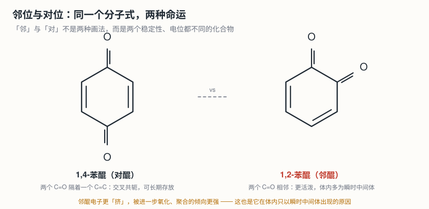

**图 1｜同一个分子式的两条路线**：两者都是 C₆H₄O₂，差别只在两个羰基的相对位置——对醌的两个 C=O 被一个 C=C 隔开，形成交叉共轭；邻醌的两个 C=O 肩并肩，电子云更「挤」，因此更容易被进一步氧化、也更容易自行聚合。

这张图能顺带解释一个日常现象：多酚氧化酶把茶多酚、酪氨酸氧化成的正是**邻醌**，它不稳定、立刻聚合交联，于是有了切开的苹果与茶叶久放后的褐变（见 §2.3）。

### 1.3 三条边界（先划清，后面少踩坑）

| 常见混淆 | 实际情况 |
|---|---|
| 「醌就是苯环加两个氧」 | 不是。加氧是环氧化物/酚的语义；醌是**脱氢 + 重构双键**，环内已不再是芳香体系 |
| 「氢醌（对苯二酚）是醌的一种」 | 不是。氢醌是醌的**完全还原态**（QH₂），两者是一对氧化还原共轭体，就像 NAD⁺ 与 NADH 的关系 |
| 「醌类是某一类药物的名字」 | 不是。蒽环类、丝裂霉素、阿托伐醌都「含醌」，但它们的靶点与药理完全不同，唯一的共性在化学层 |

> 🔗 **横向关联**：本节「结构类型 ≠ 官能团」的区分，与 [辅因子：金属离子、维生素衍生物与酶的化学外挂](../生物学/辅因子：金属离子、维生素衍生物与酶的化学外挂.md) §1.2 对「辅因子 / 辅酶 / 辅基」的三分形成**同构关系**——
> 两处都在提醒：**生物化学里最有用的分类往往不是「它属于哪一类分子」，而是「它在反应里承担什么角色」**。泛醌按结构是脂溶性小分子醌，按角色却是膜内的电子中继站。

## 二、非芳香性：醌是「芳香性的赎金」

### 2.1 结构事实：交叉共轭，而不是一个大共轭环

对苯醌是平面分子，但环内的键长**明显交替**：C=C 偏短、C–C 偏长、C=O 偏短。也就是说，它更接近「**两个各自独立的 α,β-不饱和酮（烯酮），通过单键连成一个环**」，而不是苯那种全环离域。

这种连接方式在有机化学里叫**交叉共轭（cross-conjugation）**：两条烯酮链在同一个环上「并联」，电子不会绕着环转圈。

### 2.2 电子数够 4n，为什么仍不芳香

苯有 6 个 π 电子，符合 Hückel 4n+2；对苯醌环内只有 2 个 C=C 的 4 个 π 电子（羰基的 π 键主要定域在 C=O 上），形式上是一个 4n 体系 —— 而 **4n 体系在环上倾向于反芳香（能量高、不稳定）**。分子采取的规避策略是「**干脆不当环，只当两条烯酮**」：让自己不构成有效共轭环，从而逃开反芳香的惩罚。

于是得到一个反直觉但非常有用的结论：

> **醌的高反应性，不是「多出来的活泼」，而是「放弃芳香性换来的一笔预付款」。** 它把本该用来稳定环的那部分能量提前花掉了，所以碰到还原剂就急着重整旗鼓 —— 把芳香性买回来。

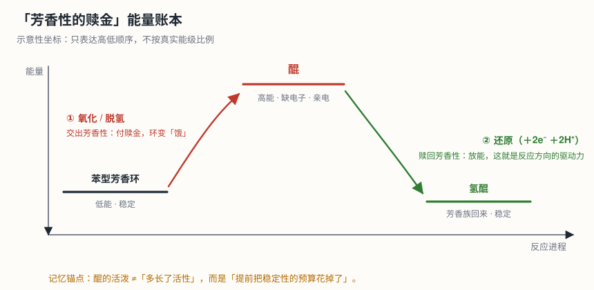

**图 2｜把「赎金」画成能级**：苯型芳香环在低能位；脱氢变成醌要交出一笔能量（芳香性被花掉），分子因此变「饿」；再接受 2e⁻ + 2H⁺ 回到氢醌，芳香性被赎回来，能量重新放出。

读图只需记住一句：**反应方向不是「醌喜欢被还原」，而是「芳香性值得被买回来」**。图中不按真实能级比例，只保证高低顺序。

### 2.3 还原 = 赎回：整条化学的方向由「芳香性」决定

| 维度 | 醌（Q） | 氢醌（QH₂） |
|---|---|---|
| 环的性质 | 交叉共轭的环状二酮，非芳香 | 苯环（或芳香环），全环离域 |
| π 电子分配 | 定域在两段烯酮上 | 均匀分布在整个环上 |
| 反应性 | 强亲电、强氧化 | 可被氧化、可被酯化/醚化 |
| 光谱 | 黄—橙—红（可见区有吸收） | 无色或浅色（除非环上有助色团） |

上表其实解释了一件日常小事：**切开的苹果、土豆、茶叶久放会变褐** —— 多酚被多酚氧化酶氧化成邻醌，邻醌再自行聚合，产物正好落在黄—红—褐的可见区。变色的化学本质，是「芳香性被花掉」这件事在肉眼里留下的痕迹。

> 🔗 **横向关联**：本节「还原即赎回芳香性」与 [化学渗透理论](../生物学/化学渗透理论.md) §1 的「电子传递释放的自由能被换成质子梯度」形成**上下游关系**——
> 醌在还原时收回的能量并没有凭空消失，它被转写成两种货币：一种是环的芳香性（化学货币），另一种是膜两侧的质子电化学势（物理货币）。呼吸链做的就是这两次兑换。

> 🔗 **横向关联**：本节「氢醌=已赎回的状态」与 [酚类：可逆的氧化——石炭酸、单宁与黑色素共享的一只羟基](酚类：可逆的氧化——石炭酸、单宁与黑色素共享的一只羟基.md) 的 §1.4「同一本账的两页」形成**镜像关系**——
> 那篇站在酚的一侧，讲「交出一个电子与一个质子之后还能被还原回来」如何支撑抗氧化、聚合与电子传递；两篇的 §1.4 与本节互为对方的另一半。

## 三、三态氧化还原：为什么醌能当「兑换所」

### 3.1 三种状态

| 状态 | 化学式写法 | 电子数（相对醌） | 电荷 | 稳定性 |
|---|---|---|---|---|
| 醌（Q） | Q | 0 | 中性 | 稳定，可长期存放（对苯醌需避光防潮） |
| 半醌自由基（Q•⁻ / HQ•） | Q•⁻（或 HQ•） | +1 e⁻ | 阴离子自由基（或中性自由基） | **寿命通常极短**，只在强稳定环境（蛋白口袋、强溶剂化、大共轭取代基）中存在 |
| 氢醌（QH₂） | QH₂ | +2 e⁻（+2 H⁺） | 中性 | 稳定，但易被空气重新氧化 |

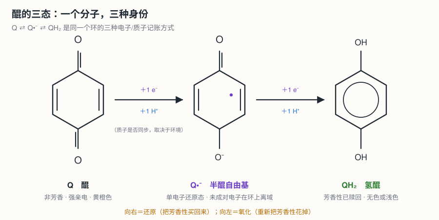

**图 3｜三态是同一个环的三种记账方式**：左端是醌（两个羰基 ＋ 两段各自独立的烯酮），中间是接受了一个电子的半醌自由基，右端是拿回两个电子两个质子的氢醌（芳香环重新成立）。环的形状基本没变，变的是电子与质子。

读图要点：**中间那一站不能跳过**。从醌到氢醌要经过两次单电子转移，半醌就是 1e⁻ 世界与 2e⁻ 世界之间唯一合法的换乘站——它也就是下一节「危险又值钱」的主角。

### 3.2 一步还是两步，由质子说了算

这是醌化学里最「条件依赖」的一处，值得单独记住：

- **酸性 / 有质子可用 + 电极表面能提供质子**：2e⁻ + 2H⁺ 一步到底，得到氢醌；循环伏安上只看到一个双电子波。
- **非质子介质（如乙腈、DMF）**：只能两步走，中间体半醌自由基能被观察到，第二步再得到二价阴离子（Q²⁻）。
- **中性水溶液**：介于两者之间，路径与电极材料、缓冲能力、局部 pH 都有关。

把这三条压成一张判断图：

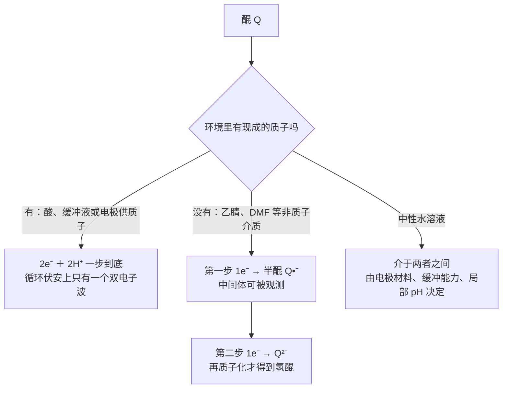

同一瓶醌，换个溶剂就换了一套机理——所以「醌是几电子反应」这个问题，离开条件就没有答案。

> 📌 **半醌（Semiquinone）**：醌接受单个电子后形成的自由基中间体，是「单电子世界」与「双电子世界」之间的唯一合法窗口。它在本文的作用是：**所有「醌既能接单电子又能接双电子」的说法，其化学基础都在这里**。

### 3.3 为什么半醌既危险又值钱

- **危险**：半醌是自由基，能把电子直接漏给分子氧，生成超氧阴离子（O₂•⁻），后者再变成过氧化氢与羟自由基。这条链叫**氧化还原循环（redox cycling）**，它不需要醌被消耗，只需要有还原力不断供。
- **值钱**：NADH、FADH₂ 都是双电子载体，而细胞色素、铁硫簇都是单电子载体。中间必须有一个**换乘站**，否则两条轨道接不上。醌（以及 FAD）就是这类换乘站。

> 🔗 **横向关联**：本节「半醌是 2e⁻/1e⁻ 之间唯一窗口」的说法，与 [辅因子：金属离子、维生素衍生物与酶的化学外挂](../生物学/辅因子：金属离子、维生素衍生物与酶的化学外挂.md) §4.3 的「FAD 与泛醌是兑换所」形成**互证关系**——
> 两处给出的是同一个结论的两种证据：从结构看，是「能稳定半醌自由基的分子才能做转换器」；从系统看，是「电子瀑布的电位表上，Q 恰好被安排在 +0.045 V 这个换乘高度」。

## 四、电位可调：给醌装一只旋钮

### 4.1 取代基怎么拧这只旋钮

醌的氧化力本质上由「**环有多缺电子**」决定：

- **给电子取代基**（–OH、–NH₂、–OCH₃、烷基）：把电子密度推回环上，醌**更不想**再接受电子 → 电位下降（还原变难）。
- **吸电子取代基**（–Cl、–Br、–CN、–NO₂）：把电子抽走，醌**更饿** → 电位上升（氧化力变强）。

这正是实验室里两瓶试剂的差别所在：**四氯苯醌（chloranil）与 DDQ** 是「加装吸电子基之后」的加强版苯醌，能氧化那些连苯醌都氧化不动的底物，是有机合成里的标准脱氢剂。

### 4.2 质子耦合：−59 mV 的魔咒

对 2e⁻/2H⁺ 的醌/氢醌半反应，能斯特关系给出：

$$E = E^{\circ} - \frac{0.059}{2}\lg\frac{[\mathrm{QH_2}]}{[\mathrm{Q}]\,[\mathrm{H^+}]^2} = E^{\circ} - 0.059\,\mathrm{pH} - \frac{0.059}{2}\lg\frac{[\mathrm{QH_2}]}{[\mathrm{Q}]}$$

也就是说，**pH 每升高 1，氧化力就掉 59 mV**。这条斜率的实际意义是：从 pH 0 到 pH 7，对苯醌的名义电位从 +0.70 V 掉到约 +0.29 V —— 从「能把碘离子氧化成碘」的强氧化剂，掉到「刚好能氧化某些邻二醇、某些硫醇」的中等氧化剂。

反过来，**升酸就等于给醌充电**。这也是为什么很多醌类染料的显色、很多醌类药物的活性、甚至很多含醌食品的褐变速率，都对 pH 异常敏感。

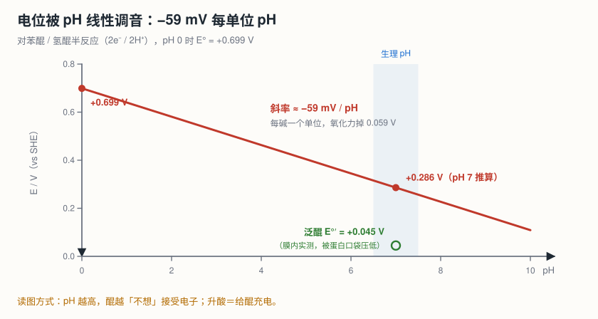

**图 4｜−59 mV 的魔咒**：红线的斜率就是 −0.059 V/pH——纵轴每掉一格（0.2 V），约相当于 pH 前进 3.4 个单位。绿圈是泛醌在膜内的实测值（+0.045 V），它并不落在这条红线上，中间差出来的 0.2 伏就是下一节要讲的「蛋白口袋调音」。**红线是化学给的上限，绿圈是生物学实际取的数。**

### 4.3 蛋白口袋的「非化学」调音

同一个泛醌分子，在不同蛋白里电位可以差出 0.1–0.3 V，靠的不是换取代基，而是**环境**：

- **氢键网络**：与羰基氧形成氢键的残基越多，醌越容易被还原；
- **介电环境**：疏水口袋让电荷分离更难，电位被压低；
- **质子可达性**：质子从哪一侧、以多快的速度到达，直接决定走 2e⁻ 还是 2×1e⁻；
- **结合构象**：Q 在 Qo 与 Qi 位点的「躺姿」不同，等于换了一个分子。

> 📌 **这句话值得单独记**：**醌的电位表是「化学给的上限」，蛋白口袋决定「实际取多少」。** 生物学不需要发明新的氧化还原分子，只需要给同一个分子换不同的插座。

## 五、亲电性：醌的另一半身份

### 5.1 1,4-加成：醌喜欢被「硫」打

醌环上两个 C=C 是强亲电的迈克尔受体（Michael acceptor）。细胞里最充裕的亲核体是**谷胱甘肽（GSH）的巯基**，于是最常见的一条反应是：

> Q + GSH → GSH-氢醌加合物（并常被进一步氧化/排出）

氯化氢加成得到氯氢醌，是这条反应的最简教科书版本；换成半胱氨酸的 –SH，就是毒理学里的加合反应。

### 5.2 两条解毒路线

| 路线 | 谁在做 | 机制 | 结果 |
|---|---|---|---|
| **加合并排出** | 谷胱甘肽 S-转移酶（GST）+ GSH 池 | 亲电体被巯基捕获，形成水溶性加合物外排 | 消耗 GSH，但保住蛋白 |
| **强制双电子还原** | NQO1（DT-二磷酸吡啶核苷酸脱氢酶，NAD(P)H:quinone oxidoreductase 1） | 一次给两个电子，**跳过半醌**，直接得氢醌 | 不产自由基，是真正的「安全阀」 |

这两条路线解释了醌毒理学的核心定律：

> **毒性不取决于「吃了多少醌」，而取决于「GSH 池还剩多少」与「走的是 NQO1 还是单电子还原酶」。**

### 5.3 从亲电升级为自由基工厂

当 GSH 被耗到阈值以下，或当单电子还原酶（NADPH-细胞色素 P450 还原酶等）占上风时，半醌开始把电子交给氧气：

```txt
Q ──(1e⁻)──> Q•⁻ ──(O₂)──> Q + O₂•⁻
O₂•⁻ ──(SOD)──> H₂O₂ ──(Fe²⁺, Fenton)──> •OH
```

把这条链画成循环，才能看出「催化剂式毒性」是怎么成立的：

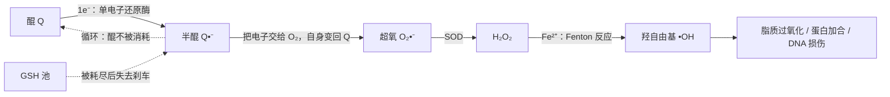

图上的两条虚线各有含义：回到起点的虚线是**催化性**（醌不被消耗），指向半醌的虚线是**阈值性**（GSH 池一空，刹车就没了）。

这个循环的可怕之处在于**催化性**：醌不消耗，只做「电子搬运工」，只要有 NADPH 供应就能无限次制造超氧。所以它的剂量-反应曲线往往不是线性的，而是**存在一个「GSH 耗尽」的悬崖**。

> 🔗 **横向关联**：本节「GSH 阈值 + 氧化还原循环」与 [辅因子：金属离子、维生素衍生物与酶的化学外挂](../生物学/辅因子：金属离子、维生素衍生物与酶的化学外挂.md) §6.4「氧与自由基：活化、泄漏与看管」形成**因果链的两端**——
> 那一节讲的是细胞如何用 SOD、过氧化氢酶、谷胱甘肽系统看管自由基；本节讲的是**醌如何绕过这套看管，用催化循环把看管预算打穿**。

## 六、家族图谱：五类母体，五种命运

### 6.1 五类母体总对照

为什么必须先分「母体」再看具体化合物？因为**母体决定了这个醌能溶解在哪、能不能进膜、能不能与蛋白结合**，而具体的取代基只决定它在这一类里偏向「毒」还是「药」。

| 维度 | 苯醌 | 萘醌 | 蒽醌 | 菲醌 / 多环醌 | 泛醌型（非芳香母体） |
|---|---|---|---|---|---|
| 环系 | 单环六元 | 双环（苯 + 醌） | 三环（两个苯夹一个醌） | 三环非线型（角式） | 单环苯醌 + 长异戊二烯侧链 |
| 典型代表 | 对苯醌、DDQ、四氯苯醌 | 维生素 K 族、胡桃醌、紫草素、指甲花醌 | 茜素、胭脂红酸、番泻苷、醌染料 | 丹参酮类 | 泛醌（CoQ）、质体醌（PQ） |
| 溶解特征 | 亲水中等，可升华 | 脂溶性上升 | 强脂溶性、易与纤维/蛋白结合 | 脂溶性高 | 完全膜内，需侧链定位 |
| 主要出场领域 | 有机合成试剂、毒理 | 维生素、植物色素、抗癌天然物 | 染料、泻药、肿瘤化疗 | 中药活性成分 | 呼吸链、光合链 |
| 一句话定位 | 「标准零件」 | 「双环调音版」 | 「染料与药物的母矿」 | 「中式多环特化」 | 「生命自带版」 |

收束句：**五类的差别不在「像不像醌」，而在「醌的一部分被并进了几个芳香环」** —— 每并进一个环，分子就更脂、更稳定、更像染料与药物，而不像活泼试剂。

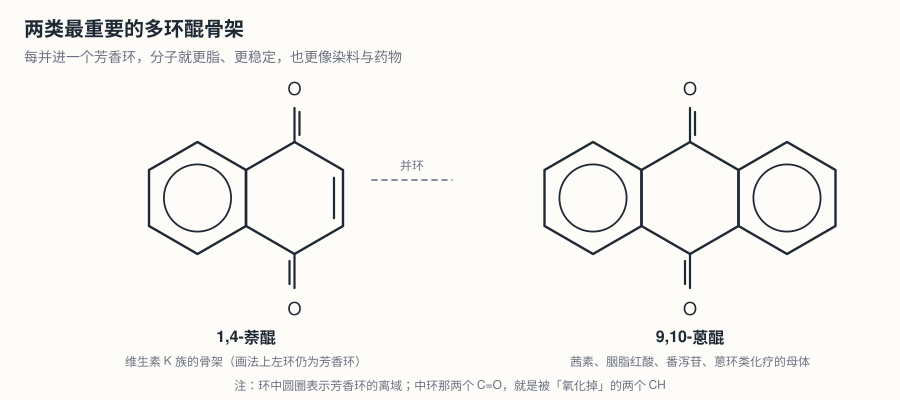

**图 5｜并环之后，脾气就变了**：萘醌只有一个环是醌式的，另一个环仍是芳香环；蒽醌更极端，中间那个环承担两个羰基，两侧都是芳香环。并进去的芳香环越多，分子越脂、越稳定、越容易与纤维和蛋白结合——这正是染料与药物需要的性质，而不是「活泼试剂」需要的性质。

### 6.2 苯醌：标准零件

- **对苯醌**：黄色晶体，刺激性氯味，易升华，水中可溶 11 g/L，是检验亲电加成与 Diels–Alder 的经典底物。
- **四氯苯醌 / DDQ**：加装吸电子基的「加强版」，用来做脱氢、氧化，也用于合成甾体与抗生素中间体。
- **醌氢醌（quinhydrone）**：醌与氢醌 1:1 的电荷转移复合物，暗绿到古铜色，曾用于 pH 测量的醌氢醌电极 —— 这是「醌与氢醌之间的平衡」，恰好可以做成一枚 pH 探针。

### 6.3 萘醌：维生素与植物色素的主场

| 化合物 | 结构要点 | 出场方式 |
|---|---|---|
| 维生素 K₁（叶绿醌，phylloquinone） | 2-甲基-3-植基-1,4-萘醌 | 绿叶蔬菜；凝血；同时是光系统 I 的 A₁ 电子受体 |
| 维生素 K₂（甲基萘醌，MK-n） | 侧链为 n 个异戊二烯单元 | 肠道菌群合成、发酵食品（纳豆）；骨与血管钙化调控 |
| 维生素 K₃（甲萘醌，menadione） | 2-甲基-1,4-萘醌，人工合成 | 饲料添加剂与水溶性衍生物；可致溶血，G6PD 缺乏者禁用 |
| 胡桃醌（juglone） | 5-羟基-1,4-萘醌 | 黑胡桃的化感物质，「胡桃树下不长东西」的化学解释 |
| 指甲花醌（lawsone） | 2-羟基-1,4-萘醌 | 海娜（henna）染发染甲的主要色素，与角蛋白共价结合 |
| 紫草素（shikonin / alkannin） | 5,8-二羟基萘醌 + 手性侧链 | 紫草科的紫根染、中药紫草的活性成分；一对对映体活性不同 |

表里最后一行那句「一对对映体活性不同」，是这一节唯一需要额外工具才读得懂的地方——**对映体在非手性环境里的差别，本质上只有一个可测量：旋光方向**。先把这件工具补齐：

> 📌 **旋光度（optical rotation, α）与比旋光度（specific rotation, [α]）**：把一束**线偏振光**送进手性物质的溶液，出射光的振动面会转过一个角度，这个角度就是旋光度 α（单位：度）。α 本身不是常数——它随浓度、光程、溶剂、温度、波长一起变；把这些条件标准化之后，才得到可以互相比较的**比旋光度**：$[\alpha]_\lambda^{T} = \alpha / (l \cdot c)$（l 用 dm，c 用 g/mL）。文献里的 $[\alpha]_D^{20}$ 就是指钠 D 线（589 nm）、20 °C 下的比旋光度。本文为什么需要它：**一对对映体在非手性环境里唯一可测的差别，就是旋光方向相反**——一个右旋（+），一个左旋（−）；紫草素与 alkannin 正是这样一对（文献普遍写作 shikonin (R)-(−)、alkannin (S)-(+)），熔点、溶解度、红外光谱几乎重合，生物活性却不同。

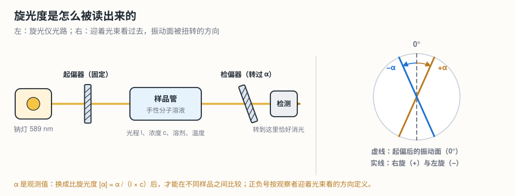

**图 6｜旋光度是怎么被读出来的**：左半是旋光仪光路——钠灯发出非偏振光，起偏器把它变成线偏振光，穿过样品管后振动面被手性分子扭转 α 角；转动检偏器直到视场重新全暗，转过的角度就是 α。右半是迎着光束看过去的两条振动面：虚线是起偏后的原始方向，两条实线分别是右旋（+）与左旋（−）。

三个容易踩的坑：**（1）** α 不是常数，浓度加倍它就加倍，必须换算成 $[\alpha]$ 才能与文献比；**（2）** 旋光符号会随溶剂、温度甚至浓度翻转，同一化合物在两种溶剂里一正一负并不稀奇；**（3）** 旋光度不等于 ee（对映体过量）——只有两个对映体的比旋光度已知、且浓度与光程准确时，才能把 α 反推成比例。

> 🔗 **横向关联**：本节「旋光度是手性最便宜的一台读数器」与 [糖基与糖基化：从糖苷键到糖密码——生命为什么给蛋白质和脂质贴糖](糖基与糖基化：从糖苷键到糖密码——生命为什么给蛋白质和脂质贴糖.md) §2.1 的**变旋（mutarotation）**形成**互证关系**——
> 那一节用 α-D-葡萄糖 +112°、β-D-葡萄糖 +18.7°、平衡 +52.7° 三个数，把「溶液里的糖是分布而不是纯物质」测了出来；本节补上这套读数的仪器条件：同一个 +52.7°，只有在固定溶剂、浓度、温度与波长时才成立——**旋光度是相对值，比旋光度才是可比的数**。

### 6.4 蒽醌：染料、泻药与化疗药共享的母矿

蒽醌是本文最「人格分裂」的一类：

- **染料线**：茜素（1,2-二羟基蒽醌）来自茜草根，1868 年成为第一个被人工合成的天然染料；茜素红 S 至今仍是组织学里染钙与胶原的常用染料。胭脂红酸（carminic acid）来自胭脂虫，是食品与化妆品里的 E120。
- **泻药线**：番泻叶、大黄、芦荟里的番泻苷是**二蒽酮糖苷**，在小肠几乎不吸收，到结肠被菌群水解为蒽酮类活性物，刺激结肠分泌与蠕动。长期滥用的影像学后果是**结肠黑变病**（良性色素沉积）。
- **化疗线**：蒽环类（多柔比星、柔红霉素）在结构上就是「蒽醌 + 糖 + 氨基」，见第九节。

### 6.5 菲醌与多环醌：角式连接的特化

菲醌型把醌的羰基放在「角上」，分子的形状与蒽醌不同，因而与生物大分子的结合方式也不同。**丹参酮类**（如丹参酮 IIA）就是这一型的代表，它是中药丹参被研究最多的活性成分之一，属于**邻醌型多环**结构 —— 这也解释了为什么它的化学性质更活泼、更易被还原。

### 6.6 非芳香母体的醌与醌亚胺

- **泛醌型**：核心仍是 1,4-苯醌（2,3-二甲氧基-5-甲基），但侧链是长异戊二烯，属于「核心芳香、侧链脂肪」的混血结构。它的存在提醒我们：**「醌」的定义落在环状二酮，而不落在「有没有芳环」**。
- **醌亚胺（quinone imine）**：把醌的一个羰基氧换成 =NH / =N–R。**对乙酰氨基酚的毒性代谢物 NAPQI 就是醌亚胺**，不是严格意义的醌 —— 但反应逻辑完全同源（强亲电、被 GSH 捕获）。同理还有醌甲基化物（quinone methide），常作为木质素化学与 DNA 烷基化研究中的瞬时中间体。

> 📌 **一个必须说清的边界**：文献里说「某药含醌」，可能指真正的醌、醌亚胺、氢醌或蒽酮。**这四者的反应性有共同祖先，但不能互相替代**，因为在体内的活化与解毒路径完全不同。

## 七、生物中的醌：三座电子枢纽

### 7.1 呼吸链：CoQ 与「分叉反应」

线粒体电子传递链的关键结构可以浓缩成一句话：

> **复合物 I 与 II 把电子交给泛醌（Q），复合物 III 再把电子从泛醌取走 —— 中间这个「取与交」的环节，就是 Q 循环。**

Q 循环的精妙之处在于**分叉（bifurcation）**：在复合物 III 的 Qo 位点，一个氢醌的两个电子被**朝两个相反方向**送走 ——

- 一个电子走高电位链：Rieske 铁硫簇 → 细胞色素 c₁ → 细胞色素 c；
- 另一个电子走低电位链：b_L → b_H → 回到 Qi 位点还原另一个 Q。

这个「一分为二」的设计带来两个后果：

1. **质子账翻倍**：每 2 e⁻ 通过，净泵出 4 H⁺（Qo 释放 4 H⁺、Qi 消耗 2 H⁺）。
2. **产生了一个极危险的中间体**：Qo 位点的半醌寿命被拉长到毫秒级，它能把电子漏给氧生成超氧 —— **线粒体 ROS 的主要产地之一就在这里（常称 site IIIQo）**。

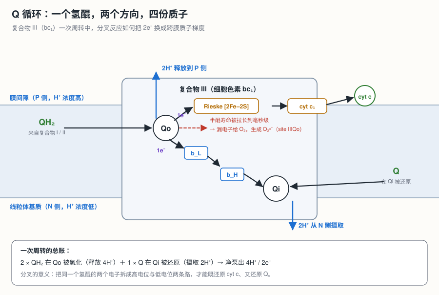

**图 7｜一次周转的四份质子**：QH₂ 在 Qo 位点被氧化，两个电子分头走——一个走高电位链（Rieske → cyt c₁ → cyt c），一个走低电位链（b_L → b_H → Qi），在 Qi 把另一个 Q 还原。Qo 向 P 侧释放 2H⁺，Qi 从 N 侧摄取 2H⁺，所以每 2e⁻ 净泵出 4H⁺。

读图时盯住两处：**（1）** 蓝色箭头才是质子账的来源，它比电子箭头更能解释「呼吸链为什么能造 ATP」；**（2）** Qo 旁那个红色虚线箭头——半醌在这里寿命被拉长到毫秒级，漏电子的机会也就来了。

> 🔗 **横向关联**：本节「Q 循环的分叉反应」与 [化学渗透理论](../生物学/化学渗透理论.md) §2 的「质子动势由 ΔpH 与 Δψ 两部分组成」形成**因果配对**——
> 化学渗透理论解释了「质子梯度怎么变成 ATP」，本节补充了「质子梯度最初是谁泵出来的」：不是 ATP 合酶，而是 Q 循环这类把氧化还原自由能兑换成电荷分离的装置。

### 7.2 光合链：质体醌与「双电子门」

叶绿体里对应的分子是**质体醌（plastoquinone, PQ-9）**，它在光系统 II 与细胞色素 b₆f 之间往返。这里有一个特别漂亮的设计：

> PSII 的反应中心每次只能传递**一个**电子，但质体醌要接受**两个**电子、两个质子才能离开结合位点。

于是 PSII 演化出一个「**双电子门**」：QA 先接受一个电子，交给 QB；QB 半还原后**待在原地不动**，等第二次光化学事件送来第二个电子，才质子化并以 PQH₂ 的形式离开。**用「暂存」把单电子流攒成双电子流**，这是醌化学对光合作用最直接的结构性贡献。

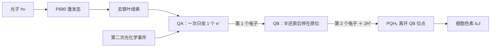

这张图的关键不在左边的光化学，而在 QB 那个「停」字：**门之所以是门，是因为它不肯半开着放行**。

### 7.3 维生素 K：一物两职的极端案例

叶绿醌（K₁）在生命史上有两个互不相干的岗位：

| 岗位 | 位置 | 作用 |
|---|---|---|
| **光系统 I 的 A₁ 电子受体** | 叶绿体类囊体膜 | 接收 A₀ 传来的电子，再交给铁硫簇 Fx |
| **γ-谷氨酰羧化酶的辅因子** | 肝、骨、血管壁 | 把谷氨酸残基羧化成 Gla，使凝血因子 II/VII/IX/X 与蛋白 C/S、骨钙素、MGP 获得钙结合能力 |

这条「维生素 K 循环」的化学核心是一个**氢醌的反复氧化**：

```mermaid
graph LR
    K[维生素 K 醌] -->|VKORC1 ＋ NAD(P)H| KH2[维生素 K 氢醌]
    KH2 -->|GGCX ＋ O₂ ＋ CO₂：Glu → Gla| KO[维生素 K 环氧化物]
    KO -->|VKORC1 再还原| KH2
    W[华法林] -.->|抑制 VKORC1：环氧化物回不去| KO
```

**华法林**做的事，就是抑制 VKORC1，让「环氧化物回不到氢醌」，于是 Gla 化停摆、凝血因子半衰期决定抗凝强度。也正因为 MGP 也依赖这条通路，长期抗凝与**血管钙化**的关系一直是临床关注点。

> 📌 **为什么这个细节重要**：很多人以为维生素 K「只是凝血」，但它同时是**光合电子传递链上的一个零件**。同一个分子在两个完全不同的物理环境里被征用两次，这是「生物借化学库存」最纯粹的例子。

### 7.4 细菌的醌指纹与古菌的替代品

- **呼吸醌谱（respiratory quinone profiling）**：不同类群的细菌用不同长度与饱和度的醌（Q-8、Q-10、MK-9 等），组成比例可当作**群落指纹**，在微生物生态学里用于估算革兰阴性/阳性比例与群落结构变化。
- **古菌与特殊环境**：部分类群换用甲基萘醌衍生物或更复杂的醌型，说明「醌」是一套**可被替换的模块化电子中继方案**，而不是某一条链的固定配件。

## 八、工业中的醌：看不见的中间体

### 8.1 蒽醌法双氧水：一个「搬运氢气」的循环

这是醌在工业上体量最大的一次出场，也是「催化剂」与「反应物」界限最模糊的一次：

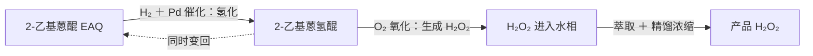

整体净反应：H₂ + O₂ → H₂O₂。**图上没画出来的才是难点**：H₂O₂ 一生成就得立刻被水相萃取走，否则它会在工作液里继续氧化溶剂与蒽醌本身，缩短载体寿命——这正是接下来第 3 点的化学理由。

三个关键点：

1. **蒽醌在这里是循环载体**，不是消耗品 —— 它的作用是「把氢气拆成两个电子两个质子，暂存起来，再在水相一侧交给氧气」。
2. **它必须易还原、又能被氧气重新氧化**，这正好落在蒽醌那种「比苯醌温和、又足够活泼」的电位区间里。
3. **后处理是全部难点**：用水萃取 H₂O₂，再精馏浓缩，同时要把工作液（蒽醌 + 溶剂）里的降解产物不断再生 —— 工业上真正的门槛在「工作液的寿命」。

### 8.2 染料：从茜草根到煤焦油

| 色素 | 来源 | 化学类型 | 历史分量 |
|---|---|---|---|
| 茜素（alizarin） | 茜草根（Rubia） | 1,2-二羟基蒽醌 | 1868 年首个被合成的天然染料，合成染料工业的开端 |
| 胭脂红酸（carminic acid） | 胭脂虫（Dactylopius coccus） | 蒽醌类 | 前哥伦布时期已用于织物，殖民贸易中的高价值商品 |
| 指甲花醌（lawsone） | 海娜叶 | 2-羟基-1,4-萘醌 | 至今仍是「植物染发」的主要化学基础 |
| 紫草素（shikonin） | 紫草根 | 5,8-二羟基萘醌衍生物 | 东亚传统紫根染与药用 |

从染料工业史看，醌类的重要性**仅次于偶氮染料**，且尤其擅长蓝紫色系 —— 这与它的共轭长度和推拉电子结构直接相关。

### 8.3 显影、造纸制浆与纸泛黄

- **黑白胶片显影**：对苯二酚（氢醌）把曝光的溴化银还原成金属银，自身被氧化成苯醌。这是「醌—氢醌」这对共轭体最日常的一次出场。
- **碱法制浆助剂**：蒽醌在碱法蒸煮中作为**催化助剂**，加速木质素脱除、同时保护纤维素不被剥皮反应降解 —— 这是「醌的氧化还原活性用于工业过程」的经典案例。
- **纸张泛黄**：木质素氧化生成醌类发色团，是旧书页变黄的主要化学原因之一。

### 8.4 合成砌块：Diels–Alder 与「造分子」

苯醌是教科书级的**亲双烯体**：与环戊二烯发生 Diels–Alder 反应，产物带有桥环骨架，再经芳构化就能得到多环体系。历史上胆固醇、可的松、吗啡、利血平的全合成都用过「醌 + 双烯」这一招。

对合成化学家来说，醌的价值是「**一次反应同时装上两个羰基 + 一个可调环系**」：羰基是后续所有官能团转化的接口，环系决定了骨架形状。

## 九、药与毒：同一枚弹头的两支部队

### 9.1 越少越好：四个经典中毒场景

| 场景 | 关键分子 | 机制链 | 临床要点 |
|---|---|---|---|
| 对乙酰氨基酚过量 | **NAPQI**（N-乙酰对苯醌亚胺） | CYP2E1 氧化 → 醌亚胺 → 与蛋白半胱氨酸加合 → 线粒体损伤 | GSH 被耗到阈值以下即肝坏死；**N-乙酰半胱氨酸（NAC）**补 GSH 解毒，越早越有效 |
| 苯暴露 | 1,4-苯醌 | CYP2E1 → 苯酚/氢醌/儿茶酚 → 骨髓髓过氧化物酶再氧化 → 苯醌 | 骨髓抑制与白血病风险；苯醌-白蛋白加合物可作暴露标志 |
| 儿茶酚雌激素 | 雌激素-3,4-醌 | 2-/4-羟基化后再氧化 → 脱嘌呤加合物 | 「雌激素致癌」的**假说之一**，与乳腺癌风险相关但因果未定 |
| 多巴胺自氧化 | 多巴胺醌 | 自氧化/L-DOPA 代谢 → 多巴胺醌 → 抑制 DAT 与酪氨酸羟化酶，降低线粒体 ATP | 帕金森黑质多巴胺神经元选择性脆弱的**候选机制之一**，非唯一解释 |

四者的共同结构：**先有一个「能被单电子氧化的酚/胺」，再有一个「能稳定半醌的环境」，最后是一个「GSH 不够用」的时刻**。

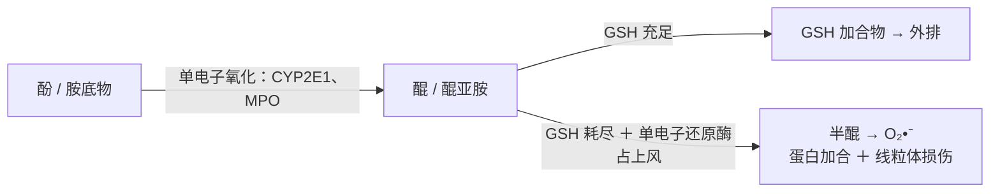

图中两条出路的差距只在 GSH 池的余量：**同一个中间体，GSH 够就是可外排的代谢物，GSH 不够就是毒物**。

### 9.2 越多越好：把毒性当武器

| 药物 | 结构类型 | 活化方式 | 杀伤逻辑 | 剂量限制 |
|---|---|---|---|---|
| 多柔比星 / 柔红霉素（蒽环类） | 蒽醌 + 糖 + 氨基 | 不需酶活化，但醌可参与氧化还原循环 | 嵌入 DNA + 拓扑异构酶 II 毒 + 自由基 | **累积心脏毒性**，经典阈值约 550 mg/m²；用右雷佐生防护 |
| 丝裂霉素 C | 醌 + 氮丙啶 + 氨甲酰基 | 需 NAD(P)H 依赖的醌还原酶还原活化 | 还原后形成双烷基化中间体，**交联 DNA 双链** | 骨髓抑制；膀胱灌注用于浅表膀胱癌 |
| β-拉帕醌（β-lapachone） | 邻醌 | **NQO1 依赖**的双电子还原 | 生成极不稳定的氢醌，瞬间被 O₂ 氧化回醌，**疯狂消耗 NAD(P)H 并产 ROS** | 依赖肿瘤高表达 NQO1 的「定向」策略，仍在临床探索 |
| 白花丹素（plumbagin） | 萘醌 | 氧化还原循环 | ROS 与拓扑异构酶抑制 | 治疗窗窄，毒性明显 |

注意这里的一个反转：**同样的「氧化还原循环」，在对乙酰氨基酚里是灾难，在 β-拉帕醌里是设计**。区别不在化学，而在「把循环放在哪个细胞里、以及那个细胞有没有 NQO1」。

### 9.3 精确制导：阿托伐醌与 Qo 位点

阿托伐醌（atovaquone）是一个羟基-1,4-萘醌，作用是**冒充泛醌**，卡在疟原虫与弓形虫细胞色素 bc₁ 复合物的 Qo 位点上，阻断电子传递。它的选择性来自「寄生虫的 bc₁ 口袋与人的不同」—— 这是「结构相似物竞争同一插座」的经典药理范式，也解释了为什么它对人体的毒性相对可接受。

> 🔗 **横向关联**：本节「药物靠冒充底物卡住 Q 位点」与 [辅因子：金属离子、维生素衍生物与酶的化学外挂](../生物学/辅因子：金属离子、维生素衍生物与酶的化学外挂.md) §9.2「抗维生素与靶向药：辅因子是药靶」形成**同型关系**——
> 两者都在说同一件事：**能当辅因子的分子，天然就是最好的药物靶点入口** —— 因为它们已经拥有一个「被蛋白精确识别」的形状。

## 十、新战场：醌还能被借多久

### 10.1 醌类液流电池

水系有机液流电池的思路是「用溶解在电解液里的分子储存电子」。醌天然适合，因为它**在水里可逆地接收两个电子两个质子**，而且分子可设计、原料便宜、不含金属。

2014 年 Harvard 组用 **AQDS（9,10-蒽醌-2,7-二磺酸）** 做负极（阳极液）、溴做正极，做出了无金属的水系液流电池（Nature 505: 195–198）。此后这一路线的主要工程问题变成三件事：**溶解度、跨膜渗透（活性物质穿过膜而失效）、以及长期化学稳定性**。

### 10.2 醌基电极与分子电子学

- **醌基正极材料**：把醌单元装进多孔骨架（如杯芳烃-醌 C4Q、醌基聚合物），做成锂/钠电池正极，理论比容量高、来源不依赖钴镍。
- **质子耦合电子转移（PCET）的标准模型**：醌/氢醌是最干净的「电子 + 质子同时转移」实验体系，被用来检验 PCET 理论 —— 这是物理化学与电催化共同的基础问题。
- **分子电子学**：把醌夹在两个电极之间做单分子结，观察「氧化态不同 → 电导不同」的开关行为。

### 10.3 绿色氧化与生物基醌

- 双氧水被称为「最绿色的氧化剂」（唯一副产物是水），而它的主流生产仍靠蒽醌法 —— 于是「**用更绿色的路线造最绿色的氧化剂**」成了化工界一个长期矛盾，直接合成法（H₂ + O₂ 直接合成）是主要竞争路线。
- 生物基醌：木质素解聚产物里天然带醌/酚结构，如何把它们变成染料、抗氧化剂或电极材料，是生物炼制的一条支线。

## 十一、收束

### 11.1 先拆掉七个误读

| 误读 | 更正 |
|---|---|
| 「醌是一种官能团」 | 它是一类**结构类型**，不能像 –OH 那样整体移植 |
| 「醌就是被氧化的苯」 | 形式来源是「脱氢 + 双键重排」；**环已非芳香**，是交叉共轭的二酮 |
| 「半醌是『半个醌』」 | 它是**单电子还原的自由基中间体**，是 1e⁻ 与 2e⁻ 世界之间唯一的窗口 |
| 「维生素 K 只管凝血」 | 它同时是**光系统 I 的 A₁ 电子受体**与 γ-羧化酶的辅因子 |
| 「CoQ10 是抗氧化剂，所以多吃有益」 | 在呼吸链里它是**电子载体（被还原的那一方）**；体外抗氧化是泛醇的另一种角色，补充剂的临床获益证据有限 |
| 「醌类抗生素靠氧化性直接杀菌」 | 多数需要**生物还原活化**（如丝裂霉素 C），或依赖特定酶（如 β-拉帕醌依赖 NQO1） |
| 「有毒 = 一定致癌 / 无毒 = 一定安全」 | 醌的毒性走**阈值 + 催化循环**，不是线性剂量关系；IARC 对 1,4-苯醌本身的致癌性评价是「证据不足」 |

### 11.2 归因：一对矛盾属性，两种征用方式

回到根节点。醌之所以能被自然与工业反复征用，靠的其实只有**一对互相拉扯的属性**：

1. **可逆的两电子/两质子开关**（Q ⇄ QH₂，中间可拆成两步单电子）—— 这是「**可以被借来当电子转盘**」的资格；
2. **强烈的亲电性 + 可催化的氧化还原循环** —— 这是「**可以被借来当破坏工具**」的资格。

生命选择了第 1 条：把它塞进膜里，用蛋白口袋把电位「拧」到刚好的位置，于是有了呼吸链、光合链、维生素 K 循环。
药物化学选择了第 2 条：把同一个骨架送进肿瘤或寄生虫，让它在那里制造 ROS、交联 DNA 或卡住 Q 位点。
毒理学则是第 2 条的副作用清单：苯、对乙酰氨基酚、多巴胺自氧化，全都是「同一个弹头在错误的地方引爆」。

**换句话说：醌不是「有用的分子」或「有毒的分子」，它是「一枚两端都带刀刃的硬币」—— 落在哪一面，由环境和剂量决定。**

### 11.3 延伸：从「借来的化学」到「造出来的化学」

- **近处**：醌类液流电池的工程化会继续围绕「溶解度—稳定性—成本」三角推进；醌基电极材料在多价离子电池里可能比锂电更有机会。
- **中处**：PCET 催化剂设计会越来越多地借用醌的「质子—电子同步」机制，用于 CO₂ 还原与析氧反应的机理模拟。
- **远处**：如果合成生物学能把「醌的合成路径」搬进工业微生物，那么染料、抗氧化剂与电极材料可能同时转向生物基路线 —— 这将是「生命借化学库存」之后的第二次反转：**工业开始借生命的库存**。

### 11.4 个体坐标：三个具体动作

1. **看药盒上的「醌」字**：维生素 K（拮抗剂是华法林）、CoQ10（与他汀同服常见）、蒽环类化疗（注意累积心脏毒性）。同一个字，风险方向完全不同。
2. **对「美白」保持警惕**：氢醌（对苯二酚）是醌的还原态，能抑制黑色素合成，但**各国监管差异极大**（欧盟禁止用于化妆品，美国为处方药，长期大面积使用有外源性褐黄病风险）。看到「对苯二酚 / hydroquinone」要当成药，不是护肤品成分。
3. **理解「无毒剂量」这件事**：苯、对乙酰氨基酚、多巴胺醌的共同点是**阈值型毒性**。真实世界里更要紧的不是「完全避免」，而是「别让 GSH 池同时被几件事掏空」（酒精、饥饿、药物相互作用都会降低阈值）。

---

## 索引表

| # | 概念/事件 | 时间 | 类型 | 所属维度 | 横向关联笔记 | 重要性 |
|---|---|---|---|---|---|---|
| 1 | 醌（Quinone）的定义 | — | 化学 | 一、定义与边界 | — | ⭐⭐⭐⭐⭐ |
| 2 | 交叉共轭与非芳香性 | — | 化学 | 二、非芳香性 | — | ⭐⭐⭐⭐⭐ |
| 3 | 醌 / 半醌 / 氢醌三态 | — | 化学 | 三、三态氧化还原 | [辅因子：金属离子、维生素衍生物与酶的化学外挂](../生物学/辅因子：金属离子、维生素衍生物与酶的化学外挂.md) | ⭐⭐⭐⭐⭐ |
| 4 | 氧化还原循环（redox cycling） | — | 毒理 | 五、亲电性 | — | ⭐⭐⭐⭐⭐ |
| 5 | NQO1（DT-diaphorase） | — | 生化 | 五、亲电性 | — | ⭐⭐⭐⭐ |
| 6 | 取代基对电位的调控 | — | 化学 | 四、电位可调 | — | ⭐⭐⭐⭐ |
| 7 | 质子耦合电子转移（PCET） | — | 物理化学 | 四、电位可调 | — | ⭐⭐⭐⭐ |
| 8 | 对苯醌（1,4-benzoquinone） | 1830s 得名 | 化学 | 六、家族图谱 | [⚗️ 电喷雾电离质谱（ESI-MS）完整学习笔记](⚗️%20电喷雾电离质谱（ESI-MS）完整学习笔记.md) | ⭐⭐⭐⭐⭐ |
| 9 | 醌氢醌（quinhydrone） | — | 化学 | 六、家族图谱 | — | ⭐⭐⭐ |
| 10 | 维生素 K₁（叶绿醌） | — | 生化 | 七、生物中的醌 | — | ⭐⭐⭐⭐⭐ |
| 11 | 维生素 K 循环与 VKORC1 | 1970s 阐明 | 药理 | 七、生物中的醌 | — | ⭐⭐⭐⭐⭐ |
| 12 | 泛醌（CoQ₁₀） | 1957 发现 | 生化 | 七、生物中的醌 | [辅因子：金属离子、维生素衍生物与酶的化学外挂](../生物学/辅因子：金属离子、维生素衍生物与酶的化学外挂.md) | ⭐⭐⭐⭐⭐ |
| 13 | Q 循环与分叉反应 | 1961/1978 | 生化 | 七、生物中的醌 | [化学渗透理论](../生物学/化学渗透理论.md) | ⭐⭐⭐⭐⭐ |
| 14 | 双电子门（QA/QB） | — | 光合 | 七、生物中的醌 | [化学渗透理论](../生物学/化学渗透理论.md) | ⭐⭐⭐⭐ |
| 15 | 呼吸醌谱（Q-n / MK-n） | — | 微生物 | 七、生物中的醌 | — | ⭐⭐⭐ |
| 16 | 蒽醌法双氧水（Riedl–Pfleiderer） | 1940s | 工业 | 八、工业中的醌 | — | ⭐⭐⭐⭐⭐ |
| 17 | 茜素（alizarin）人工合成 | 1868 | 工业史 | 八、工业中的醌 | — | ⭐⭐⭐⭐ |
| 18 | 胭脂红酸（E120） | 前哥伦布 | 工业史 | 八、工业中的醌 | — | ⭐⭐⭐ |
| 19 | 指甲花醌（lawsone） | — | 日用化学 | 六、家族图谱 | — | ⭐⭐⭐ |
| 20 | 胡桃醌（juglone）与化感作用 | — | 生态化学 | 六、家族图谱 | — | ⭐⭐⭐ |
| 21 | 紫草素（shikonin） | — | 天然产物 | 六、家族图谱 | — | ⭐⭐⭐ |
| 22 | 番泻苷与蒽醌泻药 | — | 药理 | 六、家族图谱 | — | ⭐⭐⭐ |
| 23 | 氢醌显影与造纸制浆 | — | 工业 | 八、工业中的醌 | — | ⭐⭐⭐ |
| 24 | 醌作为 Diels–Alder 亲双烯体 | — | 有机合成 | 八、工业中的醌 | — | ⭐⭐⭐⭐ |
| 25 | NAPQI 与对乙酰氨基酚肝毒性 | 1984 确证 | 毒理 | 九、药与毒 | — | ⭐⭐⭐⭐⭐ |
| 26 | 苯 → 苯醌 → 骨髓毒性 | — | 毒理 | 九、药与毒 | — | ⭐⭐⭐⭐ |
| 27 | 多巴胺醌与黑质脆弱性 | — | 神经化学 | 九、药与毒 | — | ⭐⭐⭐ |
| 28 | 蒽环类化疗与心脏毒性 | — | 药理 | 九、药与毒 | — | ⭐⭐⭐⭐ |
| 29 | 丝裂霉素 C 的还原活化 | — | 药理 | 九、药与毒 | — | ⭐⭐⭐⭐ |
| 30 | 阿托伐醌靶向 Qo 位点 | — | 药理 | 九、药与毒 | — | ⭐⭐⭐⭐ |
| 31 | AQDS 水系液流电池 | 2014 | 材料 | 十、新战场 | — | ⭐⭐⭐⭐ |
| 32 | 醌基电极材料 | 2010s— | 材料 | 十、新战场 | — | ⭐⭐⭐ |
| 33 | 「借来的化学」框架 | — | 总纲 | 十一、收束 | [辅因子：金属离子、维生素衍生物与酶的化学外挂](../生物学/辅因子：金属离子、维生素衍生物与酶的化学外挂.md) | ⭐⭐⭐⭐⭐ |
| 34 | 旋光度与比旋光度 | — | 物理化学 | 六、家族图谱 | [糖基与糖基化：从糖苷键到糖密码——生命为什么给蛋白质和脂质贴糖](糖基与糖基化：从糖苷键到糖密码——生命为什么给蛋白质和脂质贴糖.md) | ⭐⭐⭐ |

## 参考来源

1. IUPAC. *Compendium of Chemical Terminology*（Gold Book），词条「Quinones」（Q05015）。
2. Patai, S.; Rappoport, Z. (eds.). *The Quinonoid Compounds*, Vol. 1–2. Wiley, 1988.
3. Wikipedia. 「Quinone」词条（结构、性质、加成/还原反应、Diels–Alder、染料与摄影应用），访问于 2026-11-14。
4. Wikipedia. 「1,4-Benzoquinone」词条（物性表：C₆H₄O₂、108.10 g·mol⁻¹、熔点 115 °C、水中 11 g/L、LD₅₀ 与 NIOSH 限值），访问于 2026-11-14。
5. Wikipedia. 「Anthraquinone process」词条（Riedl–Pfleiderer 法、IG Farben 1940s、2-乙基/2-叔丁基蒽醌 + Pd 催化）。
6. Goor, G.; Glenneberg, J.; Jacobi, S. 「Hydrogen Peroxide」, *Ullmann's Encyclopedia of Industrial Chemistry*, 2007.
7. Campos-Martin, J. M.; Blanco-Brieva, G.; Fierro, J. L. G. 「Hydrogen Peroxide Synthesis: An Outlook beyond the Anthraquinone Process」, *Angew. Chem. Int. Ed.* 45 (2006) 6962–6984.
8. Huskinson, B. et al. 「A metal-free organic–inorganic aqueous flow battery」, *Nature* 505 (2014) 195–198.
9. Nawrat, C. C.; Moody, C. J. 「Quinones as Dienophiles in the Diels–Alder Reaction」, *Angew. Chem. Int. Ed.* 53 (2014) 2056–2077.
10. O'Brien, P. J. 「Molecular mechanisms of quinone cytotoxicity」, *Chem.-Biol. Interact.* 80 (1991) 1–41.
11. Dahlin, D. C.; Miwa, G. T.; Lu, A. Y. H.; Nelson, S. D. 「N-acetyl-p-benzoquinone imine: a cytochrome P-450-mediated oxidation product of acetaminophen」, *PNAS* 81 (1984) 1327–1331.
12. Lin, Y. S.; McKelvey, W.; Waidyanatha, S.; Rappaport, S. M. 「Variability of albumin adducts of 1,4-benzoquinone, a toxic metabolite of benzene, in human volunteers」, *Biomarkers* 11 (2006) 14–27.
13. IARC. *Re-evaluation of Some Organic Chemicals*（Monographs Vol. 71，含 1,4-benzoquinone 条目）。
14. Dorszewska, J. et al. 「Molecular Effects of L-dopa Therapy in Parkinson's Disease」, *Curr. Genomics* 15 (2014) 11–17.
15. Mitchell, P. 「Coupling of phosphorylation to electron and hydrogen transfer by a chemi-osmotic type of mechanism」, *Nature* 191 (1961) 144–148.
16. Crane, F. L.; Hatefi, Y.; Lester, R. L.; Widmer, C. 「Isolation of a quinone from beef heart mitochondria」, *Biochim. Biophys. Acta* 25 (1957) 220–221.
17. 库内笔记：[辅因子：金属离子、维生素衍生物与酶的化学外挂](../生物学/辅因子：金属离子、维生素衍生物与酶的化学外挂.md)（电子瀑布电位表、FAD/泛醌兑换所、PQQ/TPQ/LTQ）。
18. 库内笔记：[化学渗透理论](../生物学/化学渗透理论.md)（PMF 两部分、ATP 合酶）。
19. 库内笔记：[广义生命的四级阶梯：从循环到复制——理论草图](../生物学/广义生命的四级阶梯：从循环到复制——理论草图.md)（§5.1 线粒体与能量武器）。
20. 库内笔记：[⚗️ 电喷雾电离质谱（ESI-MS）完整学习笔记](⚗️%20电喷雾电离质谱（ESI-MS）完整学习笔记.md)（§1.2 软电离、§3.2 同位素峰簇；醌类小分子检测常走负离子模式，见该笔记负离子相关段落讨论的加合/去质子化逻辑）。
21. IUPAC. *Compendium of Chemical Terminology*（Gold Book），词条「optical rotation」「specific rotation」（旋光与比旋光度的定义、符号约定与标准化条件）。
22. 库内笔记：[糖基与糖基化：从糖苷键到糖密码——生命为什么给蛋白质和脂质贴糖](糖基与糖基化：从糖苷键到糖密码——生命为什么给蛋白质和脂质贴糖.md)（§2.1 变旋与 +112° / +18.7° / +52.7° 的比旋光度读数）。

> **待核实项**：蒽醌法在全球双氧水产量中的占比（本文取常引的「约 95%」）随统计口径与年份浮动；阿霉素心脏毒性的 550 mg/m² 阈值是经典经验值，现代实践因个体风险分层与右雷佐生使用而有所调整；儿茶酚雌激素与乳腺癌、多巴胺醌与帕金森的关系均属假说层级，不宜写作因果；紫草素 (R)-(−) 与 alkannin (S)-(+) 的构型归属按常见文献写法给出，实际样品常为两者混合物，旋光符号与数值随溶剂、温度变化——跨文献比较时应取同条件测得的比旋光度。
