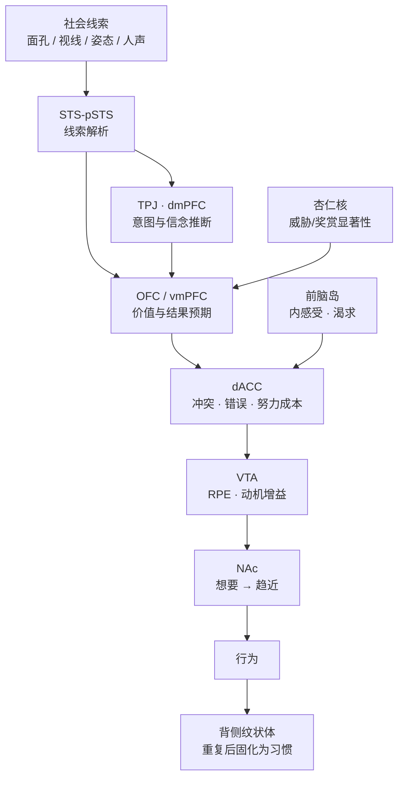

# 功能脑区速查：社会线索、价值计算与动机输出

> **根节点**：为什么 STS、VTA、NAc、OFC、dACC 这五个缩写总是一起出现在社会神经科学文献里，而把它们当成"五个并列的功能模块"却会系统地读错论文？

> **叙事逻辑**：命名层级（为什么不能并列）→ 解剖坐标（谁在哪儿）→ 五个核心节点（各自算什么）→ 回路串联（社会线索→价值→动机→行动）→ 同类区域总表（补全其余常见缩写）→ 网络层 → 读文献防坑 → 临床映射 → 收束（归因、延伸、个体坐标）。

> **立场说明**：本文是**速查型工具笔记**，不是某一实验的深度拆解。凡属教科书级共识（如 VTA→NAc 是奖赏回路主干），直接陈述；凡属仍有争议（OFC 与 vmPFC 的边界、dACC 究竟算冲突还是算努力成本、社会疼痛与生理疼痛是否共享表征），一律标注"有争议"并说明争在哪里。整理者的整合判断会以"可以理解为""更倾向于"标出。

> **来源标注**：综合神经解剖教材与公开综述整理，主要文献见文末；整理日期 2026-10-31。所有 MNI 坐标仅为检索起点，不是定位标准。

---

## 📚 知识树

```txt
根节点：五个缩写为何总一起出现，而"五个并列模块"的读法为何会出错？
│
├── 〇、命名层级（为什么五个缩写不能并列）
│   ├── 沟 / 皮层分区 / 核团：三种不同性质的东西
│   └── 影像分辨率如何把层级差异抹平
│
├── 一、解剖坐标（谁在哪儿，靠什么划界）
│   ├── 中脑：VTA 与 SNc 的分工
│   ├── 腹侧纹状体：NAc 的 core / shell
│   └── 三处皮层：OFC、dACC、STS
│
├── 二、五个核心节点（各自算什么）
│   ├── STS：社会线索的物理载体
│   ├── OFC：具体价值与结果预期
│   ├── dACC：冲突、错误与努力成本
│   ├── VTA：奖赏预测误差与动机增益
│   └── NAc：激励显著性与趋近
│
├── 三、回路串联（社会线索 → 价值 → 动机 → 行动）
│   ├── 一条主链与两条支路
│   ├── 目标导向 / 习惯 / 动机三套系统
│   └── 为什么"缺一座桥"式说法容易过度
│
├── 四、同类区域总表（按系统补全其余常见缩写）
│   ├── 价值与控制（vmPFC、dlPFC、vlPFC/IFG、前脑岛）
│   ├── 社会认知（TPJ、dmPFC、颞极、FFA）
│   ├── 记忆与自我（海马、PCC/楔前叶）
│   └── 皮层下核团（杏仁核、纹状体、腹侧苍白球、缰核、LC、中缝、下丘脑、PAG、BNST）
│
├── 五、网络层（从点到网）
│   ├── 四个常用网络
│   └── 网络的三种误用
│
├── 六、读文献防坑（四条纪律）
│   ├── 反向推断
│   ├── 看坐标不看缩写
│   ├── 亚群与异质性
│   └── 效应量与可重复性
│
├── 七、临床映射（这些节点失灵会怎样）
│   ├── 六类障碍的节点谱
│   └── 证据强度分级
│
└── 八、收束（归因、延伸、个体坐标）
```

---

## 〇、命名层级：为什么五个缩写不能并列

先看一个最容易被忽略的事实：这五个缩写在解剖学上**根本不是一个类别**。STS 是一条沟的名字，OFC 与 dACC 是皮层上的分区，VTA 与 NAc 是深部核团。它们能并列出现在同一句话里，只因为功能影像论文习惯用"显著激活的团块"给结果贴标签——而团块不区分层级。

| 缩写 | 全称 | 解剖层级 | 边界可靠度 | 影像上的麻烦 |
|---|---|---|---|---|
| **STS** | superior temporal sulcus 颞上沟 | 沟（地形地标） | 沟本身清楚，但"STS 区"范围随作者变 | 报告中八成指沟后段的 pSTS，邻区常被一起卷入 |
| **OFC** | orbitofrontal cortex 眶额皮层 | 皮层大区（BA 11/12/13/14 一带） | 与 vmPFC 边界在影像上高度重叠，有争议 | "OFC"可能是内侧、外侧或眶部前段，功能差别很大 |
| **dACC** | dorsal anterior cingulate cortex 背侧前扣带 | 皮层亚区（BA 24/32 背侧） | 与 sgACC、腹侧情感部靠沟与细胞构筑划分 | 同一团块可被不同作者报成 dACC 或 ACC |
| **VTA** | ventral tegmental area 腹侧被盖区 | 中脑核团（体积很小） | 与 SNc 相邻，常规分辨率难分 | 所谓"VTA 激活"常是 VTA+SN 的混合信号 |
| **NAc** | nucleus accumbens 伏隔核 | 核团（腹侧纹状体主体） | 相对清楚 | core / shell 在人体影像上几乎无法分开 |

> 📌 **Brodmann 分区（Brodmann Areas, BA）**：Korbinian Brodmann 在 1909 年按皮层细胞构筑（神经元类型、层厚、密度）划分的 52 个区域。它是**组织学地图**，不是功能地图——同一个 BA 可以承担多种计算。本文用它定位，不用它定义功能。

> 📌 **细胞构筑（Cytoarchitecture）**：皮层各层神经元的组成与排列方式。它是皮层分区最硬的依据，也是为什么"dACC 与 sgACC 是不是两个区"这种争论必须回到组织学而不是看 fMRI 团块。

> 🔗 **横向关联**：[脑区](脑区.md) 从**解剖学**逐叶梳理了额叶、顶叶、颞叶、岛叶、基底核与黑质，其中〈眶额皮层〉〈扣带皮层/扣带回〉〈前脑岛——详解〉三节给出的分区与纤维联系，正是本文功能讨论的地基。本文与它形成**上下游关系**：它回答"长什么样、连着谁"，本文回答"算的是什么"。

一句话收束：**层级不同的东西不能比较功能强弱，只能比较"在回路里占哪个位置"**。

---

## 一、解剖坐标：谁在哪儿，靠什么划界

先给一张粗坐标表，只用于在文献里定位，不作为判据。

| 结构 | 所在位置（landmark） | 大致 MNI 范围（检索起点） | 主要划界依据 |
|---|---|---|---|
| **pSTS** | 颞上回与颞中回之间的沟后段 | x ≈ ±50~60，y ≈ −40~−55，z ≈ 0~+15 | 沟的走向；功能上常按"对生物运动响应"界定 |
| **OFC** | 额叶底面、眶板之上 | 内侧 x ≈ 0~±10，外侧 x ≈ ±25~40；y ≈ +25~+45；z ≈ −20~−5 | 眶沟、嗅沟、BA 分区 |
| **dACC** | 胼胝体上方、扣带沟下方，C 形成对 | x ≈ ±2~8，y ≈ +10~+35，z ≈ +25~+40 | 扣带沟位置 + 细胞构筑（无颗粒皮层） |
| **VTA** | 中脑被盖内侧，脚间窝背侧、红核后方 | x ≈ 0~±5，y ≈ −15~−20，z ≈ −10~−15 | 与 SNc 的相对位置、DA 细胞群（A10） |
| **NAc** | 尾状核头下方、内囊前肢内侧、隔区外侧 | x ≈ ±8~12，y ≈ +5~+12，z ≈ −5~−10 | 灰质团块边界；core/shell 靠化学标记与连接 |

> 📌 **腹侧纹状体（Ventral Striatum）**：纹状体位于内囊前肢腹侧的部分，主要包括 NAc 与嗅结节。它在解剖上是"纹状体的腹侧延伸"，在功能上却是**边缘系统与运动系统的接口**——情绪、动机的信息在这里被翻译成"要不要动"。

### 1.1 中脑：VTA 与 SNc 的分工

VTA（A10 细胞群）与黑质致密部 SNc（A9）紧邻，都是多巴胺的主要来源，但**靶区不同**：

- **VTA → 腹侧纹状体（NAc）、杏仁核、海马**：中脑-边缘通路（mesolimbic）。
- **VTA → 内侧前额叶、OFC**：中脑-皮层通路（mesocortical）。
- **SNc → 背侧纹状体（尾状核、壳核）**：黑质-纹状体通路，管运动与习惯。

> 📌 **中脑-边缘通路 / 中脑-皮层通路（Mesolimbic / Mesocortical Pathway）**：前者从 VTA 到 NAc 等边缘结构，是"想要"与趋近行为的主干；后者从 VTA 到前额叶，参与价值表征与工作记忆的门控。两条通路常被合称"中脑-皮质-边缘系统"，是成瘾、精神分裂与抑郁研究共同的靶区。

> 🔗 **横向关联**：[寻求系统与动机心理学](寻求系统与动机心理学.md) 把这条通路写成"寻求系统的化学动力引擎"，强调多巴胺在**寻找过程中**而非获得之后释放。这与本文"VTA 编码的是预测误差而不是快乐"的判断构成**互证关系**——两篇笔记从不同入口（动机心理学 vs 神经解剖）指向同一个结论：多巴胺服务于"追"，不服务于"享受"。

### 1.2 NAc 的 core 与 shell

| 维度 | core（核） | shell（壳） |
|---|---|---|
| 位置 | 偏背外侧 | 偏腹内侧，包绕 core |
| 连接风格 | 更接近背侧纹状体：投射到腹侧苍白球、参与习惯与线索-反应 | 更接近边缘系统：投射到下丘脑、VTA、杏仁核 |
| 功能倾向 | 线索引导的趋近、行为激活 | 情境性奖赏、应激反应、**享乐热点**所在 |
| 损伤后果 | 趋近行为受损、线索反应减弱 | 应激易感性与情绪反应改变 |

> 📌 **享乐热点（Hedonic Hotspot）**：Berridge 与 Kringelbach 提出的概念，指 NAc shell、腹侧苍白球等少数小区域中，阿片类与内源性大麻素信号能把"喜欢"（liking）的体验放大。它与多巴胺主导的"想要"（wanting）是**两套可分离的系统**——这是推翻"多巴胺=快乐"的关键证据。

### 1.3 三处皮层：OFC、dACC、STS

- **OFC**：额叶底面，接收全部感觉模态（味觉、嗅觉、躯体感觉、视觉、听觉）与内脏信号，是"多模态汇聚到同一个价值尺度"的地方。
- **dACC**：扣带皮层前部的背侧段。它与腹侧的 sgACC（BA25）在功能和连接上几乎相反：dACC 偏认知控制与负性监测，sgACC 偏内脏-情绪调节，且是难治性抑郁的深部脑刺激靶点之一。
- **STS**：颞上回与颞中回之间的沟。它本身是地形，但沟两岸与沟底的皮层对**生物运动、面孔动态、人声**有选择性反应，文献把它们统称 pSTS 区。

---

## 二、五个核心节点：各自算什么

### 2.1 STS / pSTS：社会线索的物理载体

STS 的核心工作不是"读懂别人想什么"，而是**把动作流解析成有社会意义的单元**：这是不是活物、视线朝向哪里、嘴唇在不在动、声音是不是人声、动作的终点是哪里。

> 📌 **生物运动（Biological Motion）**：由关节运动学定义的、只有生命体才会产生的运动模式。Johansson 的点光行走者（point-light walker）实验证明，仅十几个光点的运动学信息就足以让人识别性别、步态甚至情绪。STS/pSTS 对这类刺激的选择性反应，是"社会知觉有专用神经基础"最硬的证据之一。

- **经典范式**：点光行走者、Heider-Simmel 几何图形动画（把三角形"拟人化"）、注视追随、唇读。
- **输出方向**：向 TPJ 与 dmPFC 提供"原始素材"，向杏仁核与 OFC 提供"显著性"与"价值"输入。
- **损伤表现**：社会知觉变粗糙（读不准视线与意图），但基础物体识别完好——这与面孔失认（FFA 损伤）不同。
- **常见误读**：把 STS 当成"心理理论中枢"。真正的心理化网络以 TPJ/dmPFC 为核心，STS 更像**前端传感器**。

> 🔗 **横向关联**：STS 的"只解析动作、不判定意图"这一分工，与 [预测加工理论](预测加工理论.md) 中"低层预测误差向上传递、高层先验向下解释"的层级结构形成**对照关系**——STS 提供的是高精度但低抽象度的证据，意图推断发生在更高层。

### 2.2 OFC：具体价值与结果预期

OFC 是本文五个节点里功能争议最大的一个。可以较有把握地说三件事：

1. **它表征主观价值**：同一杯果汁在不同渴度下的价值不同，OFC 的活动随之改变（感觉特异性饱足实验）。
2. **它支持结果贬值（devaluation）**：动物吃饱某食物后，该食物的价值下降；OFC 损伤的动物不再根据"吃饱了"调整选择——说明它参与**当前价值**的动态更新。
3. **它支持反转学习**：奖励与惩罚的关联反转后，OFC 损伤者难以切换策略。

> 📌 **结果贬值（Devaluation）**：先让动物把某个线索与食物建立联系，再让动物吃饱该食物（使结果失去价值），观察它是否还追那个线索。能追 = 行为由"结果当前价值"引导；不能 = 行为被线索本身劫持。这是区分**目标导向**与**习惯**的经典操作。

争议在于它**是不是"价值地图"**。Rudebeck 与 Murray 把它比作"预言机"（oracle），强调它提供的是**任务模型与结果身份**；Stalnaker 等则质疑"OFC 编码价值"这一说法过于笼统，认为它更像在编码**任务的结构与状态**。折中的看法是：OFC 表征的是**具体的、与刺激绑定的预期结果**，而抽象的、跨情境的价值整合更依赖 vmPFC。

| 维度 | OFC | vmPFC |
|---|---|---|
| 表征内容 | 具体刺激-结果绑定、"这个东西值多少" | 抽象价值、跨情境整合、自我参照 |
| 学习角色 | 反转学习、结果贬值敏感 | 消退记忆的提取、价值更新 |
| 损伤表现 | 冲动、社交失当、策略僵化 | 价值整合困难、情绪调节与消退缺陷 |
| 影像边界 | 常与 vmPFC 团块重叠，难以干净分离（有争议） | 同上 |

> 🔗 **横向关联**：[人格障碍谱系与现代心理分析](人格障碍谱系与现代心理分析.md) 把反社会型人格障碍描述为"OFC/vmPFC 功能弱 → 难以把道德情绪整合进决策"，把强迫型描述为"OFC-尾状核-丘脑环路过度活跃"。这两条正是本文"OFC 是价值与结果预期节点"的**临床演绎**——同一脑区在不同环路里失灵，表现成完全相反的两种人格。

### 2.3 dACC：冲突、错误与努力成本

dACC 至少有四种主流解释，它们并不互斥，而是**同一套计算的四个侧面**：

| 理论 | 核心主张 | 典型证据 | 主要局限 |
|---|---|---|---|
| 冲突监测 | 检测同时活跃的冲突反应倾向，并招募控制 | Stroop、flanker 任务 | 难以解释无冲突但需努力的任务 |
| 错误检测 | 对错误反应产生负性信号（ERN） | 错误相关负波 | 只覆盖"已犯错"情形 |
| 努力成本 / EVC | 评估"投入控制值不值"，决定控制强度 | 认知努力折扣、难度操纵 | 与价值区（vmPFC）边界模糊 |
| 疼痛情感维度 | 编码疼痛的**不愉快**而非强度 | 疼痛预期、安慰剂、催眠 | 与"社会疼痛"共享的表述有争议 |

> 📌 **预期控制价值（Expected Value of Control, EVC）**：Shenhav 等提出的框架，认为 dACC 计算的是"施加认知控制能带来多少收益、需要付出多少代价"，并据此**设定控制强度**。它把 dACC 从"报警器"升级为"油门控制器"。

> 📌 **冲突监测（Conflict Monitoring）**：Botvinick 等的模型，认为 ACC 检测到冲突升高后，向背外侧前额叶发出"加控制"的信号。这个模型最大的贡献是把 ACC 从"情绪区"改写成"控制回路的一环"。

- **社会情境**：社会排斥（Cyberball 范式）、被评价、地位威胁都会激活 dACC 与前脑岛——但"社会疼痛 = 生理疼痛"的强版本已被质疑（见第六节）。
- **常见误读**：把 dACC 叫"疼痛中枢"。它编码的是"这件事对我构成多大负担、值不值得继续投入"，疼痛只是其中一类输入。

> 🔗 **横向关联**：[ADHD症状的神经生物学机制深度解析](ADHD症状的神经生物学机制深度解析.md) 把前扣带回写成"冲突监控——检测当前注意力是否在正确轨道上"，正对应本文的冲突监测与 EVC 两层。区别在于：ADHD 笔记关心**这条监测线失灵后行为如何散掉**，本文关心**这条线本身在算什么**。

### 2.4 VTA：奖赏预测误差与动机增益

VTA 的教科书功能来自 Schultz 的猴子电生理：多巴胺神经元的放电不是对"奖赏"本身，而是对**奖赏减去预期**的差值。

> 📌 **奖赏预测误差（Reward Prediction Error, RPE）**：实际结果与预期结果之差。正 RPE → 多巴胺爆发（"比预期好，再来一次"）；负 RPE → 多巴胺低于基线（"比预期差，改策略"）；结果完全符合预期 → 无变化。它是时序差分学习（TD learning）在神经系统的实现，也是强化学习与多巴胺之间最坚实的一座桥。

但 VTA 远不止于此：

- **异质性**：VTA 内除多巴胺神经元外还有 GABA 与谷氨酸神经元；投射到 NAc 的亚群与投射到 mPFC 的亚群，功能甚至可以相反（一部分编码奖赏，一部分编码厌恶）。
- **动机增益（vigor）**：多巴胺水平影响"愿不愿意为某个结果付出行动"，而不只是"学到什么"。
- **显著性 vs 价值**：VTA 对**新异**与**显著**刺激也反应，不限于奖赏。

> 🔗 **横向关联**：[潘克塞普的情绪系统理论与建构主义之争](潘克塞普研究/潘克塞普的情绪系统理论与建构主义之争.md) 把 SEEKING 系统的神经基础写成"内侧前脑束、外侧下丘脑、VTA、伏隔核、PAG"，并强调它是"过程奖赏"而非"结果奖赏"。这与本文的 RPE 解释构成**同一现象的两套语言**：RPE 说的是学习信号，SEEKING 说的是主观的探索兴奋。

### 2.5 NAc：激励显著性与趋近

NAc 不是"快乐中枢"，而是**把价值翻译成行动倾向**的转换器。它的三个核心概念：

> 📌 **激励显著性（Incentive Salience）**：Berridge 与 Robinson 的术语，指某个线索被赋予"想要"（wanting）的属性——它变得抓眼球、值得追。它与"喜欢"（liking）可分离：成瘾者对毒品高度"想要"，但"喜欢"并未同比增加。

> 📌 **努力意愿（Effort Willingness）**：为获得某结果愿意付出多少成本。NAc 的多巴胺信号调节的正是这个"值不值得费劲"的门槛，而不是快乐本身。

- **输入**：VTA 的多巴胺、腹侧海马的**情境**信息、基底外侧杏仁核的**情绪**信息、mPFC 的**价值**信息。
- **输出**：经腹侧苍白球 → 丘脑 → 皮层，形成"动机→行动"的环路。
- **社会奖赏**：社会认可、公平分配、被接纳，都能激活 NAc——这使 NAc 成为社会动机研究最常用的读出点。

> 🔗 **横向关联**：[网络色情与变比率强化的神经机制](网络色情与变比率强化的神经机制.md) 描述 VTA 持续高频输出、人为延长唤起区间；[成瘾与冲动控制障碍谱系全解析](心理疾病全解/成瘾与冲动控制障碍谱系全解析.md) 则记录 VTA→NAc 被反复劫持后 D2 受体下调。两篇与本文形成**因果关系**：本文给出回路结构，它们记录结构被滥用后的后果。

### 2.6 五节点总对照

为什么要并排比较？因为这五个节点恰好覆盖"输入—估价—监测—驱动—输出"一条链，只有并排才能看清谁缺了都不行。

| 维度 | STS/pSTS | OFC | dACC | VTA | NAc |
|---|---|---|---|---|---|
| 层级 | 皮层（沟旁） | 皮层 | 皮层 | 中脑核团 | 腹侧纹状体核团 |
| 核心计算 | 社会线索解析 | 具体价值与结果预期 | 冲突/错误/努力成本 | RPE + 动机增益 | 激励显著性与趋近 |
| 主要输入 | 视听觉联合皮层 | 全感觉模态 + 内脏 | 前额叶、顶叶、岛叶 | 多模态显著刺激、PFC | VTA、vHPC、BLA、mPFC |
| 主要输出 | TPJ、dmPFC、杏仁核、OFC | vmPFC、纹状体、下丘脑 | 运动前区、dlPFC | NAc、mPFC、OFC | 腹侧苍白球 → 丘脑 → 皮层 |
| 一句话误读 | "读心中枢" | "情绪中枢" | "疼痛中枢" | "快乐中枢" | "快乐点" |

最关键的差异不在功能名称，而在**方向**：STS 与 OFC 是**输入与估价**，dACC 是**监测与调控**，VTA 与 NAc 是**驱动与输出**。把它们当成并列的"功能模块"会丢掉全部方向信息。

---

## 三、回路串联：社会线索 → 价值 → 动机 → 行动



### 3.1 一条主链与两条支路

- **主链**：STS（是什么）→ OFC/vmPFC（值多少）→ dACC（值不值得费劲）→ VTA（该不该学、该不该加力）→ NAc（要不要动）。
- **支路一（情绪）**：杏仁核给主链打"威胁/奖赏"的显著性标记，让估价带上情绪权重。
- **支路二（身体）**：前脑岛提供内感受状态（饥饿、疲劳、渴求），让"值多少"随时受身体状态调制。

### 3.2 三套并行系统，不要混成一条

| 系统 | 核心结构 | 学习规则 | 行为特征 | 典型实验 |
|---|---|---|---|---|
| **目标导向** | OFC、vmPFC、尾状核（associative） | 模型式（model-based）：用结果当前价值做选择 | 结果贬值后立刻改选 | 结果贬值、反转学习 |
| **习惯** | 感觉运动皮层、壳核（sensorimotor） | 无模型式（model-free）：线索-反应直接绑定 | 结果贬值后照旧 | 过度训练、习惯化范式 |
| **动机驱动** | VTA、NAc、腹侧苍白球 | 激励显著性调制 | 想要 → 趋近，可脱离喜欢 | 激励显著性、努力折扣 |

这张表最关键的一句：**"知道该做"（目标导向）与"真的会做"（动机驱动）是两条不同的回路**，前者完好不代表后者能被调动。这正是很多"道理都懂但动不了"现象的神经学解释。

> 🔗 **横向关联**：[情绪失调与人格整合系列/兴趣驱动型神经系统与内在监工：死结结构、病因学与系统全景](情绪失调与人格整合系列/兴趣驱动型神经系统与内在监工：死结结构、病因学与系统全景.md) 用"热执行功能（OFC/vmPFC）vs 冷执行功能（dlPFC）"解释同一件事：冷 EF 可以超常，热 EF 才是"仅凭重要性就能推动自己"所依赖的系统。本文的"三套系统"表为这个判断提供了回路层面的支撑，两者是**上下游关系**。

### 3.3 为什么"缺一座桥"式说法容易过度

常见叙事是：VTA 会释放多巴胺、NAc 会接收，但两者之间"缺一座桥"，所以动机传不过去。这类说法的问题在于：

1. **解剖上并不存在"缺桥"**：VTA→NAc 是白质束明确的中脑-边缘投射，不是待建的工程。
2. **功能上"信号弱"与"没有通路"是两件事**：前者是增益问题（受体密度、相位/张力释放比例），后者是结构问题。
3. **多巴胺不是唯一的传声筒**：NAc 还接收海马、杏仁核、mPFC 的谷氨酸输入，"想不想动"是多方投票的结果。

更稳妥的表述是：**某条通路的增益下调**，而不是"通路缺失"。这个区别决定了干预方向——增益可以靠行为、药物、环境调节，缺失只能靠替代。

> 🔗 **横向关联**：[对话总结](对话总结.md) 明确记录了一次自我修正：把"VTA→NAc 缺一座桥"当成结论写下来，是"把假说写成结论"的典型。本文第三节正是对那次修正的**方法论回应**——区分"结构缺失"与"增益不足"，是写神经科学笔记时必须守住的一条线。

---

## 四、同类区域总表：按系统补全其余常见缩写

### 4.1 价值与控制（前额叶与岛叶）

| 区域 | 全称 | 一句话功能 | 最常见误读 |
|---|---|---|---|
| **vmPFC** | ventromedial prefrontal cortex 腹内侧前额叶 | 抽象价值整合、自我参照、消退记忆提取 | 与 OFC 混用；两者影像上高度重叠 |
| **dlPFC** | dorsolateral prefrontal cortex 背外侧前额叶 | 工作记忆、规则维持、认知重评 | "理性中枢"；它只是控制的一环 |
| **vlPFC / IFG** | ventrolateral PFC / inferior frontal gyrus 腹外侧前额叶/额下回 | 反应抑制、语义选择；镜像系统皮层端 | "意志力开关"；抑制是多个环路的结果 |
| **AI** | anterior insula 前脑岛 | 内感受、厌恶、渴求、情绪意识 | " disgust 中枢"；它编码的是身体状态预测 |

> 📌 **内感受（Interoception）**：对身体内部状态（心跳、饥饿、呼吸、内脏）的感知。Craig 提出前脑岛是内感受的皮层枢纽，并把"我知道我在难受"这层元认知也放在这里——这是它区别于杏仁核的关键。

> 🔗 **横向关联**：[脑区](脑区.md) 的〈前脑岛——详解〉一节记录了 von Economo 神经元、前后岛叶的信息流方向与连接组学。本文只保留功能层的一句话，需要解剖细节时应回该节——这是**上下游关系**的又一次应用。

### 4.2 社会认知

| 区域 | 全称 | 一句话功能 | 备注 |
|---|---|---|---|
| **TPJ** | temporoparietal junction 颞顶联合区 | 心理理论核心：推断他人信念、注意重定向 | 与 STS 分工：STS 给线索，TPJ 给解释 |
| **dmPFC** | dorsomedial prefrontal cortex 背内侧前额叶 | 推断他人特质、信念，反思自我 | 与 vmPFC 一背一腹，功能不同 |
| **颞极** | temporal pole | 语义"枢纽"，社会概念与人物知识 | 语义痴呆早期受累 |
| **FFA** | fusiform face area 梭状回面孔区 | 面孔身份识别 | 与 STS 分工：FFA 认"是谁"，STS 读"在干什么" |

### 4.3 记忆与自我

| 区域 | 全称 | 一句话功能 | 备注 |
|---|---|---|---|
| **海马** | hippocampus | 情景记忆、情境编码、模式分离/补全 | 给 NAc 提供"这是哪个情境"的输入 |
| **PCC** | posterior cingulate cortex 后扣带 | 默认网络核心：自我参照、自传体记忆 | 与 dACC 同属扣带，功能几乎无关 |
| **楔前叶** | precuneus | 自我相关加工、心理意象、导航 | 常与 PCC 一起报告 |

### 4.4 皮层下核团

| 结构 | 全称 | 一句话功能 | 备注 |
|---|---|---|---|
| **杏仁核** | amygdala（BLA / CeA） | 威胁检测、恐惧学习、显著性标记 | BLA 管学习与价值，CeA 管输出 |
| **背侧纹状体** | dorsal striatum（尾状核/壳核） | 目标导向（尾状核）/ 习惯与运动（壳核） | 与 NAc 的分工是"认知/习惯 vs 动机" |
| **腹侧苍白球** | ventral pallidum | 动机输出；享乐热点之一 | NAc 的主要出口 |
| **缰核** | habenula（尤其外侧） | **负**奖赏预测误差、失望信号 | 抑郁与回避行为研究热点 |
| **蓝斑** | locus coeruleus (LC) | 去甲肾上腺素：觉醒、**不确定性驱动的探索** | 与 VTA 同为"增益调节"系统 |
| **中缝核** | raphe nuclei | 5-HT：情绪、冲动控制、行为抑制 | 与 SSRI 机制直接相关 |
| **下丘脑** | hypothalamus | 稳态、攻击、性行为、食欲素 | 动机的"生理需求"输入端 |
| **PAG** | periaqueductal gray 中脑导水管周围灰质 | 防御行为、疼痛下行控制、发声 | 恐慌与威胁反应的执行端 |
| **BNST** | bed nucleus of the stria terminalis 终纹床核 | 持续性焦虑、不可预测威胁 | 与杏仁核分工：CeA 管急性恐惧，BNST 管慢性焦虑 |

> 📌 **缰核的负 RPE（Negative Reward Prediction Error）**：Matsumoto 与 Hikosaka 发现外侧缰核神经元在"结果比预期差"时放电，并抑制 VTA 的多巴胺神经元。它相当于奖赏系统的**刹车片**，也是"失望为什么会让人停下"的回路解释。

> 🔗 **横向关联**：[应激相关障碍：抑郁、焦虑、PTSD、库欣与慢性疼痛综合征](应激相关障碍：抑郁、焦虑、PTSD、库欣与慢性疼痛综合征.md) 记录了膝下前扣带回（sgACC，BA25）过度激活与抑郁的关系。把本文的 dACC 与它并读，能看清"背侧管控制、腹侧管情绪"这条扣带内的**对照关系**——同一个 C 形结构，背腹两端几乎承担相反的工作。

---

## 五、网络层：从点到网

单点功能只是近似。同一个核团在不同网络里可以被征用做不同的事，所以现代文献更常以网络为单位报告。

| 网络 | 核心节点 | 一句话功能 | 最常被误用成 |
|---|---|---|---|
| **默认网络 DMN** | mPFC、PCC/楔前叶、角回、海马旁 | 自我参照、自传体记忆、走神、社会推断 | "休息时才有用的网络"——它在社会认知任务里同样活跃 |
| **突显网络 SN** | dACC、前脑岛、杏仁核 | 检测显著事件，切换 DMN 与 CEN | "注意力网络"——它管的是**切换**，不是维持 |
| **中央执行网络 CEN** | dlPFC、顶内沟 IPS | 工作记忆、规则操作、目标维持 | "理性网络" |
| **心理化网络** | dmPFC、TPJ、pSTS、颞极、楔前叶 | 推断他人信念与意图 | "共情网络"——共情（感受）与心理化（推断）可分离 |
| **奖赏网络** | VTA/SNc、NAc、OFC/vmPFC、杏仁核、前脑岛 | 价值计算与动机驱动 | "快乐网络" |

> 📌 **突显网络（Salience Network）**：Seeley 等提出，核心是 dACC 与前脑岛。它的关键作用是**在默认网络与中央执行网络之间做切换**——哪件事值得打断当前状态。这解释了为什么 dACC 既出现在疼痛研究里，也出现在冲突研究与社交排斥研究里：它处理的不是"疼"，而是"该不该切资源"。

网络的三种误用：

1. **把网络当器官**：网络是统计相关性的聚类，不是解剖单元，节点归属会随阈值变化。
2. **把"激活"当"参与"**：默认网络在任务中"去激活"不等于"关闭"。
3. **把网络名当功能名**："突显网络"不是"显著性器官"，它只是这批节点经常一起升降。

> 🔗 **横向关联**：[自我、羡慕与神圣：可达性动力学、通约与共同体的耗散维护](../人类学/自我、羡慕与神圣：可达性动力学、通约与共同体的耗散维护.md) 在讨论"显著性"时列出"凸显性网络（前岛叶、dACC、杏仁核）"，并把 SEEKING 写成"VTA→NAc 多巴胺 = 我想要更多"。本文为那张表提供了**回路层的展开**，两者构成**互证关系**：人类学侧关心"什么被一个共同体反复点亮"，神经科学侧关心"点亮发生在哪条线上"。

---

## 六、读文献防坑：四条纪律

### 6.1 反向推断

> 📌 **反向推断（Reverse Inference）**：从"区域 X 激活"倒推"心理过程 Y 正在发生"。Poldrack 指出，这种推理只有在 Y 是该区的**选择性**功能时才成立，而多数脑区并不选择性。

正确读法：激活只说明**参与**，不说明**专责**。OFC 出现在味觉、道德、金融决策里，不是因为它有"道德模块"，而是因为三类任务都要算价值。

### 6.2 看坐标，不看缩写

| 论文里写的 | 实际可能是 | 判断方法 |
|---|---|---|
| "OFC" | 内侧 OFC（≈vmPFC）或外侧 OFC | 看 x 坐标：接近中线 = 内侧 |
| "STS" | pSTS、STG、甚至 MT/V5 | 看 y 与 z：越靠后越可能是运动区 |
| "ACC" | dACC 或 sgACC/vACC | 看 z：z 高 = 背侧认知部，z 低 = 腹侧情感部 |
| "VTA" | VTA + SN 混合 | 看团块是否延伸到 y < −20 且偏外侧 |
| "NAc" | 整个腹侧纹状体 | 看是否包含嗅结节 |

一句话：**缩写是作者的选择，坐标是数据的硬约束**。

### 6.3 亚群与异质性

- VTA：多巴胺、GABA、谷氨酸三类神经元；不同投射亚群功能可相反。
- NAc：core 与 shell 的连接与功能不同，人体影像分不开。
- OFC：内侧/外侧、前/后段功能不同（外侧偏惩罚与抑制，内侧偏奖赏与价值）。
- dACC：背腹梯度上功能连续变化，没有一条清晰的"功能线"。

### 6.4 效应量与可重复性

社会神经科学大量结论来自 n≈20 的 fMRI 研究，效应量普遍偏小。两个必须知道的争议：

1. **社会疼痛与生理疼痛共享 dACC/前脑岛**：Eisenberger 的早期结论影响极大，但 Iannetti 等的概念批评与 Woo 等的多变量模式分析显示，两者的**神经表征可分离**。较稳妥的表述是"共享部分**情感-显著性**成分"，而不是"社会排斥等于生理疼痛"。
2. **"某区体积与某特质相关"**：这类研究在样本增大后效应常缩水，VBM 的预处理选择也会显著改变结果。看到"体积减小"要先问样本量与校正方式。

> 🔗 **横向关联**：[情绪失调与人格整合的共同解](情绪失调与人格整合系列/情绪失调与人格整合的共同解.md) 引用"社交排斥与物理疼痛共享前扣带与前脑岛"这一结论。本文第六节对它是**边界修正**：共享的是情感-显著性成分，不是完整的疼痛体验——引用时需要保留这个限定语。

---

## 七、临床映射：这些节点失灵会怎样

| 障碍 | 主要受累节点 | 机制一句话 | 证据强度 |
|---|---|---|---|
| **抑郁** | sgACC、NAc、OFC/vmPFC | 负性价值权重过高 + 奖赏反应钝化；sgACC 是 DBS 靶点 | 中—强（DBS 与影像均有支持，但异质性大） |
| **成瘾** | VTA→NAc、OFC、背侧纹状体 | 激励显著性被劫持 → 习惯化 → 控制权从目标导向转向线索反应 | 强（动物模型与人体影像一致） |
| **焦虑/PTSD** | 杏仁核、vmPFC、BNST、海马 | 威胁学习过强 + 消退提取不足；BNST 支撑持续性焦虑 | 强（恐惧回路的证据链最完整） |
| **精神分裂** | VTA、纹状体、STS/TPJ | "异常显著性"：中性线索被赋予意义；社会线索误读 | 中（多巴胺假说强，社会认知部分异质） |
| **ADHD** | dACC、dlPFC、VTA→NAc | 冲突监控与延迟奖赏折扣异常；动机增益不稳 | 中（神经影像效应量小，行为证据更强） |
| **人格障碍** | OFC/vmPFC、杏仁核、OFC-尾状核环路 | 价值-情绪整合失灵，或监控环路过度激活 | 中—弱（多为相关研究，因果方向不明） |

这张表要收束在一句话上：**没有哪个障碍是"某区坏了"**。同一区域（如 OFC）在反社会型里表现为"太弱"，在强迫型里表现为"环路太强"；决定临床表现的是**环路与增益**，不是单点。

> 🔗 **横向关联**：[依恋理论：鲍尔比、安斯沃思与内部工作模型](依恋理论研究/依恋理论：鲍尔比、安斯沃思与内部工作模型.md) 讨论内部工作模型如何塑造对社会线索的解释。用本文的语言说，这相当于**社会线索（STS 层）到价值（OFC 层）的通路被早期经验调参**——这是"回路可塑性"在人际层面的表现，两者形成**上下游关系**。

---

## 八、收束

**归因层**：为什么"某区 = 某功能"的叙事这么流行？因为它可讲述、可记忆、可自我诊断。但它的证据强度往往低于它的传播力。一个区域被写进科普，通常不是因为它被证明得最牢，而是因为它最容易被讲成一个比喻。

**延伸层**：过去三十年，神经科学的重心已经从"定位"（哪个区管什么）转向"回路 + 计算"（这条回路在算什么、用什么规则更新）。本文五节点之所以要按"输入—估价—监测—驱动—输出"排列，就是为了让读者在任何一篇新论文里先问：**这个团块在链条的哪一段？** 而不是"这个区叫什么名字"。

**个体坐标**：三条可操作的自检。

1. **不要把"多巴胺不足"当自我诊断**。多巴胺管的是学习信号与动机增益，不是快乐水平；"我不快乐"与"我多巴胺低"之间没有直接推理链。
2. **区分"想要"与"喜欢"**。刷到停不下来是 wanting 被拉高，不是 liking 被满足——这个区分能解释大量"得到了却不开心"的体验。
3. **社会线索的解读是变量，不是事实**。STS 给的是原始素材，TPJ/dmPFC 给的是解释。解释这一层可以被经验、情绪状态、依恋模式改写——这意味着"他是不是看不起我"这个判断，永远有第二解。

---

## 📇 索引表

| 缩写 | 全称 | 层级 | 核心计算 | 详见 |
|---|---|---|---|---|
| STS / pSTS | superior temporal sulcus / posterior STS | 沟（区） | 生物运动、视线、人声等社会线索解析 | §2.1 |
| OFC | orbitofrontal cortex | 皮层大区 | 具体价值、结果预期、反转学习 | §2.2 |
| dACC | dorsal anterior cingulate cortex | 皮层亚区 | 冲突、错误、努力成本（EVC） | §2.3 |
| VTA | ventral tegmental area | 中脑核团 | 奖赏预测误差、动机增益 | §2.4 |
| NAc | nucleus accumbens | 腹侧纹状体核团 | 激励显著性、趋近、努力意愿 | §2.5 |
| vmPFC | ventromedial prefrontal cortex | 皮层 | 抽象价值整合、消退提取 | §4.1 |
| dlPFC | dorsolateral prefrontal cortex | 皮层 | 工作记忆、认知重评 | §4.1 |
| vlPFC / IFG | ventrolateral PFC / inferior frontal gyrus | 皮层 | 反应抑制、语义选择 | §4.1 |
| AI | anterior insula | 皮层 | 内感受、厌恶、渴求 | §4.1 |
| TPJ | temporoparietal junction | 皮层 | 心理理论、注意重定向 | §4.2 |
| dmPFC | dorsomedial prefrontal cortex | 皮层 | 推断他人特质与信念 | §4.2 |
| FFA | fusiform face area | 皮层 | 面孔身份 | §4.2 |
| PCC | posterior cingulate cortex | 皮层 | 自我参照、自传体记忆 | §4.3 |
| BLA / CeA | basolateral / central amygdala | 核团亚区 | 价值学习 / 恐惧输出 | §4.4 |
| LC | locus coeruleus | 脑干核团 | 觉醒、不确定性驱动探索 | §4.4 |
| BNST | bed nucleus of the stria terminalis | 核团 | 持续性焦虑 | §4.4 |
| PAG | periaqueductal gray | 中脑核团 | 防御、疼痛下行控制 | §4.4 |
| RPE | reward prediction error | 计算量 | 实际 − 预期 | §2.4、§3 |
| EVC | expected value of control | 计算量 | 控制的收益 − 代价 | §2.3 |

---

## 📚 参考来源

1. Schultz, W., Dayan, P., & Montague, P. R. (1997). A neural substrate of prediction and reward. *Science*, 275(5306), 1593–1599.
2. Schultz, W. (1998). Predictive reward signal of dopamine neurons. *Journal of Neurophysiology*, 80(1), 1–27.
3. Berridge, K. C., & Robinson, T. E. (2016). Liking, wanting, and the incentive-sensitization theory of addiction. *American Psychologist*, 71(8), 670–679.
4. Berridge, K. C., & Kringelbach, M. L. (2015). Pleasure systems in the brain. *Neuron*, 86(3), 646–664.
5. Kringelbach, M. L. (2005). The human orbitofrontal cortex: linking reward to hedonic experience. *Nature Reviews Neuroscience*, 6(9), 691–702.
6. Rudebeck, P. H., & Murray, E. A. (2014). The orbitofrontal oracle: cortical mechanisms for the prediction and evaluation of specific behavioral outcomes. *Neuron*, 84(6), 1143–1156.
7. Stalnaker, T. A., Cooch, N. K., & Schoenbaum, G. (2015). What the orbitofrontal cortex does not do. *Nature Neuroscience*, 18(5), 620–627.
8. Shenhav, A., Botvinick, M. M., & Cohen, J. D. (2013). The expected value of control: an integrative theory of anterior cingulate cortex function. *Neuron*, 79(2), 217–240.
9. Botvinick, M. M., Braver, T. S., Barch, D. M., Carter, C. S., & Cohen, J. D. (2001). Conflict monitoring and cognitive control. *Psychological Review*, 108(3), 624–652.
10. Etkin, A., Egner, T., & Kalisch, R. (2011). Emotional processing in anterior cingulate and medial prefrontal cortex. *Trends in Cognitive Sciences*, 15(2), 85–93.
11. Allison, T., Puce, A., & McCarthy, G. (2000). Social perception from visual cues: role of the STS region. *Trends in Cognitive Sciences*, 4(7), 267–278.
12. Puce, A., & Perrett, D. (2003). Electrophysiology and brain imaging of biological motion. *Philosophical Transactions of the Royal Society B*, 358(1431), 435–445.
13. Frith, C. D., & Frith, U. (2006). The neural basis of mentalizing. *Neuron*, 50(4), 531–534.
14. Amodio, D. M., & Frith, C. D. (2006). Meeting of minds: the medial frontal cortex and social cognition. *Nature Reviews Neuroscience*, 7(4), 268–277.
15. Craig, A. D. (2009). How do you feel — now? The anterior insula and human awareness. *Nature Reviews Neuroscience*, 10(1), 59–70.
16. Seeley, W. W., et al. (2007). Dissociable intrinsic connectivity networks for salience processing and executive control. *Journal of Neuroscience*, 27(9), 2349–2356.
17. Raichle, M. E., et al. (2001). A default mode of brain function. *PNAS*, 98(2), 676–682.
18. Buckner, R. L., Andrews-Hanna, J. R., & Schacter, D. L. (2008). The brain's default network: anatomy, function, and relevance to disease. *Annals of the New York Academy of Sciences*, 1124, 1–38.
19. Haber, S. N., & Knutson, B. (2010). The reward circuit: linking primate anatomy and human imaging. *Neuropsychopharmacology*, 35(1), 4–26.
20. Sesack, S. R., & Grace, A. A. (2010). Cortico-basal ganglia reward network: microcircuitry. *Neuropsychopharmacology*, 35(1), 27–47.
21. Lammel, S., Lim, B. K., & Malenka, R. C. (2014). Reward and aversion in a heterogeneous midbrain dopamine system. *Neuropharmacology*, 76, 351–359.
22. Matsumoto, M., & Hikosaka, O. (2007). Lateral habenula as a source of negative reward signals in dopamine neurons. *Nature*, 447(7148), 1111–1115.
23. Aston-Jones, G., & Cohen, J. D. (2005). An integrative theory of locus coeruleus-norepinephrine function: adaptive gain and optimal performance. *Annual Review of Neuroscience*, 28, 403–450.
24. Eisenberger, N. I. (2012). The pain of social disconnection: examining the shared neural underpinnings of physical and social pain. *Nature Reviews Neuroscience*, 13(6), 421–434.
25. Iannetti, G. D., Salomons, T. V., Moayedi, M., Mouraux, A., & Davis, K. D. (2013). Beyond metaphor: contrasting mechanisms of social and physical pain. *Trends in Cognitive Sciences*, 17(8), 371–378.
26. Woo, C.-W., et al. (2014). Separate neural representations for physical pain and social rejection. *Nature Communications*, 5, 5380.
27. Poldrack, R. A. (2006). Can cognitive processes be inferred from neuroimaging data? *Trends in Cognitive Sciences*, 10(2), 59–63.
28. Mayberg, H. S., et al. (2005). Deep brain stimulation for treatment-resistant depression. *Neuron*, 45(5), 651–660.
29. Volkow, N. D., Koob, G. F., & McLellan, A. T. (2016). Neurobiologic advances from the brain disease model of addiction. *New England Journal of Medicine*, 374(4), 363–371.
30. Kapur, S. (2003). Psychosis as a state of aberrant salience: a framework linking biology, phenomenology, and pharmacology in schizophrenia. *American Journal of Psychiatry*, 160(1), 13–23.
31. Milad, M. R., & Quirk, G. J. (2002). Neurons in medial prefrontal cortex signal memory for fear extinction. *Nature*, 420(6911), 70–74.
32. LeDoux, J. E. (2000). Emotion circuits in the brain. *Annual Review of Neuroscience*, 23, 155–184.
33. Yassa, M. A., & Stark, C. E. L. (2011). Pattern separation in the hippocampus. *Trends in Neurosciences*, 34(10), 515–525.
34. Panksepp, J. (1998). *Affective Neuroscience: The Foundations of Human and Animal Emotions*. Oxford University Press.
35. Rolls, E. T. (2019). *The Orbitofrontal Cortex*. Oxford University Press.
