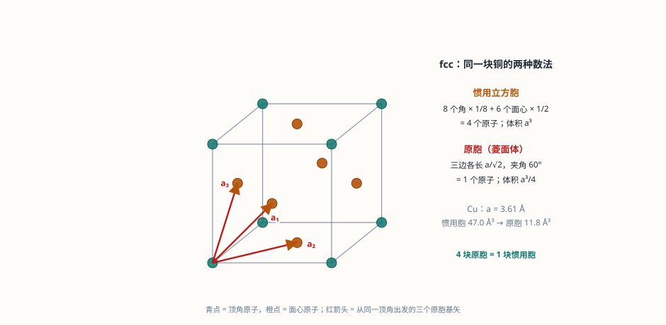
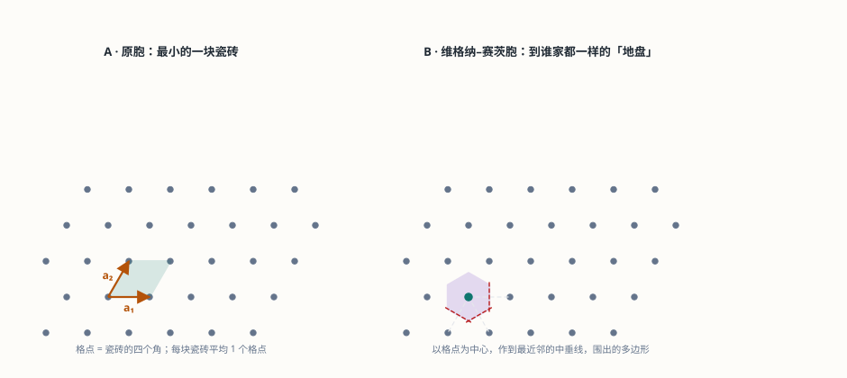

---
tags:
  - 物理
  - 固体物理
  - 晶体学
  - 晶格
  - 声子
关联:
  - "[法拉第电荷转移、晶格声子、电子-声子耦合与费米面](../化学/法拉第电荷转移、晶格声子、电子-声子耦合与费米面：一次电子换手的四层账本.md)"
  - "[香农采样定理与信息论](../电子、计算机和通信/香农采样定理与信息论：数字世界的两条底层定律.md)"
---

# 原胞与晶胞：同一块晶体，为什么有两套数法——格点、基元与布里渊区

> **根节点**：同一块铜，为什么既能说「一个立方胞里 4 个原子」，又能说「一个原胞里 1 个原子」？到底哪一个才是「重复单元」？如果原胞已经最小，晶胞为什么还存在、还更好用？

> **叙事逻辑**：晶格与格点（骨架）→ 基元（挂在格点上的东西）→ 原胞（最小瓷砖）→ 晶胞（便于看对称的整砖）→ 维格纳–赛茨胞（势力范围）→ 第一布里渊区（倒空间的同一件事）→ 四者对照与误读 → 接回声子与能带

> **立场说明**：几何定义、体积公式与晶体常数属于可查证内容；「该用哪一个」属于建模选择，本文按用途分别说明，不把某一种选择说成唯一正确；不同教材对「晶胞/单胞/惯用胞」的用词有差异，文中给出对照。

> **来源标注**：Bravais 1848 的 14 种点阵、Wigner–Seitz 1933 的对称胞、Brillouin 的倒空间分区；标准表述取 Kittel《固体物理导论》、Ashcroft–Mermin《固体物理》与国际晶体学表 A；整理于 2026-11-20。

## 知识树

```txt
根节点：同一块晶体，为什么原胞与晶胞的原子数不同？该用哪一个？
│
├── 一、晶格与格点（骨架）
│   ├── 14 种 Bravais 点阵
│   └── 格点是抽象位置，不是原子
│
├── 二、基元（挂在格点上的套餐）
│   ├── 晶体 = 晶格 + 基元
│   └── 蜂窝不是 Bravais 点阵，是三角点阵 + 2 原子基元
│
├── 三、原胞（最小瓷砖）
│   ├── 1 个格点，体积最小，形状不唯一
│   └── 原子数 p 可以 > 1 → 光学支 3(p−1)
│
├── 四、晶胞（惯用胞）
│   ├── 体积 = n × 原胞，格点数 = n
│   └── fcc：4 个原子；bcc：2 个原子
│
├── 五、维格纳–赛茨胞（势力范围）
│   ├── 到所有近邻的中垂面围成
│   └── 唯一、保持点群对称
│
├── 六、第一布里渊区（倒空间的同一件事）
│   ├── 倒空间中的 WS 原胞
│   └── 所有 q 与 q+G 等价 → 折叠
│
├── 七、四者对照与五种误读
│   └── 原胞≠只含一个原子；晶胞≠唯一
│
└── 八、接回：声子与能带为什么用原胞
    ├── 3 支声学 + 3(p−1) 支光学
    └── 用大胞只会折叠，不会更准
```

## 〇、锚点：先把量级摆出来

### 0.1 数字锚点

| 数字 | 含义 | 在本文中的作用 |
|---|---|---|
| **a(Cu) = 3.61 Å** | fcc 铜的立方晶胞边长 | 惯用胞与原胞的换算主角 |
| **11.8 ų** | Cu 每个原子占的体积（a³/4） | 与 Fe 的 11.8 ų 巧合一致 |
| **a(Fe,bcc) = 2.87 Å** | bcc 铁的立方晶胞边长 | bcc 惯用胞含 2 个原子 |
| **a(Si) = 5.43 Å** | 金刚石型硅的立方晶胞边长 | 惯用胞 8 个原子、原胞 2 个 |
| **a(NaCl) = 5.64 Å** | 岩盐结构的立方晶胞边长 | 惯用胞 8 个原子（4 个 NaCl） |
| **4 : 1** | fcc 惯用胞与原胞的原子数比 | 「同一块铜两种数法」的答案 |
| **3N** | N 个原子的总振动自由度数 | 声子分支数的上限 |

### 0.2 时间锚点

| 年份 | 事件 | 为什么值得记 |
|---|---|---|
| **1848** | Bravais 证明三维点阵只有 14 种 | 「格点」这一层与原子无关 |
| 1912–1913 | Laue 衍射、Bragg 父子解结构 | 晶胞从此可测 |
| **1930 前后** | Brillouin 提出倒空间的分区（布里渊区） | 周期性在倒空间的像 |
| **1933** | Wigner 与 Seitz 提出对称化原胞 | 「势力范围」式的唯一原胞 |

### 0.3 图示导览

| 图 | 位置 | 一句话 |
|---|---|---|
| 图 1 · 原胞与维格纳–赛茨胞 | §五 | 同一片点阵，左边取最小平行四边形，右边取「最近归谁」的多边形 |
| 图 2 · fcc 的惯用胞与原胞 | §四 | 立方胞 4 个原子，菱面体原胞 1 个原子，体积比 4:1 |

---

## 一、晶格与格点（Bravais Lattice）

**晶格（Bravais lattice）**是指==由三个基矢 $\mathbf a_1,\mathbf a_2,\mathbf a_3$ 的所有整数组合 $\mathbf R=n_1\mathbf a_1+n_2\mathbf a_2+n_3\mathbf a_3$ 构成的无限点阵；它只描述平移对称性，点上有没有原子、有几个原子，都不属于晶格本身的定义==。

> 🔗 **横向关联**：本词条的「格点是抽象位置」与 [法拉第电荷转移、晶格声子、电子-声子耦合与费米面](../化学/法拉第电荷转移、晶格声子、电子-声子耦合与费米面：一次电子换手的四层账本.md) §2.1 的「声子由波矢标记、没有位置」形成**同一层抽象**——格点不是原子，声子也不是小球；两者都是把「具体的一大堆原子」压缩成「周期性 + 少量参数」的语言。

### 一、核心要素与运作机制（Mechanism）

1. **三个基矢**：$\mathbf a_1,\mathbf a_2,\mathbf a_3$ 线性无关，张成一个平行六面体；所有格点是它们的整数组合。
2. **只有 14 种**：在三维中，按点群与中心化方式分类，Bravais 点阵恰好 14 种（7 个晶系 × 中心化方式）。
3. **格点无实体**：格点是一个位置标签；真正的原子由「基元」挂上去（下一节）。
4. **平移群**：把晶体平移任意格矢 $\mathbf R$，原子排布与自身完全重合——这是「晶体」的定义性对称性。

### 二、形象化解构：比喻与具体实例（Metaphor & Example）

* **形象比喻**：**剧院座位表**。座位表上画着一个个编号位置（格点），但座位表本身不是观众（原子）；同一个座位表，可以安排「一人一座」，也可以安排「一人加一个行李箱」（基元）。
* **具体实例**：Cu 的格点是 fcc：$\mathbf a_1=\frac a2(0,1,1)$、$\mathbf a_2=\frac a2(1,0,1)$、$\mathbf a_3=\frac a2(1,1,0)$，每个格点上挂 1 个 Cu 原子；NaCl 的格点**也是 fcc**，但每个格点上挂的是「Na 在原点 + Cl 在 $\frac a2(1,0,0)$」这一对——同一个骨架，不同的挂法。

### 三、多维度对比表格（Comparison）

「晶格」与「晶体结构」经常被当成同义词，其实一个是骨架、一个是骨架加装饰：

| 维度 | 晶格（Bravais lattice） | 晶体结构（crystal structure） |
|---|---|---|
| 内容 | 只有平移对称性 | 格点 + 基元（真实原子排布）|
| 是否含化学信息 | ❌ 不含元素、不含键 | ✅ 含元素、键长、配位 |
| 数量 | 三维只有 14 种 | 由 14 种 × 无数基元组合 |
| 例子 | fcc | Cu（fcc + 1 原子）、NaCl（fcc + 2 原子）、金刚石（fcc + 2 原子）|

**最关键的差异点**：**晶格回答「怎么重复」，结构回答「重复的是什么」**——同一套 fcc 骨架可以长出铜、食盐和金刚石三种完全不同的晶体。

### 💡 记忆锚点与口诀

- **核心拆解**：Bravais = 平移；基元 = 内容。
- **极简公式**：$\mathbf R=n_1\mathbf a_1+n_2\mathbf a_2+n_3\mathbf a_3$（$\mathbf R$ 格矢，$n_i$ 整数，$\mathbf a_i$ 基矢）。
- **记忆口诀**：**「点阵是座位表，原子是观众。」**

---

## 二、基元（Basis）

**基元（basis）**是指==挂在每一个格点上的那团原子（可以只有 1 个，也可以有很多个）；晶体结构 = 晶格 + 基元，同一个基元被复制到所有格点上，就得到整块晶体==。

> 🔗 **横向关联**：本词条的「格点 + 基元」与 [法拉第电荷转移、晶格声子、电子-声子耦合与费米面](../化学/法拉第电荷转移、晶格声子、电子-声子耦合与费米面：一次电子换手的四层账本.md) §2.1 的 **$p$（原胞内原子数）** 形成**直接上下游**——那里说光学支有 $3(p-1)$ 支，这里的 $p$ 就是基元里的原子数；基元是 1 个原子还是 2 个原子，直接决定晶体有没有光学声子。

### 一、核心要素与运作机制（Mechanism）

1. **基元用分数坐标给出**：以某个格点为原点，写出基元内每个原子的位置（如 NaCl：Na $(0,0,0)$、Cl $(\tfrac12,0,0)$）。
2. **复制规则**：把基元平移到每一个格矢 $\mathbf R$ 上，得到全部原子位置。
3. **同一个结构可以有多种「晶格 + 基元」写法**：NaCl 可以写成「fcc + 2 原子」，也可以写成「sc + 8 原子」；前者用的是**真正的平移群**，后者只是人为选了一个更小的子群。
4. **判据**：真正的 Bravais 点阵必须是「把晶体平移后与自身重合」的全部平移的集合——选大了会漏掉对称性，选小了会引入多余的基元原子。

### 二、形象化解构：比喻与具体实例（Metaphor & Example）

* **形象比喻**：**套餐**。格点是「每个餐位」，基元是「每个餐位上摆的那一套」（一杯一碟）。单点（1 个原子）和套餐（2 个原子）都可以，但套餐里各件的相对位置是固定的。
* **具体实例**：石墨烯的蜂窝不是 Bravais 点阵——它缺少把 A 子晶格映到 B 子晶格的平移。正确写法是**三角点阵 + 2 原子基元**（两个碳原子在 $(\tfrac13,\tfrac23)$ 与 $(\tfrac23,\tfrac13)$）。这也解释了为什么石墨烯的原胞里有 2 个原子、有 3 支声学 + 3 支光学支。

### 三、多维度对比表格（Comparison）

初学者常把「蜂窝」当成一种点阵，把「NaCl 的两个 fcc」当成两套独立点阵；把三种常见描述并排就能看清差别：

| 晶体 | 常见误写 | 正确写法（Bravais + 基元） | 原胞原子数 $p$ |
|---|---|---|---|
| 石墨烯 | 蜂窝点阵 | 三角点阵 + 2 原子基元 | 2 |
| NaCl | 两套 fcc 互相穿插 | fcc + 2 原子基元（Na、Cl） | 2 |
| 金刚石 | 两套 fcc 互相穿插 | fcc + 2 原子基元 | 2 |
| Cu | — | fcc + 1 原子基元 | 1 |

**最关键的差异点**：**「几套 fcc 互相穿插」是描述，不是点阵**；只有能单独承担全部平移对称性的那套格子才是 Bravais 点阵，其余的都只是基元的一部分。

### 💡 记忆锚点与口诀

- **核心拆解**：基元 = 一个格点上「挂什么、怎么摆」。
- **极简公式**：结构 = 晶格 $\{\mathbf R\}$ + 基元 $\{\mathbf r_i\}$。
- **记忆口诀**：**「座位表 + 套餐 = 晶体。」**

---

## 三、原胞（Primitive Cell）

**原胞（primitive cell）**是指==由三个基矢张成、体积最小、且能靠整数倍平移无缝隙无重叠铺满整块晶体的平行六面体；它平均只含 **1 个格点**，但含几个原子取决于基元（可以有多个）==。

> 🔗 **横向关联**：本词条的「原胞里 1 个格点、$p$ 个原子」与 [法拉第电荷转移、晶格声子、电子-声子耦合与费米面](../化学/法拉第电荷转移、晶格声子、电子-声子耦合与费米面：一次电子换手的四层账本.md) §2.1 的色散关系形成**因果链**——用原胞算声子，分支数正好是 $3$（声学）$+\,3(p-1)$（光学）；这也是那篇敢写「Cu 只有声学支」的原因。

### 一、核心要素与运作机制（Mechanism）

体积公式：

$$V_{\rm prim}=|\mathbf a_1\cdot(\mathbf a_2\times\mathbf a_3)|$$

- $V_{\rm prim}$：原胞体积，m³ 或 ų；
- $\mathbf a_1,\mathbf a_2,\mathbf a_3$：三个原胞基矢，m；
- $\mathbf a_2\times\mathbf a_3$：叉积，方向垂直于 $\mathbf a_2,\mathbf a_3$ 所在面；
- 点积取绝对值：保证体积为正。

三条性质：

1. **格点数 = 1**（按「角共享」计数：8 个角 × 1/8 = 1）。
2. **形状不唯一**：只要体积最小、由三个基矢张成，选哪种斜法都行；维格纳–赛茨胞是其中最对称的一种。
3. **原子数 $p$ 可大于 1**：格点只有 1 个，但基元可以挂多个原子（NaCl、Si、石墨烯都是 $p=2$）。

### 二、形象化解构：比喻与具体实例（Metaphor & Example）

* **形象比喻**：**最小的瓷砖**。同一面墙可以用 10×10 cm 的小砖铺，也可以用 20×20 cm 的大砖铺；原胞就是那块「面积最小、还能无缝铺满」的砖。至于砖面上印几个图案（原子），是另一回事。
* **具体实例**：Cu 的惯用立方胞边长 3.61 Å、含 4 个原子；原胞是边长 $a/\sqrt2=2.55$ Å、夹角 60° 的菱面体，体积 $a^3/4=11.8$ ų，只含 1 个原子。**每个原子的体积都是 11.8 ų**——这才是材料常数，与你怎么选胞无关。

### 三、多维度对比表格（Comparison）

原胞与惯用胞（下一节）是本文的主角，先把最容易被忽略的三处差异列出来：

| 维度 | 原胞（primitive） | 惯用胞（conventional） |
|---|---|---|
| 体积 | 最小 | $n\times V_{\rm prim}$（$n=1,2,4,\dots$）|
| 格点数 | 恒为 1 | $n$ |
| 原子数 | $p$（可为 1、2、8…）| $n\times p$ |
| 形状是否唯一 | ❌ 不唯一（体积定死，形状可斜）| 通常取立方/六方等 |
| 用途 | 声子、能带、DFT 计算 | 报晶体常数、看对称性、画图 |

**最关键的差异点**：**原胞管「最小」，晶胞管「好看」**——两者体积永远是整数倍关系，原子数也按同一倍数放大，所以不存在「哪个更真」的问题。

### 💡 记忆锚点与口诀

- **核心拆解**：原胞 = 1 个格点 + $p$ 个原子。
- **极简公式**：$V_{\rm prim}=|\mathbf a_1\cdot(\mathbf a_2\times\mathbf a_3)|$；$N_{\rm cell}=V_{\rm conv}/V_{\rm prim}$。
- **记忆口诀**：**「原胞是最小瓷砖，原子数另算。」**

---

## 四、晶胞（Conventional Cell / Unit Cell）

**晶胞（conventional cell，也叫惯用胞、单胞）**是指==为了显示立方、六方等点群对称性而选用的较大重复单元；它的体积是原胞的整数倍 $n$，含 $n$ 个格点，因此原子数是原胞的 $n$ 倍==。

> 🔗 **横向关联**：本词条的「惯用胞只是放大，不改物理」与 [法拉第电荷转移、晶格声子、电子-声子耦合与费米面](../化学/法拉第电荷转移、晶格声子、电子-声子耦合与费米面：一次电子换手的四层账本.md) §2.3 的「金属没有光学支」形成**限定关系**——那篇的结论只在原胞口径下成立；若拿惯用立方胞去算 bcc 金属，会看到折叠出来的假光学支。

### 一、核心要素与运作机制（Mechanism）

1. **体积关系**：$V_{\rm conv}=n\,V_{\rm prim}$，$n$ 就是惯用胞里的格点数（fcc：4；bcc：2；sc：1）。
2. **原子计数规则**：角 1/8、棱 1/4、面 1/2、体内 1。
3. **为什么叫「惯用」**：立方胞的 90° 角和四重轴一眼可见；用菱面体原胞反而看不出立方对称。
4. **同一结构可有多种合法晶胞**：选哪个取决于你要展示什么对称性；晶体学数据库通常给惯用胞 + 分数坐标。

> 📌 **fcc（face-centered cubic，面心立方）**：立方惯用胞的 **8 个顶角 + 6 个面心**各有一个格点；每胞原子数 $8\times\frac18+6\times\frac12=4$，配位数 12，堆积率 74%，最近邻距离 $a/\sqrt2$；原胞是菱面体（1 个原子，体积 $a^3/4$）。Cu、Ag、Au、Al、Ni、Pt、Pb 与高温奥氏体 $\gamma$-Fe 都是 fcc。

三种最常见的金属结构放在一起看，差别只有「原子怎么堆」：

| 结构 | 每惯用胞原子数 | 配位数 | 堆积率 | 最近邻距离 | 典型金属 |
|---|---|---|---|---|---|
| **fcc**（面心立方）| 4 | 12 | 74% | $a/\sqrt2$ | Cu、Al、Ni、Pt、Pb、$\gamma$-Fe |
| **bcc**（体心立方）| 2 | 8 | 68% | $\sqrt3a/2$ | $\alpha$-Fe、Cr、W、Mo |
| **hcp**（六方最密）| 6 | 12 | 74% | $a$ | Mg、Zn、Ti、Co |



### 二、形象化解构：比喻与具体实例（Metaphor & Example）

* **形象比喻**：**装修用的整砖**。小瓷砖（原胞）铺得满，但看图案要蹲下来数；整砖（惯用胞）由 4 块小砖拼成，花纹对齐、一眼看出对称性。**整砖不是更「真」，只是更好看。**
* **具体实例**：Si 的惯用立方胞含 8 个原子（8 个角 + 6 个面心 + 4 个体内），原胞是菱面体、含 2 个原子，体积 $a^3/4=40.0$ ų。论文里报「Si 的晶格常数 5.43 Å」用的是惯用胞；算声子时用 2 原子原胞，分支数才是 6 支（3 声学 + 3 光学）。

### 三、多维度对比表格（Comparison）

四种常见晶体在两套口径下的数字，直接对照最不容易记错：

| 晶体 | 结构 | 惯用胞原子数 | 原胞原子数 | 惯用胞体积 / 原胞体积 |
|---|---|---|---|---|
| Cu | fcc | 4 | 1 | 4 : 1 |
| Fe | bcc | 2 | 1 | 2 : 1 |
| Si / 金刚石 | 金刚石型 | 8 | 2 | 4 : 1 |
| NaCl | 岩盐 | 8（4 个 NaCl）| 2（1 个 NaCl）| 4 : 1 |

**最关键的差异点**：**「原子数」不是材料的固有标签，而是「你选了多大的盒子」的函数**；材料真正的固有量是**每个原子占的体积**（Cu 11.8 ų）与**每个原胞的原子数 $p$**。

### 💡 记忆锚点与口诀

- **核心拆解**：惯用胞 = 原胞 × $n$；$n$ 就是格点数。
- **极简公式**：$N_{\rm atoms}=n\,p$；计数 1/8、1/4、1/2、1。
- **记忆口诀**：**「fcc 四、bcc 二、sc 一。」**

---

## 五、维格纳–赛茨胞（Wigner–Seitz Cell）

**维格纳–赛茨胞**是指==以一个格点为中心、作它到所有其他格点连线的中垂面，所围出的最小多面体；它把空间划分成「离哪个格点最近就归谁」的区域，是一种形状唯一、且完全保留点群对称性的特殊原胞==。

> 🔗 **横向关联**：本词条的「中垂面围出的最小多面体」与 [香农采样定理与信息论](../电子、计算机和通信/香农采样定理与信息论：数字世界的两条底层定律.md) 中的**最近邻判决**形成**同构关系**——两者都在回答「这个点该归谁」：采样定理按最近的采样点重建信号，WS 胞按最近的格点划分空间。**一个是信号的地盘，一个是格点的地盘。**

### 一、核心要素与运作机制（Mechanism）

1. **构造**：取格点 $O$，对每个近邻 $\mathbf R$ 作垂直平分面，取所有「靠近 $O$ 的一侧」的交集。
2. **性质**：体积等于原胞体积；形状唯一；保持点群对称性；边界属于两个格点「等距」。
3. **常见形状**：sc → 立方；bcc → 截角八面体；fcc → 菱形十二面体；二维三角点阵 → 正六边形（图 1 右）。
4. **用途**：能带与声子的积分区域、紧束缚近似、以及第一布里渊区的定义模板。

### 二、形象化解构：比喻与具体实例（Metaphor & Example）

* **形象比喻**：**外卖服务区**。每个格点是一家店，骑手按「离哪家近」接单；把每条街都判给最近的店，划出来的边界就是 WS 胞——边界上的地址两家距离相等，属于「共同配送区」。
* **具体实例**：二维三角点阵（图 1）里，最近邻距离为 $a$，WS 胞是正六边形，内切半径 $a/2$、外接半径 $a/\sqrt3$；面积恰等于一个原胞（$\sqrt3 a^2/2$）。它的六个边分别垂直于六个最近邻方向。



### 三、多维度对比表格（Comparison）

原胞有无数种形状，WS 胞只有一种；拿它和「随手画的平行四边形」比，差别在对称性与唯一性：

| 维度 | 普通原胞（平行四边形/菱面体） | 维格纳–赛茨胞 |
|---|---|---|
| 体积 | 最小 | 最小（相同）|
| 形状 | 不唯一 | ✅ 唯一 |
| 对称性 | 一般不显点群 | ✅ 完全保留点群 |
| 边界含义 | 无 | 到两格点等距 |
| 典型形状 | 斜平行六面体 | 立方 / 截角八面体 / 菱形十二面体 / 六边形 |

**最关键的差异点**：**所有原胞体积相同，只有 WS 胞把「对称性」也一起保住**——这也是为什么能带图总是画在布里渊区（WS 胞的倒空间版）里。

### 💡 记忆锚点与口诀

- **核心拆解**：WS 胞 = 「最近归谁」的地盘。
- **极简公式**：体积 = 原胞体积；边界 = 中垂面。
- **记忆口诀**：**「离谁近，归谁管。」**

---

## 六、第一布里渊区（First Brillouin Zone）

**第一布里渊区**是指==倒空间（波矢空间）中的维格纳–赛茨原胞：以 $\mathbf q=0$ 为中心，作到所有倒格矢的中垂面，围出的最小区域；所有等价的波矢都可通过减去倒格矢 $\mathbf G$ 折回这一区域内==。

> 🔗 **横向关联**：本词条的「把 $q$ 折回 $[-\pi/a,\pi/a]$」与 [法拉第电荷转移、晶格声子、电子-声子耦合与费米面](../化学/法拉第电荷转移、晶格声子、电子-声子耦合与费米面：一次电子换手的四层账本.md) §2.1 的「$q$ 与 $q+2\pi/a$ 给出同一列位移」形成**同一件事的两种说法**——正空间的「最小瓷砖」到了倒空间就是布里渊区；那篇的 $\Gamma\to X$ 只是这个六边形（一维时是线段）的一条半径。

### 一、核心要素与运作机制（Mechanism）

1. **倒格矢**：$\mathbf G=m_1\mathbf b_1+m_2\mathbf b_2+m_3\mathbf b_3$，其中 $\mathbf b_i$ 满足 $\mathbf a_i\cdot\mathbf b_j=2\pi\delta_{ij}$（$\delta_{ij}$ 为克罗内克符号）。
2. **体积**：$V_{\rm BZ}=(2\pi)^3/V_{\rm prim}$（$V_{\rm prim}$ 为正空间原胞体积）。
3. **等价性**：$\mathbf q$ 与 $\mathbf q+\mathbf G$ 描述同一列波（晶格分不清），所以只需在 BZ 内取值。
4. **高对称点**：$\Gamma$（中心）、$X$、$L$、$K$ 等；能带图与声子谱的横轴就是沿这些点的路径。

### 二、形象化解构：比喻与具体实例（Metaphor & Example）

* **形象比喻**：**把无限长的琴键折成一圈十二平均律**。超出八度的音，听觉上与低八度「同名」；把所有音折回一个八度，就是布里渊区。**不是信息丢了，而是重复的部分不必再画。**
* **具体实例**：一维链 $a=3$ Å，BZ 是 $[-\pi/a,\pi/a]=[-1.05,1.05]$ Å⁻¹；若算出的 $q=1.4$ Å⁻¹，减去 $2\pi/a=2.09$ Å⁻¹ 得 $q'=-0.69$ Å⁻¹，落在 BZ 内——这就是「折叠」。声子色散 $\omega=2\omega_0|\sin(qa/2)|$ 在扩展区是周期函数，折进 BZ 后就成了图 2 那条从 0 出发的曲线。

### 三、多维度对比表格（Comparison）

正空间与倒空间的四个概念一一对应，记住这张表就不会把「原胞」和「布里渊区」混为一谈：

| 正空间 | 倒空间 | 关系 |
|---|---|---|
| 晶格（格点）| 倒格点 | 傅里叶对偶 |
| 基矢 $\mathbf a_i$ | 倒基矢 $\mathbf b_i$ | $\mathbf a_i\cdot\mathbf b_j=2\pi\delta_{ij}$ |
| 原胞（体积 $V$）| 第一布里渊区（体积 $(2\pi)^3/V$）| 互为 WS 胞 |
| 晶胞（$n$ 倍）| 折叠后的 BZ（$1/n$ 大小）| 大胞 ↔ 小 BZ |

**最关键的差异点**：**原胞越大，布里渊区越小**——这正是超胞方法（supercell）里「用大胞算，能带被折叠」的几何原因。

### 💡 记忆锚点与口诀

- **核心拆解**：BZ = 倒空间的 WS 胞；$q$ 与 $q+G$ 等价。
- **极简公式**：$V_{\rm BZ}=(2\pi)^3/V_{\rm prim}$；$\mathbf a_i\cdot\mathbf b_j=2\pi\delta_{ij}$。
- **记忆口诀**：**「正空间选瓷砖，倒空间折琴键。」**

---

## 七、四者对照与五种误读

### 7.1 一张总表

| 概念 | 在哪个空间 | 是否最小 | 格点数 | 原子数 | 形状唯一 | 主要用途 |
|---|---|---|---|---|---|---|
| 晶格（格点）| 正空间 | — | — | 0（抽象）| — | 平移对称性 |
| 基元 | 正空间 | — | — | $p$ | — | 每个格点挂什么 |
| 原胞 | 正空间 | ✅ | 1 | $p$ | ❌ | 声子、能带、DFT |
| 晶胞（惯用胞）| 正空间 | ❌（$n$ 倍）| $n$ | $n p$ | 通常取高对称 | 报常数、看对称 |
| WS 胞 | 正空间 | ✅ | 1 | $p$ | ✅ | 对称性分析、BZ 模板 |
| 第一布里渊区 | 倒空间 | ✅ | 1 | — | ✅ | 色散图、积分区域 |

### 7.2 五种误读

| # | 误读 | 为什么错 | 正确说法 |
|---|---|---|---|
| 1 | 「原胞里只有一个原子」 | 只有**格点**是 1 个；基元可以挂多个原子 | NaCl、Si、石墨烯的原胞都含 2 个原子 |
| 2 | 「原胞形状是唯一的」 | 体积最小即可，斜法可无数种 | 唯一的是 WS 胞，不是所有原胞 |
| 3 | 「晶胞就是原胞」 | 晶胞常指惯用胞，体积是整数倍 | fcc：惯用胞 4 个原子，原胞 1 个 |
| 4 | 「蜂窝是 Bravais 点阵」 | 蜂窝缺少 A↔B 的平移 | 三角点阵 + 2 原子基元 |
| 5 | 「用大胞算声子/能带更准」 | 大胞只会把谱线折叠，不增加信息 | 用原胞最干净；大胞只在建模超晶格时故意用 |

**最关键的差异点**：**「原子数」随盒子大小变，「每原子体积」和「$p$」不随盒子变**——判断一个数是材料常数还是记账口径，就看它会不会因为你换了胞而改变。

---

## 八、接回：声子与能带为什么用原胞

1. **分支数**：$N$ 个原子 → $3N$ 个自由度。按原胞计，每个波矢有 $3$ 支声学 + $3(p-1)$ 支光学；若把 $n$ 个原胞拼成一个惯用胞，分支数变成 $n$ 倍，多出来的只是折叠，不是新物理。
2. **例子**：bcc 金属（$p=1$）只有 3 支声学；用含 2 个原子的立方惯用胞去算，会得到 6 支，其中 3 支是折叠支。fcc 用立方胞则会折叠出 4 倍。
3. **能带同理**：能带数 = 原胞内原子轨道数 × 自旋；用大胞算，能带被折进更小的 BZ，看起来「变多」，其实信息量没变。
4. **超胞的合法用途**：掺杂质、建界面、算缺陷时，故意用大胞把局域扰动装进去；这时折叠是**代价**，不是错误——只要你知道自己在做什么。

> 🔗 **横向关联**：本节与 [法拉第电荷转移、晶格声子、电子-声子耦合与费米面](../化学/法拉第电荷转移、晶格声子、电子-声子耦合与费米面：一次电子换手的四层账本.md) §2.3 的「金属没有光学支」是同一句话的展开——**$p=1$ 时 $3(p-1)=0$**，不是「金属的光学支很弱」，而是根本没有。

### 三句话收束

1. **晶格管重复，基元管内容**：14 种点阵 × 任意基元 = 所有晶体。
2. **原胞最小、晶胞好看、WS 胞对称**：三者体积只差整数倍，物理完全等价。
3. **倒空间是正空间的傅里叶像**：原胞越大，布里渊区越小；折叠不会创造新信息。

## 索引表

| # | 概念 | 英文/缩写 | 类型 | 所属维度 | 横向关联 | 关键数字/口诀 | 重要性 |
|---|---|---|---|---|---|---|---|
| 1 | 晶格（Bravais 点阵）| Bravais lattice | 概念 | 一 | [法拉第…声子](../化学/法拉第电荷转移、晶格声子、电子-声子耦合与费米面：一次电子换手的四层账本.md) §2 | 14 种；格矢 $\mathbf R$ | ⭐⭐⭐⭐⭐ |
| 2 | 基矢 | basis vectors | 参数 | 一 | — | $\mathbf a_1,\mathbf a_2,\mathbf a_3$ | ⭐⭐⭐⭐ |
| 3 | 格点 | lattice point | 概念 | 一 | — | 抽象位置，不是原子 | ⭐⭐⭐⭐⭐ |
| 4 | 基元 | basis | 概念 | 二 | [法拉第…声子](../化学/法拉第电荷转移、晶格声子、电子-声子耦合与费米面：一次电子换手的四层账本.md) §2 | 每个格点挂什么 | ⭐⭐⭐⭐⭐ |
| 5 | 原胞 | primitive cell | 概念 | 三 | [法拉第…声子](../化学/法拉第电荷转移、晶格声子、电子-声子耦合与费米面：一次电子换手的四层账本.md) §2.1 | 1 格点 + $p$ 原子 | ⭐⭐⭐⭐⭐ |
| 6 | 原胞体积 | $V_{\rm prim}$ | 公式 | 三 | — | $|\mathbf a_1\cdot(\mathbf a_2\times\mathbf a_3)|$ | ⭐⭐⭐⭐ |
| 7 | 晶胞（惯用胞）| conventional cell | 概念 | 四 | — | 体积 $n$ 倍；fcc 4、bcc 2 | ⭐⭐⭐⭐⭐ |
| 8 | 原子计数规则 | site counting | 方法 | 四 | — | 角 1/8、棱 1/4、面 1/2、体 1 | ⭐⭐⭐⭐ |
| 9 | fcc 立方胞 4 原子 | fcc | 数字 | 四 | — | 8×1/8 + 6×1/2 | ⭐⭐⭐⭐⭐ |
| 10 | bcc 立方胞 2 原子 | bcc | 数字 | 四 | — | 8×1/8 + 1 | ⭐⭐⭐⭐ |
| 11 | 每原子体积 | atomic volume | 参数 | 四 | — | Cu 11.8 ų | ⭐⭐⭐⭐ |
| 12 | 维格纳–赛茨胞 | Wigner–Seitz cell | 概念 | 五 | [香农采样](../电子、计算机和通信/香农采样定理与信息论：数字世界的两条底层定律.md) | 「离谁近归谁」 | ⭐⭐⭐⭐ |
| 13 | 中垂面构造 | perpendicular bisector | 方法 | 五 | — | 到两格点等距 | ⭐⭐⭐ |
| 14 | 第一布里渊区 | first Brillouin zone | 概念 | 六 | [香农采样](../电子、计算机和通信/香农采样定理与信息论：数字世界的两条底层定律.md) | 倒空间的 WS 胞 | ⭐⭐⭐⭐⭐ |
| 15 | 倒格矢 | reciprocal lattice vector | 概念 | 六 | — | $\mathbf a_i\cdot\mathbf b_j=2\pi\delta_{ij}$ | ⭐⭐⭐⭐ |
| 16 | BZ 体积 | $V_{\rm BZ}$ | 公式 | 六 | — | $(2\pi)^3/V_{\rm prim}$ | ⭐⭐⭐ |
| 17 | 折叠 | zone folding | 现象 | 六/八 | — | $q$ 与 $q+G$ 等价 | ⭐⭐⭐⭐ |
| 18 | 声子分支数 | $3$ 声学 $+\,3(p-1)$ 光学 | 公式 | 八 | [法拉第…声子](../化学/法拉第电荷转移、晶格声子、电子-声子耦合与费米面：一次电子换手的四层账本.md) §2.1 | $p=1$ 无光学支 | ⭐⭐⭐⭐⭐ |
| 19 | 超胞 | supercell | 方法 | 八 | — | 故意折叠，装缺陷 | ⭐⭐⭐ |

## 参考来源

1. Bravais, A.：〈Mémoire sur les systèmes formés par des points distribués régulièrement sur un plan ou dans l'espace〉，*J. École Polytech.* 19（1850）：1–128（1848 年提交；14 种点阵）。
2. Wigner, E. & Seitz, F.：〈On the constitution of metallic sodium〉，*Phys. Rev.* 43（1933）：804–810（对称化原胞）。
3. Kittel, C.：*Introduction to Solid State Physics*，8th ed.，Wiley，2005（第 1–2 章：晶体结构、倒格子、布里渊区）。
4. Ashcroft, N. W. & Mermin, N. D.：*Solid State Physics*，Holt–Saunders，1976（第 4–5 章、第 22 章）。
5. *International Tables for Crystallography*, Vol. A：Space-Group Symmetry（惯用胞与分数坐标的标准来源）。
6. 用户本地笔记：[法拉第电荷转移、晶格声子、电子-声子耦合与费米面](../化学/法拉第电荷转移、晶格声子、电子-声子耦合与费米面：一次电子换手的四层账本.md)、[香农采样定理与信息论](../电子、计算机和通信/香农采样定理与信息论：数字世界的两条底层定律.md)（库内互证材料）。

## 待核实

1. Brillouin 提出「布里渊区」的精确年份与原始文献（通常记为 1930 年前后，卷期待查）。
2. Bravais  memoir 的提交年份（1848）与发表年份（1850）在不同教材中写法不一，本文并列给出。
3. 石墨烯「三角点阵 + 2 原子基元」的分数坐标与晶格常数（2.46 Å）取常用值，未逐一核对原始文献。
4. Si 与金刚石的惯用胞体积 $a^3/4$ 与每原子体积，随同位素与温度略有差异，本文取室温值。
5. 二维三角点阵 WS 胞的面积 $\sqrt3a^2/2$ 与内切/外接半径，按最近邻距离 $a$ 定义；若改用晶格常数定义，数值差 $\sqrt3$ 倍。
