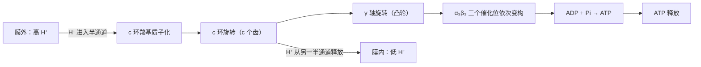
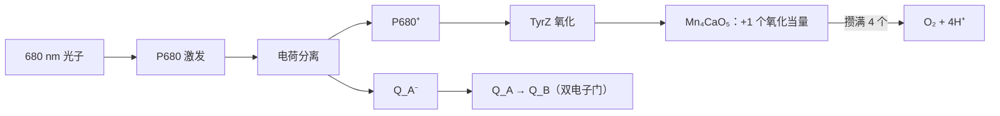
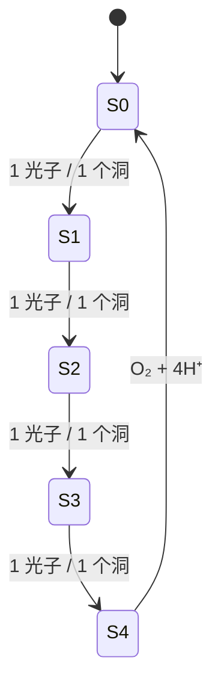

---
tags:
  - 生物学
  - 生物化学
  - 生物能学
  - 分子马达
  - 光合作用
  - ATP合酶
  - 放氧中心
关联:
  - "[化学渗透理论](化学渗透理论.md)"
  - "[分子马达蛋白——类型与作用原理](分子马达蛋白——类型与作用原理.md)"
  - "[辅因子：金属离子、维生素衍生物与酶的化学外挂](辅因子：金属离子、维生素衍生物与酶的化学外挂.md)"
  - "[Nernst方程：59 mV 的来历、三种写法与它失效的四道边界](../化学/Nernst方程：59 mV 的来历、三种写法与它失效的四道边界.md)"
  - "[水与膜上的自发电位：从冻结电势到化学渗透——电荷分离的三种手法与三层膜电位](../化学/水与膜上的自发电位：从冻结电势到化学渗透——电荷分离的三种手法与三层膜电位.md)"
  - "[醌类：芳香性的赎金——呼吸链的心脏、染料母体与药毒同源的弹头](../化学/醌类：芳香性的赎金——呼吸链的心脏、染料母体与药毒同源的弹头.md)"
  - "[赝电容：一条 Nernst 曲线如何冒充电容——机制、判据与「假电容」的边界](../化学/赝电容：一条 Nernst 曲线如何冒充电容——机制、判据与「假电容」的边界.md)"
---

# 攒能量：ATP 合酶的分子变速箱与光系统 II 放氧中心

> **根节点**：把几份「零钱」攒成一张「整钞」，物理上到底需要什么？ATP 合酶用约 3 个质子的自由能合成 1 个 ATP，Mn₄CaO₅ 用 4 个光子的氧化当量放出 1 个 O₂——这两台机器共享哪几条工程原理？为什么一张炭黑膜学不会？
>
> **叙事逻辑**：能量面值（eV / kJ/mol / kT 同一把尺） → 攒能量的四个条件 → ATP 合酶的结构 → 齿轮比与结合变化 → 收支与可逆性 → 放氧中心的四个障碍 → Kok 循环 → O–O 成键 → 两台机器的同构 → 炭黑膜为什么不行 → 收束
>
> **立场说明**：本文把教科书层面的机制共识标为 ✅；把有实验支撑但细节仍在争论的模型标为 ⚠️；把用于跨领域类比的推论标为「分析」。所有能量换算注明温度与 pH 条件；1.23 V（pH 0）与 0.82 V（pH 7）两个口径不混用。
>
> **来源标注**：Lehninger《Principles of Biochemistry》、Stryer《Biochemistry》、Blankenship《Molecular Mechanisms of Photosynthesis》，以及 Abrahams et al. 1994、Boyer 1997、Umena et al. 2011、Suga et al. 2015/2019、Kern et al. 2018 等原始文献；库内 [化学渗透理论](化学渗透理论.md)、[Nernst 方程](../化学/Nernst方程：59 mV 的来历、三种写法与它失效的四道边界.md)、[水与膜上的自发电位](../化学/水与膜上的自发电位：从冻结电势到化学渗透——电荷分离的三种手法与三层膜电位.md)、[醌类](../化学/醌类：芳香性的赎金——呼吸链的心脏、染料母体与药毒同源的弹头.md) 已做交叉核对。整理时间：2026-11-19。

## 知识树

```txt
根节点：把零散的输入攒成一个化学键，物理上需要什么？
│
├── 〇、锚点：把 eV、kJ/mol、kT 放到同一把尺子上
│   ├── 数字锚点（1 eV = 96.485 kJ/mol；kT = 25.7 meV；ATP 50–60 kJ/mol）
│   └── 时间锚点（1961 Mitchell → 1994 F1 结构 → 2011 PSII 1.9 Å → 2018 S3 结构）
│
├── 一、先算账：为什么「攒」是必需的
│   ├── 三种输入的面值：质子 7 kT、光子 71 kT、水氧化 48 kT/电子
│   ├── 两种产物的标价：ATP 50–60 kJ/mol、O₂ 3.3–4.9 eV
│   └── 热涨落：1.82 eV ≈ 70 kT——「70 个水分子」这个数的真正来历
│
├── 二、攒能量的四个条件
│   ├── 定向输入（非平衡）
│   ├── 单向阀（棘轮）
│   ├── 固定汇率（化学计量）
│   └── 亚稳中间态（动力学绝缘）
│
├── 三、ATP 合酶：一台真正的分子变速箱
│   ├── Fo 与 F1：转子、定子、凸轮轴
│   ├── 两个半通道：质子不能「穿过去」，只能「搭车」
│   ├── c 环齿数：8–15 个亚基决定汇率
│   └── 结合变化机制：能量花在「松手」上
│
├── 四、ATP 合酶的收支：8 个质子够不够
│   ├── 力矩算术：40–50 pN·nm
│   ├── 8 H⁺ × 17–19 kJ vs 3 ATP × 50 kJ
│   └── 可逆性：同一台机器也能水解 ATP 泵质子
│
├── 五、放氧中心：四个障碍
│   ├── 热力学：1.23 V（pH 0）/ 0.82 V（pH 7）
│   ├── 动力学：O–O 成键的活化能
│   ├── 计量：四电子反应 vs 单光子单电子
│   └── 选择性：水多但惰性
│
├── 六、Kok 循环：四个氧化当量的蓄水池
│   ├── S0–S4：每个光子加一个「洞」
│   ├── 价态记账：Mn(III)/Mn(IV) 阶梯
│   ├── 最后一个洞存在配体上
│   └── 质子释放 1:0:1:2
│
├── 七、O–O 成键：两条模型与 Ca²⁺ 的角色
│   ├── 亲核攻击模型
│   ├── 自由基耦合模型
│   └── 为什么「埋得深」是优点
│
├── 八、两台机器的同构
│   ├── 八维对照表
│   ├── 五条共同工程原理
│   └── 与电容器的区别：电压 ≠ 能量
│
├── 九、反例：为什么一张炭黑膜做不到
│   ├── 水伏给的是电位，不是化学自由能
│   ├── 炭黑膜的五个缺失
│   ├── 「70 个水分子」的口径校正
│   └── 生物学旁证的正确读法
│
└── 十、收束：归因、延伸与个体坐标
    ├── 归因：四个条件缺一不可
    ├── 延伸：人工水氧化与分子机器
    └── 个体坐标：读「发电/制氢」新闻的五个问题
```

## 〇、锚点：把 eV、kJ/mol、kT 放到同一把尺子上

### 0.1 数字锚点

先看二十个数——它们覆盖了全文所有量级，后面的换算都从这里取。

| 项 | 数值 | 为什么记它 |
|---|---|---|
| 1 eV 每分子 | 96.485 kJ/mol | 全文所有能量换算的汇率 |
| 室温热涨落 $kT$（25 ℃） | 25.7 meV = 2.48 kJ/mol | 判断「一份能量」能不能被热噪声淹没 |
| 1.23 eV | 118.6 kJ/mol = 47.9 $kT$ | 从水里拿走一个电子的热力学标价（pH 0） |
| 680 nm 光子 | 1.82 eV = 175.6 kJ/mol = 70.8 $kT$ | 光系统 II 每步支付的「光子面值」 |
| 水的汽化热（25 ℃） | 44.0 kJ/mol = 0.456 eV = 17.8 $kT$ | 「70 个水分子」这个数的校准尺 |
| ATP 水解 $\Delta G^\circ{}'$ | −30.5 kJ/mol | 标准状态下的「标价」 |
| ATP 水解 $\Delta G$（细胞内） | −50 至 −60 kJ/mol | 真实细胞里的「成交价」 |
| 质子动力势 $\Delta p$ | 150–200 mV | 线粒体与细菌的能量货币面值 |
| 1 个质子过膜 | $F\Delta p$ = 14.5–19.3 kJ/mol | 单份质子的「面值」 |
| 哺乳动物 c 环 | 8 个亚基 | 齿轮比的分母 |
| 合成汇率 | 2.67 H⁺/ATP | $c/3$ |
| 细胞总账 | 约 4 H⁺/ATP | 加上磷酸与腺苷酸转运 |
| F1 力矩 | 约 40–50 pN·nm / 120° | 分子变速箱的「扭矩」 |
| P680/P680⁺ | 约 +1.2 至 +1.3 V | 生物学里最强的氧化剂之一 |
| 水氧化 $E^\circ$ | +1.23 V（pH 0） | 四电子反应的标价 |
| 水氧化 $E^\circ{}'$ | +0.82 V（pH 7） | 细胞内真实标价 |
| O₂ 热力学最低 | 4.92 eV（pH 0）/ 3.28 eV（pH 7） | 四个电子一起走的总价 |
| PSII 量子需求 | 4 光子 / O₂ | 四步蓄能 |
| OEC 核心 | Mn₄CaO₅ | 四个锰、一个钙、五个氧 |
| 水伏开路电压 | 0.1–1 V，短路电流 nA–μA | 反例的量级 |

**收束句**：这张表只做一件事——把「eV」「kJ/mol」「kT」三种语言并排放在一起。**读不懂能量，往往不是公式难，而是单位没有对齐。**

### 0.2 时间锚点

再看九个时间点——它们标记了机制被确认的节点，而不是人物生卒年。

| 时间 | 事件 | 为什么值得记 |
|---|---|---|
| 1961 | Mitchell 提出化学渗透假说 | 把「膜电位」变成生物能量学的通用语言 |
| 1969–1970 | Joliot 与 Kok 提出 S 态循环 | 放氧被写成「四步蓄能」 |
| 1978 | Mitchell 获诺贝尔化学奖 | 化学渗透从异端变成教科书 |
| 1994 | Abrahams 等解出 F1-ATPase 2.8 Å 结构 | 分子变速箱第一次有了零件图 |
| 1997 | Boyer 与 Walker 获诺贝尔化学奖 | 结合变化机制与旋转催化被确认 |
| 2011 | Umena 等解出 PSII 1.9 Å 结构 | Mn₄CaO₅ 的几何第一次看清 |
| 2015 | Suga 等用 XFEL 解出 PSII 1.95 Å 天然结构 | XFEL 让「无辐射损伤」的结构成为可能 |
| 2018 | Kern 等解出 Kok 循环的多个中间态 | 四步循环有了时间分辨的结构证据 |
| 2019 | Suga 等提出 oxyl/oxo 耦合机制 | O–O 成键的候选答案 |

**收束句**：这条时间线只说明一件事——**「攒能量」的机制不是靠猜出来的，而是一步步被结构生物学和单分子实验逼出来的。**

### 0.3 三条换算，够用全文

$$1\ \mathrm{eV} = 96.485\ \mathrm{kJ/mol}$$

- **$1\ \mathrm{eV}$**：一个电子经 1 V 电势差获得的能量；
- **$96.485\ \mathrm{kJ/mol}$**：乘上阿伏伽德罗常数后的宏观量；
- **用法**：把「每分子」变成「每摩尔」，才能和 ATP 的 kJ/mol 比较。

$$kT(25^\circ\mathrm{C}) = 25.7\ \mathrm{meV} = 2.48\ \mathrm{kJ/mol}$$

- **$k$**：玻尔兹曼常数；
- **$T$**：绝对温度；
- **用法**：把任何能量除以 $kT$，就得到「相当于几份热涨落」。

$$\frac{1.82\ \mathrm{eV}}{kT} \approx 70.8$$

- **1.82 eV**：680 nm 光子的能量；
- **70.8**：这就是「70 个水分子」这个数字的真正来源（见 §9.3）。

**收束句**：把这三条记住，后面所有「几个质子」「几个光子」「几个水分子」的换算都不需要再查表。

## 一、先算账：为什么「攒」是必需的

### 1.1 三种输入的面值都很小

先看四种输入的单份面值——单位不同，先统一成 kJ/mol 与 $kT$。

| 输入 | 单份能量 | 条件 | 相当于多少 $kT$ | 备注 |
|---|---|---|---|---|
| 质子过 ATP 合酶 | 17.4 kJ/mol | $\Delta p=180$ mV | 7.0 | 单份只够「零钱」 |
| 680 nm 光子 | 1.82 eV = 175.6 kJ/mol | 25 ℃ | 70.8 | 单份很大，但一次只推一个电子 |
| 水氧化（每电子） | 1.23 eV = 118.6 kJ/mol | pH 0 | 47.9 | pH 7 时降到 0.82 eV |
| ATP 水解 | 50–60 kJ/mol | 细胞内 | 20–24 | 目标产物 |

**收束句**：单份质子的 7 $kT$ 只有一个氢键的量级；单份光子的 70 $kT$ 足以打断共价键——**「攒」的必要性，取决于输入和产物之间的汇率，而不是输入本身的绝对大小。**

### 1.2 两种产物的标价

ATP 的标价分两个口径。标准自由能 $\Delta G^\circ{}'=-30.5$ kJ/mol 是「所有反应物与产物都处于 1 M、pH 7」时的值；真实细胞里 ATP/ADP 比值远离 1，$\Delta G$ 通常在 −50 至 −60 kJ/mol。**本文谈「攒」时用后一个数**，因为机器是在细胞里工作的。

水氧化的标价则要分清 pH：

$$2{\rm H_2O}\rightarrow{\rm O_2}+4{\rm H^+}+4e^-$$

$$E^\circ = +1.23\ {\rm V}\quad(\mathrm{pH}=0)$$

$$E^\circ{}' = +0.82\ {\rm V}\quad(\mathrm{pH}=7)$$

- **$E^\circ$**：标准电极电位，所有活度为 1；
- **$E^\circ{}'$**：生化标准电位，pH 固定为 7；
- **$4e^-$**：每放出一个 O₂ 要拿走四个电子；
- **换算**：$4\times1.23=4.92$ eV（pH 0），$4\times0.82=3.28$ eV（pH 7）。

| 产物 | 反应 | 标价 | 需要几份输入 |
|---|---|---|---|
| ATP | ADP + Pi → ATP + H₂O | 50–60 kJ/mol | 3 个质子（理想汇率） |
| O₂ | 2H₂O → O₂ + 4H⁺ + 4e⁻ | 3.28–4.92 eV | 4 个光子 |

**收束句**：ATP 是「三份换一份」，O₂ 是「四份换一份」——**两个整数汇率，都是蛋白质结构写死的，不是统计平均出来的。**

### 1.3 热涨落：敌人也是原料

分子机器的处境和宏观机器完全不同：它泡在 25 ℃ 的水里，每一次碰撞都在给它 25.7 meV 的随机推力。这个数字很小，但乘上 70 就足以覆盖一个 1.8 eV 的光子。

$$E_{\rm photon}=\frac{hc}{\lambda}$$

- **$h$**：普朗克常数；
- **$c$**：光速；
- **$\lambda$**：波长，680 nm；
- **代入**：$1240/680\approx1.82$ eV。

热涨落在这里扮演两个角色：

1. **原料**：没有热运动，分子马达根本转不动；ATP 合酶的 c 环在质子化后可以「晃」到下一个位置，靠的就是热涨落。
2. **敌人**：同一个热涨落也能把已经攒起来的电荷重新复合、把 ATP 水解回去。**攒能量的关键不是「没有噪声」，而是「噪声不能反向通过」。**

> 📌 **热涨落（thermal fluctuation）**：在温度 $T$ 下，单个分子自由度上可用的随机能量，量级为 $kT$。它既是分子机器运动的来源，也是任何蓄能结构漏电的来源；分子机器的任务是把前者整流成后者。

> 🔗 **横向关联**：本节把「$kT$ 是敌人也是原料」当作分子机器的共同处境；这与 [Nernst 方程](../化学/Nernst方程：59 mV 的来历、三种写法与它失效的四道边界.md) §8.3「ATP 合酶的算术」形成**同一笔账的两种写法**——那篇用 $F\Delta p$ 算质子能付多少，本篇用 $kT$ 算一份输入相当于几份热涨落。两篇合起来看：**电化学的「伏特」和统计力学的「$kT$」是同一把尺子的两种刻度。**

## 二、攒能量的四个条件

### 2.1 条件一：定向输入

热力学第二定律不禁止「局部攒能量」，只禁止「无代价地攒」。所以第一件事是有一个**非平衡源**：光、质子梯度、外部偏压，或者化学燃料。源可以是外部的，也可以是细胞自己维持的；但它必须持续把系统推离平衡。

- **ATP 合酶**：呼吸链或光合链持续把 H⁺ 泵到膜外，维持 $\Delta p$。
- **放氧中心**：太阳持续提供 680 nm 光子，每次电荷分离把 P680 激发到 P680⁺。
- **炭黑膜**：蒸发确实维持了一个湿度梯度，所以它「有源」；但这个源既不能选择性驱动电子，也不能提供四电子反应所需的电位。

> 📌 **质子动力势（proton motive force, PMF）**：跨膜质子电化学势差，$\Delta p=\Delta\psi-59\Delta{\rm pH}$（mV）。它由膜电位与 pH 差两部分组成，是 ATP 合酶的直接燃料；本文用它来量化「一个质子值多少 kJ/mol」。

**收束句**：有源只是入场券；**源的质量（选择性、电位、通量）决定你能不能做化学，而不只是做静电。**

### 2.2 条件二：单向阀

有了源，还需要一个**只允许正向通过、不允许反向回流**的结构。否则，攒起来的能量会在热涨落中漏回去。

- **ATP 合酶**：a 亚基的两个半通道 + c 环羧基的质子化/去质子化循环。质子不能「穿过」a 亚基，只能「搭」c 环的车；车只能朝一个方向转。
- **放氧中心**：S 态之间的门控 + 质子通道。每吸收一个光子，氧化当量被锁在簇上；在第四个当量到齐之前，O–O 成键不会发生。
- **炭黑膜**：没有。电荷分离后，电子和离子可以在同一张膜里复合。

> 📌 **布朗棘轮（Brownian ratchet）**：利用热涨落提供随机尝试、再用一个不对称的能量景观阻止反向运动的机制。它不是「推着走」，而是「让前进的涨落被留下，让后退的涨落被挡住」。ATP 合酶与分子马达是典型的布朗棘轮；放氧中心的 S 态门控也可以借用这个语言来理解——用能垒让反应只向前走。

### 2.3 条件三：固定汇率

第三个条件最容易被忽略：**输入和输出之间必须有一个由结构写死的化学计量**。没有固定汇率，能量输入和产物生成就解耦了：你可以有很高的电压，却做不出一个化学键。

- **ATP 合酶**：c 环的齿数决定每圈几个质子，三个 β 位决定每圈几个 ATP。汇率 = $c/3$。
- **放氧中心**：四个光子对应四个氧化当量，四个电子对应一个 O₂。汇率 = 4。
- **炭黑膜**：没有「几个电子换一个产物」的定义；它只有电荷分离，没有化学计量。

> 📌 **化学计量（stoichiometry）**：反应物与产物之间固定的整数比。在分子机器里，它不是「平均比例」，而是「结构强制」——少一个质子，c 环就转不到下一个锁定位置；少一个光子，S 态就上不去。

### 2.4 条件四：亚稳中间态

最后，攒起来的东西必须**活得足够久**，久到能被下一步用掉；但又不能太久，久到去和不该反应的东西反应。这就是「亚稳」。

- **ATP 合酶**：L、T、O 三个构象态都是亚稳的；ATP 在 T 位形成后不会立刻水解，直到 γ 轴转到 O 位把它放出去。
- **放氧中心**：S₂、S₃ 可以存活毫秒到秒级；它们既没有短到立刻复合，也没有长到乱反应。
- **炭黑膜**：电荷分离的寿命由材料的介电弛豫和复合决定，通常远短于建立四电子窗口所需的时间。

> 📌 **动力学绝缘（kinetic insulation）**：用能垒把高能中间态与副反应隔开，使它只能沿着设计好的路径前进。它不是「热力学稳定」，而是「动力学上暂时出不去」；一旦门打开，反应就快速完成。

### 2.5 四个条件的总表

把四个条件放进同一张表，逐列对照两台机器与炭黑膜。

| 条件 | ATP 合酶 | 放氧中心 | 炭黑膜 |
|---|---|---|---|
| 定向输入 | 呼吸链/光合链维持 $\Delta p$ | 680 nm 光子 | 蒸发梯度（弱、无选择性） |
| 单向阀 | a 亚基半通道 + c 环质子化循环 | S 态门控 + 质子通道 | 无 |
| 固定汇率 | $c/3$ H⁺/ATP | 4 光子/O₂ | 无 |
| 亚稳中间态 | L/T/O 构象 | S₂/S₃ | 电荷分离寿命短 |

**收束句**：四行里炭黑膜只在第一行有东西，后三行要么是「无」，要么是「短命」。**这不是「材料还不够好」，而是「机制不在一个层级上」。**

## 三、ATP 合酶：一台真正的分子变速箱

### 3.1 结构：转子、定子、凸轮轴

ATP 合酶由两个马达拼成：

- **$F_o$**：嵌在膜里的部分，包含 c 环和 a 亚基；负责把质子流变成旋转。
- **$F_1$**：伸进膜内的部分，包含 $\alpha_3\beta_3$ 六聚体、γ 轴和 ε 亚基；负责把旋转变成 ATP。
- **周边柄（peripheral stalk）**：把 $F_1$ 的 $\alpha_3\beta_3$ 固定在 a 亚基上，充当「定子」。

> 📌 **c 环（c-ring）**：由 8–15 个 c 亚基围成的环状转子，每个 c 亚基带一个保守的 Glu/Asp 羧基。质子化/去质子化让这个环相对于 a 亚基旋转，是 ATP 合酶的「齿轮」。

> 📌 **γ 轴（γ shaft）**：穿过 $\alpha_3\beta_3$ 中央的不对称轴，像凸轮一样，每转 120° 就改变一个 β 亚基的构象。它是「输出轴」。

> 📌 **$F_oF_1$-ATP 合酶（F-type ATPase）**：线粒体、叶绿体和细菌共用的旋转式 ATP 合酶。$F_o$ 是质子通道，$F_1$ 是催化头；两者通过中心轴与周边柄机械耦合。

把零件和宏观变速箱的对应关系排成一张表，机械类比就有了具体落点。

| 零件 | 宏观变速箱里的对应物 | 功能 |
|---|---|---|
| c 环 | 输入齿轮 | 接收质子流，产生旋转 |
| a 亚基 | 壳体/换向阀 | 两个半通道，决定质子进出 |
| γ 轴 | 凸轮轴 | 把旋转传给三个催化位 |
| $\alpha_3\beta_3$ | 三组活塞 | 依次完成 ADP + Pi → ATP |
| 周边柄 | 定子/机座 | 防止催化头跟着转 |
| ε 亚基 | 离合器/抑制器 | 在细菌中抑制反向水解 |

**收束句**：转子、定子、凸轮轴、齿轮——**这不是比喻的装饰，而是这台机器真实的机械学。**



### 3.2 质子怎么推：两个半通道

a 亚基里有两个**半通道**：一个通膜外，一个通膜内，但两者在蛋白质内部**不连通**。质子从膜外进入第一个半通道，质子化 c 环上的羧基；c 环转到第二个半通道时，羧基去质子化，质子释放到膜内。

这个设计的精妙之处在于：**质子不能「穿过去」，只能「搭车」。** 如果两个半通道连通，质子就会直接漏回去，梯度立刻消失；正因为不连通，质子必须等待 c 环转动，而 c 环的转动又被下一枚质子的结合锁住。**这就是单向阀。**

> 📌 **半通道（half-channel）**：膜蛋白中只连通膜的一侧、在蛋白质内部中断的质子通路。两个半通道在空间上错开、不连续，使质子必须经过一个可移动的载体（如 c 环羧基）才能完成跨膜。

**比喻**：船闸。船（质子）不能从高水位直接「跳」到低水位；它必须进入闸室，关前门、开后门，随闸室一起下降。闸室就是 c 环，前门后门就是两个半通道。**船闸消耗的是水位差，ATP 合酶消耗的是质子梯度；两者都把「落差」变成了「定向运输」。**

> 🔗 **横向关联**：本节「两个半通道把梯度变成旋转」与 [化学渗透理论](化学渗透理论.md) §2「质子动势由 $\Delta\psi$ 与 $\Delta\rm pH$ 两部分组成」形成**上下游关系**——那篇给出 PMF 的定义与两种成分，本篇给出 PMF 如何被一台具体机器兑换成机械功。

### 3.3 齿轮比：c 环的齿数决定汇率

$$N_{\rm H^+/ATP}=\frac{c}{3}$$

- **$N_{\rm H^+/ATP}$**：合成一个 ATP 需要过膜的质子数；
- **$c$**：c 环的亚基数，也就是「齿数」；
- **$3$**：每转一圈，三个 β 位各产一个 ATP；
- **含义**：齿数越多，汇率越「贵」——每转一圈要更多质子，但每圈仍然只产 3 个 ATP。

不同物种的齿数不同，汇率也就不同；先看五个常引例子。

| 物种/细胞器 | c 亚基数 | H⁺ 每圈 | H⁺/ATP |
|---|---|---|---|
| 哺乳动物线粒体 | 8 | 8 | 2.67 |
| 大肠杆菌 | 10 | 10 | 3.33 |
| 酵母线粒体 | 10 | 10 | 3.33 |
| 叶绿体 | 14 | 14 | 4.67 |
| 蓝细菌 | 15 | 15 | 5.0 |

**收束句**：齿数不是常数，而是物种的「汇率政策」；**但它一旦写进基因，就是固定的——这就是「变速箱」和「统计平均」的区别。**

> 📌 **齿轮比（gear ratio）**：输入轴转一圈与输出轴转一圈之间的固定比例。ATP 合酶的齿轮比由 c 环亚基数决定；它把「多少质子」与「多少 ATP」锁死，使能量输入和产物生成不能各自独立漂移。

> 🔗 **横向关联**：本节把 $c/3$ 当作「结构写死的汇率」；这与 [Nernst 方程](../化学/Nernst方程：59 mV 的来历、三种写法与它失效的四道边界.md) §8.3「哺乳动物 c 环 8 个亚基、每圈 8 个质子产 3 个 ATP」形成**同一事实的两种读法**——那篇用它做数量级自洽检查，本篇用它说明「汇率」从哪里来。

### 3.4 结合变化机制：能量花在「松手」上

Boyer 的结合变化机制（binding change mechanism）是这台机器最反直觉的部分。三个 β 位并不是同时工作，而是以 120° 的相位差轮流经历三种状态：

| 状态 | 对 ADP/Pi 的亲和力 | 对 ATP 的亲和力 | 发生什么 |
|---|---|---|---|
| **O**（open） | 低 | 低 | 释放 ATP，空出位点 |
| **L**（loose） | 高 | 低 | 结合 ADP + Pi |
| **T**（tight） | 高 | 高 | ATP 在位上形成，但被紧紧抓住 |

γ 轴每转 120°，三个 β 位就同时换一次状态：L → T → O → L。**ATP 在 T 位形成几乎是热中性的**；真正消耗质子梯度能量的，是 **T → O 的「松手」** 和 **O → L 的「复位」**。

> 📌 **结合变化机制（binding change mechanism）**：Boyer 提出的 ATP 合酶催化模型。三个催化位以 O/L/T 三种构象轮换，ATP 在 T 位形成，靠构象变化释放；质子梯度的自由能主要用于产物释放与位点复位，而不是「把 ADP 和 Pi 捏在一起」。

**比喻**：一台压铸机。金属在模具里成型几乎不费劲，费劲的是**把成品从模具里顶出来**。ATP 合酶也是这样：化学键的形成不难，难的是让酶「松手」。

> 🔗 **横向关联**：本节「能量花在松手上」与 [分子马达蛋白——类型与作用原理](分子马达蛋白——类型与作用原理.md) §三「ATP 合酶：质子驱动的发电机」形成**总述与拆解的关系**——那篇给出「梯度→旋转→ATP」的三步概要，本篇拆开每一步的构象与能量账。

## 四、ATP 合酶的收支：8 个质子够不够

### 4.1 力矩的算术

把一圈看成一次做功循环：

$$\tau=\frac{\Delta G_{\rm turn}}{2\pi}$$

- **$\tau$**：平均力矩，单位 N·m；
- **$\Delta G_{\rm turn}$**：转一圈的可用自由能，等于 3 个 ATP 的 $\Delta G$ 之和；
- **$2\pi$**：一圈的弧度；
- **含义**：力矩不是「越大越好」，而是由 $\Delta G$ 和转角共同决定。

取 $\Delta G_{\rm ATP}=50$ kJ/mol：

$$\Delta G_{\rm turn}=3\times50=150\ \mathrm{kJ/mol}$$

$$\tau=\frac{150000/(6.022\times10^{23})}{2\pi}\approx3.96\times10^{-20}\ \mathrm{N\cdot m}\approx40\ \mathrm{pN\cdot nm}$$

把两个常用 $\Delta G$ 值代入，得到两档力矩。

| $\Delta G_{\rm ATP}$ | 每圈能量 | 平均力矩 |
|---|---|---|
| 50 kJ/mol | 150 kJ/mol | 40 pN·nm |
| 60 kJ/mol | 180 kJ/mol | 48 pN·nm |

**收束句**：实验测到的 F1 力矩大致在 30–100 pN·nm 的范围（⚠️ 不同测量体系差异较大），与这个算术同量级。**「分子变速箱」不是文学比喻，它的扭矩是可以算出来的。**

### 4.2 收支表：8 个质子够不够

把上一节的力矩换算放回质子收支，看看 8 个质子到底够不够。

| $\Delta p$ | 8 个质子的收入 | 3 个 ATP 的支出 | 差额 |
|---|---|---|---|
| 180 mV | $8\times17.4=139$ kJ/mol | 150 kJ/mol | −11 kJ/mol |
| 200 mV | $8\times19.3=154$ kJ/mol | 150 kJ/mol | +4 kJ/mol |

**收束句**：在 180 mV 时，8 个质子的收入略低于 3 个 ATP 的支出；把 $\Delta p$ 提到 200 mV，收支才转正。**这不是设计缺陷，而是可逆机器的特征——它必须工作在和平衡只差一点点的位置，才能正反两个方向都能转。**

### 4.3 细胞总账：为什么教科书说 4 个质子

细胞里的实际汇率还要加上运输环节，所以要把「马达汇率」和「细胞总账」分开。

| 项目 | 质子当量 | 说明 |
|---|---|---|
| ATP 合成（c8） | 2.67 | $8/3$ |
| 磷酸转运 | 约 1 | ${\rm H_2PO_4^-}$ 与 H⁺ 同向转运 |
| ADP/ATP 交换 | 约 1 | ATP⁴⁻ 出、ADP³⁻ 入，基质净少一个负电荷（等效于移入一个正电荷） |
| **合计** | **约 4.7** | 教科书常四舍五入为 4 |

**收束句**：2.67 是「马达本身」的汇率，4.7 是「细胞总账」的汇率。**谈能量效率时，必须说清你用的是哪一个。**

### 4.4 可逆性：同一台机器反向运转

ATP 合酶不是单向阀，而是**可逆的变速箱**：质子顺梯度流 → 合成 ATP；ATP 水解 → 反向泵质子。细菌在没有呼吸底物时，就靠反向运转维持 $\Delta p$；线粒体在缺血时，反向运转会把 ATP 白白水解掉。

**收束句**：可逆性是好设计的标志——**同样的齿轮，既能当马达，也能当发电机；关键在于哪一侧的自由能更高。**

> 🔗 **横向关联**：本节「可逆性」与 [化学渗透理论](化学渗透理论.md) §3「ATP 合酶 = 分子涡轮机」形成**同一台机器的正反两面**——那篇强调「H⁺ 流过驱动旋转」，本篇补上「旋转也可以反过来驱动 H⁺」。

## 五、放氧中心：四个障碍

### 5.1 坐标：PSII 与 Mn₄CaO₅

光系统 II（photosystem II, PSII）是类囊体膜上的多亚基色素蛋白复合体。它的反应中心由 D1/D2 两个蛋白组成，放氧复合体（oxygen-evolving complex, OEC）挂在 D1 的腔侧。

> 📌 **放氧复合体（oxygen-evolving complex, OEC）**：PSII 中负责氧化水的 Mn₄CaO₅ 簇及其周围配位环境的总称。它把四个单电子氧化事件攒成一次四电子水氧化，释放 O₂ 和 4 个 H⁺。

Mn₄CaO₅ 的几何可以粗略看成「一个 Mn₃CaO₄ 立方烷 + 一个悬挂的 Mn」，五个氧桥把金属连在一起；氯离子和一批蛋白侧链围在周围。2011 年的 1.9 Å 结构第一次让这个簇的原子位置变得可讨论。

| 组件 | 角色 |
|---|---|
| P680 | 反应中心叶绿素，吸收 680 nm 光子，形成 P680⁺ |
| TyrZ（D1-Tyr161） | 从 P680⁺ 接收氧化当量，再传给 OEC |
| Mn₄CaO₅ | 四个锰、一个钙、五个氧组成的催化簇 |
| Ca²⁺ | 路易斯酸，定位底物水，稳定簇 |
| Cl⁻ | 电荷平衡与质子通道的一部分 |
| Q_A / Q_B | 受体侧的次级醌，Q_B 收两个电子后离开 |
| D1 蛋白 | OEC 的支架，也是光损伤后会被替换的「耗材」 |

**收束句**：OEC 不是一颗孤立的簇，而是被蛋白侧链、氯离子和质子通道包围的「反应腔」。**它的催化能力，一半在簇里，一半在簇外。**



### 5.2 障碍一：热力学标价

$$E^\circ{}' = 1.23 - 0.059\times{\rm pH}$$

- **1.23 V**：pH 0 时的标准电位；
- **0.059 V**：室温下一价反应的 Nernst 斜率；
- **pH**：环境酸碱度；
- **含义**：每升高一个 pH 单位，水氧化的电位下降 59 mV。

把 pH 0、pH 7 与光子面值放在一起比较。

| 条件 | 每电子（或每光子） | 每 O₂ 能量 | 备注 |
|---|---|---|---|
| pH 0 | 1.23 V | 4.92 eV | 教科书标价 |
| pH 7 | 0.82 V | 3.28 eV | 细胞内真实标价 |
| 680 nm 光子 | 1.82 eV | 7.28 eV（4 个） | PSII 支付的光子面值 |

**收束句**：热力学只告诉你「至少要走四步、每步 0.82–1.23 V」；它不告诉你「怎么走」。**真正的难点在动力学。**

> 🔗 **横向关联**：本节「1.23 V 的水窗」与 [Nernst 方程](../化学/Nernst方程：59 mV 的来历、三种写法与它失效的四道边界.md) §7.3「Pourbaix 图」形成**同一常数的两个应用**——那篇把水的稳定窗写成两条 −59 mV/pH 直线，本篇把这两条线换算成「每个电子要付多少能量」。

### 5.3 障碍二：动力学

水是稳定的。要把两个水分子变成一个 O₂，需要：

1. **去质子化**：水先变成 OH⁻/O²⁻ 配体；
2. **O–O 成键**：两个氧原子靠近到 1.5 Å 以内；
3. **四电子同步**：四个电子必须几乎同时被拿走，否则中间体会变成高能自由基。

把四个障碍与 OEC 的解法逐项对照。

| 障碍 | 为什么难 | OEC 的解法 |
|---|---|---|
| O–H 键活化 | 水的 pKa 高、配位弱 | Mn/Ca 配位，降低 pKa |
| O–O 成键 | 两个氧都富电子，相互排斥 | 高价 Mn=O / oxyl 自由基 |
| 中间体危险 | OH•、O₂•⁻ 会破坏蛋白 | 埋深 + 快速推进 |
| 四电子计量 | 单光子只给一个电子 | S 态累积四个「洞」 |

**收束句**：如果只看热力学，1.23 V 就够了；**真正让水难拆的，是「四个电子必须一起走」这件事。**

### 5.4 障碍三：化学计量

一个 Mn 原子最多能稳定到 +4 价；再往上（Mn(V)、Mn(VI)、Mn(VII)）虽然存在，但在水相里要么太强、要么不稳定。**把四个氧化当量全塞进一个 Mn，化学上做不到。**

于是 OEC 采用「分散记账」：四个 Mn 分担价态变化，最后一个当量交给配体氧。这样既避免了 Mn(V)，又让四个「洞」在空间上彼此靠近，方便最后一步成键。

五个 S 态的形式价态记账如下。

| S 态 | 相对 S₀ 的氧化当量 | 常用 Mn 形式价态 | 说明 |
|---|---|---|---|
| S₀ | 0 | Mn(III)₃Mn(IV) | 最还原态 |
| S₁ | 1 | Mn(III)₂Mn(IV)₂ | 暗稳定态 |
| S₂ | 2 | Mn(III)Mn(IV)₃ | 有多线 EPR 信号 |
| S₃ | 3 | Mn(IV)₄ | 最后一个 Mn 被氧化 |
| S₄ | 4 | Mn(IV)₄ + 配体自由基（⚠️） | 瞬态，O–O 成键 |

**收束句**：四个当量不是「四个电子同时飞走」，而是「四个洞按顺序存进同一个簇」——**这就是「攒」的化学定义。**

### 5.5 障碍四：选择性

水是 55.5 M，看起来「到处都是」，但它是惰性的：O–H 键强、孤对电子不活泼、去质子化需要高 pH。OEC 必须：

- 只结合两个底物水，不结合其他亲核物；
- 按顺序去质子化，避免生成游离 OH⁻；
- 不让 Cl⁻、蛋白残基或脂质被氧化；
- 在 O₂ 释放后迅速复位。

**收束句**：水多不等于水好抓——**恰恰因为水太稳定，酶必须把它「激活」，而不是「找到」它。**

## 六、Kok 循环：四个氧化当量的蓄水池

### 6.1 循环总览

> 📌 **Kok 循环（Kok cycle）**：PSII 放氧中心在四个光子驱动下，依次经过 S₀ → S₁ → S₂ → S₃ → S₄ → S₀ 五个氧化态，每步积累一个氧化当量；S₄ 瞬态完成 O–O 成键并释放 O₂，回到 S₀。



把四次闪光摊开，每一步的质子账如下。

| 跃迁 | 释放的 H⁺ | 备注 |
|---|---|---|
| S₀ → S₁ | 1 | 第一个质子 |
| S₁ → S₂ | 0 | 常报道为 0；pH 依赖 ⚠️ |
| S₂ → S₃ | 1 | 第二个质子 |
| S₃ → S₄ → S₀ | 2 | 最后两个质子 + O₂ |

**收束句**：四个光子不是同时到达的；**循环把「同时需要四个电子」的难题，改写成「分四次存四个洞」。**

### 6.2 价态记账：四个洞存在哪

四条独立证据指向同一个簇，先看它们各自看到了什么。

| 证据 | 说明 |
|---|---|
| Mn K-edge XANES | 随 S 态推进，吸收边向高能移动，说明 Mn 被氧化 |
| S₂ 多线 EPR | Mn(III)Mn(IV)₃ 的混合价信号，是 S₂ 指认的硬证据 |
| EXAFS | Mn–Mn 距离随 S 态变化，说明簇的几何在动 |
| XFEL 结构 | 直接看到 S₃ 的桥氧变化与底物水位置 |

**收束句**：这些证据合起来说明——**OEC 的「蓄能」不是抽象概念，而是四个 Mn 的价态和几何在四步里真实地变化。**

⚠️ 上表的「Mn(III)₃Mn(IV)」等是**形式价态记账**，不是四个 Mn 上真的有整数电荷；实际电子密度是离域的。

> 🔗 **横向关联**：本节「Mn 的多价态可以存多个氧化当量」与 [辅因子：金属离子、维生素衍生物与酶的化学外挂](辅因子：金属离子、维生素衍生物与酶的化学外挂.md) §三「金属辅因子：路易斯酸、静电与可调电位」形成**一般原理与极端案例的关系**——那篇讲 Mn 为什么适合做氧化还原与路易斯酸，本篇讲它如何被演化用到极限。

### 6.3 最后一个洞：为什么不是 Mn(V)

到 S₃ 时，四个 Mn 都已经是 +4 价。再拿走一个电子，形式上要变成 Mn(V)——这个价态太高，容易把配体一起氧化，或者直接分解。演化给出的答案是：**把最后一个洞放在氧上。**

- 一个桥氧或底物水被氧化成 **oxyl 自由基**（O•⁻）；
- 这个自由基与相邻的 Mn=O / Mn–OH 发生耦合，形成 O–O 键；
- 整个过程不需要 Mn(V) 作为稳定中间体。

> 📌 **配体氧化（ligand oxidation）**：氧化当量不落在金属上，而落在配体（这里是氧）上，形成氧自由基。它让金属簇在不进入过高价态的情况下，仍然能储存氧化能力。

**收束句**：这就是「攒」的化学本质——**不是把四个电子塞进一个原子，而是把四个「洞」分散到 Mn 和 O 上，让它们在最后一步同时生效。**

## 七、O–O 成键：两条模型与 Ca²⁺ 的角色

### 7.1 亲核攻击模型

**大意**：一个水分子（或 OH⁻）作为亲核试剂，攻击一个高价 Mn=O（Mn(V)=O 或 Mn(IV)=O•），形成 O–O 键。

- **支持**：模型配合物里常见；同位素标记可以追踪底物氧的来源；
- **困难**：需要稳定的 Mn(V)=O，而 OEC 里 Mn(V) 的存在缺乏直接证据（⚠️）。

### 7.2 自由基耦合模型

**大意**：两个相邻的 oxyl 自由基（一个在 Mn 上，一个在 Ca 上）直接耦合，形成 O–O 键。

- **支持**：XFEL 结构显示 S₃ 的桥氧/底物水位置变化；光谱看到自由基特征；
- **困难**：自由基寿命极短，捕捉困难；具体是哪两个氧耦合仍有争论（⚠️）。

把两条模型的关键差别压缩成一张表，更容易看出它们争的是什么。

| 模型 | 关键中间体 | 证据 | 问题 |
|---|---|---|---|
| 亲核攻击 | Mn(V)=O | 模型化学、同位素 | Mn(V) 是否稳定存在 |
| 自由基耦合 | 两个 oxyl | XFEL、光谱 | 自由基捕捉与指认 |

**收束句**：两条模型都指向同一个结论——**O–O 键不是「挤」出来的，而是「两个高能氧」在正确的位置上相遇。**

### 7.3 Ca²⁺ 的角色

Ca²⁺ 不是「可有可无的装饰」：

1. **路易斯酸**：极化配位水，降低去质子化能垒；
2. **结构模板**：支撑 Mn₃CaO₄ 立方烷，稳定簇的几何；
3. **底物定位**：把其中一个底物水放在合适的位置，等待成键；
4. **电荷平衡**：+2 价抵消簇的负电荷，调 Mn 的氧化还原电位。

把 Ca²⁺ 换成 Sr²⁺ 还能部分工作，换成其他金属则大多失活——**这说明 Ca²⁺ 的离子半径和配位几何本身就是机制的一部分。**

> 🔗 **横向关联**：本节「Ca²⁺ 是机制的一部分」与 [辅因子](辅因子：金属离子、维生素衍生物与酶的化学外挂.md) §三「金属辅因子」形成**离子半径与催化功能的对照**——那篇给出 Mn/Ca 的配位化学一般规律，本篇展示二者如何在同一个簇里分工。

### 7.4 为什么「埋得深」是优点

OEC 埋在 PSII 内部，离腔侧表面有相当距离。表面看这是「不方便」：水要进来、质子要出去、O₂ 要离开。但这正是**动力学绝缘**：

- **防止副反应**：高能中间体不会随便氧化周围的蛋白或脂质；
- **控制底物**：只有经过通道的水才能到达簇；
- **控制质子**：质子释放有顺序，不会一次性把电荷平衡打乱；
- **保护簇**：把脆弱的 Mn₄CaO₅ 放在蛋白壳里，减少光损伤。

**收束句**：精密不是「复杂」，而是**每一件事都在正确的时间、正确的位置发生**。埋得深，是为了让「攒」不被提前引爆。

## 八、两台机器的同构

### 8.1 八维对照表

把两台机器放在同一张表里，差异和共性会同时显形。

| 维度 | ATP 合酶 | 光系统 II 放氧中心 |
|---|---|---|
| 输入 | 质子梯度（$\Delta p$ 150–200 mV） | 光子（680 nm，1.82 eV） |
| 能量载体 | 质子电化学势 | 氧化当量（空穴） |
| 蓄能单元 | c 环旋转 + L/T/O 构象 | Mn₄CaO₅ 的 S 态 |
| 单向阀 | a 亚基两个半通道 | S 态门控 + 质子通道 |
| 汇率 | $c/3$ H⁺/ATP | 4 光子/O₂ |
| 输出 | ATP（50–60 kJ/mol） | O₂ + 4H⁺ + 4e⁻ |
| 可逆性 | 可反向水解 ATP 泵质子 | 原则上可反向，但生理上不跑 |
| 失效模式 | 质子漏、ATP 水解 | 光抑制、Mn 簇损伤 |

**收束句**：最关键的共同点是：**两者都把「多个小输入」映射到「一个机械/电子自由度」上，再用结构写死汇率。**

### 8.2 五条共同工程原理

把共性提炼成五条，每条都给出「缺了会怎样」。

| 原理 | ATP 合酶 | 放氧中心 | 缺了会怎样 |
|---|---|---|---|
| ① 离散输入 → 同一自由度 | 质子逐个结合 c 环 | 光子逐个加洞 | 输入各自耗散，无法叠加 |
| ② 亚稳中间态 | L/T/O 构象 | S₂/S₃ | 能量存不住 |
| ③ 单向门控 | 半通道 + 旋转 | S 态门控 | 能量漏回去 |
| ④ 固定化学计量 | $c/3$ | 4 | 输入输出解耦 |
| ⑤ 动力学绝缘 | 蛋白壳 + 定子 | 埋深的 OEC | 副反应、自我氧化 |

**收束句**：这五条不是生物学的「巧合」，而是任何蓄能机器都需要的工程条件——**从蒸汽机到分子马达，缺一条就会漏。**

### 8.3 与电容器的区别：电压 ≠ 能量

一个 1 V 的电容器可以存储电荷，但它不会自动把水拆开。原因很简单：**电压是状态，化学反应是路径。**

$$E_{\rm cap}=\frac12 CV^2$$

- **$E_{\rm cap}$**：电容器储存的能量；
- **$C$**：电容；
- **$V$**：电压；
- **含义**：能量随电压平方增长，但电荷总量由 $C$ 决定；一个高电压、极小电容的体系，能量可以很小。

把电容器和分子蓄能器放在同一张表里，差别不在「谁更先进」，而在「存的是什么」。

| 维度 | 电容器 | 分子蓄能器（ATP 合酶/OEC） |
|---|---|---|
| 储存什么 | 电荷分离 | 化学键/构象自由能 |
| 能量公式 | $\frac12 CV^2$ | $\Delta G$ |
| 输出 | 电能（可瞬时大电流） | 特定化学反应 |
| 选择性 | 无 | 由酶/簇结构决定 |
| 计量 | 无 | 固定汇率 |
| 典型失效 | 击穿、漏电 | 质子漏、复合、光抑制 |

**收束句**：水伏薄膜的 1 V 更像电容器；ATP 合酶的 1 个 ATP 更像一块「化学电池」。**把两者混为一谈，是「电压越高越能制氢」这类误读的根源。**

> 🔗 **横向关联**：本节「电压 ≠ 能量」与 [赝电容](../化学/赝电容：一条 Nernst 曲线如何冒充电容——机制、判据与「假电容」的边界.md) §8.1「两笔账」形成**同一量级观的两个应用**——那篇算的是「每平方厘米能存多少电荷」，本篇算的是「这些电荷能不能变成化学键」；两者都提醒：**别把 F/g 或 V 当成能量本身。**

## 九、反例：为什么一张炭黑膜做不到

### 9.1 水伏给的是电位，不是化学自由能

2017 年的炭黑薄膜工作让「蒸发生电」进入主流视野：一端接触水、另一端暴露在空气中持续蒸发，就能产生 0.1–1 V 的开路电压和 nA–μA 的短路电流。

先看量级：电压、电流、功率与门槛并排。

| 量 | 典型值 | 换算 |
|---|---|---|
| 开路电压 | 0.1–1 V | — |
| 短路电流 | nA–μA | — |
| 功率 | $10^{-8}$–$10^{-6}$ W | 1 V × 1 μA = 1 μW |
| 水氧化所需 | 1.23 V × 电流（pH 0 保守估算） | 1.23 μW @ 1 μA |

**收束句**：电压看起来够，功率却刚好在门槛上；更关键的是，**薄膜没有把电子送进水的法拉第路径**——它只是把电荷分开了，没有让电荷参与 O–O 成键。

> 🔗 **横向关联**：本节「水伏的电压不等于水分解的自由能」与 [水与膜上的自发电位](../化学/水与膜上的自发电位：从冻结电势到化学渗透——电荷分离的三种手法与三层膜电位.md) §3.4「蒸发生电：水伏效应」形成**现象与机制边界的关系**——那篇列出三条候选机制（伪流动电势、离子扩散、电子拖曳），本篇指出：**这三条都只能解释「电压」，没有一条能解释「四电子水氧化」。**

### 9.2 炭黑膜的五个缺失

把「做不到」拆成五项可检查的要求，逐项对照。

| 要求 | ATP 合酶 | 放氧中心 | 炭黑膜 |
|---|---|---|---|
| 选择性通道 | a 亚基半通道 | 水/质子通道 | 无 |
| 固定化学计量 | c/3 | 4 光子/O₂ | 无 |
| 单向阀 | 旋转 + 半通道 | S 态门控 | 无 |
| 催化位点 | β 位 | Mn₄CaO₅ | 无 |
| 材料稳定性 | 蛋白 | 蛋白 + 修复 | 高电位下碳自身会被氧化（⚠️） |

**收束句**：炭黑能做的，是分离电荷；它不能做的，是把电荷变成化学键。**「一张膜顺手解决阳极问题」不是材料学的任务，而是催化化学 + 分子机器学的任务。**

> 📌 **法拉第效率（Faradaic efficiency）**：用于目标反应的电子数占总通过电子数的比例。水分解制氢/制氧时，如果副反应（如碳腐蚀、氧还原）分走电子，法拉第效率就小于 100%。它是判断「电压漂亮」是否等于「化学有效」的硬指标。

### 9.3 「70 个水分子」的口径校正

把四个换算并排，口径差异一目了然。

| 说法 | 数值 | 对应什么 |
|---|---|---|
| $1.23\ \mathrm{eV}/kT$ | 47.9 | 从水里拿走一个电子的标价，折合 48 份室温热涨落 |
| $1.82\ \mathrm{eV}/kT$ | 70.8 | 一个 680 nm 光子，折合 71 份室温热涨落 |
| $1.23\ \mathrm{eV}/\Delta H_{\rm vap}$ | 2.7 | 折合 2.7 个水分子蒸发 |
| $1.82\ \mathrm{eV}/\Delta H_{\rm vap}$ | 4.0 | 折合 4 个水分子蒸发 |

**收束句**：**70 这个数对应的是 $kT$，不是汽化热。** 把「70 个水分子的蒸发能量」改成「70 份室温热涨落」或「约 3 个水分子的汽化热」，数字就自洽了。**结论不变：热力学不禁止攒能量，禁止的是「没有机器还想攒」。**

> ⚠️ **口径提醒**：1.23 eV 是 pH 0 的标价；在 pH 7 的细胞里，热力学底线是 0.82 eV。用 1.23 eV 做量级论证是保守的（把困难说大了），但没有改变「需要机器」的结论。

### 9.4 生物学旁证的正确读法

PSII 是地球上唯一已知的、在常温下以水为电子供体并放出 O₂ 的生物系统。它为此付出的代价包括：

- 一个由 20 多个亚基组成的超大复合体；
- 一个由 4 个 Mn、1 个 Ca、5 个 O 组成的催化簇；
- 四个光子换一个 O₂，热力学效率上限约 45%（pH 7，按光子能量与 $4FE^\circ{}'$ 计算）；
- 光损伤后的 D1 蛋白降解与重新合成循环。

三种系统放在一起，代价一目了然。

| 系统 | 组成 | 代价 | 结论 |
|---|---|---|---|
| PSII | 20+ 亚基、Mn₄CaO₅ | 光抑制 + D1 修复 | 演化只解决了一次 |
| 人工水氧化催化剂 | Mn/Ru/Ir 配合物 | 过电位、稳定性 | 仍需精密设计 |
| 炭黑膜 | 一张多孔膜 | 无催化位点 | 只能分离电荷 |

**收束句**：演化的「代价」不是修辞：**PSII 每吸收过量光就要降解 D1 蛋白并重新合成，这就是阳极问题的维护费。** 一张炭黑膜没有这笔预算，也没有这套零件。

## 十、收束：归因、延伸与个体坐标

### 10.1 归因：攒能量的四个条件

把全文压缩成一句话：**攒能量 = 非平衡输入 + 单向阀 + 固定汇率 + 亚稳中间态。** 缺任何一条，你得到的都不是「储存的自由能」，而是「统计涨落」。

- ATP 合酶用 c 环把约 3 个质子的零钱换成 1 个 ATP；
- 放氧中心用 Mn₄CaO₅ 把 4 个光子的空穴换成 1 个 O₂；
- 炭黑膜只有第一步，没有后三步。

### 10.2 延伸：人工水氧化与分子机器

- **人工光合作用**：Mn/Ru/Ir 水氧化催化剂仍在与 PSII 的过电位和稳定性较劲；
- **分子机器**：2016 年诺贝尔化学奖的分子泵/分子马达，本质上也是在学这套「棘轮 + 计量」；
- **水伏器件**：适合做传感器、微能量收集，不适合做水分解——除非它被加上光/电输入和真正的催化剂。

### 10.3 个体坐标：读「发电/制氢」新闻的五个问题

五个问题，按顺序问，基本能拆掉大部分叙事。

| 问题 | 为什么问 | 常见话术 |
|---|---|---|
| 电压多少？ | 电压不等于能量 | 「产生了 1 V 电压」 |
| 电流多少？ | 功率 = $VI$ | 只给电压不给电流 |
| 能量从哪来？ | 光/热/蒸发/外部偏压 | 把环境能说成「凭空」 |
| 法拉第效率多少？ | 电子有没有去做目标反应 | 只给产气速率，不给电子账 |
| 稳定性多久？ | 催化剂会不会被腐蚀 | 只给初始性能 |

**收束句**：看到「1 V」先问「多少 μA」；看到「制氢」先问「法拉第效率」；看到「一张膜」先问「四电子路径在哪」。**这三个问题，能过滤掉大部分「水变油」式的叙事。**

### 10.4 三句话总结

1. **ATP 合酶**：3 个质子 → 1 个 ATP，靠 c 环齿轮比与结合变化机制。
2. **放氧中心**：4 个光子 → 4 个氧化当量 → 1 个 O₂，靠 Kok 循环与 Mn₄CaO₅。
3. **炭黑膜**：能分离电荷，不能攒出化学键；**电压不是能量，电位不是催化剂。**

## 索引表

最后是检索表：按概念、时间、所属章节和横向关联排列。

| # | 概念/事件 | 时间 | 类型 | 所属维度 | 横向关联笔记 | 重要性 |
|---|---|---|---|---|---|---|
| 1 | 1 eV = 96.485 kJ/mol | — | 换算 | 〇 | [Nernst 方程](../化学/Nernst方程：59 mV 的来历、三种写法与它失效的四道边界.md) | ⭐⭐⭐⭐⭐ |
| 2 | 室温 $kT$ = 25.7 meV | — | 换算 | 〇 | [水与膜上的自发电位](../化学/水与膜上的自发电位：从冻结电势到化学渗透——电荷分离的三种手法与三层膜电位.md) | ⭐⭐⭐⭐ |
| 3 | 1.23 eV / 0.82 eV 水氧化标价 | — | 热力学 | 五 | [Nernst 方程](../化学/Nernst方程：59 mV 的来历、三种写法与它失效的四道边界.md) §7.3 | ⭐⭐⭐⭐⭐ |
| 4 | 680 nm 光子 = 1.82 eV | — | 光化学 | 五 | — | ⭐⭐⭐⭐ |
| 5 | 1.82 eV ≈ 70 $kT$ | — | 换算 | 九 | — | ⭐⭐⭐⭐ |
| 6 | ATP 水解 50–60 kJ/mol | — | 生物能学 | 一/四 | [Nernst 方程](../化学/Nernst方程：59 mV 的来历、三种写法与它失效的四道边界.md) §8.3 | ⭐⭐⭐⭐⭐ |
| 7 | 质子动力势 150–200 mV | — | 生物能学 | 三/四 | [化学渗透理论](化学渗透理论.md) §2 | ⭐⭐⭐⭐⭐ |
| 8 | 半通道 | — | 结构 | 三 | [化学渗透理论](化学渗透理论.md) §2 | ⭐⭐⭐⭐ |
| 9 | c 环 8–15 个亚基 | — | 结构 | 三 | [Nernst 方程](../化学/Nernst方程：59 mV 的来历、三种写法与它失效的四道边界.md) §8.3 | ⭐⭐⭐⭐ |
| 10 | 齿轮比 $c/3$ | — | 机制 | 三 | — | ⭐⭐⭐⭐⭐ |
| 11 | 结合变化机制（O/L/T） | 1997 | 机制 | 三 | [分子马达蛋白](分子马达蛋白——类型与作用原理.md) §三 | ⭐⭐⭐⭐⭐ |
| 12 | F1 力矩 40–50 pN·nm | — | 力学 | 四 | — | ⭐⭐⭐ |
| 13 | ATP 合酶可逆性 | — | 机制 | 四 | [化学渗透理论](化学渗透理论.md) §3 | ⭐⭐⭐⭐ |
| 14 | PSII / P680 | — | 光化学 | 五 | [醌类](../化学/醌类：芳香性的赎金——呼吸链的心脏、染料母体与药毒同源的弹头.md) §7.2 | ⭐⭐⭐⭐ |
| 15 | Mn₄CaO₅ 放氧簇 | 2011 | 结构 | 五 | [辅因子](辅因子：金属离子、维生素衍生物与酶的化学外挂.md) §三 | ⭐⭐⭐⭐⭐ |
| 16 | Kok 循环 S₀–S₄ | 1969–1970 | 机制 | 六 | — | ⭐⭐⭐⭐⭐ |
| 17 | S 态 Mn 价态记账 | — | 机制 | 六 | [辅因子](辅因子：金属离子、维生素衍生物与酶的化学外挂.md) §三 | ⭐⭐⭐⭐ |
| 18 | 配体氧化 / oxyl 自由基 | — | 机制 | 六 | — | ⭐⭐⭐⭐ |
| 19 | 质子释放 1:0:1:2 | — | 机制 | 六 | — | ⭐⭐⭐ |
| 20 | O–O 成键两条模型 | 2019 | 争议 | 七 | — | ⭐⭐⭐⭐ |
| 21 | Ca²⁺ 的四重角色 | — | 结构 | 七 | [辅因子](辅因子：金属离子、维生素衍生物与酶的化学外挂.md) §三 | ⭐⭐⭐⭐ |
| 22 | 动力学绝缘 | — | 机制 | 七 | — | ⭐⭐⭐⭐ |
| 23 | 攒能量的四个条件 | — | 框架 | 二/八 | — | ⭐⭐⭐⭐⭐ |
| 24 | 电容器 vs 化学键 | — | 对比 | 八 | [赝电容](../化学/赝电容：一条 Nernst 曲线如何冒充电容——机制、判据与「假电容」的边界.md) §8.1 | ⭐⭐⭐⭐ |
| 25 | 水伏效应 | 2017 | 现象 | 九 | [水与膜上的自发电位](../化学/水与膜上的自发电位：从冻结电势到化学渗透——电荷分离的三种手法与三层膜电位.md) §3.4 | ⭐⭐⭐⭐ |
| 26 | 炭黑膜的五个缺失 | — | 反例 | 九 | [水与膜上的自发电位](../化学/水与膜上的自发电位：从冻结电势到化学渗透——电荷分离的三种手法与三层膜电位.md) §8.3 | ⭐⭐⭐⭐ |
| 27 | 法拉第效率 | — | 判据 | 九 | — | ⭐⭐⭐⭐ |
| 28 | D1 蛋白修复循环 | — | 生理 | 九 | — | ⭐⭐⭐ |
| 29 | 人工水氧化催化剂 | — | 应用 | 十 | — | ⭐⭐⭐ |
| 30 | 读新闻五问 | — | 方法 | 十 | — | ⭐⭐⭐ |

## 参考来源

1. Abrahams, J. P., Leslie, A. G. W., Lutter, R., Walker, J. E. (1994). Structure at 2.8 Å resolution of F1-ATPase from bovine heart mitochondria. *Nature* 370, 621–628.
2. Boyer, P. D. (1997). The ATP synthase—a splendid molecular machine. *Annual Review of Biochemistry* 66, 717–749.
3. Junge, W., Nelson, N. (2015). ATP synthase. *Annual Review of Biochemistry* 84, 631–657.
4. Mitchell, P. (1961). Coupling of phosphorylation to electron and hydrogen transfer by a chemi-osmotic type of mechanism. *Nature* 191, 144–148.
5. Umena, Y., Kawakami, K., Shen, J.-R., Kamiya, N. (2011). Crystal structure of oxygen-evolving photosystem II at a resolution of 1.9 Å. *Nature* 473, 55–60.
6. Suga, M., et al. (2015). Native structure of photosystem II at 1.95 Å resolution viewed by femtosecond X-ray pulses. *Nature* 517, 99–103.
7. Kern, J., et al. (2018). Structures of the intermediates of Kok's photosynthetic water oxidation clock. *Nature* 563, 421–425.
8. Suga, M., et al. (2019). An oxyl/oxo mechanism for oxygen-oxygen coupling in PSII revealed by an x-ray free-electron laser. *Nature* 565, 334–338.
9. Kok, B., Forbush, B., McGloin, M. (1970). Cooperation of charges in photosynthetic O₂ evolution—I. A linear four step mechanism. *Photochemistry and Photobiology* 11, 457–475.
10. Blankenship, R. E. (2014). *Molecular Mechanisms of Photosynthesis*, 2nd ed. Wiley-Blackwell.
11. Nelson, D. L., Cox, M. M. (2017). *Lehninger Principles of Biochemistry*, 7th ed. W. H. Freeman.
12. Stryer, L., Berg, J. M., Tymoczko, J. L., Gatto, G. J. (2019). *Biochemistry*, 9th ed. W. H. Freeman.
13. Xue, G., et al. (2017). Water-evaporation-induced electricity with nanostructured carbon materials. *Nature Nanotechnology* 12, 317–321.
14. 库内笔记：[化学渗透理论](化学渗透理论.md)、[分子马达蛋白——类型与作用原理](分子马达蛋白——类型与作用原理.md)、[辅因子：金属离子、维生素衍生物与酶的化学外挂](辅因子：金属离子、维生素衍生物与酶的化学外挂.md)。
15. 库内笔记：[Nernst方程：59 mV 的来历、三种写法与它失效的四道边界](../化学/Nernst方程：59 mV 的来历、三种写法与它失效的四道边界.md)、[水与膜上的自发电位：从冻结电势到化学渗透——电荷分离的三种手法与三层膜电位](../化学/水与膜上的自发电位：从冻结电势到化学渗透——电荷分离的三种手法与三层膜电位.md)、[醌类：芳香性的赎金——呼吸链的心脏、染料母体与药毒同源的弹头](../化学/醌类：芳香性的赎金——呼吸链的心脏、染料母体与药毒同源的弹头.md)、[赝电容：一条 Nernst 曲线如何冒充电容——机制、判据与「假电容」的边界](../化学/赝电容：一条 Nernst 曲线如何冒充电容——机制、判据与「假电容」的边界.md)。

## 待核实

1. **c 环亚基数**：哺乳动物 8、酵母 10、叶绿体 14、蓝细菌 15 是常引值，但不同物种、不同测定方法有差异；引用前建议核对具体物种。
2. **H⁺/ATP 总账**：2.67 是 c8 的合成汇率；加上磷酸转运与 ADP/ATP 交换后的 4–5 因物种和组织而异，教科书常简化为 4。
3. **F1 力矩**：40–50 pN·nm 是常见量级；单分子测量给出 30–100 pN·nm 的范围，取决于实验体系与 ATP 浓度。
4. **S 态 Mn 价态**：S₀–S₃ 的形式价态记账是常用模型；S₄ 的最后一个氧化当量究竟在 Mn 还是 O 上，仍有争论。
5. **质子释放模式**：1:0:1:2 是常引模式，但随 pH 与实验条件变化；也有 1:1:1:1 的报道。
6. **O–O 成键模型**：亲核攻击与自由基耦合两条路线都有一批支持者；2019 年的 XFEL 工作支持 oxyl/oxo 耦合，但尚未定论。
7. **P680/P680⁺ 电位**：+1.2 至 +1.3 V 是常引范围，不同估计给出 +1.1 至 +1.3 V。
8. **PSII 热力学效率**：45%（pH 7）与 68%（pH 0）只按光子能量与 $4FE^\circ{}'$ 计算，不含天线损耗、量子产率与修复成本；真实整体效率更低。
9. **碳腐蚀电位**：碳/CO₂ 电对约 +0.2 V（pH 0）是热力学近似，实际腐蚀速率强烈依赖碳材料、电位与气氛；本文只把它当作「高电位下碳不稳定」的量级论据。
