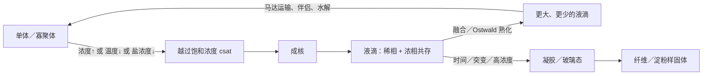
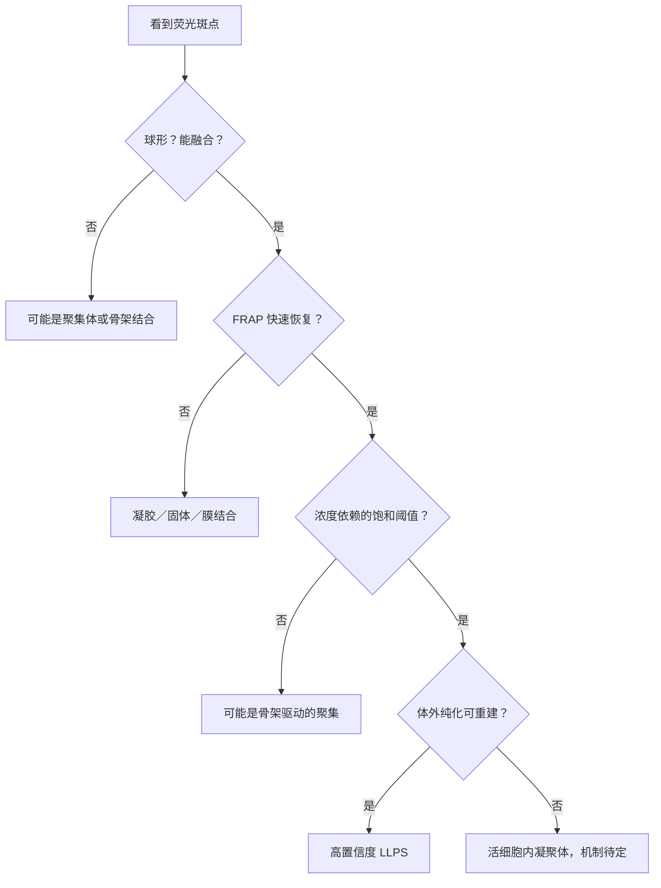
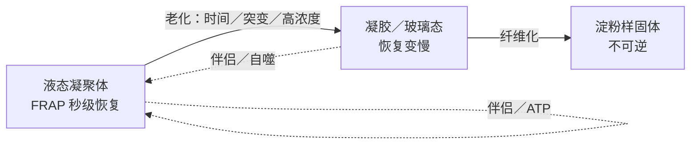

---
tags:
  - 生物学
  - 细胞生物学
  - 无膜细胞器
  - 生物分子凝聚体
  - 相分离
  - 蛋白质稳态
  - 神经退行性疾病
  - 生命起源
关联:
  - "[第四相水与生命的必然涌现：从界面物理到自组织选择的统一框架](第四相水与生命的必然涌现：从界面物理到自组织选择的统一框架.md)"
  - "[广义生命的四级阶梯：从循环到复制——理论草图](广义生命的四级阶梯：从循环到复制——理论草图.md)"
  - "[生命起源八大假说综述](生命起源八大假说综述.md)"
  - "[文献笔记01_矿物引导的分子富集MSE](文献笔记01_矿物引导的分子富集MSE.md)"
  - "[文献笔记03_原始膜的化学配方](文献笔记03_原始膜的化学配方.md)"
  - "[核酶催化化学：磷酰基转移与酯交换](核酶催化化学：磷酰基转移与酯交换.md)"
  - "[RNA](RNA.md)"
  - "[细胞周期](细胞周期.md)"
  - "[化学渗透理论](化学渗透理论.md)"
  - "[辅因子：金属离子、维生素衍生物与酶的化学外挂](辅因子：金属离子、维生素衍生物与酶的化学外挂.md)"
  - "[脂质组学](脂质组学.md)"
  - "[完整对话记录——从水凝胶膜到意识与遗传战争](完整对话记录——从水凝胶膜到意识与遗传战争.md)"
  - "[糖基与糖基化：从糖苷键到糖密码——生命为什么给蛋白质和脂质贴糖](../化学/糖基与糖基化：从糖苷键到糖密码——生命为什么给蛋白质和脂质贴糖.md)"
  - "[醌类：芳香性的赎金——呼吸链的心脏、染料母体与药毒同源的弹头](../化学/醌类：芳香性的赎金——呼吸链的心脏、染料母体与药毒同源的弹头.md)"
---

# 无膜细胞器：没有膜的区室——相分离、凝聚体与细胞内的化学组织

> **根节点**：一个没有脂双层包裹的「液滴」，凭什么能被叫作细胞器？如果细胞里的区室可以靠物理相分离自发涌现，那么「结构」与「功能」、「自发」与「被调控」、「细胞器」与「一团凝聚的分子」之间的边界，究竟应该划在哪里？
>
> **叙事逻辑**：术语与历史 → 物理化学 → 序列语法 → 凝聚体地图 → 功能 → 调控 → 方法学判据 → 争议 → 疾病 → 应用与起源 → 收束。
>
> **立场说明**：本文以 2009 年以来相分离文献与细胞生物学教科书共识为骨架。对「活细胞内是否真的发生 LLPS」「凝聚体是否为功能所必需」「1,6-己二醇是否特异」等争议点明确标注证据强度，不用单一叙事压平分歧。所有数值只给量级，不伪装成精确常数；尚无定论处写「待确认」。
>
> **来源标注**：Brangwynne 2009、Li 2012、Feric 2016、Banani 2017、Shin & Brangwynne 2017、Alberti 2019、Choi–Holehouse–Pappu 2020、Lyon–Peeples–Rosen 2021 等；库内 RNA、核酶、第四相水、生命起源、辅因子与细胞周期笔记。具体见文末。

## 知识树

```txt
根节点：没有膜的液滴，凭什么算细胞器？
│
├── 〇、数字与时间锚点（先建立量级感）
│   ├── 尺寸、浓度、时间尺度
│   └── 2009 / 2012 / 2016 / 2017 / 2019 五个节点
│
├── 一、术语与历史：三个词的分工与一条时间线
│   ├── 无膜细胞器／凝聚体／相分离
│   └── 从核仁、共凝聚层到液滴
│
├── 二、物理化学：弱相互作用如何造出一个相
│   ├── 饱和浓度与相图
│   ├── 多价 × 弱亲和
│   └── sticker–spacer、电荷图案、π 相互作用
│
├── 三、序列语法：什么样的蛋白会相分离
│   ├── IDR／LCD／RGG（Arg-Gly-Gly）／FG（Phe-Gly）
│   ├── 芳香族、精氨酸与电荷块
│   └── RNA 作为多价骨架
│
├── 四、地图：细胞里到底有哪些凝聚体
│   ├── 核内
│   ├── 胞质
│   ├── 膜与骨架上的润湿
│   └── 原核与病毒
│
├── 五、功能：凝聚体替膜做了什么
│   ├── 浓缩、缓冲、隔离、感应
│   └── 力学、记忆、不对称
│
├── 六、调控：十个旋钮
│   ├── 浓度／温度／pH／离子／拥挤
│   ├── ATP 与水解酶
│   └── PTM、RNA、伴侣
│
├── 七、方法：怎么证明那是一个液滴
│   ├── 六条判据
│   └── 常见假阳性
│
├── 八、争议：LLPS 是不是被过度推销
│   ├── 活细胞内证据强度
│   ├── 功能因果性
│   └── 术语与「渗流 vs 相分离」
│
├── 九、疾病：当液滴老化成固体
│   ├── 神经退行
│   ├── 癌症与转录
│   └── 免疫、感染与衰老
│
├── 十、应用与起源
│   ├── 凝聚体药物
│   ├── 合成生物学
│   ├── 原始细胞与膜的分工
│   └── 三层选择性买到了什么
│
└── 十一、收束：被允许出现的相
    ├── 归因
    ├── 延伸
    └── 个体坐标
```

## 〇、数字与时间锚点

先给量级。这个话题最容易被讲成「一堆蛋白聚成小点」的科普故事，而一旦有了浓度、尺寸和时间尺度，「小点」就变成了可以被推理的物理对象。

| 数值 | 含义 | 在本文中的作用 |
|---|---|---|
| 18 世纪 | 核仁在光学显微镜下被记录 | 无膜区室不是新发现，只是新解释 |
| 1903 | 卡哈尔描述「副体」 | 后来的卡哈尔体 |
| 1924 / 1929 | 奥巴林提出共凝聚层／Bungenberg de Jong 系统研究 coacervation | 相分离作为「原始区室」的百年前史 |
| 1960 年代 | 电镜在昆虫卵母细胞中看到无膜「nuage」 | 生殖颗粒的形态学起点 |
| 1980 年代 | 线虫 P 颗粒被遗传学定义 | 2009 年液滴实验的材料 |
| 2009 | P 颗粒被证明像液滴一样融合与溶解 | 现代相分离领域的起点 |
| 2012 | 多价信号蛋白相变／RNA 结合蛋白水凝胶 | 从「现象」转向「机制」 |
| 2016 | 核仁三层亚区被重构为共存液相 | 凝聚体可以再分层 |
| 2017—2018 | 综述、异染色质、中心体、转录、免疫集中爆发 | 领域成型 |
| 2019 | 方法学共识与第一批系统性质疑 | 「怎么证明」成为核心问题 |
| 0.1—5 µm | 多数细胞凝聚体的直径 | 介于蛋白复合物与细胞器之间 |
| 0.5—5 µm | 哺乳动物核仁直径 | 最大的核内凝聚体 |
| 0.1—2 µm | 应激颗粒直径 | 最动态的胞质凝聚体之一 |
| 数十个 | 每个细胞核中核散斑的数量级 | 凝聚体不是「一个器官一个」 |
| 3 层 | 核仁的 FC／DFC／GC | 一个凝聚体内部还能再相分离 |
| ~80% | rRNA 占细胞总 RNA 的比例 | 核仁是细胞里最忙的工厂 |
| 100—300 mg/mL | 细胞内总蛋白浓度 | 细胞质本身就是拥挤的「浓汤」 |
| 20—40% | 大分子占细胞体积的比例 | 拥挤效应不是可忽略的修正 |
| 1—10 mM | 细胞内 ATP 浓度 | 它同时是能量货币与水溶助剂 |
| µM—mM | 常见蛋白的饱和浓度 $c_{sat}$ | 体内浓度离阈值常常只差几倍 |
| 5—10%（v/v） | 1,6-己二醇的常用工作浓度 | 最常被误用的「液滴证据」 |
| 秒—数十秒 | 液态凝聚体的 FRAP 半恢复时间 | 与凝胶、固体最直观的区别 |
| ≥3 | 常被视为「容易相分离」的有效价阈值 | 多价是硬门槛 |
| $10^2$—$10^4$ | 凝聚体相对稀相的富集倍数 | 「区室化」的定量含义 |
| ~$10^3$ | 哺乳动物细胞核孔数量级 | 核孔是天然的选择性凝聚相 |
| 小时—年 | 液滴老化到固体的时间跨度 | 疾病与衰老的时间轴 |

三个尺度最关键：**分子尺度（纳米，序列与相互作用）→ 介观尺度（百纳米到微米，液滴与界面）→ 细胞尺度（微米到十微米，功能与调控）**。相分离之所以值得单独成篇，就是因为它把这三层用一个物理量（相互作用强度与浓度的比值）串了起来。

## 一、术语与历史：三个词的分工与一条时间线

### 1.1 四个词，各管一段

> 📌 **无膜细胞器（membraneless organelle）**：细胞内由蛋白质、RNA 或其他生物大分子富集形成、但没有脂双层包裹的区室。这个词强调的是「功能上像细胞器」——有边界、有组分偏置、有可调控的功能；它不承诺形成机制。
>
> 📌 **生物分子凝聚体（biomolecular condensate）**：由生物大分子通过弱的多价相互作用富集而成的相。这是目前更中性、更被推荐的描述性术语：它说的是「有一个浓相」，而不是「一定是液-液相分离」。
>
> 📌 **液-液相分离（liquid–liquid phase separation, LLPS）**：两种或多种组分在特定条件下分离成两个成分不同、但都保持流动性的液相的过程。它是对机制的断言：浓相与稀相之间是相平衡关系，而不是简单的结合或沉淀。
>
> 📌 **共凝聚层（coacervate）**：由带相反电荷的聚电解质（或聚合物）通过静电作用形成的富集液滴。奥巴林在 1920 年代把它当作原始细胞的原型；今天它仍是人工凝聚体与生命起源研究的重要模型。

这四个词常被混用，但承诺强度完全不同。用「无膜细胞器」是在说功能地位，用「凝聚体」是在说形态与组成，用「LLPS」是在说热力学机制。**写作与读文献时，最重要的纪律是：不要把描述性观察偷换成机制性结论。**

| 维度 | 膜性细胞器 | 无膜细胞器／凝聚体 | 淀粉样沉淀／包涵体 |
|---|---|---|---|
| 边界由什么维持 | 脂双层 | 相界面（界面张力） | 无稳定界面，靠共价或紧密堆积 |
| 组成 | 膜 + 腔内组分 | 蛋白、RNA、少量小分子 | 主要是错误折叠蛋白 |
| 形成机制 | 膜出芽、囊泡运输 | 多价弱相互作用驱动的相分离或渗流 | 成核依赖的纤维化 |
| 可逆性 | 可逆，但需要膜重塑机器 | 高度可逆，秒到分钟级 | 基本不可逆 |
| 选择性 | 靠转运体与信号肽 | 靠亲和力与价态的「分配系数」 | 低选择性 |
| 尺寸 | 50 nm—数 µm | 0.1—5 µm | 0.1—数十 µm |
| 例子 | 线粒体、溶酶体、内质网 | 核仁、应激颗粒、P 小体 | 路易体、神经原纤维缠结 |
| 能量需求 | 膜运输需 ATP | 形成常不需 ATP，维持与清除常需 | 清除需伴侣与蛋白酶体／自噬 |

表里最关键的一行不是尺寸，而是**边界由什么维持**：膜性细胞器的边界是一个「膜」，凝聚体的边界是一个「相界面」。前者需要膜蛋白、脂质组成与融合机器持续维护；后者只需要相互作用强度超过溶解度阈值，就会自己出现、自己消失。

### 1.2 一条时间线：从「核体」到「相」

无膜区室并不是 21 世纪的新发现。核仁在 18 世纪就已被显微镜看到；1903 年卡哈尔描述了后来以他命名的核内小体；20 世纪 60 年代的电镜研究在昆虫卵母细胞里记录到无膜的「nuage」结构；1980 年代线虫遗传学定义了 P 颗粒。真正的新东西不是「看到了」，而是**解释了它们为什么能稳定存在**。

- **1924／1929**：奥巴林的共凝聚层与 Bungenberg de Jong 的胶体凝聚研究，第一次把「没有膜的区室」当成物理化学问题处理。
- **2009**：Brangwynne 等人发现线虫胚胎中的 P 颗粒会融合、会滴落、会在细胞质中按受控方式溶解与凝聚——它们的行为符合液滴的流体力学，而不是固体的力学。这篇论文通常被视为现代相分离领域的起点。
- **2012**：两条线汇合。一条是 Rosen 组的多价信号蛋白实验，证明「多个弱结合位点」足以驱动相变；另一条是 McKnight 组的 RNA 结合蛋白低复杂度结构域实验，证明这些区域能形成动态水凝胶。
- **2016**：Feric 等人在体外重构出核仁的三层结构，证明三个不同的液相可以共存并套叠——凝聚体内部还能再分相。
- **2017—2018**：综述集中出现，异染色质、中心体、转录调控、免疫信号、自噬受体相继被纳入相分离框架。领域从「细胞生物学的一个角落」变成「一种通用组织原理」。
- **2019 之后**：反思开始。Alberti、Gladfelter 与 Mittag 提出方法学清单，McSwiggen 等人系统列出活细胞证据的陷阱，「凝聚体」逐渐取代「LLPS」成为更稳妥的描述词。

> 🔗 **横向关联**：这条「从形态描述到物理机制」的转向，与 [完整对话记录——从水凝胶膜到意识与遗传战争](完整对话记录——从水凝胶膜到意识与遗传战争.md) 里那句「液-液相分离／无膜细胞器某种程度上复活了结构化相思想」形成**互证**——
> 两者都在说同一件事：细胞里的「结构」不必总是被膜或骨架固定，也可以是一种由弱相互作用维持的、可逆的、统计意义上的相。

### 1.3 为什么可以叫「细胞器」

「细胞器」原本是一个形态学与功能学混合的概念：有边界、有特定组分、有可分离的功能。无膜凝聚体满足后两条，第一条则打了折扣——它的边界是相界面，不是膜。因此更严格的说法是：**它是一个「区室」（compartment），而不是一个「细胞器」（organelle）**；把它叫细胞器，是一种功能上的类比，而不是结构上的等同。

判断一个凝聚体是否够格被称为功能性区室，可以看四条：

1. **边界性**：能否把某些分子富集在内、把另一些排除在外（分配系数显著偏离 1）。
2. **组成特异性**：不是随机吸附，而是有可重复的组分清单。
3. **功能可测**：破坏它会不会改变某个可测的细胞过程。
4. **可调控**：细胞能否在需要时组装、在不需要时溶解。

这四条里，第四条最容易被忽略，却最能区分「细胞器」与「一团沉淀」。

## 二、物理化学：弱相互作用如何造出一个相

### 2.1 相图：饱和浓度是唯一的硬门槛

> 📌 **饱和浓度（saturation concentration, $c_{sat}$）**：在给定温度、pH、离子强度下，某组分开始从稀相析出成浓相时的浓度。低于它，体系是单一均匀相；高于它，体系分裂成稀相与浓相。本文中它是判断「某蛋白在细胞内到底会不会相分离」的第一把尺子。
>
> 📌 **双节线（binodal）与旋节线（spinodal）**：相图上分隔「单相」与「两相共存」的边界叫双节线；双节线以内、由二阶导数决定的失稳边界叫旋节线。越过双节线要走成核，越过旋节线则自发分相。本文只需要记住：**相分离是一个阈值现象，不是线性渐变。**



这张图的重点是最后那条回环：**液滴不是终点**。同一套组分可以在液态、凝胶态、固体之间移动，而细胞的功能通常依赖它停在液态那一格。

### 2.2 Flory–Huggins：$\chi$ 就是「讨厌周围环境」的度量

高分子溶液的经典平均场理论给出混合自由能：

$$
\frac{\Delta G_{\text{mix}}}{k_B T}
= \frac{\phi}{N_A}\ln\phi + \frac{1-\phi}{N_B}\ln(1-\phi) + \chi\,\phi(1-\phi)
$$

其中 $\phi$ 是某组分的体积分数，$N_A$、$N_B$ 是聚合度，$\chi$ 是相互作用参数。前两项是熵（总是促进混合），第三项是相互作用（$\chi>0$ 时促进分相）。对称共混物的临界值约为

$$
\chi_c \approx \frac{1}{2}\left(1+\frac{1}{\sqrt{N}}\right)^2
$$

当 $N$ 很大时 $\chi_c \to 0.5$。这个公式的价值不在于精确预测细胞，而在于给出三条直觉：

- **链越长，越容易分相**（$N$ 大，熵的惩罚被稀释）。
- **相互作用只要「稍微不利」就够**（$\chi$ 刚过 0.5 的量级，不需要「强烈排斥」）。
- **多组分体系里，$\chi$ 可以被别的组分调节**（RNA、盐、拥挤剂都会改变有效 $\chi$）。

所以相分离不需要「强结合」，只需要**足够多的、方向一致的弱相互作用**。

### 2.3 多价 × 弱：为什么不是「强结合」

这是整个领域最反直觉、也最重要的一条。

| 维度 | 强结合（如抗体–抗原） | 多价弱结合（凝聚体） |
|---|---|---|
| 单个位点 $K_d$ | $10^{-9}$—$10^{-12}$ M | $10^{-3}$—$10^{-5}$ M |
| 每个分子的结合位点数 | 1—2 | 10—100 |
| 复合物寿命 | 分钟到小时 | 毫秒到秒 |
| 结果 | 稳定的 1:1 复合物 | 动态的、可交换的浓相 |
| 对浓度的响应 | 饱和曲线 | 阈值 + 相变 |
| 可逆性 | 慢 | 快 |

关键在于**亲和力的「加法」不是线性叠加，而是乘性放大**：$n$ 个弱位点同时接触，有效亲和力可以近似按 $K_d^{n}$ 量级改善，但每一个接触又都保留了快速解离的能力。结果是「整体很黏、局部很松」——这正是凝聚体既能稳定存在、又能快速交换组分的原因。

> 🔗 **横向关联**：这套「多价 × 弱 = 高选择性 + 高可逆性」的逻辑，与 [糖基与糖基化：从糖苷键到糖密码——生命为什么给蛋白质和脂质贴糖](../化学/糖基与糖基化：从糖苷键到糖密码——生命为什么给蛋白质和脂质贴糖.md) 第五节「信息层：分支、多价与末端」形成**同构关系**——
> 糖链用单价 $10^{-3}$ M 的弱识别叠加成 $10^{-9}$—$10^{-12}$ M 的表观亲和力；凝聚体用同样的算术，把「弱」变成了「相」。两者都是「概率化的精确」。

### 2.4 sticker–spacer：不是每个残基都重要

> 📌 **贴纸–间隔模型（sticker-and-spacer model）**：把参与相分离的蛋白序列抽象成两类片段——「贴纸」是能形成可逆物理交联的残基或短基序，「间隔」是不参与交联、只提供柔性的连接区。相行为主要由贴纸的价态、强度与排列决定，间隔的长度与柔性调节网络的连通性。

这个模型解决了一个长期困惑：为什么许多相分离蛋白的序列看起来「没有结构、没有保守性」？答案是——**保守的不是序列本身，而是贴纸的图案**。只要芳香族、精氨酸、带电块出现在合适的位置，具体是哪种氨基酸可以很宽容。

### 2.5 电荷图案与 π 相互作用

三类相互作用撑起了大部分生物凝聚体：

- **静电**：Arg（精氨酸）／Lys（赖氨酸）的正电荷与 Asp（天冬氨酸）／Glu（谷氨酸）的负电荷形成盐桥。电荷「成块分布」比「均匀散布」更容易相分离——因为块状分布允许一个分子同时与多个分子形成多点接触，而均匀分布会让每个接触都孤立。
- **π–π 与阳离子–π**：Tyr（酪氨酸）、Phe（苯丙氨酸）、Trp（色氨酸）的芳香环之间，以及芳香环与 Arg（精氨酸）的胍基之间。这类相互作用在 FUS、hnRNPA1 等 RNA 结合蛋白的低复杂度区里尤其重要。
- **氢键与极性**：Gln（谷氨酰胺）、Asn（天冬酰胺）、Ser（丝氨酸）、Thr（苏氨酸）提供的弱氢键网络，是核孔 FG 重复序列（Phe-Gly，苯丙氨酸-甘氨酸）形成选择性相的基础。

三者可以叠加。一个典型的相分离结构域往往同时有芳香族、精氨酸和极性残基——这也是为什么「打乱序列」常常不破坏相分离，而「换掉酪氨酸」却会。

### 2.6 液滴的物理：张力、粘度、润湿、粗化

一旦形成浓相，它就表现出普通液体的性质：

- **表面张力**让它趋于球形，并在两个液滴相遇时驱动融合。
- **粘度**决定分子在内部扩散的快慢，也决定了 FRAP 的恢复速度。
- **润湿（wetting）**让它能铺展在膜、骨架或另一相的表面，形成「帽状」「环状」或「层状」结构，而不是孤立的球。
- **粗化（coarsening）**让小的液滴消失、大的液滴长大（Ostwald 熟化与融合），这是热力学驱动的必然趋势。

但细胞里的液滴不是被动的。主动过程（马达运输、局部合成与降解、水解酶、伴侣）可以持续对抗粗化，把液滴维持在特定尺寸。理论工作把这类体系称为「主动液滴」（active droplet）：它的尺寸分布不再由简单的表面张力与粘度平衡决定，而由化学势的持续输入维持。**这就是「细胞器」与「一瓶乳液」的分水岭。**

## 三、序列语法：什么样的蛋白会相分离

### 3.1 从结构域到内在无序区

> 📌 **内在无序区（intrinsically disordered region, IDR）**：在生理条件下不形成稳定三维结构、但也不是完全随机的蛋白片段。它采样一组构象集合，因而能同时与多个伙伴形成瞬时接触。本文中它是「多价弱相互作用」的结构基础。
>
> 📌 **低复杂度结构域（low-complexity domain, LCD）**：氨基酸组成偏斜、重复性高的序列片段，常见于 RNA 结合蛋白。它通常属于 IDR 的一种，但「低复杂度」强调的是组成偏斜，不是无序本身。

| 维度 | 折叠结构域 | 内在无序区 |
|---|---|---|
| 构象 | 单一或少数稳定构象 | 构象集合 |
| 结合方式 | 锁–钥，高亲和 | 多价、弱、瞬时 |
| 进化约束 | 序列保守 | 组成与图案保守，序列可漂变 |
| 典型功能 | 催化、识别 | 相分离、支架、调控 |
| 实验表征 | 晶体学、冷冻电镜 | NMR、SAXS、单分子 FRET、预测 |

表里最值得注意的是「进化约束」那一行：无序区看起来变化很快，但**贴纸的位置和类型**常常被保留。这正是「序列语法」的含义。

### 3.2 五种「黏性」残基

下表按侧链性质分组。每个缩写后附中文名；同一段内后文重复出现时不再逐一标注，以免打断句子。

| 类型 | 代表残基 | 主要相互作用 | 典型体系 |
|---|---|---|---|
| 芳香族 | Tyr（酪氨酸）、Phe（苯丙氨酸）、Trp（色氨酸） | π–π、阳离子–π | FUS、hnRNPA1、TDP-43 |
| 碱性 | Arg（精氨酸）、Lys（赖氨酸） | 盐桥、阳离子–π、与 RNA 的静电 | Ddx4、核糖核蛋白颗粒 |
| 酸性 | Asp（天冬氨酸）、Glu（谷氨酸） | 盐桥、与碱性蛋白共凝聚 | 电荷块蛋白 |
| 极性（酰胺） | Gln（谷氨酰胺）、Asn（天冬酰胺） | 氢键、柔性间隔 | 核孔 FG 重复（Phe-Gly） |
| 极性（羟基／小） | Ser（丝氨酸）、Thr（苏氨酸）、Gly（甘氨酸） | 氢键、柔性间隔 | 酵母 prion 区、LCD 连接段 |
| 疏水 | Val（缬氨酸）、Leu（亮氨酸）、Ile（异亮氨酸）、Met（甲硫氨酸） | 疏水效应 | 膜蛋白、部分 LCD |

一个常见的误解是「相分离蛋白一定富含某种氨基酸」。更准确的说法是：**相分离依赖的是这些残基的组合与排列，而不是单一组成的富集**。同一段序列里把 Tyr（酪氨酸）换成 Ser（丝氨酸），可能完全破坏相分离；把整段序列打乱顺序，反而可能保留。

### 3.3 FUS 的分子语法

> 📌 **FUS（Fused in Sarcoma，融合肉瘤蛋白）**：FET 家族（FUS／EWSR1／TAF15）的核内 RNA／DNA 结合蛋白，N 端是一大段富含 Gln（谷氨酰胺）、Gly（甘氨酸）、Ser（丝氨酸）、Tyr（酪氨酸）的低复杂度区（LCD），C 端含 RNA 识别基序、锌指、富精氨酸的 RGG 区（Arg-Gly-Gly，精氨酸-甘氨酸-甘氨酸）与核定位信号。它参与转录、剪接、DNA 损伤修复与 RNA 运输；其 LCD 能在温和条件下相分离，是研究「序列—相行为」关系最常用的模型，也是家族性 ALS／FTD 的致病基因之一。本文用它来说明：相分离能力可以被少数几种残基的配比编码，因而能被突变破坏、被修饰调节。

FUS 的低复杂度区是这个领域最常被引用的模型。它的序列里有大量重复的 `[G/S]Y[G/S]` 基序（单字母码：G＝Gly 甘氨酸，S＝Ser 丝氨酸，Y＝Tyr 酪氨酸），Tyr（酪氨酸）提供芳香族贴纸，Arg（精氨酸）提供阳离子–π 与静电接触，Gly（甘氨酸）提供柔性。系统突变实验给出的结论是：

- **Tyr（酪氨酸）的数量**决定相分离的驱动力强弱。
- **Tyr（酪氨酸）与 Arg（精氨酸）的相对比例**改变临界浓度与材料性质。
- **把 Tyr（酪氨酸）换成非芳香族残基**，相分离显著减弱甚至消失。
- **把 Arg（精氨酸）甲基化**（模拟翻译后修饰），相分离被抑制。

这套「用少数几种残基的配比决定相行为」的逻辑，就是所谓的**分子语法（molecular grammar）**。它的意义在于：相分离性质可以被基因序列编码，因而可以被进化选择、被突变破坏、被药物调节。

### 3.4 RNA：被低估的多价骨架

RNA 不是被动的「货物」。它是一条长度可变、带大量负电荷、能折叠出多种二级结构的多价聚合物——换句话说，它天生就是相分离的支架。

- **长度效应**：长 RNA 能同时接触更多蛋白分子，降低 $c_{sat}$；短 RNA 或单核苷酸则可能起相反作用。
- **结构效应**：单链区暴露的碱基更容易形成多价接触；高度折叠的 RNA 可能把接触位点埋起来。
- **化学计量效应**：蛋白与 RNA 的比例偏离最优值时，相分离会被抑制——这就是「化学计量控制」，在信号蛋白体系里也被独立观察到。
- **修饰效应**：m6A 等 RNA 修饰可以增强或减弱特定 reader 蛋白的相分离能力。

> 🔗 **横向关联**：RNA 在这里扮演的角色，与 [RNA](RNA.md) 第 2—3 节里「RNA 既能催化、又是核糖体催化核心」的双重身份形成**上下游关系**——
> RNA 在起源上是催化剂与遗传载体，在现代细胞里又多了第三种身份：多价支架。三者共用同一个化学事实——磷酸二酯骨架给了它长度、电荷与可折叠性。

### 3.5 结构域与翻译后修饰：给相分离装开关

除了 IDR，折叠结构域也能提供「价」：

- **寡聚化结构域**（coiled-coil、SAM、PB1、TNFR 等）把单体变成二聚体、三聚体或更高阶寡聚体，直接提高有效价态。
- **模块化相互作用对**（SH3–PRM、SUMO–SIM、PDZ–肽）可以在合成体系里按设计组装凝聚体。
- **翻译后修饰**改变电荷与体积：磷酸化（FUS、TDP-43）、甲基化（Ddx4）、乙酰化、PARylation、SUMOylation 都能调节 $c_{sat}$。

这也是为什么相分离能把「信号」翻译成「结构」：一个激酶在几秒内加上几个磷酸基团，就足以让一个凝聚体溶解或重新组装。**在这个意义上，相分离是一种把化学信号转成空间组织的换能器。**

## 四、地图：细胞里到底有哪些凝聚体

### 4.1 核内：一个已经被细分到「层中有层」的空间

| 凝聚体 | 关键组分 | 主要功能 | 备注 |
|---|---|---|---|
| 核仁（nucleolus） | NPM1、FBL、RNA Pol I、rRNA | 核糖体生物合成 | 分 FC／DFC／GC 三层，可共存 |
| 核散斑（nuclear speckle） | SON、SRRM2、剪接因子 | 剪接因子的储存与组装 | 不是剪接发生的主要位点 |
| 卡哈尔体（Cajal body） | coilin、snRNP | snRNP 成熟 | 与核散斑可动态交换 |
| 副斑（paraspeckle） | NEAT1_2 lncRNA、NONO、SFPQ | RNA 滞留、应激响应 | 以 lncRNA 为支架 |
| PML 小体（PML body） | PML、SUMO 化蛋白 | 衰老、抗病毒、凋亡调控 | PML–RARα 与急性早幼粒白血病 |
| 组蛋白基因座小体（HLB） | NPAT、FLASH | 组蛋白 mRNA 合成 | 与细胞周期同步 |
| 异染色质域 | HP1α、H3K9me3（组蛋白 H3 第 9 位赖氨酸三甲基化） | 基因沉默、染色体稳定性 | HP1α 可自组装成相 |
| 转录凝聚体 | BRD4、MED1、Pol II CTD | 超级增强子驱动的转录 | 体内证据仍有争议 |

核仁是理解「凝聚体可以再分层」的最佳例子。它不是一个均匀的液滴，而是三个不同的相：FC（纤维中心）富集 RNA Pol I，DFC（致密纤维组分）富集 FBL 与早期 rRNA 加工因子，GC（颗粒组分）富集 NPM1 与晚期装配因子。体外重构实验表明，这三种组分可以在同一体系里形成互不相溶、层层套叠的液滴。**换句话说，一个无膜细胞器内部，可以再长出无膜亚细胞器。**

> 🔗 **横向关联**：核仁在细胞周期中的「解体—重组」与 [细胞周期](细胞周期.md) 里描述的 M 期核膜破裂、核仁消失形成**因果链**——
> 细胞周期不是「在细胞器之间」运行的，它直接拆装细胞器本身。核仁的溶解与重组，既是 CDK 磷酸化驱动的结果，也是每个周期重新分配核糖体生产能力的必要步骤。

### 4.2 胞质：动态性最高的一层

- **生殖颗粒**：线虫 P 颗粒、果蝇极颗粒、卵母细胞 Balbiani 体。它们储存母源 RNA 与 piRNA 通路组分，并在不对称分裂中决定生殖系命运。
- **应激颗粒（stress granule）**：在氧化、热、渗透、病毒等应激下由停滞的翻译起始复合物、mRNA 与 RNA 结合蛋白组装而成。G3BP1 被广泛视为「开关」蛋白：它的浓度、磷酸化状态与 RNA 可用性共同决定颗粒是否形成。
- **P 小体（processing body, P-body）**：富集脱帽酶、脱腺苷酸酶与外切酶，是 mRNA 降解与储存的节点。它与应激颗粒可以接触、交换组分，甚至融合。
- **神经元颗粒**：FMRP 等蛋白在树突与轴突中形成运输颗粒，把 mRNA 送到局部翻译位点。
- **自噬受体凝聚体**：p62／SQSTM1 通过 PB1 结构域寡聚化，并通过 UBA 结构域结合泛素链，把泛素化的货物浓缩成可被自噬体吞没的「包裹」。
- **中心体周围物质（PCM）**：Woodruff 等人的工作把它描述为一个「选择性凝聚相」——它富集微管蛋白，并以浓度依赖的方式促进微管成核。
- **突触凝聚体**：synapsin 与脂质囊泡形成液相，把突触小泡组织成可快速释放的簇；突触后致密区也被认为具有凝聚体性质。
- **免疫信号凝聚体**：T 细胞受体信号微簇、cGAS–DNA 凝聚体、MAVS 聚集体、炎症小体等。

### 4.3 膜与骨架上的「润湿」

凝聚体不一定要悬浮在细胞质里。它们可以**润湿**在膜或骨架上，形成帽状、环状或层状结构：

- **核孔**：FG 重复（Phe-Gly，苯丙氨酸-甘氨酸）核孔蛋白形成的相，是核孔选择性屏障的物理基础。它让小分子自由通过，却让大分子需要转运受体「护送」——这是「无膜选择性屏障」最漂亮的例子。
- **内质网表面的 TIS 颗粒**：某些 RNA 结合蛋白在内质网表面形成凝聚体，把 mRNA 定位到翻译位点。
- **质膜受体簇**：多价配体可以诱导受体在膜上形成二维凝聚体，改变信号强度。
- **藻类的蛋白核（pyrenoid）**：Rubisco 与连接蛋白 EPYC1 形成相分离的固碳区室，是「凝聚体提高代谢效率」的教科书案例。
- **植物光小体（photobody）**：光敏色素在光照下改变构象并聚集成核内凝聚体，把光信号转成发育决策。

### 4.4 原核与病毒：相分离不是真核生物的专利

- **细菌拟核（nucleoid）**：DNA、RNA 与拟核相关蛋白形成的无膜区室，具有液晶与相分离的双重特征。
- **细菌 RNP 体**：部分细菌在应激下形成富含 RNase E 的 RNA–蛋白凝聚体，功能类似简化的应激颗粒。
- **病毒工厂（viral factory）**：许多 RNA 病毒在感染细胞里形成无膜复制区室，把复制酶、模板与宿主因子浓缩在一起，同时躲避先天免疫。
- **SARS-CoV-2 核衣壳蛋白**：N 蛋白的 IDR 与 RNA 共同形成凝聚体，被认为是病毒复制与免疫逃逸的潜在靶点。

这张地图说明一件事：**无膜区室是细胞组织的「默认选项」之一，而不是真核生物的创新**。膜的出现更像是给某些区室加了一道「更硬的边界」，而不是从无到有地发明区室。

## 五、功能：凝聚体替膜做了什么

### 5.1 浓缩：把「稀」变「浓」

最直接的功能是提高局部浓度。一个反应在两个底物都稀到 $10^{-8}$ M 的溶液里可能慢得可以忽略，但在凝聚体里被富集 $10^2$—$10^4$ 倍后，速率可以上升几个数量级。

但浓缩不是万能的。凝聚体也可以**隔离**底物，让它们接触不到彼此；也可以**改变底物的构象**，让酶更容易或更难作用。所以「凝聚体加速反应」是一个需要逐系统验证的命题，而不是普遍规律。

> 🔗 **横向关联**：这层「局部浓度决定通量」的逻辑，与 [辅因子：金属离子、维生素衍生物与酶的化学外挂](辅因子：金属离子、维生素衍生物与酶的化学外挂.md) 第七节「辅因子的三种限制（总量、比值、竞争）」形成**上下游关系**——
> 辅因子笔记讨论的是「酶有多少辅因子可用」；相分离则改变了「酶和辅因子在哪个空间里相遇」。前者是库存问题，后者是物流问题。

### 5.2 缓冲与储存

P 颗粒储存母源 mRNA，应激颗粒储存停滞的翻译复合物，P 小体储存待降解的 mRNA。凝聚体在这里扮演的是**仓库**：它让分子在不需要时处于「低活性、可快速调用」的状态，而不是被降解掉。

这个功能有一个容易被忽略的推论：**凝聚体的溶解动力学决定了响应速度**。一个能在几秒内溶解的颗粒，比一个需要重新转录翻译的系统快得多。

### 5.3 隔离：把信号关进「小黑屋」

凝聚体可以把信号分子隔离起来，从而抑制通路。例如某些应激条件下，信号激酶被招募进颗粒，暂时无法接触下游底物。这种「 sequestration」是可逆的，因而比降解更灵活。

但它也带来一个风险：如果凝聚体长期不溶解，隔离就变成了病理性的「功能丧失」。

### 5.4 感应：把物理量翻译成结构

这是凝聚体最优雅的功能。因为相分离是一个阈值现象，温度、pH、离子强度或氧化还原状态的微小变化，可以触发一次「全有或全无」的结构转变——天然适合做开关。

- **温度**：拟南芥 ELF3 的 prion 样结构域在温度升高时改变相行为，充当「温度计」，把春化与开花时间同环境温度耦合。
- **pH**：酵母 Pab1 在应激导致的胞质酸化下相分离，形成保护性颗粒。
- **氧化**：酵母 Sup35 的 prion 结构域在氧化应激下凝聚，提高存活率，且这一能力在进化上被保留。
- **离子**：镁离子、钙离子与多胺可以中和 RNA 或蛋白的电荷，改变 $c_{sat}$。

### 5.5 力学与润湿

凝聚体不是被动的小球。它们能：

- 在膜上铺展，改变膜的曲率与张力；
- 在骨架上形成节点，改变局部力学；
- 通过表面张力把多个小囊泡「拉」成一簇；
- 在细胞核里形成「最硬的」结构之一，参与机械信号的传递。

中心体 PCM 是「选择性凝聚相」的典型：它不是简单地「变黏」，而是选择性地富集微管蛋白与成核因子，从而在正确的时间与位置启动微管聚合。

### 5.6 不对称、记忆与演化

- **不对称**：P 颗粒在受精卵不对称分裂时被分配到生殖系，决定「谁成为生殖细胞」。这是一个凝聚体直接决定细胞命运的案例。
- **记忆**：光遗传学实验表明，短暂的光诱导寡聚化可以在凝聚体解散后留下持续的结构与功能改变——相变可以存储「曾经发生过什么」的信息。这种迟滞（hysteresis）在物理上来自相图的多值性。
- **演化**：Sup35 的相分离能力在酵母中可被选择；应激颗粒的组成与动力学在物种间存在差异。相分离不是「物理副产物」，它本身可以是适应性性状。

| 功能 | 机制 | 代表体系 | 证据强度 |
|---|---|---|---|
| 浓缩反应 | 提高局部浓度 | 蛋白核、中心体 PCM | 较强 |
| 储存／缓冲 | 可逆富集，降低降解 | P 颗粒、应激颗粒 | 较强 |
| 隔离抑制 | 把组分与底物分开 | 信号激酶被招募进颗粒 | 中等 |
| 物理感应 | 阈值型相变 | ELF3 温度感应、Pab1 pH 感应 | 较强 |
| 力学与润湿 | 界面张力、膜铺展 | synapsin 囊泡簇、核仁 | 中等 |
| 不对称分配 | 极性定位 | 线虫 P 颗粒 | 较强 |
| 信息记忆 | 迟滞与多稳态 | 光遗传凝聚体 | 初步 |

表里最关键的一列是「证据强度」：**有些功能已经被严格证明，有些仍停留在相关性层面**。把这两类混为一谈，是这个领域最常见的叙事问题。

## 六、调控：十个旋钮

细胞不会让凝聚体随意生长。它们用一整套「旋钮」来调节 $c_{sat}$、界面张力与材料性质。

| 旋钮 | 作用方向 | 代表例子 | 证据强度 |
|---|---|---|---|
| 总浓度 | 升高 → 促进相分离 | 过表达常诱导人工颗粒 | 强，但易造成假阳性 |
| 温度 | 依体系而定，UCST 或 LCST | ELF3 温度感应 | 强 |
| pH | 改变电荷与氢键 | Pab1 应激颗粒 | 强 |
| 离子强度 | 高盐通常削弱静电相分离 | RNA–蛋白体系 | 强 |
| 二价离子 | Mg²⁺／Ca²⁺ 可桥接 RNA | 核仁、RNA 颗粒 | 中—强 |
| 分子拥挤 | 提高有效浓度 | PEG、葡聚糖增强体外相分离 | 强（体外） |
| ATP | 水溶助剂，可溶解凝聚体 | 1—10 mM 生理浓度 | 中—强 |
| 翻译后修饰 | 改变电荷、体积与价态 | FUS 磷酸化、Ddx4 甲基化 | 强 |
| RNA 种类与量 | 改变价态与化学计量 | m6A 增强 YTHDF 相分离 | 强 |
| 分子伴侣 | 溶解、重塑、清除 | Hsp70／Hsp40、Hsp104 | 强 |

这张表里最容易被低估的是 **ATP**。除了作为能量货币，ATP 在毫摩尔浓度下还能像「生物水溶助剂」一样削弱蛋白质间的疏水与静电接触，帮助溶解凝聚体。这解释了一个看似矛盾的现象：**能量耗尽时，应激颗粒反而更难溶解**——因为 ATP 依赖的伴侣与重塑机器停摆了。

另一个容易被低估的是**化学计量**。许多体系在蛋白与 RNA 的比例接近最优点时相分离最强，偏离则被抑制。这意味着「表达量升高」不一定促进凝聚，也可能因为配比失衡而破坏它。

> 🔗 **横向关联**：氧化应激触发应激颗粒这条路径，与 [醌类：芳香性的赎金——呼吸链的心脏、染料母体与药毒同源的弹头](../化学/醌类：芳香性的赎金——呼吸链的心脏、染料母体与药毒同源的弹头.md) 第九节「药毒同源」形成**因果链**——
> 醌类在体内可进入氧化还原循环、产生 ROS；ROS 一方面损伤蛋白与脂质，另一方面通过改变氧化还原状态与 ATP 水平，直接推动应激颗粒的组装与「老化」。**毒性与保护，取决于液滴停在哪个材料状态。**

## 七、方法：怎么证明那是一个液滴

### 7.1 体外：先把它纯化出来

体外实验是机制的「干净房间」：

- 表达并纯化目标蛋白（必要时加 RNA、盐、拥挤剂）；
- 用浊度、DIC 显微镜或荧光标记观察液滴形成；
- 测相图（浓度—温度—盐的边界）；
- 用 FRAP 测内部扩散，用微流控测表面张力与粘度；
- 用突变体做「序列—相行为」映射。

体外实验的最大优势是可控，最大局限是「可控」本身——纯化体系里没有细胞内的拥挤、骨架、主动运输与降解。

### 7.2 体内：斑点不等于液滴

活细胞里常见的证据链是：

1. 荧光标记的目标蛋白形成点状信号；
2. 点状信号是球形、能融合；
3. FRAP 显示快速恢复；
4. 1,6-己二醇可溶解；
5. 浓度或温度改变时出现阈值行为；
6. 突变体破坏相分离并改变功能。

这套链条看起来严密，实际上每一步都有陷阱。**过表达可以人为制造斑点；荧光标签可以改变相行为；固定可以制造假球形；1,6-己二醇不是特异溶剂；细胞死亡前的应激本身就会诱导颗粒。**

### 7.3 六条判据

| 判据 | 观察什么 | 支持什么 | 不能排除什么 |
|---|---|---|---|
| 形态 | 球形、可融合、可润湿 | 流体性质 | 凝胶也可呈球形 |
| 动力学 | FRAP 快速恢复 | 内部高流动性 | 稀薄凝胶也可能恢复 |
| 溶解度 | 1,6-己二醇溶解 | 弱疏水相互作用 | 很多非凝聚体也被溶解 |
| 阈值 | 浓度／温度依赖的突变 | 相变 | 骨架驱动的聚集也可能有阈值 |
| 重建 | 纯化组分体外成滴 | 组分自足 | 体内可能依赖其他因子 |
| 功能 | 破坏相分离改变表型 | 因果性 | 突变可能同时破坏其他功能 |

结论是：**没有任何单一判据足够，必须多条独立证据收敛。** 这也是 Alberti 等人在 2019 年方法学共识里反复强调的。

### 7.4 常见假阳性清单

- 过表达导致的人工聚集；
- 荧光蛋白标签促进寡聚；
- 固定剂造成的形态假象；
- 细胞凋亡或 ATP 耗尽引起的「颗粒」；
- 1,6-己二醇的非特异效应；
- 把「点状信号」等同于「液相」；
- 把「体外能成滴」等同于「体内就是液滴」。



## 八、争议：LLPS 是不是被过度推销

### 8.1 活细胞里到底有没有「真正的」相分离

支持者的证据是：球形、融合、FRAP、阈值、温度依赖——这些在体外与部分体内体系里都观察到了。反对者的理由同样有力：

- 细胞内有骨架、膜系统与主动运输，**不是理想的两组分体系**；
- 许多「凝聚体」更接近**渗流网络（percolation）**或**凝胶**，而不是热力学意义上的两相共存；
- 细胞内的浓度、pH、离子强度局部不均，**相图本身难以定义**；
- 一些被称作「液滴」的结构，在高分辨率下显示为纤维、环或异质网络。

「渗流」与「相分离」的区别很关键：渗流只需要**连通性**超过阈值，不需要**两相共存**。一个体系可以看起来像液滴，实际上是交联网络。两者的物理机制、对温度的响应、对浓度的依赖都不同。

### 8.2 功能因果性：相关不等于必要

这是比「是不是液滴」更难的问题。要证明一个凝聚体有功能，至少需要：

1. **必要性**：破坏相分离（而不是破坏蛋白本身）会改变功能；
2. **充分性**：人为重建相分离可以恢复功能；
3. **特异性**：用于破坏相分离的扰动不影响其他已知功能。

难点在于，**相分离与结合常常由同一批残基驱动**。一个破坏相分离的突变，往往也破坏了与伙伴的结合或催化活性。于是「相分离是否必要」就变成了一个几乎无法干净回答的问题。

更尖锐的批评是：有些凝聚体可能是**功能的副产物**，而不是功能的原因。就像鸟的骨头中空是飞行的结果而不是原因——结构存在，不等于结构有用。

### 8.3 术语之争

「无膜细胞器」暗示功能地位，「生物分子凝聚体」暗示形态，「LLPS」暗示机制。2020 年以后的共识大致是：

- 描述形态与组成时，用**凝聚体**；
- 有热力学证据时，才用**相分离**；
- 讨论功能时，用**区室**（compartment）比用**细胞器**更稳妥。

术语不是小事。它决定了读者会默认接受多少未经证明的结论。

### 8.4 1,6-己二醇不是万能溶剂

1,6-己二醇被广泛用于「溶解凝聚体」，但它的作用机制并不特异：它削弱疏水与部分静电相互作用，因而会影响许多非凝聚体结构。高浓度还有细胞毒性。**它最多是一个辅助证据，不能单独作为「这是液滴」的判据。**

### 8.5 我的判断：三层证据，三种确定性

把这场争论拆成三层，会清楚很多：

1. **现象层**：细胞内确实存在无膜的大分子富集区室——这一点几乎无疑，几十年的电镜与荧光数据都支持。
2. **机制层**：这些区室通过 LLPS、凝胶化还是渗流网络形成——因系统而异，需要逐案判断，不能一概而论。
3. **功能层**：哪些区室的功能确实依赖其材料状态——目前只有少数系统被严格证明，多数仍在「相关」阶段。

因此，最合理的态度不是「相分离是万能解释」，也不是「相分离是过度炒作」，而是：**它是一个强大的候选机制，需要按证据强度分级使用。**

> 🔗 **横向关联**：这场关于「证据强度」的争论，与 [第四相水与生命的必然涌现：从界面物理到自组织选择的统一框架](第四相水与生命的必然涌现：从界面物理到自组织选择的统一框架.md) 第八节「磐石与流沙：诚实的证据评估」形成**镜像关系**——
> 两个框架都提出了一种「非膜、非经典」的区室化机制，都面临同一个问题：现象可以观察，机制难以在活细胞内直接测量。区别在于，第四相水强调的是界面水的极化层，相分离强调的是大分子浓相——两者不是同一个「相」，不能互相替代。
>
> 另一条对照在 [文献笔记01_矿物引导的分子富集MSE](文献笔记01_矿物引导的分子富集MSE.md) 第五节：那篇论文把 LLPS 当作富集效率的「上限参照」，同时指出 LLPS 需要 µM—mM 级的蛋白浓度，而矿物表面在稀环境里更管用。**这正好说明：相分离不是唯一的富集机制，它只是浓度足够高时最优雅的那一种。**

## 九、疾病：当液滴老化成固体

### 9.1 从液态到固态的三级台阶



这张图是理解「相分离相关疾病」的核心。**致病的关键往往不是「有没有凝聚体」，而是「凝聚体停在了哪一级台阶」。** 正常的应激颗粒形成与溶解是可逆的；病理状态下，它可能变成不可逆的凝胶，再进一步纤维化，形成经典的病理包涵体。

### 9.2 神经退行性疾病

| 疾病 | 关键蛋白 | 相变与病理 | 证据要点 |
|---|---|---|---|
| ALS／FTD | TDP-43 | LCD 相分离 → 凝胶 → 胞质包涵体 | 病理标志蛋白；突变改变相行为 |
| ALS | FUS | LCD 相分离；磷酸化调节 | 突变与磷酸化均改变 $c_{sat}$ |
| ALS／FTD | C9orf72 DPR（二肽重复蛋白） | poly-GR／PR（甘氨酸-精氨酸／脯氨酸-精氨酸重复）干扰核仁与应激颗粒 | 重复扩增是最常见家族性病因之一 |
| 阿尔茨海默病 | tau | 相分离促进聚集 → 神经原纤维缠结 | 体外与细胞模型支持 |
| 帕金森病 | α-synuclein | 液滴成核 → 纤维 | 体外重构支持 |
| 亨廷顿病 | huntingtin（polyQ，多聚谷氨酰胺） | 长度依赖的聚集 | polyQ 越长越易聚集 |

这里最值得记住的是 **TDP-43**：它既是 ALS 与 FTLD 的主要病理蛋白，也是最典型的「相分离—聚集」连续体案例。它的低复杂度区在正常状态下参与核内凝聚体的形成，在病理状态下却在胞质中形成不可逆包涵体。**同一个蛋白、同一段序列，在不同位置与不同修饰状态下，走向了完全不同的材料命运。**

### 9.3 癌症：凝聚体作为「异常基因调控」的载体

- **EWS-FLI1**（尤文肉瘤）：prion 样结构域驱动异常染色质重塑复合物的招募。
- **NUP98-HOXA9**（白血病）：相分离驱动异常染色质环化与致癌基因激活。
- **NPM1c**（急性髓系白血病）：核仁蛋白突变导致异常胞质定位与转录程序改变。
- **超级增强子**：BRD4、MED1 等转录共激活因子在增强子簇上形成高浓度凝聚体，被认为是「转录爆发」的物理基础——但体内证据仍有争议。

### 9.4 免疫、感染与衰老

- **cGAS–DNA**：DNA 与 cGAS 形成液滴，显著增强 cGAMP 合成，是先天免疫「看见 DNA」的机制之一。
- **MAVS**：线粒体抗病毒信号蛋白形成 prion 样聚集体，放大抗病毒信号。
- **炎症小体**：ASC 的 prion 样聚合是炎症小体组装的结构基础。
- **病毒工厂**：RNA 病毒把复制机器浓缩在无膜区室里，既提高效率又躲避免疫识别。
- **衰老**：核仁形态改变、应激颗粒清除变慢、蛋白稳态网络负荷增加，三者共同构成「凝聚体老化」的表型。

### 9.5 为什么「液滴老化」是一个好的疾病框架

它把三类看似无关的疾病——神经退行、癌症、感染——放进了同一个物理语言里：

- 神经退行：**溶解度下降 → 材料硬化 → 不可逆聚集**；
- 癌症：**相分离改变基因调控的空间组织**；
- 感染：**病原体劫持宿主凝聚体机器**。

这个框架的价值不是「一个机制解释一切」，而是提供了一个**可测量的中间表型**：材料状态。如果一种药物能改变凝聚体的粘度、表面张力或溶解动力学，它就可能改变疾病进程——即使我们还不完全清楚下游的分子细节。

## 十、应用与起源：从药物到原始细胞

### 10.1 凝聚体药物：靶向「相」而不是「位点」

传统小分子药物靶向活性位点或结合界面。凝聚体提供了一个新的靶点类别：**相边界本身**。理论上，一个分子只要足够改变 $\chi$ 或有效价态，就能让凝聚体在病理条件下溶解或稳定。

- 1,6-己二醇是工具分子，不是药物——毒性太高、特异性太差。
- 一些实验室与初创公司（如 Dewpoint Therapeutics）试图开发「凝聚体调节剂」，针对转录、剪接与神经退行相关凝聚体。
- 难点在于：如何证明药物作用于「相」而不是某个具体蛋白；如何在体内获得足够的选择性；如何设定剂量与生物标志物。

目前这个方向仍处于早期，**任何「相分离药物」的说法都应附带证据等级**。

### 10.2 合成生物学：设计出来的无膜细胞器

因为相分离的规则相对简单，它很适合被工程化：

- **模块化价态**：用 SH3–PRM、SUMO–SIM 等配对构建可设计的凝聚体；
- **代谢分流**：把一条代谢通路的关键酶浓缩进凝聚体，提高通量、减少副产物；
- **光控开关**：用光诱导寡聚化结构域（optoDroplet、Corelet）实现可逆的凝聚与溶解；
- **人工细胞器**：在细菌或哺乳动物细胞里构建全新的区室，执行自然界不存在的反应。

这条线的意义不只是应用。它也是**检验机制的工具**：如果一个人工凝聚体能复现天然凝聚体的功能，就说明「相分离本身」足以解释那项功能，而不需要额外的生物机器。

### 10.3 生命起源：无膜区室可能比膜更早

奥巴林的共凝聚层假说早就提出：原始细胞可能起源于带电聚合物形成的富集液滴。今天的实验给了它新的支持：

- 液滴可以浓缩 RNA、肽与辅因子，提高反应速率；
- 液滴可以被脂肪酸膜包裹，形成「膜中有相」的复合结构；
- 液滴可以生长、分裂、并把自己的组分分配给子代——这是原始细胞需要的「繁殖」雏形；
- 双水相体系与复杂共凝聚层可以同时对 RNA 长度进行选择。

> 🔗 **横向关联**：这条「液滴先于膜」的路线，与 [生命起源八大假说综述](生命起源八大假说综述.md) 第十节的「八类隔间模型」形成**上下游关系**——
> 那张表里，共凝聚体与双水相只是「隔间」的两种备选；本文则说明，这两种备选不是权宜之计，而是有明确物理机制、可被实验检验的区室化方案。再往下一层，[文献笔记03_原始膜的化学配方](文献笔记03_原始膜的化学配方.md) 讨论的是「膜怎么来」；相分离讨论的是「膜之前，区室怎么来」。两者合起来，才是完整的区室化起源叙事。

### 10.4 膜与凝聚体：两种边界哲学

| 维度 | 膜 | 凝聚体 |
|---|---|---|
| 边界本质 | 脂双层，物理屏障 | 相界面，热力学平衡 |
| 选择性来源 | 转运体、通道、膜电位 | 分配系数、亲和力、价态 |
| 建立速度 | 慢，需要合成与运输 | 快，秒到分钟 |
| 可逆性 | 需要膜重塑机器 | 只需改变条件 |
| 能量成本 | 高（脂质合成、运输） | 低（形成常自发） |
| 尺寸控制 | 靠出芽与融合 | 靠粗化与主动过程 |
| 演化顺序 | 可能是后来的「加固」 | 可能是更早的「默认」 |

> 📌 **分配系数（partition coefficient, $K$）**：在相分离体系中，某分子在浓相与稀相中的浓度比 $K_i = c_i^{\text{dense}} / c_i^{\text{dilute}}$。$K_i>1$ 表示被富集，$K_i<1$ 表示被排除。本文中它既是「选择性」的定量读数，也是把亲和力与价态翻译成空间分布的最后一环。

这三个词不是并列的三把尺子，而是一条因果链：

$$
K_i=\exp\left(-\frac{\Delta G_i^{\text{transfer}}}{k_B T}\right),
\qquad
\Delta G_i^{\text{transfer}}\approx -\,n_i\,\varepsilon_i
$$

其中 $\varepsilon_i$ 是客户分子与凝聚体网络每形成一处接触所获得的能量（以 $k_BT$ 为单位），$n_i$ 是它能同时形成的有效接触数。两种分子之间的选择性就是 $\alpha_{ij}=K_i/K_j$。

- **亲和力 $\varepsilon_i$**：决定「一次接触有多划算」。它来自化学匹配——氢键的位置、电荷的正负、芳香环能否叠在一起。
- **价态 $n_i$**：决定「能同时占多少便宜」。一个只有单个弱位点的分子几乎留不住；有十个弱位点的同一分子可以被指数级富集。
- **分配系数 $K_i$**：前两者经过指数放大后的结果。$\varepsilon$ 只差 $1\,k_BT$、$n$ 只差几个，$K$ 就能差一个数量级以上。

一个数量级直觉：$n=3$、$\varepsilon=1\,k_BT$ 时 $K\approx20$；$n=6$、$\varepsilon=1.5\,k_BT$ 时 $K\approx8\times10^3$。**弱亲和之所以能产生高选择性，靠的不是「抓得紧」，而是「同时抓很多次」——错配的客户会一次性丢掉全部接触，因而被指数级惩罚。** 这与抗体那种「单点抓得极紧」的选择性来源完全不同。

这也划出了凝聚体选择性的三条边界：

1. **价态过高 → 凝胶化**：$n$ 太大时网络被不可逆交联，$K$ 仍然高，但分子不再快速交换，选择性变成了「困住」。
2. **化学计量失衡 → 排斥**：客户与支架的比例偏离最优值时，多余的客户找不到匹配位点，$K$ 反而下降。
3. **尺寸筛分 → 大分子被排除**：凝聚体网络的网眼尺寸会像凝胶过滤一样排斥过大的复合物，这是一种不依赖亲和力的物理选择性。

还有一层容易被忽略：**选择性是「凝聚体化学」与「客户语法」共同定义的，不是凝聚体单方面的属性。** 同一个客户分子，在核仁里可能被富集，在应激颗粒里可能被排除；改变支架的序列或修饰，选择性就会重排。这也是为什么「某蛋白是不是无膜细胞器的组分」这个问题，必须先说明是哪一个凝聚体、在哪一种生理状态下。

最后回到与膜的分工：膜的「选择性」是门禁式的——靠转运体、通道与泵主动决定谁进谁出，能维持非平衡梯度；凝聚体的「选择性」是分配式的——靠平衡态下的自由能差决定谁浓谁稀，快、可逆，但不能凭空维持梯度。**膜能逆着浓度差搬运，凝聚体只能顺着自由能差分配。**

> 💡 **一个比喻：没有门卫的包厢**。把凝聚体想成一间没有门卫的包厢，里面的人靠不停握手彼此留住——
> **亲和力**是「单次握手有多舒服」，**价态**是「你有几只手能同时伸出去」，**分配系数**是「你在包厢里待的时间 ÷ 在门外待的时间」。
> 错配的人一只手都握不上，再想留下也留不住；匹配的人十只手同时握，哪怕每次只是轻轻一搭，也走不掉。
> 手太多会把人缠成一张网（凝胶化），椅子不够会把后来者挤出去（化学计量失衡），门太窄会把大个子挡在外面（尺寸筛分）。
> 而膜不同：膜门口有保安查证件，能强行把人拦下或拉进来。

最关键的差异是：**膜用边界换取选择，凝聚体用相换取可逆。** 两者不是替代关系，而是互补关系。现代细胞把两者叠加使用：核孔是凝聚体嵌在膜上，自噬体是膜包裹凝聚体，突触是凝聚体锚定在膜上。

> 🔗 **横向关联**：这里的分工与 [化学渗透理论](化学渗透理论.md) 形成**对照关系**——
> 化学渗透的前提是一层不透质子的膜，把「电荷差」变成「能量」；相分离的前提是**没有**膜，却同样能把「浓度差」变成「功能区室」。前者是「用屏障换能量」，后者是「用相换组织」。细胞两种都用。
>
> 与 [脂质组学](脂质组学.md) 的关系也在同一层：膜的脂质组成决定了膜的流动性、弯曲与相分离倾向；而膜脂本身也能形成「脂筏」这种二维微相。**膜不是相分离的反面，膜上也有相分离。**

### 10.5 选择性到底买到了什么

「选择性」在凝聚体里不是一个动作，而是三个层次叠在一起的结果。

| 层次 | 选的是什么 | 靠什么 | 结果 |
|---|---|---|---|
| 组成选择性 | 谁进入浓相、谁被排除 | 分配系数 $K_i$ | 浓相有一份特定的「会员名单」 |
| 相互作用选择性 | 进来后与谁形成接触 | 亲和力与价态、序列语法 | 内部形成特定网络，而不是一锅乱炖 |
| 功能选择性 | 哪些反应被放大、哪些被抑制 | 局部浓度改变通量 | 翻译停、降解启、固碳加速 |

表里最关键的是第二行：**凝聚体先选「成员」，成员之间的接触再决定「谁能碰到谁」**。它不是先配对再决定谁进来。

还要区分三种进入方式：

- **客户（client）**：与支架有弱多价接触，被特异性招募；
- **溶质（solute）**：不与支架直接结合，只因为尺寸、电荷、疏水性与相内环境相容而留下；
- **被排除者（excluded）**：被网眼挡住、被电荷排斥，或与相内环境不相容。

所以「选择进入相」比「选择谁跟谁结合」更准确；后者只是前者的一种机制。**凝聚体选的是会员资格，不是配对**；分子进来之后，结合仍是动态平衡，凝聚体只是提高相遇概率，让某些相遇变得频繁、另一些变得稀少。

那么这套选择性在功能上买到了什么？四件事：

1. **加速特定反应**：把酶与底物一起富集。蛋白核富集 Rubisco 与碳酸酐酶，cGAS 富集 DNA，自噬受体富集泛素化货物。
2. **排除干扰**：把不该在场的分子挡在外面。应激颗粒排除核糖体，翻译才能停下来。
3. **做阈值开关**：浓度或修饰越过临界点才组装，于是能对温度、pH、氧化还原做「全有或全无」的响应。
4. **在一个细胞里造出多个功能不同的区室**：核仁、应激颗粒、P 小体、PML 小体各有各的会员名单，同一锅胞质可以同时跑几套不同的反应程序。

严格说，选择性不是「目的」，而是物理性质；进化只是把它拿来用。真正需要记住的权衡是：**选择性太强会变成凝胶或固体，太弱会变成非特异性聚集**。功能性凝聚体必须同时做到「挑人」和「流动」，这两件事在物理上互相拉扯——这也是这个领域争议不断的根源之一。

> 💡 一句话收束：**膜像海关，控制「过境」；凝聚体像商圈，控制「驻留」。** 前者需要能量维持梯度，后者只能顺着自由能差分配。

### 10.6 与核酶的最后一层联系

如果原始区室是液滴，那么液滴里的 RNA 必须在没有蛋白帮助的情况下催化反应。这与 [核酶催化化学：磷酰基转移与酯交换](核酶催化化学：磷酰基转移与酯交换.md) 的核心问题直接相关：

- 核酶的催化效率依赖金属离子与局部结构，而液滴可以富集 Mg²⁺；
- 液滴的粘度与拥挤环境可以延长分子间接触时间；
- 液滴的界面可以富集两亲性分子，为膜的形成提供前体。

换句话说，**液滴可能既是「原始细胞」，也是「原始反应器」**——它解决的不只是「东西放在哪」，还有「东西怎么碰在一起」。

## 十一、收束：被允许出现的相

### 11.1 归因：这不是「造出来的结构」，而是「被允许出现的相」

无膜细胞器最深的启示，不是「细胞里还有别的细胞器」，而是**结构的生成方式可以不止一种**。

- 膜性细胞器是「建造」出来的：需要基因、膜、运输、融合机器。
- 骨架是「聚合」出来的：需要核苷酸、马达、交联蛋白。
- 凝聚体是「被允许」出现的：只要局部条件越过相界，它自己就会形成；条件一变，它自己就会消失。

这三种组织方式对应三种不同的物理逻辑：**边界、张力、相**。细胞把它们叠加在一起，才形成了我们看到的复杂空间结构。

### 11.2 延伸：三个仍未解决的问题

1. **活细胞内的热力学**：我们还没有办法在活细胞里直接测量 $\chi$、$c_{sat}$ 与相图。多数「体内相分离」的结论仍是间接推断。
2. **功能因果性**：如何在不破坏其他功能的前提下特异性破坏相分离，仍是一个方法学难题。
3. **从材料状态到疾病**：材料状态（粘度、张力、老化程度）能否成为可靠的生物标志物与药物靶点，仍待临床验证。

### 11.3 个体坐标：四条读文献的操作建议

1. **先看判据，再看结论**：作者有没有给出球形、融合、FRAP、阈值、体外重建中的至少三条独立证据？
2. **先看浓度，再看现象**：实验里的表达量是否远超生理水平？过表达制造的斑点不能当作证据。
3. **先看对照，再看机制**：1,6-己二醇有没有配套的突变对照？体外体系有没有模拟细胞内的拥挤与配比？
4. **先看必要性，再看故事**：破坏相分离的扰动是否同时破坏了其他功能？如果没有区分，就只能说「相关」。

### 11.4 一句话

**无膜细胞器不是被造出来的结构，而是被允许出现的相；细胞要做的不是建造它，而是决定什么时候允许它出现、什么时候让它消失。**

## 索引表

| # | 概念／结构 | 英文／缩写 | 类型 | 所在章节 | 关联词条 | 记忆关键词 | 重要性 |
|---|---|---|---|---|---|---|---|
| 1 | 无膜细胞器 | membraneless organelle | 概念 | §1.1 | 凝聚体 | 功能类比 | ⭐⭐⭐⭐ |
| 2 | 生物分子凝聚体 | biomolecular condensate | 概念 | §1.1 | 相分离 | 中性描述 | ⭐⭐⭐⭐⭐ |
| 3 | 液-液相分离 | LLPS | 机制 | §1.1 | 相图 | 两相共存 | ⭐⭐⭐⭐⭐ |
| 4 | 共凝聚层 | coacervate | 结构 | §1.1 | 生命起源 | 静电富集 | ⭐⭐⭐ |
| 5 | 饱和浓度 | $c_{sat}$ | 参数 | §2.1 | 相图 | 阈值 | ⭐⭐⭐⭐⭐ |
| 6 | 双节线／旋节线 | binodal／spinodal | 参数 | §2.1 | 相图 | 成核 vs 失稳 | ⭐⭐⭐ |
| 7 | Flory–Huggins | — | 理论 | §2.2 | $\chi$ 参数 | 熵 vs 相互作用 | ⭐⭐⭐⭐ |
| 8 | 相互作用参数 | $\chi$ | 参数 | §2.2 | 溶解度 | 讨厌程度 | ⭐⭐⭐⭐ |
| 9 | 多价弱相互作用 | multivalency | 机制 | §2.3 | 糖基多价 | 弱而多 | ⭐⭐⭐⭐⭐ |
| 10 | 贴纸–间隔模型 | sticker-and-spacer | 理论 | §2.4 | 序列语法 | 图案比序列重要 | ⭐⭐⭐⭐ |
| 11 | 阳离子–π | cation–π | 相互作用 | §2.5 | 芳香族 | 精氨酸 + 酪氨酸 | ⭐⭐⭐ |
| 12 | 润湿 | wetting | 物理 | §2.6 | 膜／骨架 | 铺展 | ⭐⭐⭐ |
| 13 | 粗化 | coarsening | 物理 | §2.6 | 主动液滴 | 小的消失 | ⭐⭐⭐ |
| 14 | 主动液滴 | active droplet | 理论 | §2.6 | 细胞调控 | 对抗热力学 | ⭐⭐⭐ |
| 15 | 内在无序区 | IDR | 结构 | §3.1 | 低复杂度区 | 构象集合 | ⭐⭐⭐⭐⭐ |
| 16 | 低复杂度结构域 | LCD | 结构 | §3.1 | IDR | 组成偏斜 | ⭐⭐⭐⭐ |
| 17 | 分子语法 | molecular grammar | 概念 | §3.3 | FUS | 酪氨酸／精氨酸配比 | ⭐⭐⭐⭐ |
| 18 | 分配系数 | partition coefficient | 参数 | §1.3 | 富集倍数 | 浓／稀 | ⭐⭐⭐ |
| 19 | 核仁 | nucleolus | 凝聚体 | §4.1 | 细胞周期 | 三层 | ⭐⭐⭐⭐⭐ |
| 20 | 核散斑 | nuclear speckle | 凝聚体 | §4.1 | 剪接 | 储存站 | ⭐⭐⭐ |
| 21 | 卡哈尔体 | Cajal body | 凝聚体 | §4.1 | snRNP | coilin | ⭐⭐⭐ |
| 22 | 副斑 | paraspeckle | 凝聚体 | §4.1 | NEAT1 | lncRNA 支架 | ⭐⭐⭐ |
| 23 | PML 小体 | PML body | 凝聚体 | §4.1 | 衰老 | SUMO | ⭐⭐⭐ |
| 24 | 应激颗粒 | stress granule | 凝聚体 | §4.2 | G3BP1 | 翻译停滞 | ⭐⭐⭐⭐⭐ |
| 25 | P 小体 | P-body | 凝聚体 | §4.2 | mRNA 降解 | 脱帽 | ⭐⭐⭐⭐ |
| 26 | 生殖颗粒 | germ granule | 凝聚体 | §4.2 | P 颗粒 | 生殖系 | ⭐⭐⭐⭐ |
| 27 | 自噬受体凝聚体 | p62 condensate | 凝聚体 | §4.2 | 泛素 | PB1 + UBA | ⭐⭐⭐ |
| 28 | 中心体周围物质 | PCM | 凝聚体 | §4.2 | 微管成核 | 选择性相 | ⭐⭐⭐ |
| 29 | 核孔选择性相 | FG-Nup phase | 结构 | §4.3 | 核运输 | 无膜屏障 | ⭐⭐⭐⭐ |
| 30 | 蛋白核 | pyrenoid | 凝聚体 | §4.3 | Rubisco | 固碳 | ⭐⭐⭐ |
| 31 | 病毒工厂 | viral factory | 凝聚体 | §4.4 | 感染 | 复制区室 | ⭐⭐⭐ |
| 32 | 水溶助剂 | hydrotrope | 机制 | §6 | ATP | 溶解 | ⭐⭐⭐ |
| 33 | 分子伴侣 | chaperone | 调控 | §6 | Hsp70 | 溶解与清除 | ⭐⭐⭐⭐ |
| 34 | 渗流 | percolation | 机制 | §8.1 | 网络 vs 相 | 连通性 | ⭐⭐⭐⭐ |
| 35 | 1,6-己二醇 | 1,6-hexanediol | 工具 | §8.4 | 假阳性 | 非特异 | ⭐⭐⭐ |
| 36 | 液滴老化 | condensate aging | 病理 | §9.1 | 淀粉样 | 液态→固态 | ⭐⭐⭐⭐⭐ |
| 37 | TDP-43 | TDP-43 | 蛋白 | §9.2 | ALS | LCD 相分离 | ⭐⭐⭐⭐⭐ |
| 38 | 凝聚体药物 | condensate modulator | 应用 | §10.1 | 相边界 | 早期 | ⭐⭐⭐ |
| 39 | 合成凝聚体 | synthetic condensate | 应用 | §10.2 | 模块化价态 | 设计 | ⭐⭐⭐ |
| 40 | 膜 vs 凝聚体 | membrane vs condensate | 对照 | §10.4 | 边界哲学 | 边界／相 | ⭐⭐⭐⭐ |

## 参考来源

**领域起点与奠基实验**

1. Brangwynne CP, Eckmann CR, Courson DS, Rybarska A, Hoege C, Gharakhani J, Jülicher F, Hyman AA. Germline P granules are liquid droplets that localize by controlled dissolution/condensation. *Science*. 2009;324(5935):1729–1732.
2. Li P, Banjade S, Cheng HC, Kim S, Chen B, Guo L, Liao M, Trejo J, Mok Y, Rice AE, Kahn RA, Su X, Rosen MK. Phase transitions in the assembly of multivalent signalling proteins. *Nature*. 2012;483(7389):336–340.
3. Kato M, Han TW, Xie S, Shi K, Du X, Wu LC, Mirzaei H, Goldsmith EJ, Long J, Palzkill T, et al. Cell-free formation of RNA granules: low complexity sequence domains form dynamic fibers within hydrogels. *Cell*. 2012;149(4):753–767.
4. Nott TJ, Petsalaki E, Farber P, Jervis D, Fussner E, Plochowietz A, Craggs TD, Bazett-Jones DP, Pawson T, Forman-Kay JD, Baldwin AJ. Phase transition of a disordered nuage protein generates environmentally responsive membraneless organelles. *Molecular Cell*. 2015;57(5):936–947.

**核仁、核体与细胞器结构**

5. Feric M, Vaidya N, Harmon TS, Mitrea DM, Zhu L, Richardson TM, Kriwacki RW, Pappu RV, Brangwynne CP. Coexisting liquid phases underlie nucleolar subcompartments. *Cell*. 2016;165(7):1686–1697.
6. Strom AR, Emelyanov AV, Mir M, Fyodorov DV, Darzacq X, Karpen GH. Phase separation drives heterochromatin domain formation. *Nature*. 2017;547(7662):241–245.
7. Woodruff JB, Ferreira Gomes B, Widlund PO, Mahamid J, Honigmann A, Hyman AA. The centrosome is a selective condensate that nucleates microtubules by concentrating tubulin. *Cell*. 2017;169(6):1066–1077.
8. Frey S, Görlich D. A saturated FG-repeat hydrogel can reproduce the permeability properties of nuclear pore complexes. *Cell*. 2007;130(3):512–523.

**综述与理论框架**

9. Banani SF, Lee HO, Hyman AA, Rosen MK. Biomolecular condensates: organizers of cellular biochemistry. *Nature Reviews Molecular Cell Biology*. 2017;18(5):285–298.
10. Shin Y, Brangwynne CP. Liquid phase condensation in cell physiology and disease. *Science*. 2017;357(6357):eaaf4382.
11. Brangwynne CP, Tompa P, Pappu RV. Polymer physics of intracellular phase transitions. *Nature Physics*. 2015;11(11):899–904.
12. Choi JM, Holehouse AS, Pappu RV. Physical principles underlying the complex biology of intracellular phase separation. *Annual Review of Biophysics*. 2020;49:107–133.
13. Lyon AS, Peeples WB, Rosen MK. A framework for understanding the functions of biomolecular condensates across scales. *Nature Reviews Molecular Cell Biology*. 2021;22(3):215–235.
14. Alberti S, Hyman AA. Biomolecular condensates at the nexus of cellular stress, protein aggregation disease and ageing. *Nature Reviews Molecular Cell Biology*. 2021;22(3):196–213.

**序列语法与物理机制**

15. Wang J, Choi JM, Holehouse AS, Lee HO, Zhang X, Jahnel M, Maharana S, Lemaitre R, Pozniakovsky A, Drechsel D, et al. A molecular grammar governing the driving forces for phase separation of prion-like RNA binding proteins. *Cell*. 2018;174(3):688–699.
16. Vernon RM, Chong PA, Tsang B, Kim TH, Bah A, Farber P, Lin H, Forman-Kay JD. Pi–pi contacts are an overlooked protein feature relevant to phase separation. *eLife*. 2018;7:e31486.
17. Harmon TS, Holehouse AS, Rosen MK, Pappu RV. Intrinsically disordered linkers determine the interplay between phase separation and gelation in multivalent proteins. *eLife*. 2017;6:e30294.
18. Patel A, Malinovska L, Saha S, Wang J, Alberti S, Krishnan Y, Hyman AA. ATP as a biological hydrotrope. *Science*. 2017;356(6339):753–756.
19. Zwicker D, Hyman AA, Jülicher F. Suppression of Ostwald ripening in active emulsions. *Physical Review E*. 2015;92(1):012317.

**功能、调控与应激**

20. Riback JA, Katanski CD, Kear-Scott JL, Pilipenko EV, Rojek AE, Sosnick TR, Drummond DA. Stress-triggered phase separation is an adaptive, evolutionarily tuned response. *Cell*. 2017;168(6):1028–1040.
21. Franzmann TM, Jahnel M, Pozniakovsky A, Mahamid J, Holehouse AS, Nüske E, Richter D, Baumeister W, Grill SW, Pappu RV, et al. Phase separation of a yeast prion protein promotes cellular fitness. *Science*. 2018;359(6371):eaao5654.
22. Jung JH, Barbosa AD, Hutin S, Kumita JR, Gao M, Derwort D, Silva CS, Lai X, Pierre E, Geng F, et al. A prion-like domain in ELF3 functions as a thermosensor in Arabidopsis. *Nature*. 2020;585(7824):256–260.
23. Yang P, Mathieu C, Kolaitis RM, Zhang P, Messing J, Yurtsever U, Yang Z, Wu J, Li Y, Pan Q, et al. G3BP1 is a tunable switch that triggers phase separation to assemble stress granules. *Cell*. 2020;181(2):325–345.
24. Kroschwald S, Maharana S, Mateju D, Malinovska L, Nüske E, Poser I, Richter D, Alberti S. Promiscuous interactions and protein disaggregases determine the material state of stress-inducible RNP granules. *eLife*. 2015;4:e06807.
25. Riback JA, Zhu L, Ferrolino MC, Tolbert M, Mitrea DM, Sanders DW, Wei MT, Kriwacki RW, Brangwynne CP. Composition-dependent thermodynamics of intracellular phase separation. *Nature*. 2020;581(7809):209–214.

**特定系统：转录、免疫、自噬、突触**

26. Hnisz D, Shrinivas K, Young RA, Chakraborty AK, Sharp PA. A phase separation model for transcriptional control. *Cell*. 2017;169(1):13–23.
27. Boija A, Klein IA, Sabari BR, Dall'Agnese A, Coffey EL, Zamudio AV, Li CH, Shrinivas K, Manteiga JC, Hannett NM, et al. Transcription factors activate genes through the phase-separation capacity of their activation domains. *Cell*. 2018;175(7):1842–1855.
28. Du M, Chen ZJ. DNA-induced liquid phase condensation of cGAS activates innate immune signaling. *Science*. 2018;361(6403):704–709.
29. Sun D, Wu R, Zheng J, Li P, Yu L. Polyubiquitin chain-induced p62 phase separation drives autophagic cargo segregation. *Cell Research*. 2018;28(4):405–415.
30. Milovanovic D, Wu B, Bian X, De Camilli P. A liquid phase of synapsin and lipid vesicles. *Science*. 2018;361(6402):604–607.
31. Su X, Ditlev JA, Hui E, Xing W, Banjade S, Okrut J, King DS, Taunton J, Rosen MK, Vale RD. Phase separation of signaling molecules promotes T cell receptor signal transduction. *Science*. 2016;352(6285):595–599.
32. Case LB, Zhang X, Ditlev JA, Rosen MK. Stoichiometry controls activity of phase-separated clusters of actin signaling proteins. *Science*. 2019;363(6431):1093–1097.

**方法学与质疑**

33. Alberti S, Gladfelter A, Mittag T. Considerations and challenges in studying liquid-liquid phase separation and biomolecular condensates. *Cell*. 2019;176(3):419–434.
34. McSwiggen DT, Mir M, Darzacq X, Tjian R. Evaluating phase separation in live cells: diagnosis, caveats, and functional consequences. *Genes & Development*. 2019;33(23–24):1619–1634.

**疾病**

35. Lee KH, Zhang P, Mitrea DM, Sarkaria SM, Collins BA, Gareau JR, Woo HJ, Wang XY, Wang JG, Fradet-Turcotte A, et al. C9orf72 dipeptide repeats impair the assembly, dynamics, and function of membrane-less organelles. *Cell*. 2016;167(3):774–788.
36. Monahan Z, Ryan VH, Janke AM, Burke KA, Rhoads SN, Zerze GH, O'Meally R, Dignon GL, Conicella AE, Zheng W, et al. Phosphorylation of the FUS low-complexity domain disrupts phase separation, aggregation, and toxicity. *EMBO Journal*. 2017;36(20):2951–2967.
37. Wegmann S, Eftekharzadeh B, Tepper K, Zoltowska KM, Bennett RE, Dujardin S, Laskowski PR, MacKenzie D, Kamath T, Commins C, et al. Tau protein liquid–liquid phase separation can initiate tau aggregation. *EMBO Journal*. 2018;37(7):e98049.
38. Ray S, Singh N, Kumar R, Patel K, Pandey S, Datta D, Mahato J, Panigrahi R, Navalkar A, Mehra S, et al. α-Synuclein aggregation nucleates through liquid–liquid phase separation. *Nature Chemistry*. 2020;12(8):705–716.
39. Boulay G, Sandoval GJ, Riggi N, Iyer S, Buisson R, Naigles B, Awad ME, Rengarajan S, Volorio A, McBride MJ, et al. Cancer-specific retargeting of BAF complexes by a prion-like domain. *Cell*. 2017;171(1):163–178.
40. Ahn JH, Davis ES, Daugird TA, Zhao S, Quiroga IY, Uryu H, Li J, Nagai M, McGuire AT, Bleckwehl T, et al. Phase separation drives aberrant chromatin looping and cancer development. *Nature*. 2021;595(7868):591–595.

**历史与起源**

41. Oparin AI. *The Origin of Life*. 1924（俄文小册子）；1936 年英译本.
42. Bungenberg de Jong HG, Kruyt HR. Coacervation (partial miscibility in colloid systems). *Proceedings of the Koninklijke Nederlandse Akademie van Wetenschappen*. 1929;32:849–856.

**库内关联笔记**

43. [RNA](RNA.md)
44. [核酶催化化学：磷酰基转移与酯交换](核酶催化化学：磷酰基转移与酯交换.md)
45. [第四相水与生命的必然涌现：从界面物理到自组织选择的统一框架](第四相水与生命的必然涌现：从界面物理到自组织选择的统一框架.md)
46. [生命起源八大假说综述](生命起源八大假说综述.md)
47. [广义生命的四级阶梯：从循环到复制——理论草图](广义生命的四级阶梯：从循环到复制——理论草图.md)
48. [文献笔记01_矿物引导的分子富集MSE](文献笔记01_矿物引导的分子富集MSE.md)
49. [文献笔记03_原始膜的化学配方](文献笔记03_原始膜的化学配方.md)
50. [辅因子：金属离子、维生素衍生物与酶的化学外挂](辅因子：金属离子、维生素衍生物与酶的化学外挂.md)
51. [细胞周期](细胞周期.md)
52. [化学渗透理论](化学渗透理论.md)
53. [脂质组学](脂质组学.md)
54. [糖基与糖基化：从糖苷键到糖密码——生命为什么给蛋白质和脂质贴糖](../化学/糖基与糖基化：从糖苷键到糖密码——生命为什么给蛋白质和脂质贴糖.md)
55. [醌类：芳香性的赎金——呼吸链的心脏、染料母体与药毒同源的弹头](../化学/醌类：芳香性的赎金——呼吸链的心脏、染料母体与药毒同源的弹头.md)
